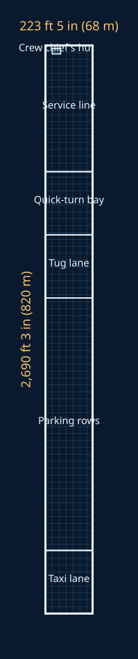

# P5-40 Open Bay 9: plan

Footprint 223 ft 5 in (68 m) × 2,690 ft 3 in (820 m) · structural grid 32 ft 10 in (10 m)

## Levels

| Level | Floor above deck | Height | Floor area |
|---|---|---|---|
| Level 1 · Ground | 0 ft (0 mm) | 13 ft 1 in (4,000 mm) | 1,033 sq ft (96 m²) |

## Elements

| ID | Designation | Type | Name | Level(s) | Size / length | Area | Status |
|---|---|---|---|---|---|---|---|
| E001 | D5F2P5B7A2R1 | zone | Service line | L1 | 223 ft 5 in (68 m) × 597 ft 9 in (182 m) | 133,557 sq ft (12,408 m²) | proposed |
| E002 | D5F2P5B7A2R2 | room | Crew chief's hut | L1 | 39 ft 4 in (12 m) × 26 ft 3 in (8,000 mm) | 1,033 sq ft (96 m²) | proposed |
| E003 | D5F2P5B7A2R3 | zone | Quick-turn bay | L1 | 223 ft 5 in (68 m) × 298 ft 11 in (91 m) | 66,778 sq ft (6,204 m²) | proposed |
| E004 | D5F2P5B7A2R4 | zone | Tug lane | L1 | 223 ft 5 in (68 m) × 298 ft 11 in (91 m) | 66,778 sq ft (6,204 m²) | proposed |
| E005 | D5F2P5B7A2R5 | zone | Parking rows | L1 | 223 ft 5 in (68 m) × 1,195 ft 10 in (364 m) | 267,187 sq ft (24,822 m²) | proposed |
| E006 | D5F2P5B7A2R6 | zone | Taxi lane | L1 | 223 ft 5 in (68 m) × 298 ft 11 in (91 m) | 66,778 sq ft (6,204 m²) | proposed |

## Drawings

### Level 1 · Ground

