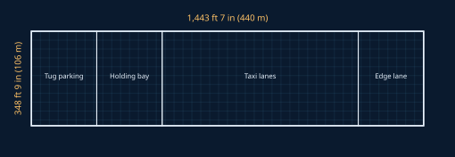

# P5-43 Taxi Apron 10: plan

Footprint 1,443 ft 7 in (440 m) × 348 ft 9 in (106 m) · structural grid 32 ft 10 in (10 m)

## Levels

| Level | Floor above deck | Height | Floor area |
|---|---|---|---|
| Level 1 · Ground | 0 ft (0 mm) | 13 ft 1 in (4,000 mm) | — |

## Elements

| ID | Designation | Type | Name | Level(s) | Size / length | Area | Status |
|---|---|---|---|---|---|---|---|
| E001 | D5F2P5B13A2R1 | zone | Tug parking | L1 | 240 ft 6 in (73 m) × 348 ft 9 in (106 m) | 83,870 sq ft (7,792 m²) | proposed |
| E002 | D5F2P5B13A2R2 | zone | Holding bay | L1 | 240 ft 10 in (73 m) × 348 ft 9 in (106 m) | 83,985 sq ft (7,802 m²) | proposed |
| E003 | D5F2P5B13A2R3 | zone | Taxi lanes | L1 | 721 ft 9 in (220 m) × 348 ft 9 in (106 m) | 251,725 sq ft (23,386 m²) | proposed |
| E004 | D5F2P5B13A2R4 | zone | Edge lane | L1 | 240 ft 6 in (73 m) × 348 ft 9 in (106 m) | 83,870 sq ft (7,792 m²) | proposed |

## Drawings

### Level 1 · Ground

