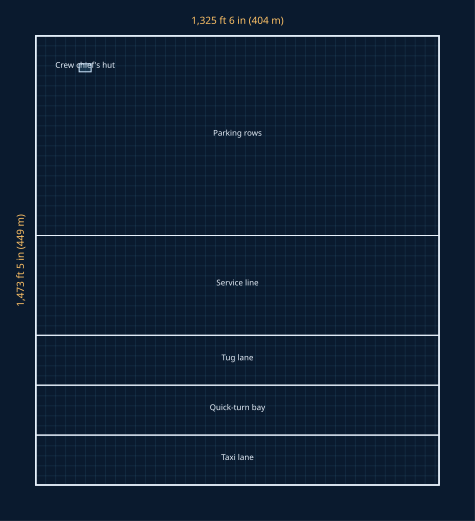

# P5-44 Open Bay 11: plan

Footprint 1,325 ft 6 in (404 m) × 1,473 ft 5 in (449 m) · structural grid 32 ft 10 in (10 m)

## Levels

| Level | Floor above deck | Height | Floor area |
|---|---|---|---|
| Level 1 · Ground | 0 ft (0 mm) | 13 ft 1 in (4,000 mm) | 1,033 sq ft (96 m²) |

## Elements

| ID | Designation | Type | Name | Level(s) | Size / length | Area | Status |
|---|---|---|---|---|---|---|---|
| E001 | D5F2P5B15A3R1 | zone | Parking rows | L1 | 1,325 ft 6 in (404 m) × 654 ft 10 in (200 m) | 867,985 sq ft (80,638 m²) | proposed |
| E002 | D5F2P5B15A3R2 | room | Crew chief's hut | L1 | 39 ft 4 in (12 m) × 26 ft 3 in (8,000 mm) | 1,033 sq ft (96 m²) | proposed |
| E003 | D5F2P5B15A3R3 | zone | Service line | L1 | 1,325 ft 6 in (404 m) × 327 ft 5 in (100 m) | 433,992 sq ft (40,319 m²) | proposed |
| E004 | D5F2P5B15A3R4 | zone | Tug lane | L1 | 1,325 ft 6 in (404 m) × 163 ft 9 in (50 m) | 216,996 sq ft (20,160 m²) | proposed |
| E005 | D5F2P5B15A3R5 | zone | Quick-turn bay | L1 | 1,325 ft 6 in (404 m) × 163 ft 9 in (50 m) | 216,996 sq ft (20,160 m²) | proposed |
| E006 | D5F2P5B15A3R6 | zone | Taxi lane | L1 | 1,325 ft 6 in (404 m) × 163 ft 9 in (50 m) | 216,996 sq ft (20,160 m²) | proposed |

## Drawings

### Level 1 · Ground

