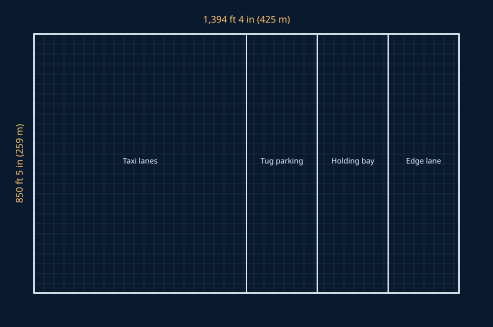

# P5-45 Taxi Apron 11: plan

Footprint 1,394 ft 4 in (425 m) × 850 ft 5 in (259 m) · structural grid 32 ft 10 in (10 m)

## Levels

| Level | Floor above deck | Height | Floor area |
|---|---|---|---|
| Level 1 · Ground | 0 ft (0 mm) | 13 ft 1 in (4,000 mm) | — |

## Elements

| ID | Designation | Type | Name | Level(s) | Size / length | Area | Status |
|---|---|---|---|---|---|---|---|
| E001 | D5F2P5B19A2R1 | zone | Taxi lanes | L1 | 697 ft 2 in (212 m) × 850 ft 5 in (259 m) | 592,876 sq ft (55,080 m²) | proposed |
| E002 | D5F2P5B19A2R2 | zone | Tug parking | L1 | 232 ft 3 in (71 m) × 850 ft 5 in (259 m) | 197,532 sq ft (18,351 m²) | proposed |
| E003 | D5F2P5B19A2R3 | zone | Holding bay | L1 | 232 ft 7 in (71 m) × 850 ft 5 in (259 m) | 197,811 sq ft (18,377 m²) | proposed |
| E004 | D5F2P5B19A2R4 | zone | Edge lane | L1 | 232 ft 3 in (71 m) × 850 ft 5 in (259 m) | 197,532 sq ft (18,351 m²) | proposed |

## Drawings

### Level 1 · Ground

