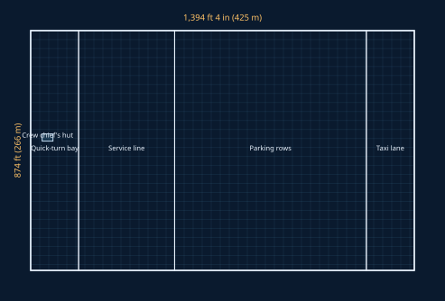

# P5-46 Open Bay 12: plan

Footprint 1,394 ft 4 in (425 m) × 874 ft (266 m) · structural grid 32 ft 10 in (10 m)

## Levels

| Level | Floor above deck | Height | Floor area |
|---|---|---|---|
| Level 1 · Ground | 0 ft (0 mm) | 13 ft 1 in (4,000 mm) | 1,033 sq ft (96 m²) |

## Elements

| ID | Designation | Type | Name | Level(s) | Size / length | Area | Status |
|---|---|---|---|---|---|---|---|
| E001 | D5F2P5B20A2R1 | zone | Quick-turn bay | L1 | 174 ft 3 in (53 m) × 874 ft (266 m) | 152,265 sq ft (14,146 m²) | proposed |
| E002 | D5F2P5B20A2R2 | room | Crew chief's hut | L1 | 39 ft 4 in (12 m) × 26 ft 3 in (8,000 mm) | 1,033 sq ft (96 m²) | proposed |
| E003 | D5F2P5B20A2R3 | zone | Service line | L1 | 348 ft 9 in (106 m) × 874 ft (266 m) | 304,816 sq ft (28,318 m²) | proposed |
| E004 | D5F2P5B20A2R4 | zone | Parking rows | L1 | 697 ft 2 in (212 m) × 874 ft (266 m) | 609,345 sq ft (56,610 m²) | proposed |
| E005 | D5F2P5B20A2R5 | zone | Taxi lane | L1 | 174 ft 3 in (53 m) × 874 ft (266 m) | 152,265 sq ft (14,146 m²) | proposed |

## Drawings

### Level 1 · Ground

