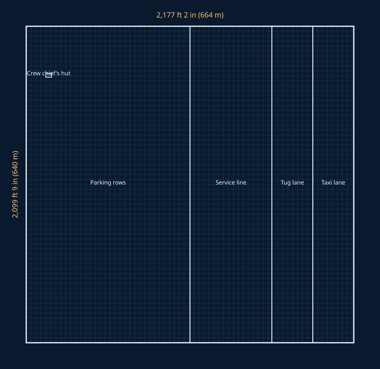

# P5-48 Open Bay 13: plan

Footprint 2,177 ft 2 in (664 m) × 2,099 ft 9 in (640 m) · structural grid 32 ft 10 in (10 m)

## Levels

| Level | Floor above deck | Height | Floor area |
|---|---|---|---|
| Level 1 · Ground | 0 ft (0 mm) | 13 ft 1 in (4,000 mm) | 1,033 sq ft (96 m²) |

## Elements

| ID | Designation | Type | Name | Level(s) | Size / length | Area | Status |
|---|---|---|---|---|---|---|---|
| E001 | D5F2P5B22A3R1 | zone | Parking rows | L1 | 1,088 ft 7 in (332 m) × 2,099 ft 9 in (640 m) | 2,285,738 sq ft (212,352 m²) | proposed |
| E002 | D5F2P5B22A3R2 | room | Crew chief's hut | L1 | 39 ft 4 in (12 m) × 26 ft 3 in (8,000 mm) | 1,033 sq ft (96 m²) | proposed |
| E003 | D5F2P5B22A3R3 | zone | Service line | L1 | 544 ft 3 in (166 m) × 2,099 ft 9 in (640 m) | 1,142,869 sq ft (106,176 m²) | proposed |
| E004 | D5F2P5B22A3R4 | zone | Tug lane | L1 | 272 ft (83 m) × 2,099 ft 9 in (640 m) | 571,090 sq ft (53,056 m²) | proposed |
| E005 | D5F2P5B22A3R5 | zone | Taxi lane | L1 | 272 ft 4 in (83 m) × 2,099 ft 9 in (640 m) | 571,779 sq ft (53,120 m²) | proposed |

## Drawings

### Level 1 · Ground

