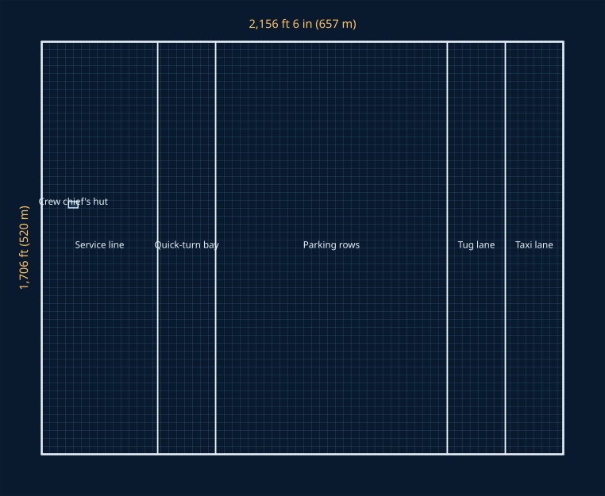

# P5-50 Open Bay 14: plan

Footprint 2,156 ft 6 in (657 m) × 1,706 ft (520 m) · structural grid 32 ft 10 in (10 m)

## Levels

| Level | Floor above deck | Height | Floor area |
|---|---|---|---|
| Level 1 · Ground | 0 ft (0 mm) | 13 ft 1 in (4,000 mm) | 1,033 sq ft (96 m²) |

## Elements

| ID | Designation | Type | Name | Level(s) | Size / length | Area | Status |
|---|---|---|---|---|---|---|---|
| E001 | D5F2P5B26A2R1 | zone | Service line | L1 | 479 ft 4 in (146 m) × 1,706 ft (520 m) | 817,756 sq ft (75,972 m²) | proposed |
| E002 | D5F2P5B26A2R2 | room | Crew chief's hut | L1 | 39 ft 4 in (12 m) × 26 ft 3 in (8,000 mm) | 1,033 sq ft (96 m²) | proposed |
| E003 | D5F2P5B26A2R3 | zone | Quick-turn bay | L1 | 239 ft 6 in (73 m) × 1,706 ft (520 m) | 408,598 sq ft (37,960 m²) | proposed |
| E004 | D5F2P5B26A2R4 | zone | Parking rows | L1 | 958 ft 4 in (292 m) × 1,706 ft (520 m) | 1,634,952 sq ft (151,892 m²) | proposed |
| E005 | D5F2P5B26A2R5 | zone | Tug lane | L1 | 239 ft 10 in (73 m) × 1,706 ft (520 m) | 409,158 sq ft (38,012 m²) | proposed |
| E006 | D5F2P5B26A2R6 | zone | Taxi lane | L1 | 239 ft 6 in (73 m) × 1,706 ft (520 m) | 408,598 sq ft (37,960 m²) | proposed |

## Drawings

### Level 1 · Ground

