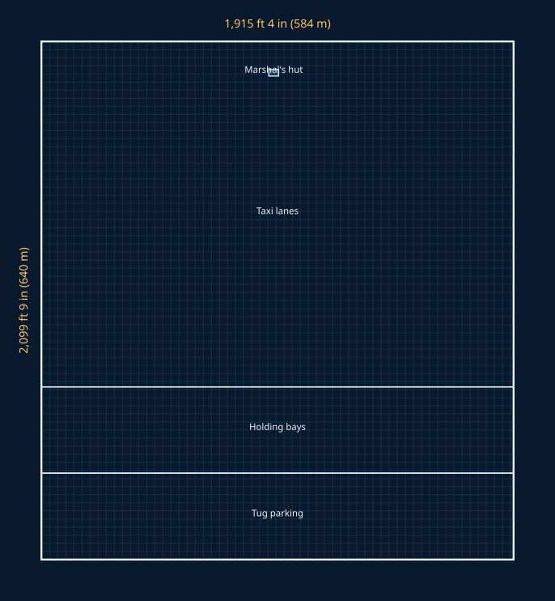

# P6-09 Starboard Taxi Apron: plan

Footprint 1,915 ft 4 in (584 m) × 2,099 ft 9 in (640 m) · structural grid 32 ft 10 in (10 m)

## Levels

| Level | Floor above deck | Height | Floor area |
|---|---|---|---|
| Level 1 · Ground | 0 ft (0 mm) | 13 ft 1 in (4,000 mm) | 1,033 sq ft (96 m²) |

## Elements

| ID | Designation | Type | Name | Level(s) | Size / length | Area | Status |
|---|---|---|---|---|---|---|---|
| E001 | D5F2P6B10A1R1 | zone | Taxi lanes | L1 | 1,915 ft 4 in (584 m) × 1,399 ft 11 in (427 m) | 2,681,371 sq ft (249,107 m²) | proposed |
| E002 | D5F2P6B10A1R2 | room | Marshal's hut | L1 | 39 ft 4 in (12 m) × 26 ft 3 in (8,000 mm) | 1,033 sq ft (96 m²) | proposed |
| E003 | D5F2P6B10A1R3 | zone | Holding bays | L1 | 1,915 ft 4 in (584 m) × 349 ft 9 in (107 m) | 669,871 sq ft (62,233 m²) | proposed |
| E004 | D5F2P6B10A1R4 | zone | Tug parking | L1 | 1,915 ft 4 in (584 m) × 350 ft 1 in (107 m) | 670,500 sq ft (62,291 m²) | proposed |

## Drawings

### Level 1 · Ground

