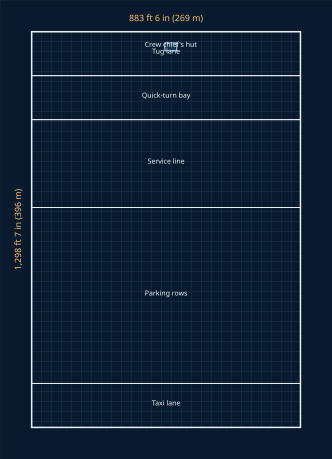

# P6-25 Open Bay 1: plan

Footprint 883 ft 6 in (269 m) × 1,298 ft 7 in (396 m) · structural grid 32 ft 10 in (10 m)

## Levels

| Level | Floor above deck | Height | Floor area |
|---|---|---|---|
| Level 1 · Ground | 0 ft (0 mm) | 13 ft 1 in (4,000 mm) | 1,033 sq ft (96 m²) |

## Elements

| ID | Designation | Type | Name | Level(s) | Size / length | Area | Status |
|---|---|---|---|---|---|---|---|
| E001 | D5F2P6B4A2R1 | zone | Tug lane | L1 | 883 ft 6 in (269 m) × 144 ft 4 in (44 m) | 127,544 sq ft (11,849 m²) | proposed |
| E002 | D5F2P6B4A2R2 | room | Crew chief's hut | L1 | 39 ft 4 in (12 m) × 26 ft 3 in (8,000 mm) | 1,033 sq ft (96 m²) | proposed |
| E003 | D5F2P6B4A2R3 | zone | Quick-turn bay | L1 | 883 ft 6 in (269 m) × 144 ft 4 in (44 m) | 127,544 sq ft (11,849 m²) | proposed |
| E004 | D5F2P6B4A2R4 | zone | Service line | L1 | 883 ft 6 in (269 m) × 288 ft 5 in (88 m) | 254,798 sq ft (23,671 m²) | proposed |
| E005 | D5F2P6B4A2R5 | zone | Parking rows | L1 | 883 ft 6 in (269 m) × 577 ft 1 in (176 m) | 509,885 sq ft (47,370 m²) | proposed |
| E006 | D5F2P6B4A2R6 | zone | Taxi lane | L1 | 883 ft 6 in (269 m) × 144 ft 4 in (44 m) | 127,544 sq ft (11,849 m²) | proposed |

## Drawings

### Level 1 · Ground

