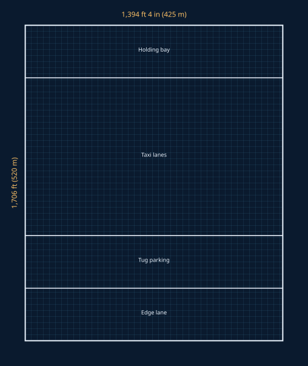

# P6-28 Taxi Apron 2: plan

Footprint 1,394 ft 4 in (425 m) × 1,706 ft (520 m) · structural grid 32 ft 10 in (10 m)

## Levels

| Level | Floor above deck | Height | Floor area |
|---|---|---|---|
| Level 1 · Ground | 0 ft (0 mm) | 13 ft 1 in (4,000 mm) | — |

## Elements

| ID | Designation | Type | Name | Level(s) | Size / length | Area | Status |
|---|---|---|---|---|---|---|---|
| E001 | D5F2P6B12A1R1 | zone | Holding bay | L1 | 1,394 ft 4 in (425 m) × 284 ft 5 in (87 m) | 396,623 sq ft (36,848 m²) | proposed |
| E002 | D5F2P6B12A1R2 | zone | Taxi lanes | L1 | 1,394 ft 4 in (425 m) × 853 ft (260 m) | 1,189,412 sq ft (110,500 m²) | proposed |
| E003 | D5F2P6B12A1R3 | zone | Tug parking | L1 | 1,394 ft 4 in (425 m) × 284 ft 1 in (87 m) | 396,166 sq ft (36,805 m²) | proposed |
| E004 | D5F2P6B12A1R4 | zone | Edge lane | L1 | 1,394 ft 4 in (425 m) × 284 ft 5 in (87 m) | 396,623 sq ft (36,848 m²) | proposed |

## Drawings

### Level 1 · Ground

