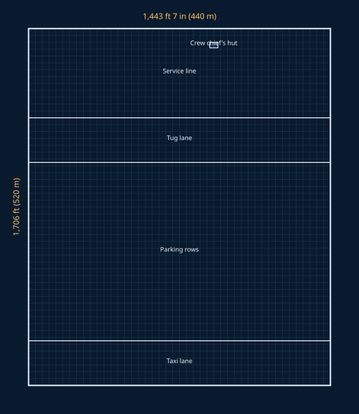

# P6-29 Open Bay 3: plan

Footprint 1,443 ft 7 in (440 m) × 1,706 ft (520 m) · structural grid 32 ft 10 in (10 m)

## Levels

| Level | Floor above deck | Height | Floor area |
|---|---|---|---|
| Level 1 · Ground | 0 ft (0 mm) | 13 ft 1 in (4,000 mm) | 1,033 sq ft (96 m²) |

## Elements

| ID | Designation | Type | Name | Level(s) | Size / length | Area | Status |
|---|---|---|---|---|---|---|---|
| E001 | D5F2P6B13A1R1 | zone | Service line | L1 | 1,443 ft 7 in (440 m) × 426 ft 6 in (130 m) | 615,696 sq ft (57,200 m²) | proposed |
| E002 | D5F2P6B13A1R2 | room | Crew chief's hut | L1 | 39 ft 4 in (12 m) × 26 ft 3 in (8,000 mm) | 1,033 sq ft (96 m²) | proposed |
| E003 | D5F2P6B13A1R3 | zone | Tug lane | L1 | 1,443 ft 7 in (440 m) × 213 ft 3 in (65 m) | 307,848 sq ft (28,600 m²) | proposed |
| E004 | D5F2P6B13A1R4 | zone | Parking rows | L1 | 1,443 ft 7 in (440 m) × 853 ft (260 m) | 1,231,391 sq ft (114,400 m²) | proposed |
| E005 | D5F2P6B13A1R5 | zone | Taxi lane | L1 | 1,443 ft 7 in (440 m) × 213 ft 3 in (65 m) | 307,848 sq ft (28,600 m²) | proposed |

## Drawings

### Level 1 · Ground

