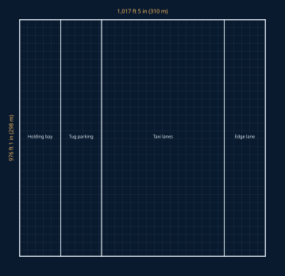

# P6-30 Taxi Apron 3: plan

Footprint 1,017 ft 5 in (310 m) × 976 ft 1 in (298 m) · structural grid 32 ft 10 in (10 m)

## Levels

| Level | Floor above deck | Height | Floor area |
|---|---|---|---|
| Level 1 · Ground | 0 ft (0 mm) | 13 ft 1 in (4,000 mm) | — |

## Elements

| ID | Designation | Type | Name | Level(s) | Size / length | Area | Status |
|---|---|---|---|---|---|---|---|
| E001 | D5F2P6B16A2R1 | zone | Holding bay | L1 | 169 ft 7 in (52 m) × 976 ft 1 in (298 m) | 165,557 sq ft (15,381 m²) | proposed |
| E002 | D5F2P6B16A2R2 | zone | Tug parking | L1 | 169 ft 7 in (52 m) × 976 ft 1 in (298 m) | 165,557 sq ft (15,381 m²) | proposed |
| E003 | D5F2P6B16A2R3 | zone | Taxi lanes | L1 | 508 ft 6 in (155 m) × 976 ft 1 in (298 m) | 496,351 sq ft (46,112 m²) | proposed |
| E004 | D5F2P6B16A2R4 | zone | Edge lane | L1 | 169 ft 7 in (52 m) × 976 ft 1 in (298 m) | 165,557 sq ft (15,381 m²) | proposed |

## Drawings

### Level 1 · Ground

