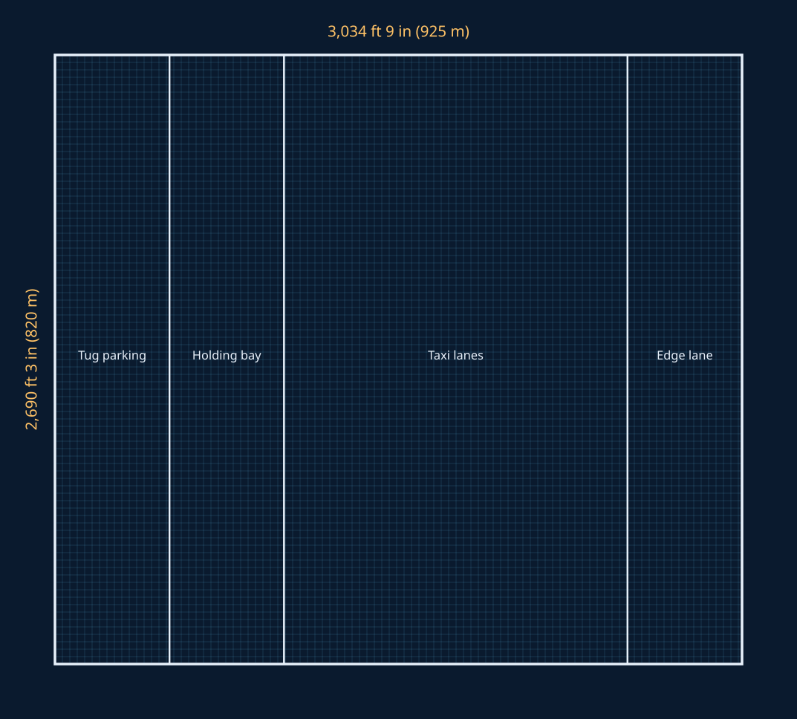

# P6-32 Taxi Apron 4: plan

Footprint 3,034 ft 9 in (925 m) × 2,690 ft 3 in (820 m) · structural grid 32 ft 10 in (10 m)

## Levels

| Level | Floor above deck | Height | Floor area |
|---|---|---|---|
| Level 1 · Ground | 0 ft (0 mm) | 13 ft 1 in (4,000 mm) | — |

## Elements

| ID | Designation | Type | Name | Level(s) | Size / length | Area | Status |
|---|---|---|---|---|---|---|---|
| E001 | D5F2P6B21A1R1 | zone | Tug parking | L1 | 505 ft 11 in (154 m) × 2,690 ft 3 in (820 m) | 1,361,032 sq ft (126,444 m²) | proposed |
| E002 | D5F2P6B21A1R2 | zone | Holding bay | L1 | 505 ft 7 in (154 m) × 2,690 ft 3 in (820 m) | 1,360,149 sq ft (126,362 m²) | proposed |
| E003 | D5F2P6B21A1R3 | zone | Taxi lanes | L1 | 1,517 ft 5 in (462 m) × 2,690 ft 3 in (820 m) | 4,082,213 sq ft (379,250 m²) | proposed |
| E004 | D5F2P6B21A1R4 | zone | Edge lane | L1 | 505 ft 11 in (154 m) × 2,690 ft 3 in (820 m) | 1,361,032 sq ft (126,444 m²) | proposed |

## Drawings

### Level 1 · Ground

