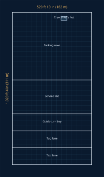

# P6-33 Open Bay 5: plan

Footprint 529 ft 10 in (162 m) × 1,020 ft 4 in (311 m) · structural grid 32 ft 10 in (10 m)

## Levels

| Level | Floor above deck | Height | Floor area |
|---|---|---|---|
| Level 1 · Ground | 0 ft (0 mm) | 13 ft 1 in (4,000 mm) | 1,033 sq ft (96 m²) |

## Elements

| ID | Designation | Type | Name | Level(s) | Size / length | Area | Status |
|---|---|---|---|---|---|---|---|
| E001 | D5F2P6B24A2R1 | zone | Parking rows | L1 | 529 ft 10 in (162 m) × 453 ft 5 in (138 m) | 240,243 sq ft (22,319 m²) | proposed |
| E002 | D5F2P6B24A2R2 | room | Crew chief's hut | L1 | 39 ft 4 in (12 m) × 26 ft 3 in (8,000 mm) | 1,033 sq ft (96 m²) | proposed |
| E003 | D5F2P6B24A2R3 | zone | Service line | L1 | 529 ft 10 in (162 m) × 226 ft 8 in (69 m) | 120,121 sq ft (11,160 m²) | proposed |
| E004 | D5F2P6B24A2R4 | zone | Quick-turn bay | L1 | 529 ft 10 in (162 m) × 113 ft 6 in (35 m) | 60,148 sq ft (5,588 m²) | proposed |
| E005 | D5F2P6B24A2R5 | zone | Tug lane | L1 | 529 ft 10 in (162 m) × 113 ft 2 in (34 m) | 59,974 sq ft (5,572 m²) | proposed |
| E006 | D5F2P6B24A2R6 | zone | Taxi lane | L1 | 529 ft 10 in (162 m) × 113 ft 6 in (35 m) | 60,148 sq ft (5,588 m²) | proposed |

## Drawings

### Level 1 · Ground

