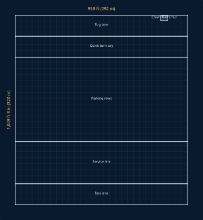

# P6-35 Open Bay 6: plan

Footprint 958 ft (292 m) × 1,049 ft 3 in (320 m) · structural grid 32 ft 10 in (10 m)

## Levels

| Level | Floor above deck | Height | Floor area |
|---|---|---|---|
| Level 1 · Ground | 0 ft (0 mm) | 13 ft 1 in (4,000 mm) | 1,033 sq ft (96 m²) |

## Elements

| ID | Designation | Type | Name | Level(s) | Size / length | Area | Status |
|---|---|---|---|---|---|---|---|
| E001 | D5F2P6B26A2R1 | zone | Tug lane | L1 | 958 ft (292 m) × 116 ft 6 in (36 m) | 111,579 sq ft (10,366 m²) | proposed |
| E002 | D5F2P6B26A2R2 | room | Crew chief's hut | L1 | 39 ft 4 in (12 m) × 26 ft 3 in (8,000 mm) | 1,033 sq ft (96 m²) | proposed |
| E003 | D5F2P6B26A2R3 | zone | Quick-turn bay | L1 | 958 ft (292 m) × 116 ft 10 in (36 m) | 111,893 sq ft (10,395 m²) | proposed |
| E004 | D5F2P6B26A2R4 | zone | Parking rows | L1 | 958 ft (292 m) × 466 ft 2 in (142 m) | 446,629 sq ft (41,493 m²) | proposed |
| E005 | D5F2P6B26A2R5 | zone | Service line | L1 | 958 ft (292 m) × 233 ft 3 in (71 m) | 223,472 sq ft (20,761 m²) | proposed |
| E006 | D5F2P6B26A2R6 | zone | Taxi lane | L1 | 958 ft (292 m) × 116 ft 6 in (36 m) | 111,579 sq ft (10,366 m²) | proposed |

## Drawings

### Level 1 · Ground

