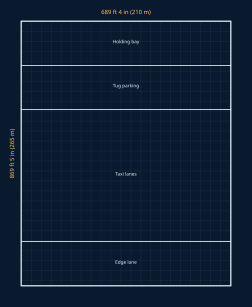

# P6-36 Taxi Apron 6: plan

Footprint 689 ft 4 in (210 m) × 869 ft 5 in (265 m) · structural grid 32 ft 10 in (10 m)

## Levels

| Level | Floor above deck | Height | Floor area |
|---|---|---|---|
| Level 1 · Ground | 0 ft (0 mm) | 13 ft 1 in (4,000 mm) | — |

## Elements

| ID | Designation | Type | Name | Level(s) | Size / length | Area | Status |
|---|---|---|---|---|---|---|---|
| E001 | D5F2P6B27A2R1 | zone | Holding bay | L1 | 689 ft 4 in (210 m) × 145 ft (44 m) | 99,958 sq ft (9,286 m²) | proposed |
| E002 | D5F2P6B27A2R2 | zone | Tug parking | L1 | 689 ft 4 in (210 m) × 144 ft 8 in (44 m) | 99,732 sq ft (9,265 m²) | proposed |
| E003 | D5F2P6B27A2R3 | zone | Taxi lanes | L1 | 689 ft 4 in (210 m) × 434 ft 9 in (132 m) | 299,648 sq ft (27,838 m²) | proposed |
| E004 | D5F2P6B27A2R4 | zone | Edge lane | L1 | 689 ft 4 in (210 m) × 145 ft (44 m) | 99,958 sq ft (9,286 m²) | proposed |

## Drawings

### Level 1 · Ground

