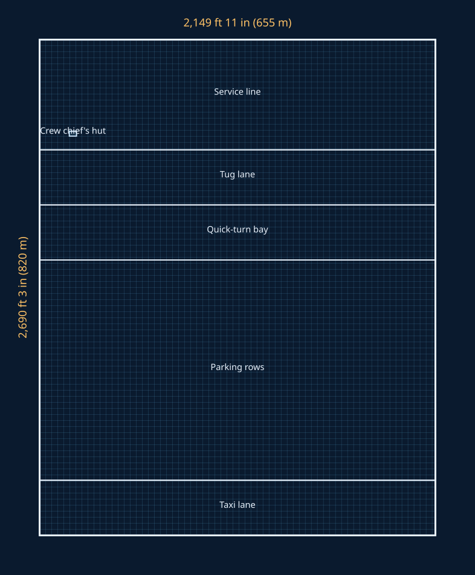

# P6-39 Open Bay 8: plan

Footprint 2,149 ft 11 in (655 m) × 2,690 ft 3 in (820 m) · structural grid 32 ft 10 in (10 m)

## Levels

| Level | Floor above deck | Height | Floor area |
|---|---|---|---|
| Level 1 · Ground | 0 ft (0 mm) | 13 ft 1 in (4,000 mm) | 1,033 sq ft (96 m²) |

## Elements

| ID | Designation | Type | Name | Level(s) | Size / length | Area | Status |
|---|---|---|---|---|---|---|---|
| E001 | D5F2P6B2A2R1 | zone | Service line | L1 | 2,149 ft 11 in (655 m) × 597 ft 9 in (182 m) | 1,285,164 sq ft (119,396 m²) | proposed |
| E002 | D5F2P6B2A2R2 | room | Crew chief's hut | L1 | 39 ft 4 in (12 m) × 26 ft 3 in (8,000 mm) | 1,033 sq ft (96 m²) | proposed |
| E003 | D5F2P6B2A2R3 | zone | Tug lane | L1 | 2,149 ft 11 in (655 m) × 298 ft 11 in (91 m) | 642,582 sq ft (59,698 m²) | proposed |
| E004 | D5F2P6B2A2R4 | zone | Quick-turn bay | L1 | 2,149 ft 11 in (655 m) × 298 ft 11 in (91 m) | 642,582 sq ft (59,698 m²) | proposed |
| E005 | D5F2P6B2A2R5 | zone | Parking rows | L1 | 2,149 ft 11 in (655 m) × 1,195 ft 10 in (364 m) | 2,571,034 sq ft (238,857 m²) | proposed |
| E006 | D5F2P6B2A2R6 | zone | Taxi lane | L1 | 2,149 ft 11 in (655 m) × 298 ft 11 in (91 m) | 642,582 sq ft (59,698 m²) | proposed |

## Drawings

### Level 1 · Ground

