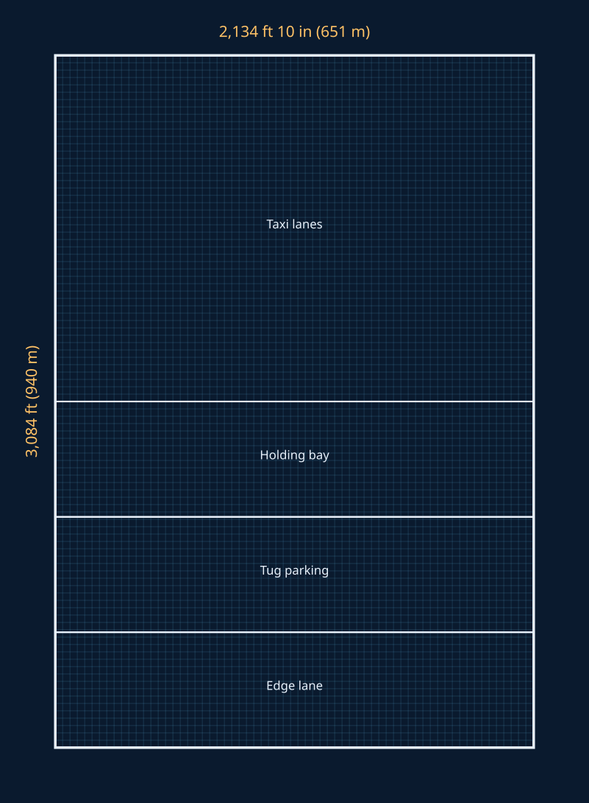

# P6-40 Taxi Apron 8: plan

Footprint 2,134 ft 10 in (651 m) × 3,084 ft (940 m) · structural grid 32 ft 10 in (10 m)

## Levels

| Level | Floor above deck | Height | Floor area |
|---|---|---|---|
| Level 1 · Ground | 0 ft (0 mm) | 13 ft 1 in (4,000 mm) | — |

## Elements

| ID | Designation | Type | Name | Level(s) | Size / length | Area | Status |
|---|---|---|---|---|---|---|---|
| E001 | D5F2P6B4A3R1 | zone | Taxi lanes | L1 | 2,134 ft 10 in (651 m) × 1,542 ft (470 m) | 3,291,916 sq ft (305,829 m²) | proposed |
| E002 | D5F2P6B4A3R2 | zone | Holding bay | L1 | 2,134 ft 10 in (651 m) × 514 ft 1 in (157 m) | 1,097,539 sq ft (101,965 m²) | proposed |
| E003 | D5F2P6B4A3R3 | zone | Tug parking | L1 | 2,134 ft 10 in (651 m) × 513 ft 9 in (157 m) | 1,096,838 sq ft (101,900 m²) | proposed |
| E004 | D5F2P6B4A3R4 | zone | Edge lane | L1 | 2,134 ft 10 in (651 m) × 514 ft 1 in (157 m) | 1,097,539 sq ft (101,965 m²) | proposed |

## Drawings

### Level 1 · Ground

