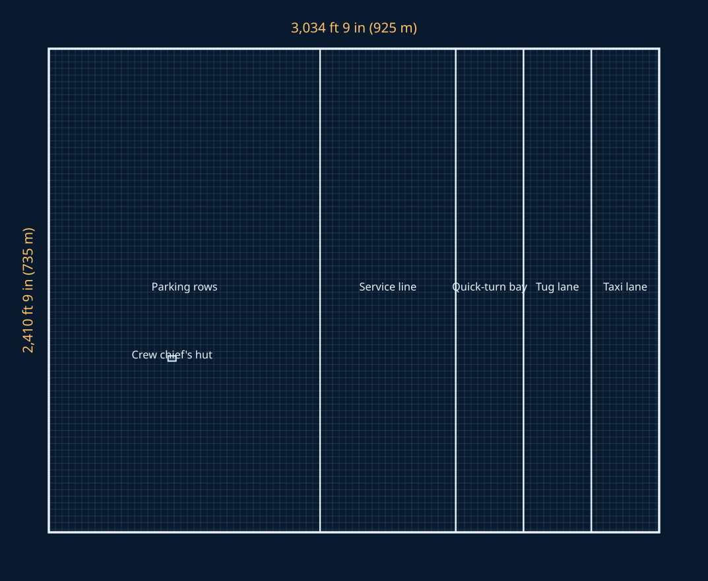

# P6-43 Open Bay 10: plan

Footprint 3,034 ft 9 in (925 m) × 2,410 ft 9 in (735 m) · structural grid 32 ft 10 in (10 m)

## Levels

| Level | Floor above deck | Height | Floor area |
|---|---|---|---|
| Level 1 · Ground | 0 ft (0 mm) | 13 ft 1 in (4,000 mm) | 1,033 sq ft (96 m²) |

## Elements

| ID | Designation | Type | Name | Level(s) | Size / length | Area | Status |
|---|---|---|---|---|---|---|---|
| E001 | D5F2P6B8A2R1 | zone | Parking rows | L1 | 1,348 ft 9 in (411 m) × 2,410 ft 9 in (735 m) | 3,251,522 sq ft (302,076 m²) | proposed |
| E002 | D5F2P6B8A2R2 | room | Crew chief's hut | L1 | 39 ft 4 in (12 m) × 26 ft 3 in (8,000 mm) | 1,033 sq ft (96 m²) | proposed |
| E003 | D5F2P6B8A2R3 | zone | Service line | L1 | 674 ft 6 in (206 m) × 2,410 ft 9 in (735 m) | 1,626,157 sq ft (151,075 m²) | proposed |
| E004 | D5F2P6B8A2R4 | zone | Quick-turn bay | L1 | 336 ft 11 in (103 m) × 2,410 ft 9 in (735 m) | 812,287 sq ft (75,464 m²) | proposed |
| E005 | D5F2P6B8A2R5 | zone | Tug lane | L1 | 337 ft 3 in (103 m) × 2,410 ft 9 in (735 m) | 813,078 sq ft (75,537 m²) | proposed |
| E006 | D5F2P6B8A2R6 | zone | Taxi lane | L1 | 337 ft 3 in (103 m) × 2,410 ft 9 in (735 m) | 813,078 sq ft (75,537 m²) | proposed |

## Drawings

### Level 1 · Ground

