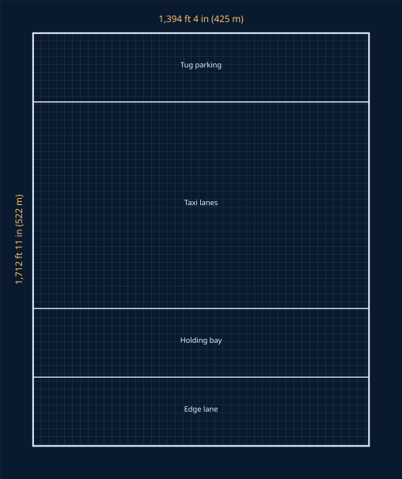

# P6-44 Taxi Apron 10: plan

Footprint 1,394 ft 4 in (425 m) × 1,712 ft 11 in (522 m) · structural grid 32 ft 10 in (10 m)

## Levels

| Level | Floor above deck | Height | Floor area |
|---|---|---|---|
| Level 1 · Ground | 0 ft (0 mm) | 13 ft 1 in (4,000 mm) | — |

## Elements

| ID | Designation | Type | Name | Level(s) | Size / length | Area | Status |
|---|---|---|---|---|---|---|---|
| E001 | D5F2P6B9A3R1 | zone | Tug parking | L1 | 1,394 ft 4 in (425 m) × 285 ft 5 in (87 m) | 397,996 sq ft (36,975 m²) | proposed |
| E002 | D5F2P6B9A3R2 | zone | Taxi lanes | L1 | 1,394 ft 4 in (425 m) × 856 ft 8 in (261 m) | 1,194,444 sq ft (110,968 m²) | proposed |
| E003 | D5F2P6B9A3R3 | zone | Holding bay | L1 | 1,394 ft 4 in (425 m) × 285 ft 5 in (87 m) | 397,996 sq ft (36,975 m²) | proposed |
| E004 | D5F2P6B9A3R4 | zone | Edge lane | L1 | 1,394 ft 4 in (425 m) × 285 ft 5 in (87 m) | 397,996 sq ft (36,975 m²) | proposed |

## Drawings

### Level 1 · Ground

