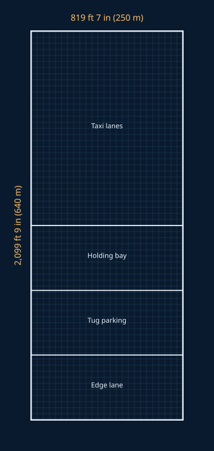

# P6-48 Taxi Apron 12: plan

Footprint 819 ft 7 in (250 m) × 2,099 ft 9 in (640 m) · structural grid 32 ft 10 in (10 m)

## Levels

| Level | Floor above deck | Height | Floor area |
|---|---|---|---|
| Level 1 · Ground | 0 ft (0 mm) | 13 ft 1 in (4,000 mm) | — |

## Elements

| ID | Designation | Type | Name | Level(s) | Size / length | Area | Status |
|---|---|---|---|---|---|---|---|
| E001 | D5F2P6B15A2R1 | zone | Taxi lanes | L1 | 819 ft 7 in (250 m) × 1,049 ft 10 in (320 m) | 860,424 sq ft (79,936 m²) | proposed |
| E002 | D5F2P6B15A2R2 | zone | Holding bay | L1 | 819 ft 7 in (250 m) × 350 ft 1 in (107 m) | 286,898 sq ft (26,654 m²) | proposed |
| E003 | D5F2P6B15A2R3 | zone | Tug parking | L1 | 819 ft 7 in (250 m) × 349 ft 9 in (107 m) | 286,629 sq ft (26,629 m²) | proposed |
| E004 | D5F2P6B15A2R4 | zone | Edge lane | L1 | 819 ft 7 in (250 m) × 350 ft 1 in (107 m) | 286,898 sq ft (26,654 m²) | proposed |

## Drawings

### Level 1 · Ground

