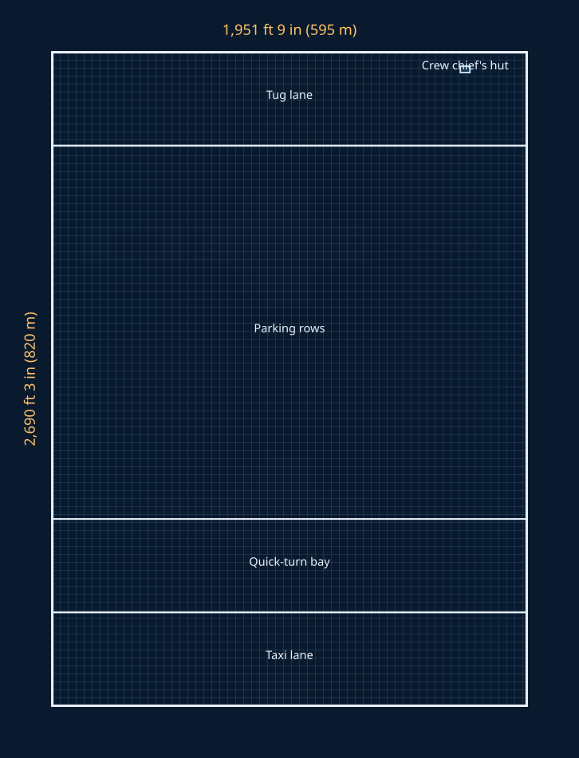

# P6-49 Open Bay 13: plan

Footprint 1,951 ft 9 in (595 m) × 2,690 ft 3 in (820 m) · structural grid 32 ft 10 in (10 m)

## Levels

| Level | Floor above deck | Height | Floor area |
|---|---|---|---|
| Level 1 · Ground | 0 ft (0 mm) | 13 ft 1 in (4,000 mm) | 1,033 sq ft (96 m²) |

## Elements

| ID | Designation | Type | Name | Level(s) | Size / length | Area | Status |
|---|---|---|---|---|---|---|---|
| E001 | D5F2P6B16A3R1 | zone | Tug lane | L1 | 1,951 ft 9 in (595 m) × 384 ft 2 in (117 m) | 749,844 sq ft (69,663 m²) | proposed |
| E002 | D5F2P6B16A3R2 | room | Crew chief's hut | L1 | 39 ft 4 in (12 m) × 26 ft 3 in (8,000 mm) | 1,033 sq ft (96 m²) | proposed |
| E003 | D5F2P6B16A3R3 | zone | Parking rows | L1 | 1,951 ft 9 in (595 m) × 1,537 ft 5 in (469 m) | 3,000,657 sq ft (278,770 m²) | proposed |
| E004 | D5F2P6B16A3R4 | zone | Quick-turn bay | L1 | 1,951 ft 9 in (595 m) × 384 ft 6 in (117 m) | 750,484 sq ft (69,722 m²) | proposed |
| E005 | D5F2P6B16A3R5 | zone | Taxi lane | L1 | 1,951 ft 9 in (595 m) × 384 ft 2 in (117 m) | 749,844 sq ft (69,663 m²) | proposed |

## Drawings

### Level 1 · Ground

