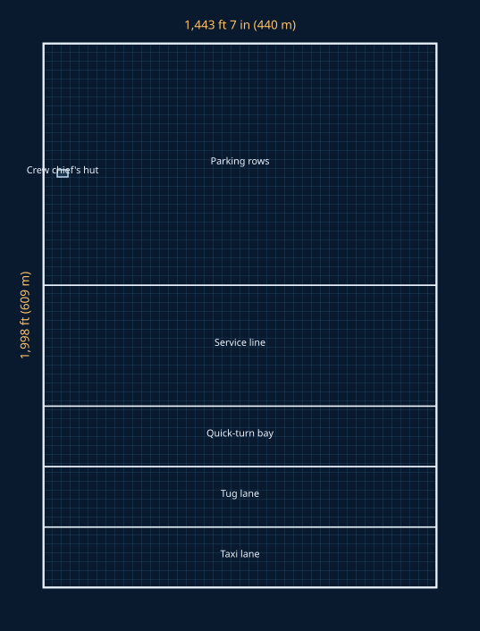

# P6-53 Open Bay 15: plan

Footprint 1,443 ft 7 in (440 m) × 1,998 ft (609 m) · structural grid 32 ft 10 in (10 m)

## Levels

| Level | Floor above deck | Height | Floor area |
|---|---|---|---|
| Level 1 · Ground | 0 ft (0 mm) | 13 ft 1 in (4,000 mm) | 1,033 sq ft (96 m²) |

## Elements

| ID | Designation | Type | Name | Level(s) | Size / length | Area | Status |
|---|---|---|---|---|---|---|---|
| E001 | D5F2P6B24A3R1 | zone | Parking rows | L1 | 1,443 ft 7 in (440 m) × 888 ft 1 in (271 m) | 1,282,068 sq ft (119,108 m²) | proposed |
| E002 | D5F2P6B24A3R2 | room | Crew chief's hut | L1 | 39 ft 4 in (12 m) × 26 ft 3 in (8,000 mm) | 1,033 sq ft (96 m²) | proposed |
| E003 | D5F2P6B24A3R3 | zone | Service line | L1 | 1,443 ft 7 in (440 m) × 443 ft 11 in (135 m) | 640,797 sq ft (59,532 m²) | proposed |
| E004 | D5F2P6B24A3R4 | zone | Quick-turn bay | L1 | 1,443 ft 7 in (440 m) × 222 ft 1 in (68 m) | 320,635 sq ft (29,788 m²) | proposed |
| E005 | D5F2P6B24A3R5 | zone | Tug lane | L1 | 1,443 ft 7 in (440 m) × 221 ft 9 in (68 m) | 320,162 sq ft (29,744 m²) | proposed |
| E006 | D5F2P6B24A3R6 | zone | Taxi lane | L1 | 1,443 ft 7 in (440 m) × 222 ft 1 in (68 m) | 320,635 sq ft (29,788 m²) | proposed |

## Drawings

### Level 1 · Ground

