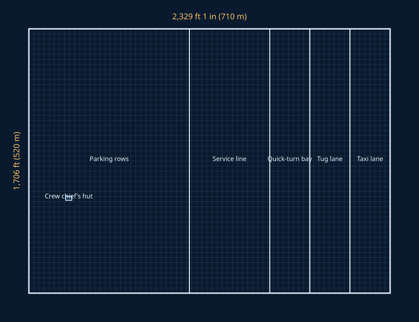

# P6-55 Open Bay 16: plan

Footprint 2,329 ft 1 in (710 m) × 1,706 ft (520 m) · structural grid 32 ft 10 in (10 m)

## Levels

| Level | Floor above deck | Height | Floor area |
|---|---|---|---|
| Level 1 · Ground | 0 ft (0 mm) | 13 ft 1 in (4,000 mm) | 1,033 sq ft (96 m²) |

## Elements

| ID | Designation | Type | Name | Level(s) | Size / length | Area | Status |
|---|---|---|---|---|---|---|---|
| E001 | D5F2P6B27A3R1 | zone | Parking rows | L1 | 1,035 ft 1 in (316 m) × 1,706 ft (520 m) | 1,765,927 sq ft (164,060 m²) | proposed |
| E002 | D5F2P6B27A3R2 | room | Crew chief's hut | L1 | 39 ft 4 in (12 m) × 26 ft 3 in (8,000 mm) | 1,033 sq ft (96 m²) | proposed |
| E003 | D5F2P6B27A3R3 | zone | Service line | L1 | 517 ft 9 in (158 m) × 1,706 ft (520 m) | 883,243 sq ft (82,056 m²) | proposed |
| E004 | D5F2P6B27A3R4 | zone | Quick-turn bay | L1 | 258 ft 6 in (79 m) × 1,706 ft (520 m) | 441,062 sq ft (40,976 m²) | proposed |
| E005 | D5F2P6B27A3R5 | zone | Tug lane | L1 | 258 ft 10 in (79 m) × 1,706 ft (520 m) | 441,622 sq ft (41,028 m²) | proposed |
| E006 | D5F2P6B27A3R6 | zone | Taxi lane | L1 | 258 ft 10 in (79 m) × 1,706 ft (520 m) | 441,622 sq ft (41,028 m²) | proposed |

## Drawings

### Level 1 · Ground

