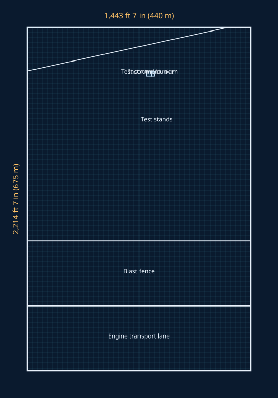

# P7-03 Engine Test Stand: plan

Footprint 1,443 ft 7 in (440 m) × 2,214 ft 7 in (675 m) · structural grid 32 ft 10 in (10 m)

## Levels

| Level | Floor above deck | Height | Floor area |
|---|---|---|---|
| Level 1 · Ground | 0 ft (0 mm) | 13 ft 1 in (4,000 mm) | 1,722 sq ft (160 m²) |

## Elements

| ID | Designation | Type | Name | Level(s) | Size / length | Area | Status |
|---|---|---|---|---|---|---|---|
| E001 | D5F2P7B1A1R1 | zone | Test stands | L1 | 1,443 ft 7 in (440 m) × 1,378 ft 11 in (420 m) | 1,808,876 sq ft (168,050 m²) | proposed |
| E002 | D5F2P7B1A1R2 | room | Test control bunker | L1 | 34 ft 9 in (11 m) × 32 ft 10 in (10 m) | 1,141 sq ft (106 m²) | proposed |
| E003 | D5F2P7B1A1R3 | room | Instrument room | L1 | 17 ft 9 in (5,400 mm) × 32 ft 10 in (10 m) | 581 sq ft (54 m²) | proposed |
| E004 | D5F2P7B1A1R4 | zone | Blast fence | L1 | 1,443 ft 7 in (440 m) × 418 ft (127 m) | 603,382 sq ft (56,056 m²) | proposed |
| E005 | D5F2P7B1A1R5 | zone | Engine transport lane | L1 | 1,443 ft 7 in (440 m) × 417 ft 8 in (127 m) | 602,908 sq ft (56,012 m²) | proposed |

## Drawings

### Level 1 · Ground

