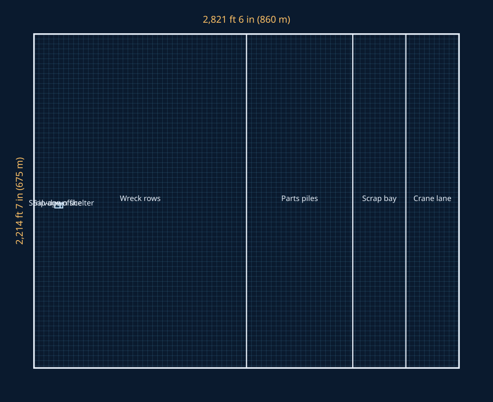

# P7-08 Salvage Yard: plan

Footprint 2,821 ft 6 in (860 m) × 2,214 ft 7 in (675 m) · structural grid 32 ft 10 in (10 m)

## Levels

| Level | Floor above deck | Height | Floor area |
|---|---|---|---|
| Level 1 · Ground | 0 ft (0 mm) | 13 ft 1 in (4,000 mm) | 1,722 sq ft (160 m²) |

## Elements

| ID | Designation | Type | Name | Level(s) | Size / length | Area | Status |
|---|---|---|---|---|---|---|---|
| E001 | D5F2P7B13A1R1 | zone | Wreck rows | L1 | 1,410 ft 9 in (430 m) × 2,214 ft 7 in (675 m) | 3,124,225 sq ft (290,250 m²) | proposed |
| E002 | D5F2P7B13A1R2 | room | Salvage office | L1 | 35 ft 1 in (11 m) × 32 ft 10 in (10 m) | 1,152 sq ft (107 m²) | proposed |
| E003 | D5F2P7B13A1R3 | room | Strip-down shelter | L1 | 17 ft 5 in (5,300 mm) × 32 ft 10 in (10 m) | 570 sq ft (53 m²) | proposed |
| E004 | D5F2P7B13A1R4 | zone | Parts piles | L1 | 705 ft 5 in (215 m) × 2,214 ft 7 in (675 m) | 1,562,113 sq ft (145,125 m²) | proposed |
| E005 | D5F2P7B13A1R5 | zone | Scrap bay | L1 | 352 ft 8 in (108 m) × 2,214 ft 7 in (675 m) | 781,056 sq ft (72,562 m²) | proposed |
| E006 | D5F2P7B13A1R6 | zone | Crane lane | L1 | 352 ft 8 in (108 m) × 2,214 ft 7 in (675 m) | 781,056 sq ft (72,562 m²) | proposed |

## Drawings

### Level 1 · Ground

