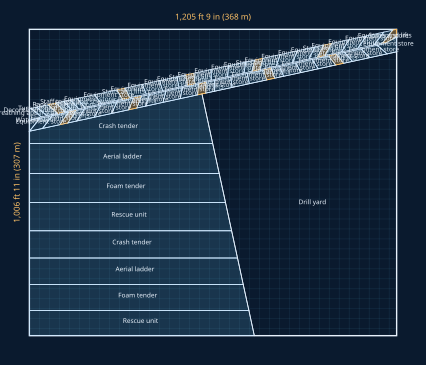
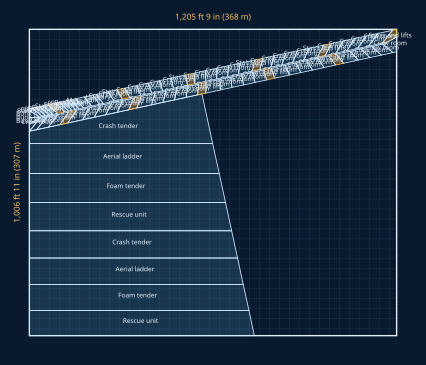
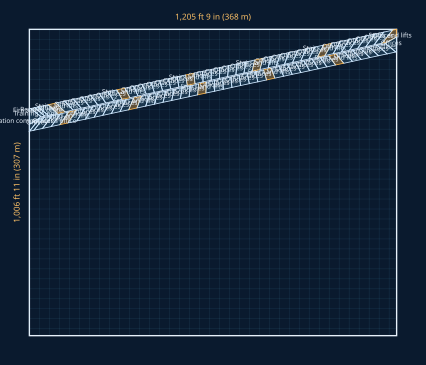

# P7-10 Port Yards Fire Station: plan

Footprint 1,205 ft 9 in (368 m) × 1,006 ft 11 in (307 m) · structural grid 32 ft 10 in (10 m)

## Levels

| Level | Floor above deck | Height | Floor area |
|---|---|---|---|
| Level 1 · Appliance floor | 0 ft (0 mm) | 23 ft (7,000 mm) | 558,675 sq ft (51,903 m²) |
| Level 2 · Crew floor | 23 ft (7,000 mm) | 13 ft 9 in (4,200 mm) | 558,659 sq ft (51,901 m²) |
| Level 3 · Training floor | 36 ft 9 in (11 m) | 13 ft 9 in (4,200 mm) | 74,601 sq ft (6,931 m²) |

## Elements

| ID | Designation | Type | Name | Level(s) | Size / length | Area | Status |
|---|---|---|---|---|---|---|---|
| E001 | D5F2P7B12A2L1R1, D5F2P7B12A2L2R1 | room | Crash tender | L1, L2 | 601 ft 8 in (183 m) × 163 ft 1 in (50 m) | 60,489 sq ft (5,620 m²) | proposed |
| E002 | D5F2P7B12A2L1R2, D5F2P7B12A2L2R2 | room | Aerial ladder | L1, L2 | 623 ft 4 in (190 m) × 98 ft 9 in (30 m) | 60,490 sq ft (5,620 m²) | proposed |
| E003 | D5F2P7B12A2L1R3, D5F2P7B12A2L2R3 | room | Foam tender | L1, L2 | 644 ft (196 m) × 95 ft 6 in (29 m) | 60,500 sq ft (5,621 m²) | proposed |
| E004 | D5F2P7B12A2L1R4, D5F2P7B12A2L2R4 | room | Rescue unit | L1, L2 | 664 ft 1 in (202 m) × 92 ft 6 in (28 m) | 60,511 sq ft (5,622 m²) | proposed |
| E005 | D5F2P7B12A2L1R5, D5F2P7B12A2L2R5 | room | Crash tender | L1, L2 | 683 ft 5 in (208 m) × 89 ft 7 in (27 m) | 60,343 sq ft (5,606 m²) | proposed |
| E006 | D5F2P7B12A2L1R6, D5F2P7B12A2L2R6 | room | Aerial ladder | L1, L2 | 702 ft 1 in (214 m) × 87 ft 3 in (27 m) | 60,456 sq ft (5,617 m²) | proposed |
| E007 | D5F2P7B12A2L1R7, D5F2P7B12A2L2R7 | room | Foam tender | L1, L2 | 720 ft 10 in (220 m) × 85 ft (26 m) | 60,455 sq ft (5,616 m²) | proposed |
| E008 | D5F2P7B12A2L1R8, D5F2P7B12A2L2R8 | room | Rescue unit | L1, L2 | 738 ft 6 in (225 m) × 83 ft (25 m) | 60,566 sq ft (5,627 m²) | proposed |
| E009 | D5F2P7B12A2L1R9 | zone | Drill yard | L1 | 639 ft 1 in (195 m) × 933 ft 1 in (284 m) | 483,786 sq ft (44,945 m²) | proposed |
| E010 | D5F2P7B12A2L1R10, D5F2P7B12A2L2R9, D5F2P7B12A2L3R1 | core | Stairs and lifts | L1, L2, L3 | 55 ft 5 in (17 m) × 34 ft 1 in (10 m) | 893 sq ft (83 m²) | proposed |
| E011 | D5F2P7B12A2L1R11, D5F2P7B12A2L2R10, D5F2P7B12A2L3R2 | core | Stairs and lifts | L1, L2, L3 | 42 ft 8 in (13 m) × 36 ft 9 in (11 m) | 894 sq ft (83 m²) | proposed |
| E012 | D5F2P7B12A2L1R12, D5F2P7B12A2L2R11, D5F2P7B12A2L3R3 | core | Stairs and lifts | L1, L2, L3 | 30 ft 2 in (9,200 mm) × 39 ft 4 in (12 m) | 899 sq ft (83 m²) | proposed |
| E013 | D5F2P7B12A2L1R13, D5F2P7B12A2L2R12, D5F2P7B12A2L3R4 | core | Stairs and lifts | L1, L2, L3 | 34 ft 5 in (10 m) × 42 ft 4 in (13 m) | 898 sq ft (83 m²) | proposed |
| E014 | D5F2P7B12A2L1R14, D5F2P7B12A2L2R13, D5F2P7B12A2L3R5 | core | Stairs and lifts | L1, L2, L3 | 46 ft 11 in (14 m) × 45 ft 3 in (14 m) | 897 sq ft (83 m²) | proposed |
| E015 | D5F2P7B12A2L1R15, D5F2P7B12A2L2R14, D5F2P7B12A2L3R6 | core | Stairs and lifts | L1, L2, L3 | 46 ft 7 in (14 m) × 45 ft 3 in (14 m) | 890 sq ft (83 m²) | proposed |
| E016 | D5F2P7B12A2L1R16, D5F2P7B12A2L2R15, D5F2P7B12A2L3R7 | core | Stairs and lifts | L1, L2, L3 | 49 ft 3 in (15 m) × 35 ft 5 in (11 m) | 896 sq ft (83 m²) | proposed |
| E017 | D5F2P7B12A2L1R17, D5F2P7B12A2L2R16, D5F2P7B12A2L3R8 | core | Stairs and lifts | L1, L2, L3 | 36 ft 5 in (11 m) × 38 ft 5 in (12 m) | 902 sq ft (84 m²) | proposed |
| E018 | D5F2P7B12A2L1R18, D5F2P7B12A2L2R17, D5F2P7B12A2L3R9 | core | Stairs and lifts | L1, L2, L3 | 27 ft 11 in (8,500 mm) × 41 ft (12 m) | 901 sq ft (84 m²) | proposed |
| E019 | D5F2P7B12A2L1R19, D5F2P7B12A2L2R18, D5F2P7B12A2L3R10 | core | Stairs and lifts | L1, L2, L3 | 40 ft 8 in (12 m) × 44 ft (13 m) | 899 sq ft (83 m²) | proposed |
| E020 | D5F2P7B12A2L1R20, D5F2P7B12A2L2R19, D5F2P7B12A2L3R11 | core | Stairs and lifts | L1, L2, L3 | 53 ft 6 in (16 m) × 46 ft 7 in (14 m) | 903 sq ft (84 m²) | proposed |
| E021 | D5F2P7B12A2L1R21 | room | Watch room | L1 | 34 ft 1 in (10 m) × 44 ft 3 in (14 m) | 644 sq ft (60 m²) | proposed |
| E022 | D5F2P7B12A2L1R22 | room | Breathing apparatus room | L1 | 39 ft 1 in (12 m) × 39 ft 1 in (12 m) | 856 sq ft (80 m²) | proposed |
| E023 | D5F2P7B12A2L1R23 | room | Decontamination room | L1 | 51 ft 10 in (16 m) × 31 ft 10 in (9,700 mm) | 650 sq ft (60 m²) | proposed |
| E024 | D5F2P7B12A2L1R24 | room | Turnout gear room | L1 | 67 ft 7 in (21 m) × 35 ft 9 in (11 m) | 1,249 sq ft (116 m²) | proposed |
| E025 | D5F2P7B12A2L1R25 | room | Rack rescue kit room | L1 | 53 ft 2 in (16 m) × 34 ft 1 in (10 m) | 860 sq ft (80 m²) | proposed |
| E026 | D5F2P7B12A2L1R26 | room | Hose store | L1 | 48 ft 11 in (15 m) × 33 ft 10 in (10 m) | 758 sq ft (70 m²) | proposed |
| E027 | D5F2P7B12A2L1R27 | room | Staff toilets and showers | L1 | 47 ft 3 in (14 m) × 34 ft 1 in (10 m) | 749 sq ft (70 m²) | proposed |
| E028 | D5F2P7B12A2L1R28 | room | Equipment store | L1 | 79 ft 1 in (24 m) × 42 ft (13 m) | 1,947 sq ft (181 m²) | proposed |
| E029 | D5F2P7B12A2L1R29 | room | Equipment store | L1 | 91 ft 2 in (28 m) × 46 ft 3 in (14 m) | 2,498 sq ft (232 m²) | proposed |
| E030 | D5F2P7B12A2L1R30 | room | Equipment store | L1 | 70 ft 3 in (21 m) × 44 ft (13 m) | 1,941 sq ft (180 m²) | proposed |
| E031 | D5F2P7B12A2L1R31 | room | Equipment store | L1 | 66 ft 11 in (20 m) × 44 ft 3 in (14 m) | 1,933 sq ft (180 m²) | proposed |
| E032 | D5F2P7B12A2L1R32 | room | Equipment store | L1 | 63 ft 8 in (19 m) × 45 ft 3 in (14 m) | 1,941 sq ft (180 m²) | proposed |
| E033 | D5F2P7B12A2L1R33 | room | Equipment store | L1 | 34 ft 5 in (10 m) × 40 ft (12 m) | 997 sq ft (93 m²) | proposed |
| E034 | D5F2P7B12A2L1R34 | room | Equipment store | L1 | 57 ft 1 in (17 m) × 46 ft 7 in (14 m) | 1,931 sq ft (179 m²) | proposed |
| E035 | D5F2P7B12A2L1R35 | room | Equipment store | L1 | 57 ft 1 in (17 m) × 47 ft 7 in (14 m) | 1,949 sq ft (181 m²) | proposed |
| E036 | D5F2P7B12A2L1R36 | room | Equipment store | L1 | 59 ft 9 in (18 m) × 47 ft 11 in (15 m) | 1,935 sq ft (180 m²) | proposed |
| E037 | D5F2P7B12A2L1R37 | room | Equipment store | L1 | 35 ft 5 in (11 m) × 42 ft 8 in (13 m) | 990 sq ft (92 m²) | proposed |
| E038 | D5F2P7B12A2L1R38 | room | Equipment store | L1 | 66 ft 3 in (20 m) × 49 ft 3 in (15 m) | 1,938 sq ft (180 m²) | proposed |
| E039 | D5F2P7B12A2L1R39 | room | Equipment store | L1 | 69 ft 3 in (21 m) × 50 ft 2 in (15 m) | 1,926 sq ft (179 m²) | proposed |
| E040 | D5F2P7B12A2L1R40 | room | Equipment store | L1 | 72 ft 10 in (22 m) × 50 ft 10 in (16 m) | 1,947 sq ft (181 m²) | proposed |
| E041 | D5F2P7B12A2L1R41 | room | Equipment store | L1 | 48 ft 3 in (15 m) × 45 ft 7 in (14 m) | 1,001 sq ft (93 m²) | proposed |
| E042 | D5F2P7B12A2L1R42 | room | Equipment store | L1 | 79 ft 1 in (24 m) × 52 ft 2 in (16 m) | 1,946 sq ft (181 m²) | proposed |
| E043 | D5F2P7B12A2L1R43 | room | Equipment store | L1 | 82 ft (25 m) × 52 ft 10 in (16 m) | 1,929 sq ft (179 m²) | proposed |
| E044 | D5F2P7B12A2L1R44 | room | Equipment store | L1 | 85 ft 8 in (26 m) × 53 ft 6 in (16 m) | 1,940 sq ft (180 m²) | proposed |
| E045 | D5F2P7B12A2L1R45 | room | Equipment store | L1 | 61 ft (19 m) × 48 ft 3 in (15 m) | 998 sq ft (93 m²) | proposed |
| E046 | D5F2P7B12A2L1R46 | room | Equipment store | L1 | 63 ft 8 in (19 m) × 55 ft 9 in (17 m) | 1,944 sq ft (181 m²) | proposed |
| E047 | D5F2P7B12A2L1R47 | room | Equipment store | L1 | 85 ft 11 in (26 m) × 40 ft 4 in (12 m) | 1,934 sq ft (180 m²) | proposed |
| E048 | D5F2P7B12A2L1R48 | room | Equipment store | L1 | 83 ft (25 m) × 41 ft (12 m) | 1,940 sq ft (180 m²) | proposed |
| E049 | D5F2P7B12A2L1R49 | room | Equipment store | L1 | 53 ft 6 in (16 m) × 35 ft 9 in (11 m) | 995 sq ft (92 m²) | proposed |
| E050 | D5F2P7B12A2L1R50 | room | Equipment store | L1 | 76 ft 5 in (23 m) × 42 ft 4 in (13 m) | 1,931 sq ft (179 m²) | proposed |
| E051 | D5F2P7B12A2L1R51 | room | Equipment store | L1 | 73 ft 2 in (22 m) × 43 ft 4 in (13 m) | 1,940 sq ft (180 m²) | proposed |
| E052 | D5F2P7B12A2L1R52 | room | Equipment store | L1 | 70 ft 3 in (21 m) × 43 ft 8 in (13 m) | 1,936 sq ft (180 m²) | proposed |
| E053 | D5F2P7B12A2L1R53 | room | Equipment store | L1 | 40 ft 8 in (12 m) × 38 ft 5 in (12 m) | 987 sq ft (92 m²) | proposed |
| E054 | D5F2P7B12A2L1R54 | room | Equipment store | L1 | 63 ft 8 in (19 m) × 44 ft 11 in (14 m) | 1,931 sq ft (179 m²) | proposed |
| E055 | D5F2P7B12A2L1R55 | room | Equipment store | L1 | 60 ft 8 in (18 m) × 45 ft 11 in (14 m) | 1,937 sq ft (180 m²) | proposed |
| E056 | D5F2P7B12A2L1R56 | room | Equipment store | L1 | 57 ft 1 in (17 m) × 46 ft 7 in (14 m) | 1,931 sq ft (179 m²) | proposed |
| E057 | D5F2P7B12A2L1R57 | room | Equipment store | L1 | 29 ft 2 in (8,900 mm) × 41 ft 4 in (13 m) | 998 sq ft (93 m²) | proposed |
| E058 | D5F2P7B12A2L1R58 | room | Equipment store | L1 | 59 ft 9 in (18 m) × 47 ft 11 in (15 m) | 1,933 sq ft (180 m²) | proposed |
| E059 | D5F2P7B12A2L1R59 | room | Equipment store | L1 | 63 ft (19 m) × 48 ft 7 in (15 m) | 1,940 sq ft (180 m²) | proposed |
| E060 | D5F2P7B12A2L1R60 | room | Equipment store | L1 | 66 ft 3 in (20 m) × 49 ft 6 in (15 m) | 1,934 sq ft (180 m²) | proposed |
| E061 | D5F2P7B12A2L1R61 | room | Equipment store | L1 | 41 ft 8 in (13 m) × 44 ft (13 m) | 995 sq ft (92 m²) | proposed |
| E062 | D5F2P7B12A2L1R62 | room | Equipment store | L1 | 72 ft 6 in (22 m) × 50 ft 6 in (15 m) | 1,928 sq ft (179 m²) | proposed |
| E063 | D5F2P7B12A2L1R63 | room | Equipment store | L1 | 75 ft 9 in (23 m) × 51 ft 6 in (16 m) | 1,940 sq ft (180 m²) | proposed |
| E064 | D5F2P7B12A2L1R64 | room | Equipment store | L1 | 79 ft 1 in (24 m) × 52 ft 2 in (16 m) | 1,937 sq ft (180 m²) | proposed |
| E065 | D5F2P7B12A2L1R65 | room | Equipment store | L1 | 54 ft 9 in (17 m) × 46 ft 11 in (14 m) | 990 sq ft (92 m²) | proposed |
| E066 | D5F2P7B12A2L1R66 | room | Equipment store | L1 | 85 ft 8 in (26 m) × 53 ft 10 in (16 m) | 1,944 sq ft (181 m²) | proposed |
| E067 | D5F2P7B12A2L1R67 | room | Equipment store | L1 | 74 ft 10 in (23 m) × 51 ft 2 in (16 m) | 1,466 sq ft (136 m²) | proposed |
| E068 | D5F2P7B12A2L2R20 | room | Bunk rooms | L2 | 34 ft 1 in (10 m) × 43 ft 8 in (13 m) | 409 sq ft (38 m²) | proposed |
| E069 | D5F2P7B12A2L2R21 | room | Bunk rooms | L2 | 34 ft 1 in (10 m) × 23 ft (7,000 mm) | 409 sq ft (38 m²) | proposed |
| E070 | D5F2P7B12A2L2R22 | room | Bunk rooms | L2 | 34 ft 1 in (10 m) × 23 ft 7 in (7,200 mm) | 409 sq ft (38 m²) | proposed |
| E071 | D5F2P7B12A2L2R23 | room | Bunk rooms | L2 | 43 ft (13 m) × 29 ft 10 in (9,100 mm) | 416 sq ft (39 m²) | proposed |
| E072 | D5F2P7B12A2L2R24 | room | Bunk rooms | L2 | 44 ft 11 in (14 m) × 30 ft 2 in (9,200 mm) | 405 sq ft (38 m²) | proposed |
| E073 | D5F2P7B12A2L2R25 | room | Bunk rooms | L2 | 44 ft 3 in (14 m) × 30 ft 6 in (9,300 mm) | 415 sq ft (39 m²) | proposed |
| E074 | D5F2P7B12A2L2R26 | room | Bunk rooms | L2 | 43 ft 8 in (13 m) × 30 ft 6 in (9,300 mm) | 405 sq ft (38 m²) | proposed |
| E075 | D5F2P7B12A2L2R27 | room | Bunk rooms | L2 | 46 ft 7 in (14 m) × 31 ft 6 in (9,600 mm) | 533 sq ft (50 m²) | proposed |
| E076 | D5F2P7B12A2L2R28 | room | Bunk rooms | L2 | 40 ft 8 in (12 m) × 31 ft 6 in (9,600 mm) | 417 sq ft (39 m²) | proposed |
| E077 | D5F2P7B12A2L2R29 | room | Bunk rooms | L2 | 40 ft (12 m) × 31 ft 6 in (9,600 mm) | 412 sq ft (38 m²) | proposed |
| E078 | D5F2P7B12A2L2R30 | room | Bunk rooms | L2 | 39 ft 1 in (12 m) × 31 ft 10 in (9,700 mm) | 408 sq ft (38 m²) | proposed |
| E079 | D5F2P7B12A2L2R31 | room | Bunk rooms | L2 | 38 ft 9 in (12 m) × 31 ft 6 in (9,600 mm) | 407 sq ft (38 m²) | proposed |
| E080 | D5F2P7B12A2L2R32 | room | Kitchen | L2 | 41 ft 8 in (13 m) × 32 ft 10 in (10 m) | 543 sq ft (50 m²) | proposed |
| E081 | D5F2P7B12A2L2R33 | room | Mess room | L2 | 52 ft 6 in (16 m) × 35 ft 9 in (11 m) | 970 sq ft (90 m²) | proposed |
| E082 | D5F2P7B12A2L2R34 | room | Gym | L2 | 50 ft 10 in (16 m) × 35 ft 9 in (11 m) | 965 sq ft (90 m²) | proposed |
| E083 | D5F2P7B12A2L2R35 | room | Laundry | L2 | 33 ft 10 in (10 m) × 32 ft 10 in (10 m) | 414 sq ft (38 m²) | proposed |
| E084 | D5F2P7B12A2L2R36 | room | Crew room | L2 | 57 ft 5 in (18 m) × 38 ft 9 in (12 m) | 1,291 sq ft (120 m²) | proposed |
| E085 | D5F2P7B12A2L2R37 | room | Crew room | L2 | 46 ft 11 in (14 m) × 37 ft 1 in (11 m) | 988 sq ft (92 m²) | proposed |
| E086 | D5F2P7B12A2L2R38 | room | Crew room | L2 | 52 ft 2 in (16 m) × 39 ft 8 in (12 m) | 1,291 sq ft (120 m²) | proposed |
| E087 | D5F2P7B12A2L2R39 | room | Crew room | L2 | 49 ft 10 in (15 m) × 40 ft (12 m) | 1,285 sq ft (119 m²) | proposed |
| E088 | D5F2P7B12A2L2R40 | room | Crew room | L2 | 47 ft 11 in (15 m) × 40 ft 8 in (12 m) | 1,293 sq ft (120 m²) | proposed |
| E089 | D5F2P7B12A2L2R41 | room | Crew room | L2 | 45 ft 7 in (14 m) × 41 ft (12 m) | 1,283 sq ft (119 m²) | proposed |
| E090 | D5F2P7B12A2L2R42 | room | Crew room | L2 | 53 ft 6 in (16 m) × 43 ft 8 in (13 m) | 1,637 sq ft (152 m²) | proposed |
| E091 | D5F2P7B12A2L2R43 | room | Crew room | L2 | 39 ft 4 in (12 m) × 42 ft 8 in (13 m) | 1,287 sq ft (120 m²) | proposed |
| E092 | D5F2P7B12A2L2R44 | room | Crew room | L2 | 38 ft 1 in (12 m) × 43 ft (13 m) | 1,300 sq ft (121 m²) | proposed |
| E093 | D5F2P7B12A2L2R45 | room | Crew room | L2 | 38 ft 9 in (12 m) × 43 ft 8 in (13 m) | 1,299 sq ft (121 m²) | proposed |
| E094 | D5F2P7B12A2L2R46 | room | Crew room | L2 | 40 ft 8 in (12 m) × 44 ft (13 m) | 1,288 sq ft (120 m²) | proposed |
| E095 | D5F2P7B12A2L2R47 | room | Crew room | L2 | 53 ft 2 in (16 m) × 46 ft 3 in (14 m) | 1,631 sq ft (152 m²) | proposed |
| E096 | D5F2P7B12A2L2R48 | room | Crew room | L2 | 47 ft 3 in (14 m) × 45 ft 3 in (14 m) | 1,284 sq ft (119 m²) | proposed |
| E097 | D5F2P7B12A2L2R49 | room | Crew room | L2 | 49 ft 6 in (15 m) × 45 ft 7 in (14 m) | 1,293 sq ft (120 m²) | proposed |
| E098 | D5F2P7B12A2L2R50 | room | Crew room | L2 | 51 ft 6 in (16 m) × 46 ft 3 in (14 m) | 1,286 sq ft (119 m²) | proposed |
| E099 | D5F2P7B12A2L2R51 | room | Crew room | L2 | 53 ft 10 in (16 m) × 46 ft 7 in (14 m) | 1,304 sq ft (121 m²) | proposed |
| E100 | D5F2P7B12A2L2R52 | room | Crew room | L2 | 65 ft 11 in (20 m) × 49 ft 6 in (15 m) | 1,645 sq ft (153 m²) | proposed |
| E101 | D5F2P7B12A2L2R53 | room | Crew room | L2 | 60 ft (18 m) × 47 ft 11 in (15 m) | 1,295 sq ft (120 m²) | proposed |
| E102 | D5F2P7B12A2L2R54 | room | Crew room | L2 | 62 ft 4 in (19 m) × 48 ft 7 in (15 m) | 1,291 sq ft (120 m²) | proposed |
| E103 | D5F2P7B12A2L2R55 | room | Crew room | L2 | 64 ft 4 in (20 m) × 48 ft 11 in (15 m) | 1,279 sq ft (119 m²) | proposed |
| E104 | D5F2P7B12A2L2R56 | room | Crew room | L2 | 66 ft 7 in (20 m) × 49 ft 3 in (15 m) | 1,292 sq ft (120 m²) | proposed |
| E105 | D5F2P7B12A2L2R57 | room | Crew room | L2 | 79 ft 1 in (24 m) × 52 ft 2 in (16 m) | 1,643 sq ft (153 m²) | proposed |
| E106 | D5F2P7B12A2L2R58 | room | Crew room | L2 | 45 ft 7 in (14 m) × 51 ft 6 in (16 m) | 1,289 sq ft (120 m²) | proposed |
| E107 | D5F2P7B12A2L2R59 | room | Crew room | L2 | 69 ft 3 in (21 m) × 36 ft 1 in (11 m) | 1,295 sq ft (120 m²) | proposed |
| E108 | D5F2P7B12A2L2R60 | room | Crew room | L2 | 66 ft 11 in (20 m) × 36 ft 5 in (11 m) | 1,285 sq ft (119 m²) | proposed |
| E109 | D5F2P7B12A2L2R61 | room | Crew room | L2 | 65 ft (20 m) × 36 ft 9 in (11 m) | 1,287 sq ft (120 m²) | proposed |
| E110 | D5F2P7B12A2L2R62 | room | Crew room | L2 | 72 ft 6 in (22 m) × 39 ft 8 in (12 m) | 1,646 sq ft (153 m²) | proposed |
| E111 | D5F2P7B12A2L2R63 | room | Crew room | L2 | 58 ft 9 in (18 m) × 38 ft 5 in (12 m) | 1,295 sq ft (120 m²) | proposed |
| E112 | D5F2P7B12A2L2R64 | room | Crew room | L2 | 56 ft 5 in (17 m) × 39 ft 1 in (12 m) | 1,297 sq ft (121 m²) | proposed |
| E113 | D5F2P7B12A2L2R65 | room | Crew room | L2 | 54 ft 6 in (17 m) × 39 ft 4 in (12 m) | 1,298 sq ft (121 m²) | proposed |
| E114 | D5F2P7B12A2L2R66 | room | Crew room | L2 | 52 ft 2 in (16 m) × 39 ft 8 in (12 m) | 1,295 sq ft (120 m²) | proposed |
| E115 | D5F2P7B12A2L2R67 | room | Crew room | L2 | 59 ft 5 in (18 m) × 42 ft 4 in (13 m) | 1,634 sq ft (152 m²) | proposed |
| E116 | D5F2P7B12A2L2R68 | room | Crew room | L2 | 45 ft 7 in (14 m) × 41 ft (12 m) | 1,292 sq ft (120 m²) | proposed |
| E117 | D5F2P7B12A2L2R69 | room | Crew room | L2 | 43 ft 4 in (13 m) × 41 ft 8 in (13 m) | 1,288 sq ft (120 m²) | proposed |
| E118 | D5F2P7B12A2L2R70 | room | Crew room | L2 | 41 ft 8 in (13 m) × 42 ft (13 m) | 1,296 sq ft (120 m²) | proposed |
| E119 | D5F2P7B12A2L2R71 | room | Crew room | L2 | 39 ft 4 in (12 m) × 42 ft 4 in (13 m) | 1,287 sq ft (120 m²) | proposed |
| E120 | D5F2P7B12A2L2R72 | room | Crew room | L2 | 48 ft 3 in (15 m) × 45 ft 3 in (14 m) | 1,643 sq ft (153 m²) | proposed |
| E121 | D5F2P7B12A2L2R73 | room | Crew room | L2 | 40 ft 8 in (12 m) × 43 ft 8 in (13 m) | 1,283 sq ft (119 m²) | proposed |
| E122 | D5F2P7B12A2L2R74 | room | Crew room | L2 | 43 ft (13 m) × 44 ft 3 in (13 m) | 1,289 sq ft (120 m²) | proposed |
| E123 | D5F2P7B12A2L2R75 | room | Crew room | L2 | 45 ft 3 in (14 m) × 44 ft 7 in (14 m) | 1,290 sq ft (120 m²) | proposed |
| E124 | D5F2P7B12A2L2R76 | room | Crew room | L2 | 47 ft 3 in (14 m) × 45 ft 3 in (14 m) | 1,284 sq ft (119 m²) | proposed |
| E125 | D5F2P7B12A2L2R77 | room | Crew room | L2 | 59 ft 9 in (18 m) × 47 ft 11 in (15 m) | 1,640 sq ft (152 m²) | proposed |
| E126 | D5F2P7B12A2L2R78 | room | Crew room | L2 | 53 ft 6 in (16 m) × 46 ft 7 in (14 m) | 1,291 sq ft (120 m²) | proposed |
| E127 | D5F2P7B12A2L2R79 | room | Crew room | L2 | 55 ft 9 in (17 m) × 47 ft 3 in (14 m) | 1,295 sq ft (120 m²) | proposed |
| E128 | D5F2P7B12A2L2R80 | room | Crew room | L2 | 57 ft 9 in (18 m) × 47 ft 7 in (14 m) | 1,293 sq ft (120 m²) | proposed |
| E129 | D5F2P7B12A2L2R81 | room | Crew room | L2 | 60 ft (18 m) × 48 ft 3 in (15 m) | 1,297 sq ft (121 m²) | proposed |
| E130 | D5F2P7B12A2L2R82 | room | Crew room | L2 | 72 ft 6 in (22 m) × 50 ft 10 in (16 m) | 1,640 sq ft (152 m²) | proposed |
| E131 | D5F2P7B12A2L2R83 | room | Crew room | L2 | 66 ft 7 in (20 m) × 49 ft 6 in (15 m) | 1,293 sq ft (120 m²) | proposed |
| E132 | D5F2P7B12A2L2R84 | room | Crew room | L2 | 68 ft 11 in (21 m) × 49 ft 10 in (15 m) | 1,287 sq ft (120 m²) | proposed |
| E133 | D5F2P7B12A2L2R85 | room | Crew room | L2 | 57 ft 1 in (17 m) × 47 ft 3 in (14 m) | 818 sq ft (76 m²) | proposed |
| E134 | D5F2P7B12A2L3R12 | room | Station commander's office | L3 | 34 ft 1 in (10 m) × 43 ft 8 in (13 m) | 409 sq ft (38 m²) | proposed |
| E135 | D5F2P7B12A2L3R13 | room | Training room | L3 | 38 ft 9 in (12 m) × 52 ft 2 in (16 m) | 1,078 sq ft (100 m²) | proposed |
| E136 | D5F2P7B12A2L3R14 | room | Fire safety office | L3 | 45 ft 11 in (14 m) × 30 ft 2 in (9,200 mm) | 427 sq ft (40 m²) | proposed |
| E137 | D5F2P7B12A2L3R15 | room | Records room | L3 | 44 ft 7 in (14 m) × 30 ft 2 in (9,200 mm) | 404 sq ft (38 m²) | proposed |
| E138 | D5F2P7B12A2L3R16 | room | Offices | L3 | 62 ft 8 in (19 m) × 34 ft 9 in (11 m) | 1,079 sq ft (100 m²) | proposed |
| E139 | D5F2P7B12A2L3R17 | room | Offices | L3 | 56 ft 1 in (17 m) × 34 ft 9 in (11 m) | 968 sq ft (90 m²) | proposed |
| E140 | D5F2P7B12A2L3R18 | room | Offices | L3 | 54 ft 6 in (17 m) × 35 ft 1 in (11 m) | 967 sq ft (90 m²) | proposed |
| E141 | D5F2P7B12A2L3R19 | room | Offices | L3 | 52 ft 10 in (16 m) × 35 ft 5 in (11 m) | 963 sq ft (89 m²) | proposed |
| E142 | D5F2P7B12A2L3R20 | room | Offices | L3 | 51 ft 6 in (16 m) × 36 ft 1 in (11 m) | 977 sq ft (91 m²) | proposed |
| E143 | D5F2P7B12A2L3R21 | room | Offices | L3 | 49 ft 6 in (15 m) × 36 ft 5 in (11 m) | 970 sq ft (90 m²) | proposed |
| E144 | D5F2P7B12A2L3R22 | room | Offices | L3 | 47 ft 11 in (15 m) × 36 ft 5 in (11 m) | 962 sq ft (89 m²) | proposed |
| E145 | D5F2P7B12A2L3R23 | room | Offices | L3 | 46 ft 7 in (14 m) × 37 ft 1 in (11 m) | 974 sq ft (90 m²) | proposed |
| E146 | D5F2P7B12A2L3R24 | room | Offices | L3 | 43 ft 4 in (13 m) × 37 ft 9 in (12 m) | 972 sq ft (90 m²) | proposed |
| E147 | D5F2P7B12A2L3R25 | room | Offices | L3 | 41 ft 8 in (13 m) × 38 ft 1 in (12 m) | 967 sq ft (90 m²) | proposed |
| E148 | D5F2P7B12A2L3R26 | room | Offices | L3 | 40 ft (12 m) × 38 ft 1 in (12 m) | 962 sq ft (89 m²) | proposed |
| E149 | D5F2P7B12A2L3R27 | room | Offices | L3 | 38 ft 5 in (12 m) × 38 ft 9 in (12 m) | 970 sq ft (90 m²) | proposed |
| E150 | D5F2P7B12A2L3R28 | room | Offices | L3 | 36 ft 9 in (11 m) × 39 ft 1 in (12 m) | 969 sq ft (90 m²) | proposed |
| E151 | D5F2P7B12A2L3R29 | room | Offices | L3 | 35 ft 1 in (11 m) × 39 ft 4 in (12 m) | 967 sq ft (90 m²) | proposed |
| E152 | D5F2P7B12A2L3R30 | room | Offices | L3 | 33 ft 10 in (10 m) × 40 ft (12 m) | 978 sq ft (91 m²) | proposed |
| E153 | D5F2P7B12A2L3R31 | room | Offices | L3 | 30 ft 2 in (9,200 mm) × 40 ft 4 in (12 m) | 961 sq ft (89 m²) | proposed |
| E154 | D5F2P7B12A2L3R32 | room | Offices | L3 | 28 ft 7 in (8,700 mm) × 40 ft 8 in (12 m) | 964 sq ft (90 m²) | proposed |
| E155 | D5F2P7B12A2L3R33 | room | Offices | L3 | 28 ft 7 in (8,700 mm) × 41 ft 4 in (13 m) | 975 sq ft (91 m²) | proposed |
| E156 | D5F2P7B12A2L3R34 | room | Offices | L3 | 29 ft 10 in (9,100 mm) × 41 ft 8 in (13 m) | 974 sq ft (90 m²) | proposed |
| E157 | D5F2P7B12A2L3R35 | room | Offices | L3 | 31 ft 2 in (9,500 mm) × 41 ft 8 in (13 m) | 964 sq ft (90 m²) | proposed |
| E158 | D5F2P7B12A2L3R36 | room | Offices | L3 | 32 ft 10 in (10 m) × 42 ft (13 m) | 964 sq ft (90 m²) | proposed |
| E159 | D5F2P7B12A2L3R37 | room | Offices | L3 | 34 ft 9 in (11 m) × 42 ft 8 in (13 m) | 971 sq ft (90 m²) | proposed |
| E160 | D5F2P7B12A2L3R38 | room | Offices | L3 | 37 ft 9 in (12 m) × 43 ft 4 in (13 m) | 965 sq ft (90 m²) | proposed |
| E161 | D5F2P7B12A2L3R39 | room | Offices | L3 | 39 ft 4 in (12 m) × 43 ft 4 in (13 m) | 975 sq ft (91 m²) | proposed |
| E162 | D5F2P7B12A2L3R40 | room | Offices | L3 | 41 ft (13 m) × 44 ft (13 m) | 970 sq ft (90 m²) | proposed |
| E163 | D5F2P7B12A2L3R41 | room | Offices | L3 | 42 ft 4 in (13 m) × 44 ft 3 in (14 m) | 956 sq ft (89 m²) | proposed |
| E164 | D5F2P7B12A2L3R42 | room | Offices | L3 | 44 ft 3 in (14 m) × 44 ft 7 in (14 m) | 968 sq ft (90 m²) | proposed |
| E165 | D5F2P7B12A2L3R43 | room | Offices | L3 | 45 ft 11 in (14 m) × 44 ft 11 in (14 m) | 975 sq ft (91 m²) | proposed |
| E166 | D5F2P7B12A2L3R44 | room | Offices | L3 | 47 ft 7 in (14 m) × 45 ft 3 in (14 m) | 974 sq ft (91 m²) | proposed |
| E167 | D5F2P7B12A2L3R45 | room | Offices | L3 | 50 ft 6 in (15 m) × 45 ft 11 in (14 m) | 967 sq ft (90 m²) | proposed |
| E168 | D5F2P7B12A2L3R46 | room | Offices | L3 | 52 ft 2 in (16 m) × 46 ft 3 in (14 m) | 974 sq ft (91 m²) | proposed |
| E169 | D5F2P7B12A2L3R47 | room | Offices | L3 | 53 ft 10 in (16 m) × 46 ft 11 in (14 m) | 966 sq ft (90 m²) | proposed |
| E170 | D5F2P7B12A2L3R48 | room | Offices | L3 | 55 ft 5 in (17 m) × 46 ft 11 in (14 m) | 966 sq ft (90 m²) | proposed |
| E171 | D5F2P7B12A2L3R49 | room | Offices | L3 | 57 ft 1 in (17 m) × 47 ft 3 in (14 m) | 973 sq ft (90 m²) | proposed |
| E172 | D5F2P7B12A2L3R50 | room | Offices | L3 | 58 ft 9 in (18 m) × 47 ft 11 in (15 m) | 971 sq ft (90 m²) | proposed |
| E173 | D5F2P7B12A2L3R51 | room | Offices | L3 | 60 ft (18 m) × 48 ft 3 in (15 m) | 957 sq ft (89 m²) | proposed |
| E174 | D5F2P7B12A2L3R52 | room | Offices | L3 | 36 ft 9 in (11 m) × 49 ft 6 in (15 m) | 973 sq ft (90 m²) | proposed |
| E175 | D5F2P7B12A2L3R53 | room | Offices | L3 | 61 ft (19 m) × 33 ft 10 in (10 m) | 970 sq ft (90 m²) | proposed |
| E176 | D5F2P7B12A2L3R54 | room | Offices | L3 | 59 ft 5 in (18 m) × 34 ft 1 in (10 m) | 966 sq ft (90 m²) | proposed |
| E177 | D5F2P7B12A2L3R55 | room | Offices | L3 | 57 ft 9 in (18 m) × 34 ft 5 in (10 m) | 965 sq ft (90 m²) | proposed |
| E178 | D5F2P7B12A2L3R56 | room | Offices | L3 | 56 ft 1 in (17 m) × 34 ft 9 in (11 m) | 968 sq ft (90 m²) | proposed |
| E179 | D5F2P7B12A2L3R57 | room | Offices | L3 | 54 ft 6 in (17 m) × 35 ft 5 in (11 m) | 976 sq ft (91 m²) | proposed |
| E180 | D5F2P7B12A2L3R58 | room | Offices | L3 | 52 ft 10 in (16 m) × 35 ft 9 in (11 m) | 972 sq ft (90 m²) | proposed |
| E181 | D5F2P7B12A2L3R59 | room | Offices | L3 | 49 ft 10 in (15 m) × 36 ft 1 in (11 m) | 968 sq ft (90 m²) | proposed |
| E182 | D5F2P7B12A2L3R60 | room | Offices | L3 | 47 ft 11 in (15 m) × 36 ft 9 in (11 m) | 969 sq ft (90 m²) | proposed |
| E183 | D5F2P7B12A2L3R61 | room | Offices | L3 | 46 ft 3 in (14 m) × 37 ft 1 in (11 m) | 968 sq ft (90 m²) | proposed |
| E184 | D5F2P7B12A2L3R62 | room | Offices | L3 | 44 ft 11 in (14 m) × 37 ft 5 in (11 m) | 973 sq ft (90 m²) | proposed |
| E185 | D5F2P7B12A2L3R63 | room | Offices | L3 | 43 ft 4 in (13 m) × 37 ft 5 in (11 m) | 967 sq ft (90 m²) | proposed |
| E186 | D5F2P7B12A2L3R64 | room | Offices | L3 | 41 ft 8 in (13 m) × 38 ft 1 in (12 m) | 967 sq ft (90 m²) | proposed |
| E187 | D5F2P7B12A2L3R65 | room | Offices | L3 | 40 ft (12 m) × 38 ft 5 in (12 m) | 966 sq ft (90 m²) | proposed |
| E188 | D5F2P7B12A2L3R66 | room | Offices | L3 | 36 ft 9 in (11 m) × 39 ft 1 in (12 m) | 972 sq ft (90 m²) | proposed |
| E189 | D5F2P7B12A2L3R67 | room | Offices | L3 | 35 ft 1 in (11 m) × 39 ft 4 in (12 m) | 967 sq ft (90 m²) | proposed |
| E190 | D5F2P7B12A2L3R68 | room | Offices | L3 | 33 ft 10 in (10 m) × 39 ft 8 in (12 m) | 969 sq ft (90 m²) | proposed |
| E191 | D5F2P7B12A2L3R69 | room | Offices | L3 | 32 ft 2 in (9,800 mm) × 40 ft (12 m) | 968 sq ft (90 m²) | proposed |
| E192 | D5F2P7B12A2L3R70 | room | Offices | L3 | 30 ft 2 in (9,200 mm) × 40 ft 4 in (12 m) | 960 sq ft (89 m²) | proposed |
| E193 | D5F2P7B12A2L3R71 | room | Offices | L3 | 28 ft 10 in (8,800 mm) × 41 ft (12 m) | 976 sq ft (91 m²) | proposed |
| E194 | D5F2P7B12A2L3R72 | room | Offices | L3 | 28 ft 7 in (8,700 mm) × 41 ft (12 m) | 970 sq ft (90 m²) | proposed |
| E195 | D5F2P7B12A2L3R73 | room | Offices | L3 | 31 ft 2 in (9,500 mm) × 41 ft 8 in (13 m) | 964 sq ft (90 m²) | proposed |
| E196 | D5F2P7B12A2L3R74 | room | Offices | L3 | 32 ft 10 in (10 m) × 42 ft 4 in (13 m) | 974 sq ft (91 m²) | proposed |
| E197 | D5F2P7B12A2L3R75 | room | Offices | L3 | 34 ft 5 in (10 m) × 42 ft 8 in (13 m) | 966 sq ft (90 m²) | proposed |
| E198 | D5F2P7B12A2L3R76 | room | Offices | L3 | 36 ft 5 in (11 m) × 42 ft 8 in (13 m) | 973 sq ft (90 m²) | proposed |
| E199 | D5F2P7B12A2L3R77 | room | Offices | L3 | 37 ft 9 in (12 m) × 43 ft 4 in (13 m) | 965 sq ft (90 m²) | proposed |
| E200 | D5F2P7B12A2L3R78 | room | Offices | L3 | 39 ft 4 in (12 m) × 43 ft 8 in (13 m) | 971 sq ft (90 m²) | proposed |
| E201 | D5F2P7B12A2L3R79 | room | Offices | L3 | 41 ft (12 m) × 44 ft (13 m) | 970 sq ft (90 m²) | proposed |
| E202 | D5F2P7B12A2L3R80 | room | Offices | L3 | 44 ft (13 m) × 44 ft 3 in (14 m) | 961 sq ft (89 m²) | proposed |
| E203 | D5F2P7B12A2L3R81 | room | Offices | L3 | 45 ft 11 in (14 m) × 44 ft 11 in (14 m) | 967 sq ft (90 m²) | proposed |
| E204 | D5F2P7B12A2L3R82 | room | Offices | L3 | 47 ft 7 in (14 m) × 45 ft 3 in (14 m) | 966 sq ft (90 m²) | proposed |
| E205 | D5F2P7B12A2L3R83 | room | Offices | L3 | 48 ft 11 in (15 m) × 45 ft 7 in (14 m) | 968 sq ft (90 m²) | proposed |
| E206 | D5F2P7B12A2L3R84 | room | Offices | L3 | 50 ft 6 in (15 m) × 46 ft 3 in (14 m) | 976 sq ft (91 m²) | proposed |
| E207 | D5F2P7B12A2L3R85 | room | Offices | L3 | 52 ft 2 in (16 m) × 46 ft 3 in (14 m) | 967 sq ft (90 m²) | proposed |
| E208 | D5F2P7B12A2L3R86 | room | Offices | L3 | 54 ft 2 in (16 m) × 46 ft 7 in (14 m) | 963 sq ft (89 m²) | proposed |
| E209 | D5F2P7B12A2L3R87 | room | Offices | L3 | 57 ft 1 in (17 m) × 47 ft 7 in (14 m) | 972 sq ft (90 m²) | proposed |
| E210 | D5F2P7B12A2L3R88 | room | Offices | L3 | 58 ft 9 in (18 m) × 47 ft 11 in (15 m) | 971 sq ft (90 m²) | proposed |
| E211 | D5F2P7B12A2L3R89 | room | Offices | L3 | 60 ft (18 m) × 47 ft 11 in (15 m) | 966 sq ft (90 m²) | proposed |
| E212 | D5F2P7B12A2L3R90 | room | Offices | L3 | 47 ft 11 in (15 m) × 45 ft 3 in (14 m) | 497 sq ft (46 m²) | proposed |

## Drawings

### Level 1 · Appliance floor

### Level 2 · Crew floor

### Level 3 · Training floor

