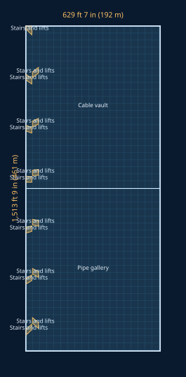
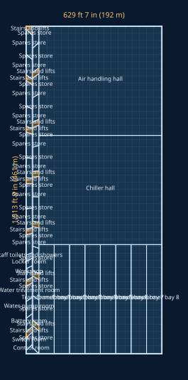
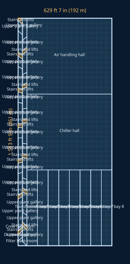

# P7-11 Port Yards Utility Plant: plan

Footprint 629 ft 7 in (192 m) × 1,513 ft 9 in (461 m) · structural grid 32 ft 10 in (10 m)

## Levels

| Level | Floor above deck | Height | Floor area |
|---|---|---|---|
| Level B1 · Pipe and cable basement | −16 ft 5 in (5,000 mm) | 16 ft 5 in (5,000 mm) | 953,065 sq ft (88,543 m²) |
| Level 1 · Plant floor | 0 ft (0 mm) | 26 ft 3 in (8,000 mm) | 938,771 sq ft (87,215 m²) |
| Level 2 · Upper plant deck | 26 ft 3 in (8,000 mm) | 19 ft 8 in (6,000 mm) | 938,771 sq ft (87,215 m²) |

## Elements

| ID | Designation | Type | Name | Level(s) | Size / length | Area | Status |
|---|---|---|---|---|---|---|---|
| E001 | D5F2P7B14A1L1R1, D5F2P7B14A1L2R1 | room | Transformer bay 1 | L1, L2 | 71 ft 2 in (22 m) × 504 ft 7 in (154 m) | 35,924 sq ft (3,337 m²) | proposed |
| E002 | D5F2P7B14A1L1R2, D5F2P7B14A1L2R2 | room | Transformer bay 2 | L1, L2 | 71 ft 6 in (22 m) × 504 ft 7 in (154 m) | 36,090 sq ft (3,353 m²) | proposed |
| E003 | D5F2P7B14A1L1R3, D5F2P7B14A1L2R3 | room | Transformer bay 3 | L1, L2 | 71 ft 2 in (22 m) × 504 ft 7 in (154 m) | 35,924 sq ft (3,337 m²) | proposed |
| E004 | D5F2P7B14A1L1R4, D5F2P7B14A1L2R4 | room | Transformer bay 4 | L1, L2 | 71 ft 2 in (22 m) × 504 ft 7 in (154 m) | 35,924 sq ft (3,337 m²) | proposed |
| E005 | D5F2P7B14A1L1R5, D5F2P7B14A1L2R5 | room | Transformer bay 5 | L1, L2 | 71 ft 6 in (22 m) × 504 ft 7 in (154 m) | 36,090 sq ft (3,353 m²) | proposed |
| E006 | D5F2P7B14A1L1R6, D5F2P7B14A1L2R6 | room | Transformer bay 6 | L1, L2 | 71 ft 2 in (22 m) × 504 ft 7 in (154 m) | 35,924 sq ft (3,337 m²) | proposed |
| E007 | D5F2P7B14A1L1R7, D5F2P7B14A1L2R7 | room | Transformer bay 7 | L1, L2 | 71 ft 6 in (22 m) × 504 ft 7 in (154 m) | 36,090 sq ft (3,353 m²) | proposed |
| E008 | D5F2P7B14A1L1R8, D5F2P7B14A1L2R8 | room | Transformer bay 8 | L1, L2 | 71 ft 2 in (22 m) × 504 ft 7 in (154 m) | 35,924 sq ft (3,337 m²) | proposed |
| E009 | D5F2P7B14A1L1R9, D5F2P7B14A1L2R9 | room | Chiller hall | L1, L2 | 570 ft 6 in (174 m) × 504 ft 7 in (154 m) | 287,890 sq ft (26,746 m²) | proposed |
| E010 | D5F2P7B14A1L1R10, D5F2P7B14A1L2R10 | room | Air handling hall | L1, L2 | 570 ft 6 in (174 m) × 504 ft 7 in (154 m) | 287,890 sq ft (26,746 m²) | proposed |
| E011 | D5F2P7B14A1LB1R1, D5F2P7B14A1L1R11, D5F2P7B14A1L2R11 | core | Stairs and lifts | LB1, L1, L2 | 27 ft 11 in (8,500 mm) × 51 ft 2 in (16 m) | 737 sq ft (68 m²) | proposed |
| E012 | D5F2P7B14A1LB1R2, D5F2P7B14A1L1R12, D5F2P7B14A1L2R12 | core | Stairs and lifts | LB1, L1, L2 | 27 ft 11 in (8,500 mm) × 42 ft 4 in (13 m) | 732 sq ft (68 m²) | proposed |
| E013 | D5F2P7B14A1LB1R3, D5F2P7B14A1L1R13, D5F2P7B14A1L2R13 | core | Stairs and lifts | LB1, L1, L2 | 27 ft 11 in (8,500 mm) × 33 ft 2 in (10 m) | 727 sq ft (68 m²) | proposed |
| E014 | D5F2P7B14A1LB1R4, D5F2P7B14A1L1R14, D5F2P7B14A1L2R14 | core | Stairs and lifts | LB1, L1, L2 | 27 ft 11 in (8,500 mm) × 27 ft 11 in (8,500 mm) | 732 sq ft (68 m²) | proposed |
| E015 | D5F2P7B14A1LB1R5, D5F2P7B14A1L1R15, D5F2P7B14A1L2R15 | core | Stairs and lifts | LB1, L1, L2 | 27 ft 11 in (8,500 mm) × 36 ft 5 in (11 m) | 727 sq ft (68 m²) | proposed |
| E016 | D5F2P7B14A1LB1R6, D5F2P7B14A1L1R16, D5F2P7B14A1L2R16 | core | Stairs and lifts | LB1, L1, L2 | 27 ft 11 in (8,500 mm) × 45 ft 7 in (14 m) | 732 sq ft (68 m²) | proposed |
| E017 | D5F2P7B14A1LB1R7, D5F2P7B14A1L1R17, D5F2P7B14A1L2R17 | core | Stairs and lifts | LB1, L1, L2 | 29 ft 2 in (8,900 mm) × 41 ft (12 m) | 737 sq ft (68 m²) | proposed |
| E018 | D5F2P7B14A1LB1R8, D5F2P7B14A1L1R18, D5F2P7B14A1L2R18 | core | Stairs and lifts | LB1, L1, L2 | 27 ft 11 in (8,500 mm) × 46 ft 7 in (14 m) | 732 sq ft (68 m²) | proposed |
| E019 | D5F2P7B14A1LB1R9, D5F2P7B14A1L1R19, D5F2P7B14A1L2R19 | core | Stairs and lifts | LB1, L1, L2 | 27 ft 11 in (8,500 mm) × 38 ft 1 in (12 m) | 737 sq ft (68 m²) | proposed |
| E020 | D5F2P7B14A1LB1R10, D5F2P7B14A1L1R20, D5F2P7B14A1L2R20 | core | Stairs and lifts | LB1, L1, L2 | 27 ft 11 in (8,500 mm) × 28 ft 10 in (8,800 mm) | 727 sq ft (68 m²) | proposed |
| E021 | D5F2P7B14A1LB1R11, D5F2P7B14A1L1R21, D5F2P7B14A1L2R21 | core | Stairs and lifts | LB1, L1, L2 | 27 ft 11 in (8,500 mm) × 32 ft 2 in (9,800 mm) | 727 sq ft (68 m²) | proposed |
| E022 | D5F2P7B14A1LB1R12, D5F2P7B14A1L1R22, D5F2P7B14A1L2R22 | core | Stairs and lifts | LB1, L1, L2 | 27 ft 11 in (8,500 mm) × 41 ft (12 m) | 732 sq ft (68 m²) | proposed |
| E023 | D5F2P7B14A1LB1R13, D5F2P7B14A1L1R23, D5F2P7B14A1L2R23 | core | Stairs and lifts | LB1, L1, L2 | 27 ft 11 in (8,500 mm) × 49 ft 10 in (15 m) | 732 sq ft (68 m²) | proposed |
| E024 | D5F2P7B14A1L1R24 | room | Control room | L1 | 59 ft 1 in (18 m) × 42 ft 8 in (13 m) | 1,290 sq ft (120 m²) | proposed |
| E025 | D5F2P7B14A1L1R25 | room | Switch room | L1 | 27 ft 11 in (8,500 mm) × 83 ft 8 in (26 m) | 1,601 sq ft (149 m²) | proposed |
| E026 | D5F2P7B14A1L1R26 | room | Battery room | L1 | 27 ft 11 in (8,500 mm) × 84 ft 8 in (26 m) | 1,715 sq ft (159 m²) | proposed |
| E027 | D5F2P7B14A1L1R27 | room | Water pump room | L1 | 27 ft 11 in (8,500 mm) × 97 ft 1 in (30 m) | 2,136 sq ft (198 m²) | proposed |
| E028 | D5F2P7B14A1L1R28 | room | Water treatment room | L1 | 27 ft 11 in (8,500 mm) × 86 ft 7 in (26 m) | 1,921 sq ft (179 m²) | proposed |
| E029 | D5F2P7B14A1L1R29 | room | Workshop | L1 | 27 ft 11 in (8,500 mm) × 68 ft 3 in (21 m) | 1,496 sq ft (139 m²) | proposed |
| E030 | D5F2P7B14A1L1R30 | room | Locker room | L1 | 27 ft 11 in (8,500 mm) × 47 ft 7 in (14 m) | 970 sq ft (90 m²) | proposed |
| E031 | D5F2P7B14A1L1R31 | room | Staff toilets and showers | L1 | 27 ft 11 in (8,500 mm) × 38 ft 5 in (12 m) | 746 sq ft (69 m²) | proposed |
| E032 | D5F2P7B14A1L1R32 | room | Spares store | L1 | 27 ft 11 in (8,500 mm) × 101 ft 5 in (31 m) | 2,566 sq ft (238 m²) | proposed |
| E033 | D5F2P7B14A1L1R33 | room | Spares store | L1 | 27 ft 11 in (8,500 mm) × 97 ft 1 in (30 m) | 2,571 sq ft (239 m²) | proposed |
| E034 | D5F2P7B14A1L1R34 | room | Spares store | L1 | 27 ft 11 in (8,500 mm) × 117 ft 2 in (36 m) | 3,207 sq ft (298 m²) | proposed |
| E035 | D5F2P7B14A1L1R35 | room | Spares store | L1 | 27 ft 11 in (8,500 mm) × 96 ft 2 in (29 m) | 2,571 sq ft (239 m²) | proposed |
| E036 | D5F2P7B14A1L1R36 | room | Spares store | L1 | 27 ft 11 in (8,500 mm) × 122 ft 8 in (37 m) | 3,207 sq ft (298 m²) | proposed |
| E037 | D5F2P7B14A1L1R37 | room | Spares store | L1 | 27 ft 11 in (8,500 mm) × 105 ft (32 m) | 2,576 sq ft (239 m²) | proposed |
| E038 | D5F2P7B14A1L1R38 | room | Spares store | L1 | 27 ft 11 in (8,500 mm) × 131 ft 7 in (40 m) | 3,202 sq ft (298 m²) | proposed |
| E039 | D5F2P7B14A1L1R39 | room | Spares store | L1 | 27 ft 11 in (8,500 mm) × 113 ft 6 in (35 m) | 2,571 sq ft (239 m²) | proposed |
| E040 | D5F2P7B14A1L1R40 | room | Spares store | L1 | 27 ft 11 in (8,500 mm) × 140 ft 1 in (43 m) | 3,202 sq ft (297 m²) | proposed |
| E041 | D5F2P7B14A1L1R41 | room | Spares store | L1 | 34 ft 1 in (10 m) × 101 ft 1 in (31 m) | 2,580 sq ft (240 m²) | proposed |
| E042 | D5F2P7B14A1L1R42 | room | Spares store | L1 | 27 ft 11 in (8,500 mm) × 137 ft 10 in (42 m) | 3,202 sq ft (298 m²) | proposed |
| E043 | D5F2P7B14A1L1R43 | room | Spares store | L1 | 27 ft 11 in (8,500 mm) × 110 ft 3 in (34 m) | 2,566 sq ft (238 m²) | proposed |
| E044 | D5F2P7B14A1L1R44 | room | Spares store | L1 | 27 ft 11 in (8,500 mm) × 129 ft 3 in (39 m) | 3,207 sq ft (298 m²) | proposed |
| E045 | D5F2P7B14A1L1R45 | room | Spares store | L1 | 27 ft 11 in (8,500 mm) × 101 ft 5 in (31 m) | 2,566 sq ft (238 m²) | proposed |
| E046 | D5F2P7B14A1L1R46 | room | Spares store | L1 | 27 ft 11 in (8,500 mm) × 120 ft 5 in (37 m) | 3,207 sq ft (298 m²) | proposed |
| E047 | D5F2P7B14A1L1R47 | room | Spares store | L1 | 27 ft 11 in (8,500 mm) × 94 ft 2 in (29 m) | 2,576 sq ft (239 m²) | proposed |
| E048 | D5F2P7B14A1L1R48 | room | Spares store | L1 | 27 ft 11 in (8,500 mm) × 118 ft 5 in (36 m) | 3,207 sq ft (298 m²) | proposed |
| E049 | D5F2P7B14A1L1R49 | room | Spares store | L1 | 27 ft 11 in (8,500 mm) × 100 ft 5 in (31 m) | 2,571 sq ft (239 m²) | proposed |
| E050 | D5F2P7B14A1L1R50 | room | Spares store | L1 | 27 ft 11 in (8,500 mm) × 127 ft (39 m) | 3,207 sq ft (298 m²) | proposed |
| E051 | D5F2P7B14A1L1R51 | room | Spares store | L1 | 27 ft 11 in (8,500 mm) × 109 ft 3 in (33 m) | 2,571 sq ft (239 m²) | proposed |
| E052 | D5F2P7B14A1L1R52 | room | Spares store | L1 | 27 ft 11 in (8,500 mm) × 135 ft 10 in (41 m) | 3,202 sq ft (298 m²) | proposed |
| E053 | D5F2P7B14A1L1R53 | room | Spares store | L1 | 27 ft 11 in (8,500 mm) × 129 ft 7 in (40 m) | 2,891 sq ft (269 m²) | proposed |
| E054 | D5F2P7B14A1L2R24 | room | Filter bank room | L2 | 59 ft 1 in (18 m) × 57 ft 9 in (18 m) | 1,715 sq ft (159 m²) | proposed |
| E055 | D5F2P7B14A1L2R25 | room | Ductwork gallery | L2 | 27 ft 11 in (8,500 mm) × 68 ft 3 in (21 m) | 1,176 sq ft (109 m²) | proposed |
| E056 | D5F2P7B14A1L2R26 | room | Crew rest room | L2 | 27 ft 11 in (8,500 mm) × 39 ft 4 in (12 m) | 425 sq ft (40 m²) | proposed |
| E057 | D5F2P7B14A1L2R27 | room | Upper plant gallery | L2 | 27 ft 11 in (8,500 mm) × 211 ft 11 in (65 m) | 5,348 sq ft (497 m²) | proposed |
| E058 | D5F2P7B14A1L2R28 | room | Upper plant gallery | L2 | 27 ft 11 in (8,500 mm) × 151 ft 3 in (46 m) | 3,856 sq ft (358 m²) | proposed |
| E059 | D5F2P7B14A1L2R29 | room | Upper plant gallery | L2 | 27 ft 11 in (8,500 mm) × 77 ft 9 in (24 m) | 1,921 sq ft (178 m²) | proposed |
| E060 | D5F2P7B14A1L2R30 | room | Upper plant gallery | L2 | 27 ft 11 in (8,500 mm) × 142 ft 5 in (43 m) | 3,856 sq ft (358 m²) | proposed |
| E061 | D5F2P7B14A1L2R31 | room | Upper plant gallery | L2 | 27 ft 11 in (8,500 mm) × 70 ft 3 in (21 m) | 1,921 sq ft (178 m²) | proposed |
| E062 | D5F2P7B14A1L2R32 | room | Upper plant gallery | L2 | 27 ft 11 in (8,500 mm) × 143 ft 1 in (44 m) | 3,856 sq ft (358 m²) | proposed |
| E063 | D5F2P7B14A1L2R33 | room | Upper plant gallery | L2 | 27 ft 11 in (8,500 mm) × 77 ft 5 in (24 m) | 1,921 sq ft (178 m²) | proposed |
| E064 | D5F2P7B14A1L2R34 | room | Upper plant gallery | L2 | 27 ft 11 in (8,500 mm) × 151 ft 11 in (46 m) | 3,861 sq ft (359 m²) | proposed |
| E065 | D5F2P7B14A1L2R35 | room | Upper plant gallery | L2 | 27 ft 11 in (8,500 mm) × 86 ft 3 in (26 m) | 1,917 sq ft (178 m²) | proposed |
| E066 | D5F2P7B14A1L2R36 | room | Upper plant gallery | L2 | 27 ft 11 in (8,500 mm) × 160 ft 9 in (49 m) | 3,861 sq ft (359 m²) | proposed |
| E067 | D5F2P7B14A1L2R37 | room | Upper plant gallery | L2 | 27 ft 11 in (8,500 mm) × 94 ft 10 in (29 m) | 1,912 sq ft (178 m²) | proposed |
| E068 | D5F2P7B14A1L2R38 | room | Upper plant gallery | L2 | 34 ft 1 in (10 m) × 146 ft (44 m) | 3,861 sq ft (359 m²) | proposed |
| E069 | D5F2P7B14A1L2R39 | room | Upper plant gallery | L2 | 27 ft 11 in (8,500 mm) × 90 ft 11 in (28 m) | 1,921 sq ft (178 m²) | proposed |
| E070 | D5F2P7B14A1L2R40 | room | Upper plant gallery | L2 | 27 ft 11 in (8,500 mm) × 155 ft 6 in (47 m) | 3,852 sq ft (358 m²) | proposed |
| E071 | D5F2P7B14A1L2R41 | room | Upper plant gallery | L2 | 27 ft 11 in (8,500 mm) × 82 ft 4 in (25 m) | 1,921 sq ft (179 m²) | proposed |
| E072 | D5F2P7B14A1L2R42 | room | Upper plant gallery | L2 | 27 ft 11 in (8,500 mm) × 146 ft 8 in (45 m) | 3,852 sq ft (358 m²) | proposed |
| E073 | D5F2P7B14A1L2R43 | room | Upper plant gallery | L2 | 27 ft 11 in (8,500 mm) × 73 ft 6 in (22 m) | 1,921 sq ft (179 m²) | proposed |
| E074 | D5F2P7B14A1L2R44 | room | Upper plant gallery | L2 | 27 ft 11 in (8,500 mm) × 141 ft 1 in (43 m) | 3,861 sq ft (359 m²) | proposed |
| E075 | D5F2P7B14A1L2R45 | room | Upper plant gallery | L2 | 27 ft 11 in (8,500 mm) × 73 ft 2 in (22 m) | 1,921 sq ft (178 m²) | proposed |
| E076 | D5F2P7B14A1L2R46 | room | Upper plant gallery | L2 | 27 ft 11 in (8,500 mm) × 147 ft 4 in (45 m) | 3,856 sq ft (358 m²) | proposed |
| E077 | D5F2P7B14A1L2R47 | room | Upper plant gallery | L2 | 27 ft 11 in (8,500 mm) × 81 ft 8 in (25 m) | 1,921 sq ft (179 m²) | proposed |
| E078 | D5F2P7B14A1L2R48 | room | Upper plant gallery | L2 | 27 ft 11 in (8,500 mm) × 156 ft 2 in (48 m) | 3,856 sq ft (358 m²) | proposed |
| E079 | D5F2P7B14A1L2R49 | room | Upper plant gallery | L2 | 27 ft 11 in (8,500 mm) × 90 ft 7 in (28 m) | 1,917 sq ft (178 m²) | proposed |
| E080 | D5F2P7B14A1L2R50 | room | Upper plant gallery | L2 | 27 ft 11 in (8,500 mm) × 129 ft 7 in (40 m) | 2,891 sq ft (269 m²) | proposed |
| E081 | D5F2P7B14A1LB1R14 | room | Cable vault | LB1 | 629 ft 7 in (192 m) × 756 ft 11 in (231 m) | 476,533 sq ft (44,271 m²) | proposed |
| E082 | D5F2P7B14A1LB1R15 | room | Pipe gallery | LB1 | 629 ft 7 in (192 m) × 756 ft 11 in (231 m) | 476,533 sq ft (44,271 m²) | proposed |

## Drawings

### Level B1 · Pipe and cable basement

### Level 1 · Plant floor

### Level 2 · Upper plant deck

