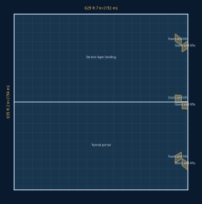
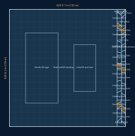
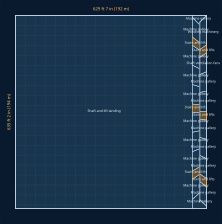

# P7-12 Port Yards Service Shaft: plan

Footprint 629 ft 7 in (192 m) × 635 ft 2 in (194 m) · structural grid 32 ft 10 in (10 m)

## Levels

| Level | Floor above deck | Height | Floor area |
|---|---|---|---|
| Level B1 · Service layer landing | −19 ft 8 in (6,000 mm) | 19 ft 8 in (6,000 mm) | 399,899 sq ft (37,152 m²) |
| Level 1 · Lift landing | 0 ft (0 mm) | 29 ft 6 in (9,000 mm) | 394,936 sq ft (36,691 m²) |
| Level 2 · Winding room | 29 ft 6 in (9,000 mm) | 19 ft 8 in (6,000 mm) | 394,936 sq ft (36,691 m²) |

## Elements

| ID | Designation | Type | Name | Level(s) | Size / length | Area | Status |
|---|---|---|---|---|---|---|---|
| E001 | D5F2P7B14A2L1R1, D5F2P7B14A2L2R1 | room | Shaft and lift landing | L1, L2 | 583 ft 8 in (178 m) × 635 ft 2 in (194 m) | 370,725 sq ft (34,441 m²) | proposed |
| E002 |  | fixture | Goods lift cage | L1 | 175 ft 2 in (53 m) × 381 ft 3 in (116 m) | 66,791 sq ft (6,205 m²) | proposed |
| E003 |  | fixture | Crew lift and stair | L1 | 116 ft 10 in (36 m) × 253 ft 11 in (77 m) | 29,659 sq ft (2,755 m²) | proposed |
| E004 | D5F2P7B14A2LB1R1, D5F2P7B14A2L1R2, D5F2P7B14A2L2R2 | core | Stairs and lifts | LB1, L1, L2 | 21 ft 8 in (6,600 mm) × 40 ft 4 in (12 m) | 568 sq ft (53 m²) | proposed |
| E005 | D5F2P7B14A2LB1R2, D5F2P7B14A2L1R3, D5F2P7B14A2L2R3 | core | Stairs and lifts | LB1, L1, L2 | 21 ft 8 in (6,600 mm) × 27 ft 3 in (8,300 mm) | 568 sq ft (53 m²) | proposed |
| E006 | D5F2P7B14A2LB1R3, D5F2P7B14A2L1R4, D5F2P7B14A2L2R4 | core | Stairs and lifts | LB1, L1, L2 | 21 ft 8 in (6,600 mm) × 42 ft (13 m) | 568 sq ft (53 m²) | proposed |
| E007 | D5F2P7B14A2LB1R4, D5F2P7B14A2L1R5, D5F2P7B14A2L2R5 | core | Stairs and lifts | LB1, L1, L2 | 21 ft 8 in (6,600 mm) × 40 ft 4 in (12 m) | 568 sq ft (53 m²) | proposed |
| E008 | D5F2P7B14A2LB1R5, D5F2P7B14A2L1R6, D5F2P7B14A2L2R6 | core | Stairs and lifts | LB1, L1, L2 | 21 ft 8 in (6,600 mm) × 27 ft 3 in (8,300 mm) | 568 sq ft (53 m²) | proposed |
| E009 | D5F2P7B14A2LB1R6, D5F2P7B14A2L1R7, D5F2P7B14A2L2R7 | core | Stairs and lifts | LB1, L1, L2 | 21 ft 8 in (6,600 mm) × 42 ft (13 m) | 568 sq ft (53 m²) | proposed |
| E010 | D5F2P7B14A2L1R8 | room | Lift control room | L1 | 21 ft 8 in (6,600 mm) × 45 ft 7 in (14 m) | 536 sq ft (50 m²) | proposed |
| E011 | D5F2P7B14A2L1R9 | room | Loading bay | L1 | 21 ft 8 in (6,600 mm) × 85 ft 11 in (26 m) | 1,481 sq ft (138 m²) | proposed |
| E012 | D5F2P7B14A2L1R10 | room | Crew check-in | L1 | 21 ft 8 in (6,600 mm) × 32 ft 2 in (9,800 mm) | 426 sq ft (40 m²) | proposed |
| E013 | D5F2P7B14A2L1R11 | room | Tool store | L1 | 21 ft 8 in (6,600 mm) × 50 ft 2 in (15 m) | 860 sq ft (80 m²) | proposed |
| E014 | D5F2P7B14A2L1R12 | room | Staff toilets and showers | L1 | 21 ft 8 in (6,600 mm) × 42 ft 4 in (13 m) | 746 sq ft (69 m²) | proposed |
| E015 | D5F2P7B14A2L1R13 | room | Holding store | L1 | 21 ft 8 in (6,600 mm) × 63 ft 8 in (19 m) | 1,282 sq ft (119 m²) | proposed |
| E016 | D5F2P7B14A2L1R14 | room | Holding store | L1 | 21 ft 8 in (6,600 mm) × 34 ft 5 in (10 m) | 721 sq ft (67 m²) | proposed |
| E017 | D5F2P7B14A2L1R15 | room | Holding store | L1 | 21 ft 8 in (6,600 mm) × 63 ft 4 in (19 m) | 1,282 sq ft (119 m²) | proposed |
| E018 | D5F2P7B14A2L1R16 | room | Holding store | L1 | 21 ft 8 in (6,600 mm) × 67 ft 7 in (21 m) | 1,282 sq ft (119 m²) | proposed |
| E019 | D5F2P7B14A2L1R17 | room | Holding store | L1 | 21 ft 8 in (6,600 mm) × 80 ft 5 in (24 m) | 1,467 sq ft (136 m²) | proposed |
| E020 | D5F2P7B14A2L1R18 | room | Holding store | L1 | 21 ft 8 in (6,600 mm) × 78 ft 1 in (24 m) | 1,282 sq ft (119 m²) | proposed |
| E021 | D5F2P7B14A2L1R19 | room | Holding store | L1 | 45 ft 11 in (14 m) × 46 ft 3 in (14 m) | 1,289 sq ft (120 m²) | proposed |
| E022 | D5F2P7B14A2L1R20 | room | Holding store | L1 | 21 ft 8 in (6,600 mm) × 85 ft 4 in (26 m) | 1,467 sq ft (136 m²) | proposed |
| E023 | D5F2P7B14A2L1R21 | room | Holding store | L1 | 21 ft 8 in (6,600 mm) × 70 ft 6 in (22 m) | 1,286 sq ft (119 m²) | proposed |
| E024 | D5F2P7B14A2L1R22 | room | Holding store | L1 | 21 ft 8 in (6,600 mm) × 66 ft 3 in (20 m) | 1,282 sq ft (119 m²) | proposed |
| E025 | D5F2P7B14A2L1R23 | room | Holding store | L1 | 21 ft 8 in (6,600 mm) × 70 ft 3 in (21 m) | 1,467 sq ft (136 m²) | proposed |
| E026 | D5F2P7B14A2L1R24 | room | Holding store | L1 | 21 ft 8 in (6,600 mm) × 63 ft 4 in (19 m) | 1,282 sq ft (119 m²) | proposed |
| E027 | D5F2P7B14A2L1R25 | room | Holding store | L1 | 21 ft 8 in (6,600 mm) × 67 ft 7 in (21 m) | 1,282 sq ft (119 m²) | proposed |
| E028 | D5F2P7B14A2L1R26 | room | Holding store | L1 | 21 ft 8 in (6,600 mm) × 80 ft 5 in (24 m) | 1,467 sq ft (136 m²) | proposed |
| E029 | D5F2P7B14A2L1R27 | room | Holding store | L1 | 21 ft 8 in (6,600 mm) × 78 ft 1 in (24 m) | 1,282 sq ft (119 m²) | proposed |
| E030 | D5F2P7B14A2L1R28 | room | Holding store | L1 | 45 ft 11 in (14 m) × 31 ft 2 in (9,500 mm) | 739 sq ft (69 m²) | proposed |
| E031 | D5F2P7B14A2L2R8 | room | Winding machinery | L2 | 21 ft 8 in (6,600 mm) × 111 ft 7 in (34 m) | 2,018 sq ft (187 m²) | proposed |
| E032 | D5F2P7B14A2L2R9 | room | Shaft ventilation fans | L2 | 21 ft 8 in (6,600 mm) × 70 ft 6 in (22 m) | 1,286 sq ft (119 m²) | proposed |
| E033 | D5F2P7B14A2L2R10 | room | Machine gallery | L2 | 21 ft 8 in (6,600 mm) × 68 ft 3 in (21 m) | 1,328 sq ft (123 m²) | proposed |
| E034 | D5F2P7B14A2L2R11 | room | Machine gallery | L2 | 21 ft 8 in (6,600 mm) × 67 ft 11 in (21 m) | 1,421 sq ft (132 m²) | proposed |
| E035 | D5F2P7B14A2L2R12 | room | Machine gallery | L2 | 21 ft 8 in (6,600 mm) × 65 ft 7 in (20 m) | 1,332 sq ft (124 m²) | proposed |
| E036 | D5F2P7B14A2L2R13 | room | Machine gallery | L2 | 21 ft 8 in (6,600 mm) × 69 ft 11 in (21 m) | 1,332 sq ft (124 m²) | proposed |
| E037 | D5F2P7B14A2L2R14 | room | Machine gallery | L2 | 21 ft 8 in (6,600 mm) × 75 ft 9 in (23 m) | 1,368 sq ft (127 m²) | proposed |
| E038 | D5F2P7B14A2L2R15 | room | Machine gallery | L2 | 21 ft 8 in (6,600 mm) × 80 ft 5 in (24 m) | 1,332 sq ft (124 m²) | proposed |
| E039 | D5F2P7B14A2L2R16 | room | Machine gallery | L2 | 45 ft 11 in (14 m) × 50 ft 6 in (15 m) | 1,336 sq ft (124 m²) | proposed |
| E040 | D5F2P7B14A2L2R17 | room | Machine gallery | L2 | 21 ft 8 in (6,600 mm) × 80 ft 9 in (25 m) | 1,371 sq ft (127 m²) | proposed |
| E041 | D5F2P7B14A2L2R18 | room | Machine gallery | L2 | 21 ft 8 in (6,600 mm) × 72 ft 6 in (22 m) | 1,332 sq ft (124 m²) | proposed |
| E042 | D5F2P7B14A2L2R19 | room | Machine gallery | L2 | 21 ft 8 in (6,600 mm) × 68 ft 3 in (21 m) | 1,332 sq ft (124 m²) | proposed |
| E043 | D5F2P7B14A2L2R20 | room | Machine gallery | L2 | 21 ft 8 in (6,600 mm) × 65 ft 7 in (20 m) | 1,371 sq ft (127 m²) | proposed |
| E044 | D5F2P7B14A2L2R21 | room | Machine gallery | L2 | 21 ft 8 in (6,600 mm) × 65 ft 7 in (20 m) | 1,332 sq ft (124 m²) | proposed |
| E045 | D5F2P7B14A2L2R22 | room | Machine gallery | L2 | 21 ft 8 in (6,600 mm) × 69 ft 11 in (21 m) | 1,332 sq ft (124 m²) | proposed |
| E046 | D5F2P7B14A2L2R23 | room | Machine gallery | L2 | 21 ft 8 in (6,600 mm) × 75 ft 9 in (23 m) | 1,368 sq ft (127 m²) | proposed |
| E047 | D5F2P7B14A2L2R24 | room | Machine gallery | L2 | 21 ft 8 in (6,600 mm) × 80 ft 5 in (24 m) | 1,332 sq ft (124 m²) | proposed |
| E048 | D5F2P7B14A2L2R25 | room | Machine gallery | L2 | 45 ft 11 in (14 m) × 28 ft 10 in (8,800 mm) | 689 sq ft (64 m²) | proposed |
| E049 | D5F2P7B14A2LB1R7 | room | Service layer landing | LB1 | 629 ft 7 in (192 m) × 317 ft 7 in (97 m) | 199,950 sq ft (18,576 m²) | proposed |
| E050 | D5F2P7B14A2LB1R8 | room | Tunnel portal | LB1 | 629 ft 7 in (192 m) × 317 ft 7 in (97 m) | 199,950 sq ft (18,576 m²) | proposed |

## Drawings

### Level B1 · Service layer landing

### Level 1 · Lift landing

### Level 2 · Winding room

