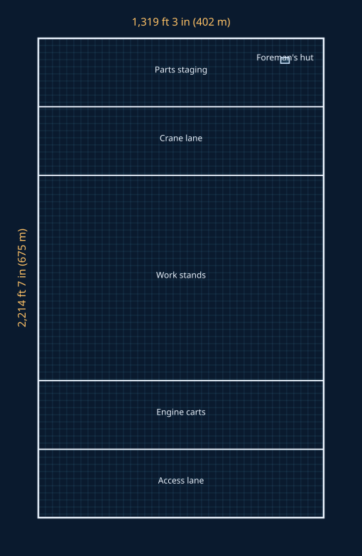

# P7-17 Work Yard 3: plan

Footprint 1,319 ft 3 in (402 m) × 2,214 ft 7 in (675 m) · structural grid 32 ft 10 in (10 m)

## Levels

| Level | Floor above deck | Height | Floor area |
|---|---|---|---|
| Level 1 · Ground | 0 ft (0 mm) | 13 ft 1 in (4,000 mm) | 1,033 sq ft (96 m²) |

## Elements

| ID | Designation | Type | Name | Level(s) | Size / length | Area | Status |
|---|---|---|---|---|---|---|---|
| E001 | D5F2P7B6A2R1 | zone | Parts staging | L1 | 1,319 ft 3 in (402 m) × 316 ft 3 in (96 m) | 417,235 sq ft (38,762 m²) | proposed |
| E002 | D5F2P7B6A2R2 | room | Foreman's hut | L1 | 39 ft 4 in (12 m) × 26 ft 3 in (8,000 mm) | 1,033 sq ft (96 m²) | proposed |
| E003 | D5F2P7B6A2R3 | zone | Crane lane | L1 | 1,319 ft 3 in (402 m) × 316 ft 7 in (96 m) | 417,668 sq ft (38,803 m²) | proposed |
| E004 | D5F2P7B6A2R4 | zone | Work stands | L1 | 1,319 ft 3 in (402 m) × 948 ft 10 in (289 m) | 1,251,706 sq ft (116,287 m²) | proposed |
| E005 | D5F2P7B6A2R5 | zone | Engine carts | L1 | 1,319 ft 3 in (402 m) × 316 ft 7 in (96 m) | 417,668 sq ft (38,803 m²) | proposed |
| E006 | D5F2P7B6A2R6 | zone | Access lane | L1 | 1,319 ft 3 in (402 m) × 316 ft 3 in (96 m) | 417,235 sq ft (38,762 m²) | proposed |

## Drawings

### Level 1 · Ground

