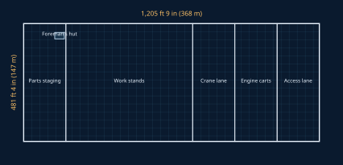

# P7-19 Work Yard 4: plan

Footprint 1,205 ft 9 in (368 m) × 481 ft 4 in (147 m) · structural grid 32 ft 10 in (10 m)

## Levels

| Level | Floor above deck | Height | Floor area |
|---|---|---|---|
| Level 1 · Ground | 0 ft (0 mm) | 13 ft 1 in (4,000 mm) | 1,033 sq ft (96 m²) |

## Elements

| ID | Designation | Type | Name | Level(s) | Size / length | Area | Status |
|---|---|---|---|---|---|---|---|
| E001 | D5F2P7B12A3R1 | zone | Parts staging | L1 | 172 ft 3 in (52 m) × 481 ft 4 in (147 m) | 82,901 sq ft (7,702 m²) | proposed |
| E002 | D5F2P7B12A3R2 | room | Foreman's hut | L1 | 39 ft 4 in (12 m) × 26 ft 3 in (8,000 mm) | 1,033 sq ft (96 m²) | proposed |
| E003 | D5F2P7B12A3R3 | zone | Work stands | L1 | 516 ft 9 in (158 m) × 481 ft 4 in (147 m) | 248,703 sq ft (23,105 m²) | proposed |
| E004 | D5F2P7B12A3R4 | zone | Crane lane | L1 | 172 ft 3 in (52 m) × 481 ft 4 in (147 m) | 82,901 sq ft (7,702 m²) | proposed |
| E005 | D5F2P7B12A3R5 | zone | Engine carts | L1 | 172 ft 3 in (52 m) × 481 ft 4 in (147 m) | 82,901 sq ft (7,702 m²) | proposed |
| E006 | D5F2P7B12A3R6 | zone | Access lane | L1 | 172 ft 3 in (52 m) × 481 ft 4 in (147 m) | 82,901 sq ft (7,702 m²) | proposed |

## Drawings

### Level 1 · Ground

