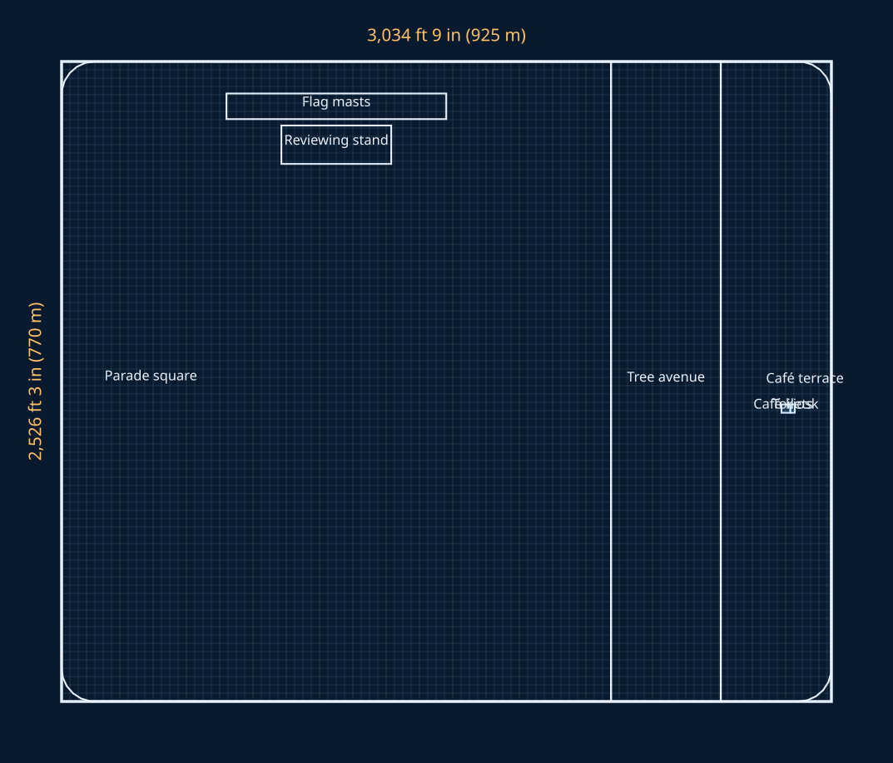

# P8-08 Command Plaza: plan

Footprint 3,034 ft 9 in (925 m) × 2,526 ft 3 in (770 m) · structural grid 32 ft 10 in (10 m)

## Levels

| Level | Floor above deck | Height | Floor area |
|---|---|---|---|
| Level 1 · Ground | 0 ft (0 mm) | 13 ft 1 in (4,000 mm) | 1,722 sq ft (160 m²) |

## Elements

| ID | Designation | Type | Name | Level(s) | Size / length | Area | Status |
|---|---|---|---|---|---|---|---|
| E001 | D5F2P8B11A1R1 | zone | Parade square | L1 | 2,166 ft (660 m) × 2,525 ft 11 in (770 m) | 5,459,997 sq ft (507,250 m²) | proposed |
| E002 |  | fixture | Flag masts | L1 | 866 ft 6 in (264 m) × 101 ft 1 in (31 m) | 87,557 sq ft (8,134 m²) | proposed |
| E003 |  | fixture | Reviewing stand | L1 | 433 ft 1 in (132 m) × 151 ft 7 in (46 m) | 65,643 sq ft (6,098 m²) | proposed |
| E004 | D5F2P8B11A1R2 | zone | Tree avenue | L1 | 432 ft 9 in (132 m) × 2,525 ft 3 in (770 m) | 1,092,647 sq ft (101,510 m²) | proposed |
| E005 | D5F2P8B11A1R3 | zone | Café terrace | L1 | 436 ft (133 m) × 2,524 ft 11 in (770 m) | 1,091,885 sq ft (101,439 m²) | proposed |
| E006 | D5F2P8B11A1R4 | room | Café kiosk | L1 | 35 ft 1 in (11 m) × 32 ft 10 in (10 m) | 1,152 sq ft (107 m²) | proposed |
| E007 | D5F2P8B11A1R5 | room | Toilets | L1 | 17 ft 5 in (5,300 mm) × 32 ft 10 in (10 m) | 570 sq ft (53 m²) | proposed |

## Drawings

### Level 1 · Ground

