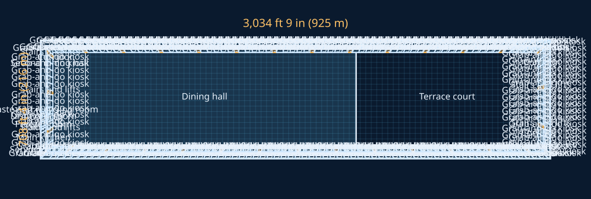
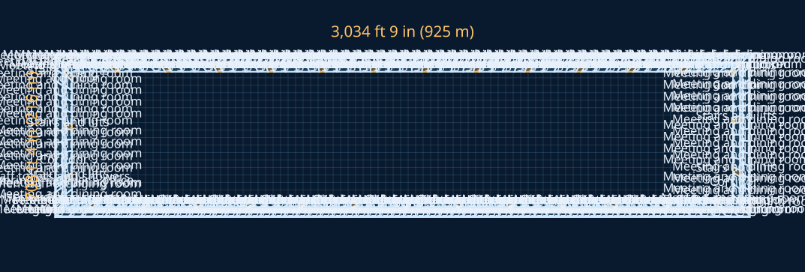

# P8-11 Hangar Mess Hall: plan

Footprint 3,034 ft 9 in (925 m) × 708 ft 4 in (216 m) · structural grid 32 ft 10 in (10 m)

## Levels

| Level | Floor above deck | Height | Floor area |
|---|---|---|---|
| Level 1 · Dining floor | 0 ft (0 mm) | 17 ft 9 in (5,400 mm) | 1,442,067 sq ft (133,972 m²) |
| Level 2 · Upper dining and staff floor | 17 ft 9 in (5,400 mm) | 13 ft 9 in (4,200 mm) | 423,283 sq ft (39,324 m²) |

## Elements

| ID | Designation | Type | Name | Level(s) | Size / length | Area | Status |
|---|---|---|---|---|---|---|---|
| E001 | D5F2P8B16A1L1R1 | room | Dining hall | L1 | 1,806 ft 5 in (551 m) × 564 ft (172 m) | 1,018,784 sq ft (94,648 m²) | proposed |
| E002 | D5F2P8B16A1L1R2 | zone | Terrace court | L1 | 1,084 ft (330 m) × 564 ft (172 m) | 611,345 sq ft (56,796 m²) | proposed |
| E003 | D5F2P8B16A1L1R3 | zone | Corridor | L1 | 9 ft 10 in (3,000 mm) × 399 ft 11 in (122 m) | 3,875 sq ft (360 m²) | proposed |
| E004 | D5F2P8B16A1L1R4 | zone | Corridor | L1 | 160 ft 5 in (49 m) × 248 ft 8 in (76 m) | 3,875 sq ft (360 m²) | proposed |
| E005 | D5F2P8B16A1L1R5 | zone | Corridor | L1 | 400 ft 11 in (122 m) × 9 ft 10 in (3,000 mm) | 3,875 sq ft (360 m²) | proposed |
| E006 | D5F2P8B16A1L1R6 | zone | Corridor | L1 | 398 ft 4 in (121 m) × 9 ft 10 in (3,000 mm) | 3,875 sq ft (360 m²) | proposed |
| E007 | D5F2P8B16A1L1R7 | zone | Corridor | L1 | 396 ft (121 m) × 9 ft 10 in (3,000 mm) | 3,875 sq ft (360 m²) | proposed |
| E008 | D5F2P8B16A1L1R8 | zone | Corridor | L1 | 395 ft (120 m) × 9 ft 10 in (3,000 mm) | 3,875 sq ft (360 m²) | proposed |
| E009 | D5F2P8B16A1L1R9 | zone | Corridor | L1 | 396 ft 4 in (121 m) × 9 ft 10 in (3,000 mm) | 3,875 sq ft (360 m²) | proposed |
| E010 | D5F2P8B16A1L1R10 | zone | Corridor | L1 | 398 ft 11 in (122 m) × 9 ft 10 in (3,000 mm) | 3,875 sq ft (360 m²) | proposed |
| E011 | D5F2P8B16A1L1R11 | zone | Corridor | L1 | 401 ft 7 in (122 m) × 9 ft 10 in (3,000 mm) | 3,875 sq ft (360 m²) | proposed |
| E012 | D5F2P8B16A1L1R12 | zone | Corridor | L1 | 65 ft (20 m) × 343 ft 6 in (105 m) | 3,875 sq ft (360 m²) | proposed |
| E013 | D5F2P8B16A1L1R13 | zone | Corridor | L1 | 105 ft 4 in (32 m) × 303 ft 2 in (92 m) | 3,875 sq ft (360 m²) | proposed |
| E014 | D5F2P8B16A1L1R14 | zone | Corridor | L1 | 401 ft 7 in (122 m) × 9 ft 10 in (3,000 mm) | 3,875 sq ft (360 m²) | proposed |
| E015 | D5F2P8B16A1L1R15 | zone | Corridor | L1 | 398 ft 11 in (122 m) × 9 ft 10 in (3,000 mm) | 3,875 sq ft (360 m²) | proposed |
| E016 | D5F2P8B16A1L1R16 | zone | Corridor | L1 | 396 ft 4 in (121 m) × 9 ft 10 in (3,000 mm) | 3,875 sq ft (360 m²) | proposed |
| E017 | D5F2P8B16A1L1R17 | zone | Corridor | L1 | 395 ft (120 m) × 9 ft 10 in (3,000 mm) | 3,875 sq ft (360 m²) | proposed |
| E018 | D5F2P8B16A1L1R18 | zone | Corridor | L1 | 396 ft 4 in (121 m) × 9 ft 10 in (3,000 mm) | 3,875 sq ft (360 m²) | proposed |
| E019 | D5F2P8B16A1L1R19 | zone | Corridor | L1 | 398 ft 11 in (122 m) × 9 ft 10 in (3,000 mm) | 3,875 sq ft (360 m²) | proposed |
| E020 | D5F2P8B16A1L1R20 | zone | Corridor | L1 | 401 ft 7 in (122 m) × 9 ft 10 in (3,000 mm) | 3,875 sq ft (360 m²) | proposed |
| E021 | D5F2P8B16A1L1R21 | zone | Corridor | L1 | 120 ft 5 in (37 m) × 9 ft 10 in (3,000 mm) | 1,091 sq ft (101 m²) | proposed |
| E022 | D5F2P8B16A1L1R22, D5F2P8B16A1L2R1 | core | Stairs and lifts | L1, L2 | 31 ft 2 in (9,500 mm) × 45 ft 7 in (14 m) | 818 sq ft (76 m²) | proposed |
| E023 | D5F2P8B16A1L1R23, D5F2P8B16A1L2R2 | core | Stairs and lifts | L1, L2 | 31 ft 2 in (9,500 mm) × 30 ft 10 in (9,400 mm) | 818 sq ft (76 m²) | proposed |
| E024 | D5F2P8B16A1L1R24, D5F2P8B16A1L2R3 | core | Stairs and lifts | L1, L2 | 31 ft 2 in (9,500 mm) × 54 ft 9 in (17 m) | 823 sq ft (76 m²) | proposed |
| E025 | D5F2P8B16A1L1R25, D5F2P8B16A1L2R4 | core | Stairs and lifts | L1, L2 | 53 ft 6 in (16 m) × 31 ft 2 in (9,500 mm) | 823 sq ft (76 m²) | proposed |
| E026 | D5F2P8B16A1L1R26, D5F2P8B16A1L2R5 | core | Stairs and lifts | L1, L2 | 48 ft 7 in (15 m) × 31 ft 2 in (9,500 mm) | 818 sq ft (76 m²) | proposed |
| E027 | D5F2P8B16A1L1R27, D5F2P8B16A1L2R6 | core | Stairs and lifts | L1, L2 | 43 ft 8 in (13 m) × 31 ft 2 in (9,500 mm) | 818 sq ft (76 m²) | proposed |
| E028 | D5F2P8B16A1L1R28, D5F2P8B16A1L2R7 | core | Stairs and lifts | L1, L2 | 38 ft 9 in (12 m) × 31 ft 2 in (9,500 mm) | 818 sq ft (76 m²) | proposed |
| E029 | D5F2P8B16A1L1R29, D5F2P8B16A1L2R8 | core | Stairs and lifts | L1, L2 | 33 ft 10 in (10 m) × 31 ft 2 in (9,500 mm) | 818 sq ft (76 m²) | proposed |
| E030 | D5F2P8B16A1L1R30, D5F2P8B16A1L2R9 | core | Stairs and lifts | L1, L2 | 28 ft 10 in (8,800 mm) × 31 ft 2 in (9,500 mm) | 818 sq ft (76 m²) | proposed |
| E031 | D5F2P8B16A1L1R31, D5F2P8B16A1L2R10 | core | Stairs and lifts | L1, L2 | 28 ft 7 in (8,700 mm) × 31 ft 2 in (9,500 mm) | 823 sq ft (76 m²) | proposed |
| E032 | D5F2P8B16A1L1R32, D5F2P8B16A1L2R11 | core | Stairs and lifts | L1, L2 | 33 ft 2 in (10 m) × 31 ft 2 in (9,500 mm) | 818 sq ft (76 m²) | proposed |
| E033 | D5F2P8B16A1L1R33, D5F2P8B16A1L2R12 | core | Stairs and lifts | L1, L2 | 38 ft 1 in (12 m) × 31 ft 2 in (9,500 mm) | 818 sq ft (76 m²) | proposed |
| E034 | D5F2P8B16A1L1R34, D5F2P8B16A1L2R13 | core | Stairs and lifts | L1, L2 | 43 ft (13 m) × 31 ft 2 in (9,500 mm) | 818 sq ft (76 m²) | proposed |
| E035 | D5F2P8B16A1L1R35, D5F2P8B16A1L2R14 | core | Stairs and lifts | L1, L2 | 47 ft 11 in (15 m) × 31 ft 2 in (9,500 mm) | 818 sq ft (76 m²) | proposed |
| E036 | D5F2P8B16A1L1R36, D5F2P8B16A1L2R15 | core | Stairs and lifts | L1, L2 | 52 ft 10 in (16 m) × 31 ft 2 in (9,500 mm) | 818 sq ft (76 m²) | proposed |
| E037 | D5F2P8B16A1L1R37, D5F2P8B16A1L2R16 | core | Stairs and lifts | L1, L2 | 44 ft 3 in (14 m) × 43 ft 8 in (13 m) | 818 sq ft (76 m²) | proposed |
| E038 | D5F2P8B16A1L1R38, D5F2P8B16A1L2R17 | core | Stairs and lifts | L1, L2 | 31 ft 2 in (9,500 mm) × 33 ft 6 in (10 m) | 818 sq ft (76 m²) | proposed |
| E039 | D5F2P8B16A1L1R39, D5F2P8B16A1L2R18 | core | Stairs and lifts | L1, L2 | 31 ft 2 in (9,500 mm) × 42 ft 8 in (13 m) | 823 sq ft (76 m²) | proposed |
| E040 | D5F2P8B16A1L1R40, D5F2P8B16A1L2R19 | core | Stairs and lifts | L1, L2 | 55 ft 5 in (17 m) × 31 ft 2 in (9,500 mm) | 818 sq ft (76 m²) | proposed |
| E041 | D5F2P8B16A1L1R41, D5F2P8B16A1L2R20 | core | Stairs and lifts | L1, L2 | 50 ft 10 in (16 m) × 31 ft 2 in (9,500 mm) | 823 sq ft (76 m²) | proposed |
| E042 | D5F2P8B16A1L1R42, D5F2P8B16A1L2R21 | core | Stairs and lifts | L1, L2 | 45 ft 11 in (14 m) × 31 ft 2 in (9,500 mm) | 818 sq ft (76 m²) | proposed |
| E043 | D5F2P8B16A1L1R43, D5F2P8B16A1L2R22 | core | Stairs and lifts | L1, L2 | 41 ft (12 m) × 31 ft 2 in (9,500 mm) | 818 sq ft (76 m²) | proposed |
| E044 | D5F2P8B16A1L1R44, D5F2P8B16A1L2R23 | core | Stairs and lifts | L1, L2 | 36 ft 1 in (11 m) × 31 ft 2 in (9,500 mm) | 818 sq ft (76 m²) | proposed |
| E045 | D5F2P8B16A1L1R45, D5F2P8B16A1L2R24 | core | Stairs and lifts | L1, L2 | 31 ft 2 in (9,500 mm) × 31 ft 2 in (9,500 mm) | 813 sq ft (76 m²) | proposed |
| E046 | D5F2P8B16A1L1R46, D5F2P8B16A1L2R25 | core | Stairs and lifts | L1, L2 | 26 ft 3 in (8,000 mm) × 31 ft 2 in (9,500 mm) | 813 sq ft (76 m²) | proposed |
| E047 | D5F2P8B16A1L1R47, D5F2P8B16A1L2R26 | core | Stairs and lifts | L1, L2 | 30 ft 10 in (9,400 mm) × 31 ft 2 in (9,500 mm) | 823 sq ft (76 m²) | proposed |
| E048 | D5F2P8B16A1L1R48, D5F2P8B16A1L2R27 | core | Stairs and lifts | L1, L2 | 35 ft 5 in (11 m) × 31 ft 2 in (9,500 mm) | 818 sq ft (76 m²) | proposed |
| E049 | D5F2P8B16A1L1R49, D5F2P8B16A1L2R28 | core | Stairs and lifts | L1, L2 | 40 ft 4 in (12 m) × 31 ft 2 in (9,500 mm) | 818 sq ft (76 m²) | proposed |
| E050 | D5F2P8B16A1L1R50, D5F2P8B16A1L2R29 | core | Stairs and lifts | L1, L2 | 45 ft 3 in (14 m) × 31 ft 2 in (9,500 mm) | 818 sq ft (76 m²) | proposed |
| E051 | D5F2P8B16A1L1R51, D5F2P8B16A1L2R30 | core | Stairs and lifts | L1, L2 | 50 ft 2 in (15 m) × 31 ft 2 in (9,500 mm) | 818 sq ft (76 m²) | proposed |
| E052 | D5F2P8B16A1L1R52, D5F2P8B16A1L2R31 | core | Stairs and lifts | L1, L2 | 55 ft 1 in (17 m) × 31 ft 2 in (9,500 mm) | 818 sq ft (76 m²) | proposed |
| E053 | D5F2P8B16A1L1R53 | room | Serving counter | L1 | 31 ft 2 in (9,500 mm) × 70 ft 10 in (22 m) | 1,294 sq ft (120 m²) | proposed |
| E054 | D5F2P8B16A1L1R54 | room | Main kitchen | L1 | 31 ft 2 in (9,500 mm) × 126 ft 4 in (38 m) | 3,226 sq ft (300 m²) | proposed |
| E055 | D5F2P8B16A1L1R55 | room | Cold room | L1 | 31 ft 2 in (9,500 mm) × 37 ft 9 in (12 m) | 649 sq ft (60 m²) | proposed |
| E056 | D5F2P8B16A1L1R56 | room | Freezer room | L1 | 31 ft 2 in (9,500 mm) × 28 ft 10 in (8,800 mm) | 429 sq ft (40 m²) | proposed |
| E057 | D5F2P8B16A1L1R57 | room | Dry store | L1 | 31 ft 2 in (9,500 mm) × 41 ft (12 m) | 864 sq ft (80 m²) | proposed |
| E058 | D5F2P8B16A1L1R58 | room | Dishwash room | L1 | 31 ft 2 in (9,500 mm) × 38 ft 5 in (12 m) | 859 sq ft (80 m²) | proposed |
| E059 | D5F2P8B16A1L1R59 | room | Goods-in bay | L1 | 31 ft 2 in (9,500 mm) × 29 ft 2 in (8,900 mm) | 644 sq ft (60 m²) | proposed |
| E060 | D5F2P8B16A1L1R60 | room | Waste and recycling room | L1 | 31 ft 2 in (9,500 mm) × 18 ft 1 in (5,500 mm) | 343 sq ft (32 m²) | proposed |
| E061 | D5F2P8B16A1L1R61 | room | Second dining hall | L1 | 137 ft 6 in (42 m) × 429 ft 6 in (131 m) | 16,146 sq ft (1,500 m²) | proposed |
| E062 | D5F2P8B16A1L1R62 | room | Toilets | L1 | 49 ft 3 in (15 m) × 31 ft 2 in (9,500 mm) | 639 sq ft (59 m²) | proposed |
| E063 | D5F2P8B16A1L1R63 | room | Grab-and-go kiosk | L1 | 69 ft 7 in (21 m) × 31 ft 2 in (9,500 mm) | 1,294 sq ft (120 m²) | proposed |
| E064 | D5F2P8B16A1L1R64 | room | Grab-and-go kiosk | L1 | 68 ft 7 in (21 m) × 31 ft 2 in (9,500 mm) | 1,294 sq ft (120 m²) | proposed |
| E065 | D5F2P8B16A1L1R65 | room | Grab-and-go kiosk | L1 | 67 ft 7 in (21 m) × 31 ft 2 in (9,500 mm) | 1,288 sq ft (120 m²) | proposed |
| E066 | D5F2P8B16A1L1R66 | room | Grab-and-go kiosk | L1 | 66 ft 11 in (20 m) × 31 ft 2 in (9,500 mm) | 1,294 sq ft (120 m²) | proposed |
| E067 | D5F2P8B16A1L1R67 | room | Grab-and-go kiosk | L1 | 65 ft 11 in (20 m) × 31 ft 2 in (9,500 mm) | 1,288 sq ft (120 m²) | proposed |
| E068 | D5F2P8B16A1L1R68 | room | Grab-and-go kiosk | L1 | 65 ft 3 in (20 m) × 31 ft 2 in (9,500 mm) | 1,294 sq ft (120 m²) | proposed |
| E069 | D5F2P8B16A1L1R69 | room | Grab-and-go kiosk | L1 | 64 ft 4 in (20 m) × 31 ft 2 in (9,500 mm) | 1,294 sq ft (120 m²) | proposed |
| E070 | D5F2P8B16A1L1R70 | room | Grab-and-go kiosk | L1 | 63 ft 4 in (19 m) × 31 ft 2 in (9,500 mm) | 1,288 sq ft (120 m²) | proposed |
| E071 | D5F2P8B16A1L1R71 | room | Grab-and-go kiosk | L1 | 62 ft 8 in (19 m) × 31 ft 2 in (9,500 mm) | 1,294 sq ft (120 m²) | proposed |
| E072 | D5F2P8B16A1L1R72 | room | Grab-and-go kiosk | L1 | 61 ft 8 in (19 m) × 31 ft 2 in (9,500 mm) | 1,294 sq ft (120 m²) | proposed |
| E073 | D5F2P8B16A1L1R73 | room | Grab-and-go kiosk | L1 | 60 ft 8 in (18 m) × 31 ft 2 in (9,500 mm) | 1,288 sq ft (120 m²) | proposed |
| E074 | D5F2P8B16A1L1R74 | room | Grab-and-go kiosk | L1 | 60 ft (18 m) × 31 ft 2 in (9,500 mm) | 1,294 sq ft (120 m²) | proposed |
| E075 | D5F2P8B16A1L1R75 | room | Grab-and-go kiosk | L1 | 59 ft 1 in (18 m) × 31 ft 2 in (9,500 mm) | 1,288 sq ft (120 m²) | proposed |
| E076 | D5F2P8B16A1L1R76 | room | Grab-and-go kiosk | L1 | 58 ft 5 in (18 m) × 31 ft 2 in (9,500 mm) | 1,294 sq ft (120 m²) | proposed |
| E077 | D5F2P8B16A1L1R77 | room | Grab-and-go kiosk | L1 | 57 ft 5 in (18 m) × 31 ft 2 in (9,500 mm) | 1,294 sq ft (120 m²) | proposed |
| E078 | D5F2P8B16A1L1R78 | room | Grab-and-go kiosk | L1 | 56 ft 5 in (17 m) × 31 ft 2 in (9,500 mm) | 1,288 sq ft (120 m²) | proposed |
| E079 | D5F2P8B16A1L1R79 | room | Grab-and-go kiosk | L1 | 55 ft 9 in (17 m) × 31 ft 2 in (9,500 mm) | 1,294 sq ft (120 m²) | proposed |
| E080 | D5F2P8B16A1L1R80 | room | Grab-and-go kiosk | L1 | 54 ft 9 in (17 m) × 31 ft 2 in (9,500 mm) | 1,294 sq ft (120 m²) | proposed |
| E081 | D5F2P8B16A1L1R81 | room | Grab-and-go kiosk | L1 | 53 ft 10 in (16 m) × 31 ft 2 in (9,500 mm) | 1,288 sq ft (120 m²) | proposed |
| E082 | D5F2P8B16A1L1R82 | room | Grab-and-go kiosk | L1 | 53 ft 2 in (16 m) × 31 ft 2 in (9,500 mm) | 1,294 sq ft (120 m²) | proposed |
| E083 | D5F2P8B16A1L1R83 | room | Grab-and-go kiosk | L1 | 52 ft 2 in (16 m) × 31 ft 2 in (9,500 mm) | 1,294 sq ft (120 m²) | proposed |
| E084 | D5F2P8B16A1L1R84 | room | Grab-and-go kiosk | L1 | 51 ft 2 in (16 m) × 31 ft 2 in (9,500 mm) | 1,288 sq ft (120 m²) | proposed |
| E085 | D5F2P8B16A1L1R85 | room | Grab-and-go kiosk | L1 | 50 ft 6 in (15 m) × 31 ft 2 in (9,500 mm) | 1,294 sq ft (120 m²) | proposed |
| E086 | D5F2P8B16A1L1R86 | room | Grab-and-go kiosk | L1 | 49 ft 6 in (15 m) × 31 ft 2 in (9,500 mm) | 1,288 sq ft (120 m²) | proposed |
| E087 | D5F2P8B16A1L1R87 | room | Grab-and-go kiosk | L1 | 48 ft 11 in (15 m) × 31 ft 2 in (9,500 mm) | 1,294 sq ft (120 m²) | proposed |
| E088 | D5F2P8B16A1L1R88 | room | Grab-and-go kiosk | L1 | 47 ft 11 in (15 m) × 31 ft 2 in (9,500 mm) | 1,294 sq ft (120 m²) | proposed |
| E089 | D5F2P8B16A1L1R89 | room | Grab-and-go kiosk | L1 | 46 ft 11 in (14 m) × 31 ft 2 in (9,500 mm) | 1,288 sq ft (120 m²) | proposed |
| E090 | D5F2P8B16A1L1R90 | room | Grab-and-go kiosk | L1 | 46 ft 3 in (14 m) × 31 ft 2 in (9,500 mm) | 1,294 sq ft (120 m²) | proposed |
| E091 | D5F2P8B16A1L1R91 | room | Grab-and-go kiosk | L1 | 45 ft 3 in (14 m) × 31 ft 2 in (9,500 mm) | 1,294 sq ft (120 m²) | proposed |
| E092 | D5F2P8B16A1L1R92 | room | Grab-and-go kiosk | L1 | 44 ft 3 in (14 m) × 31 ft 2 in (9,500 mm) | 1,288 sq ft (120 m²) | proposed |
| E093 | D5F2P8B16A1L1R93 | room | Grab-and-go kiosk | L1 | 43 ft 8 in (13 m) × 31 ft 2 in (9,500 mm) | 1,294 sq ft (120 m²) | proposed |
| E094 | D5F2P8B16A1L1R94 | room | Grab-and-go kiosk | L1 | 42 ft 8 in (13 m) × 31 ft 2 in (9,500 mm) | 1,288 sq ft (120 m²) | proposed |
| E095 | D5F2P8B16A1L1R95 | room | Grab-and-go kiosk | L1 | 42 ft (13 m) × 31 ft 2 in (9,500 mm) | 1,294 sq ft (120 m²) | proposed |
| E096 | D5F2P8B16A1L1R96 | room | Grab-and-go kiosk | L1 | 42 ft (13 m) × 31 ft 2 in (9,500 mm) | 1,294 sq ft (120 m²) | proposed |
| E097 | D5F2P8B16A1L1R97 | room | Grab-and-go kiosk | L1 | 42 ft 8 in (13 m) × 31 ft 2 in (9,500 mm) | 1,288 sq ft (120 m²) | proposed |
| E098 | D5F2P8B16A1L1R98 | room | Grab-and-go kiosk | L1 | 43 ft 8 in (13 m) × 31 ft 2 in (9,500 mm) | 1,294 sq ft (120 m²) | proposed |
| E099 | D5F2P8B16A1L1R99 | room | Grab-and-go kiosk | L1 | 44 ft 7 in (14 m) × 31 ft 2 in (9,500 mm) | 1,294 sq ft (120 m²) | proposed |
| E100 | D5F2P8B16A1L1R100 | room | Grab-and-go kiosk | L1 | 45 ft 3 in (14 m) × 31 ft 2 in (9,500 mm) | 1,288 sq ft (120 m²) | proposed |
| E101 | D5F2P8B16A1L1R101 | room | Grab-and-go kiosk | L1 | 46 ft 3 in (14 m) × 31 ft 2 in (9,500 mm) | 1,294 sq ft (120 m²) | proposed |
| E102 | D5F2P8B16A1L1R102 | room | Grab-and-go kiosk | L1 | 46 ft 11 in (14 m) × 31 ft 2 in (9,500 mm) | 1,288 sq ft (120 m²) | proposed |
| E103 | D5F2P8B16A1L1R103 | room | Grab-and-go kiosk | L1 | 47 ft 11 in (15 m) × 31 ft 2 in (9,500 mm) | 1,294 sq ft (120 m²) | proposed |
| E104 | D5F2P8B16A1L1R104 | room | Grab-and-go kiosk | L1 | 48 ft 11 in (15 m) × 31 ft 2 in (9,500 mm) | 1,294 sq ft (120 m²) | proposed |
| E105 | D5F2P8B16A1L1R105 | room | Grab-and-go kiosk | L1 | 49 ft 6 in (15 m) × 31 ft 2 in (9,500 mm) | 1,288 sq ft (120 m²) | proposed |
| E106 | D5F2P8B16A1L1R106 | room | Grab-and-go kiosk | L1 | 50 ft 6 in (15 m) × 31 ft 2 in (9,500 mm) | 1,294 sq ft (120 m²) | proposed |
| E107 | D5F2P8B16A1L1R107 | room | Grab-and-go kiosk | L1 | 51 ft 6 in (16 m) × 31 ft 2 in (9,500 mm) | 1,294 sq ft (120 m²) | proposed |
| E108 | D5F2P8B16A1L1R108 | room | Grab-and-go kiosk | L1 | 52 ft 2 in (16 m) × 31 ft 2 in (9,500 mm) | 1,288 sq ft (120 m²) | proposed |
| E109 | D5F2P8B16A1L1R109 | room | Grab-and-go kiosk | L1 | 53 ft 2 in (16 m) × 31 ft 2 in (9,500 mm) | 1,294 sq ft (120 m²) | proposed |
| E110 | D5F2P8B16A1L1R110 | room | Grab-and-go kiosk | L1 | 53 ft 10 in (16 m) × 31 ft 2 in (9,500 mm) | 1,288 sq ft (120 m²) | proposed |
| E111 | D5F2P8B16A1L1R111 | room | Grab-and-go kiosk | L1 | 54 ft 9 in (17 m) × 31 ft 2 in (9,500 mm) | 1,294 sq ft (120 m²) | proposed |
| E112 | D5F2P8B16A1L1R112 | room | Grab-and-go kiosk | L1 | 55 ft 9 in (17 m) × 31 ft 2 in (9,500 mm) | 1,299 sq ft (121 m²) | proposed |
| E113 | D5F2P8B16A1L1R113 | room | Grab-and-go kiosk | L1 | 56 ft 1 in (17 m) × 31 ft 2 in (9,500 mm) | 1,288 sq ft (120 m²) | proposed |
| E114 | D5F2P8B16A1L1R114 | room | Grab-and-go kiosk | L1 | 57 ft 1 in (17 m) × 31 ft 2 in (9,500 mm) | 1,294 sq ft (120 m²) | proposed |
| E115 | D5F2P8B16A1L1R115 | room | Grab-and-go kiosk | L1 | 58 ft 1 in (18 m) × 31 ft 2 in (9,500 mm) | 1,294 sq ft (120 m²) | proposed |
| E116 | D5F2P8B16A1L1R116 | room | Grab-and-go kiosk | L1 | 58 ft 9 in (18 m) × 31 ft 2 in (9,500 mm) | 1,288 sq ft (120 m²) | proposed |
| E117 | D5F2P8B16A1L1R117 | room | Grab-and-go kiosk | L1 | 59 ft 9 in (18 m) × 31 ft 2 in (9,500 mm) | 1,294 sq ft (120 m²) | proposed |
| E118 | D5F2P8B16A1L1R118 | room | Grab-and-go kiosk | L1 | 60 ft 4 in (18 m) × 31 ft 2 in (9,500 mm) | 1,288 sq ft (120 m²) | proposed |
| E119 | D5F2P8B16A1L1R119 | room | Grab-and-go kiosk | L1 | 61 ft 4 in (19 m) × 31 ft 2 in (9,500 mm) | 1,294 sq ft (120 m²) | proposed |
| E120 | D5F2P8B16A1L1R120 | room | Grab-and-go kiosk | L1 | 62 ft 4 in (19 m) × 31 ft 2 in (9,500 mm) | 1,294 sq ft (120 m²) | proposed |
| E121 | D5F2P8B16A1L1R121 | room | Grab-and-go kiosk | L1 | 63 ft (19 m) × 31 ft 2 in (9,500 mm) | 1,288 sq ft (120 m²) | proposed |
| E122 | D5F2P8B16A1L1R122 | room | Grab-and-go kiosk | L1 | 64 ft (20 m) × 31 ft 2 in (9,500 mm) | 1,294 sq ft (120 m²) | proposed |
| E123 | D5F2P8B16A1L1R123 | room | Grab-and-go kiosk | L1 | 65 ft (20 m) × 31 ft 2 in (9,500 mm) | 1,294 sq ft (120 m²) | proposed |
| E124 | D5F2P8B16A1L1R124 | room | Grab-and-go kiosk | L1 | 65 ft 7 in (20 m) × 31 ft 2 in (9,500 mm) | 1,288 sq ft (120 m²) | proposed |
| E125 | D5F2P8B16A1L1R125 | room | Grab-and-go kiosk | L1 | 66 ft 7 in (20 m) × 31 ft 2 in (9,500 mm) | 1,294 sq ft (120 m²) | proposed |
| E126 | D5F2P8B16A1L1R126 | room | Grab-and-go kiosk | L1 | 67 ft 3 in (20 m) × 31 ft 2 in (9,500 mm) | 1,288 sq ft (120 m²) | proposed |
| E127 | D5F2P8B16A1L1R127 | room | Grab-and-go kiosk | L1 | 68 ft 3 in (21 m) × 31 ft 2 in (9,500 mm) | 1,294 sq ft (120 m²) | proposed |
| E128 | D5F2P8B16A1L1R128 | room | Grab-and-go kiosk | L1 | 69 ft 3 in (21 m) × 31 ft 2 in (9,500 mm) | 1,294 sq ft (120 m²) | proposed |
| E129 | D5F2P8B16A1L1R129 | room | Grab-and-go kiosk | L1 | 69 ft 11 in (21 m) × 31 ft 2 in (9,500 mm) | 1,288 sq ft (120 m²) | proposed |
| E130 | D5F2P8B16A1L1R130 | room | Grab-and-go kiosk | L1 | 70 ft 10 in (22 m) × 31 ft 2 in (9,500 mm) | 1,294 sq ft (120 m²) | proposed |
| E131 | D5F2P8B16A1L1R131 | room | Grab-and-go kiosk | L1 | 71 ft 10 in (22 m) × 31 ft 2 in (9,500 mm) | 1,294 sq ft (120 m²) | proposed |
| E132 | D5F2P8B16A1L1R132 | room | Grab-and-go kiosk | L1 | 46 ft 11 in (14 m) × 55 ft 5 in (17 m) | 1,288 sq ft (120 m²) | proposed |
| E133 | D5F2P8B16A1L1R133 | room | Grab-and-go kiosk | L1 | 31 ft 2 in (9,500 mm) × 68 ft 3 in (21 m) | 1,288 sq ft (120 m²) | proposed |
| E134 | D5F2P8B16A1L1R134 | room | Grab-and-go kiosk | L1 | 31 ft 2 in (9,500 mm) × 64 ft 8 in (20 m) | 1,294 sq ft (120 m²) | proposed |
| E135 | D5F2P8B16A1L1R135 | room | Grab-and-go kiosk | L1 | 31 ft 2 in (9,500 mm) × 60 ft 8 in (18 m) | 1,288 sq ft (120 m²) | proposed |
| E136 | D5F2P8B16A1L1R136 | room | Grab-and-go kiosk | L1 | 31 ft 2 in (9,500 mm) × 57 ft 1 in (17 m) | 1,294 sq ft (120 m²) | proposed |
| E137 | D5F2P8B16A1L1R137 | room | Grab-and-go kiosk | L1 | 31 ft 2 in (9,500 mm) × 53 ft 2 in (16 m) | 1,294 sq ft (120 m²) | proposed |
| E138 | D5F2P8B16A1L1R138 | room | Grab-and-go kiosk | L1 | 31 ft 2 in (9,500 mm) × 49 ft 3 in (15 m) | 1,294 sq ft (120 m²) | proposed |
| E139 | D5F2P8B16A1L1R139 | room | Grab-and-go kiosk | L1 | 31 ft 2 in (9,500 mm) × 45 ft 3 in (14 m) | 1,288 sq ft (120 m²) | proposed |
| E140 | D5F2P8B16A1L1R140 | room | Grab-and-go kiosk | L1 | 31 ft 2 in (9,500 mm) × 43 ft 4 in (13 m) | 1,294 sq ft (120 m²) | proposed |
| E141 | D5F2P8B16A1L1R141 | room | Grab-and-go kiosk | L1 | 31 ft 2 in (9,500 mm) × 44 ft 11 in (14 m) | 1,288 sq ft (120 m²) | proposed |
| E142 | D5F2P8B16A1L1R142 | room | Grab-and-go kiosk | L1 | 31 ft 2 in (9,500 mm) × 48 ft 11 in (15 m) | 1,294 sq ft (120 m²) | proposed |
| E143 | D5F2P8B16A1L1R143 | room | Grab-and-go kiosk | L1 | 31 ft 2 in (9,500 mm) × 52 ft 6 in (16 m) | 1,288 sq ft (120 m²) | proposed |
| E144 | D5F2P8B16A1L1R144 | room | Grab-and-go kiosk | L1 | 31 ft 2 in (9,500 mm) × 56 ft 9 in (17 m) | 1,299 sq ft (121 m²) | proposed |
| E145 | D5F2P8B16A1L1R145 | room | Grab-and-go kiosk | L1 | 31 ft 2 in (9,500 mm) × 60 ft 4 in (18 m) | 1,288 sq ft (120 m²) | proposed |
| E146 | D5F2P8B16A1L1R146 | room | Grab-and-go kiosk | L1 | 31 ft 2 in (9,500 mm) × 64 ft 4 in (20 m) | 1,294 sq ft (120 m²) | proposed |
| E147 | D5F2P8B16A1L1R147 | room | Grab-and-go kiosk | L1 | 31 ft 2 in (9,500 mm) × 67 ft 11 in (21 m) | 1,288 sq ft (120 m²) | proposed |
| E148 | D5F2P8B16A1L1R148 | room | Grab-and-go kiosk | L1 | 42 ft 4 in (13 m) × 60 ft (18 m) | 1,294 sq ft (120 m²) | proposed |
| E149 | D5F2P8B16A1L1R149 | room | Grab-and-go kiosk | L1 | 71 ft 10 in (22 m) × 31 ft 2 in (9,500 mm) | 1,288 sq ft (120 m²) | proposed |
| E150 | D5F2P8B16A1L1R150 | room | Grab-and-go kiosk | L1 | 71 ft 2 in (22 m) × 31 ft 2 in (9,500 mm) | 1,294 sq ft (120 m²) | proposed |
| E151 | D5F2P8B16A1L1R151 | room | Grab-and-go kiosk | L1 | 70 ft 3 in (21 m) × 31 ft 2 in (9,500 mm) | 1,294 sq ft (120 m²) | proposed |
| E152 | D5F2P8B16A1L1R152 | room | Grab-and-go kiosk | L1 | 69 ft 3 in (21 m) × 31 ft 2 in (9,500 mm) | 1,288 sq ft (120 m²) | proposed |
| E153 | D5F2P8B16A1L1R153 | room | Grab-and-go kiosk | L1 | 68 ft 7 in (21 m) × 31 ft 2 in (9,500 mm) | 1,294 sq ft (120 m²) | proposed |
| E154 | D5F2P8B16A1L1R154 | room | Grab-and-go kiosk | L1 | 67 ft 7 in (21 m) × 31 ft 2 in (9,500 mm) | 1,294 sq ft (120 m²) | proposed |
| E155 | D5F2P8B16A1L1R155 | room | Grab-and-go kiosk | L1 | 66 ft 7 in (20 m) × 31 ft 2 in (9,500 mm) | 1,288 sq ft (120 m²) | proposed |
| E156 | D5F2P8B16A1L1R156 | room | Grab-and-go kiosk | L1 | 65 ft 11 in (20 m) × 31 ft 2 in (9,500 mm) | 1,294 sq ft (120 m²) | proposed |
| E157 | D5F2P8B16A1L1R157 | room | Grab-and-go kiosk | L1 | 65 ft (20 m) × 31 ft 2 in (9,500 mm) | 1,288 sq ft (120 m²) | proposed |
| E158 | D5F2P8B16A1L1R158 | room | Grab-and-go kiosk | L1 | 64 ft 4 in (20 m) × 31 ft 2 in (9,500 mm) | 1,294 sq ft (120 m²) | proposed |
| E159 | D5F2P8B16A1L1R159 | room | Grab-and-go kiosk | L1 | 63 ft 4 in (19 m) × 31 ft 2 in (9,500 mm) | 1,294 sq ft (120 m²) | proposed |
| E160 | D5F2P8B16A1L1R160 | room | Grab-and-go kiosk | L1 | 62 ft 4 in (19 m) × 31 ft 2 in (9,500 mm) | 1,288 sq ft (120 m²) | proposed |
| E161 | D5F2P8B16A1L1R161 | room | Grab-and-go kiosk | L1 | 61 ft 8 in (19 m) × 31 ft 2 in (9,500 mm) | 1,294 sq ft (120 m²) | proposed |
| E162 | D5F2P8B16A1L1R162 | room | Grab-and-go kiosk | L1 | 60 ft 8 in (18 m) × 31 ft 2 in (9,500 mm) | 1,294 sq ft (120 m²) | proposed |
| E163 | D5F2P8B16A1L1R163 | room | Grab-and-go kiosk | L1 | 59 ft 9 in (18 m) × 31 ft 2 in (9,500 mm) | 1,288 sq ft (120 m²) | proposed |
| E164 | D5F2P8B16A1L1R164 | room | Grab-and-go kiosk | L1 | 59 ft 1 in (18 m) × 31 ft 2 in (9,500 mm) | 1,294 sq ft (120 m²) | proposed |
| E165 | D5F2P8B16A1L1R165 | room | Grab-and-go kiosk | L1 | 58 ft 1 in (18 m) × 31 ft 2 in (9,500 mm) | 1,288 sq ft (120 m²) | proposed |
| E166 | D5F2P8B16A1L1R166 | room | Grab-and-go kiosk | L1 | 57 ft 5 in (18 m) × 31 ft 2 in (9,500 mm) | 1,294 sq ft (120 m²) | proposed |
| E167 | D5F2P8B16A1L1R167 | room | Grab-and-go kiosk | L1 | 56 ft 5 in (17 m) × 31 ft 2 in (9,500 mm) | 1,294 sq ft (120 m²) | proposed |
| E168 | D5F2P8B16A1L1R168 | room | Grab-and-go kiosk | L1 | 55 ft 5 in (17 m) × 31 ft 2 in (9,500 mm) | 1,288 sq ft (120 m²) | proposed |
| E169 | D5F2P8B16A1L1R169 | room | Grab-and-go kiosk | L1 | 54 ft 9 in (17 m) × 31 ft 2 in (9,500 mm) | 1,294 sq ft (120 m²) | proposed |
| E170 | D5F2P8B16A1L1R170 | room | Grab-and-go kiosk | L1 | 53 ft 10 in (16 m) × 31 ft 2 in (9,500 mm) | 1,294 sq ft (120 m²) | proposed |
| E171 | D5F2P8B16A1L1R171 | room | Grab-and-go kiosk | L1 | 52 ft 10 in (16 m) × 31 ft 2 in (9,500 mm) | 1,288 sq ft (120 m²) | proposed |
| E172 | D5F2P8B16A1L1R172 | room | Grab-and-go kiosk | L1 | 52 ft 2 in (16 m) × 31 ft 2 in (9,500 mm) | 1,294 sq ft (120 m²) | proposed |
| E173 | D5F2P8B16A1L1R173 | room | Grab-and-go kiosk | L1 | 51 ft 2 in (16 m) × 31 ft 2 in (9,500 mm) | 1,288 sq ft (120 m²) | proposed |
| E174 | D5F2P8B16A1L1R174 | room | Grab-and-go kiosk | L1 | 50 ft 6 in (15 m) × 31 ft 2 in (9,500 mm) | 1,294 sq ft (120 m²) | proposed |
| E175 | D5F2P8B16A1L1R175 | room | Grab-and-go kiosk | L1 | 49 ft 6 in (15 m) × 31 ft 2 in (9,500 mm) | 1,294 sq ft (120 m²) | proposed |
| E176 | D5F2P8B16A1L1R176 | room | Grab-and-go kiosk | L1 | 48 ft 7 in (15 m) × 31 ft 2 in (9,500 mm) | 1,288 sq ft (120 m²) | proposed |
| E177 | D5F2P8B16A1L1R177 | room | Grab-and-go kiosk | L1 | 47 ft 11 in (15 m) × 31 ft 2 in (9,500 mm) | 1,294 sq ft (120 m²) | proposed |
| E178 | D5F2P8B16A1L1R178 | room | Grab-and-go kiosk | L1 | 46 ft 11 in (14 m) × 31 ft 2 in (9,500 mm) | 1,294 sq ft (120 m²) | proposed |
| E179 | D5F2P8B16A1L1R179 | room | Grab-and-go kiosk | L1 | 45 ft 11 in (14 m) × 31 ft 2 in (9,500 mm) | 1,288 sq ft (120 m²) | proposed |
| E180 | D5F2P8B16A1L1R180 | room | Grab-and-go kiosk | L1 | 45 ft 3 in (14 m) × 31 ft 2 in (9,500 mm) | 1,294 sq ft (120 m²) | proposed |
| E181 | D5F2P8B16A1L1R181 | room | Grab-and-go kiosk | L1 | 44 ft 3 in (14 m) × 31 ft 2 in (9,500 mm) | 1,288 sq ft (120 m²) | proposed |
| E182 | D5F2P8B16A1L1R182 | room | Grab-and-go kiosk | L1 | 43 ft 8 in (13 m) × 31 ft 2 in (9,500 mm) | 1,294 sq ft (120 m²) | proposed |
| E183 | D5F2P8B16A1L1R183 | room | Grab-and-go kiosk | L1 | 42 ft 8 in (13 m) × 31 ft 2 in (9,500 mm) | 1,294 sq ft (120 m²) | proposed |
| E184 | D5F2P8B16A1L1R184 | room | Grab-and-go kiosk | L1 | 41 ft 8 in (13 m) × 31 ft 2 in (9,500 mm) | 1,288 sq ft (120 m²) | proposed |
| E185 | D5F2P8B16A1L1R185 | room | Grab-and-go kiosk | L1 | 42 ft (13 m) × 31 ft 2 in (9,500 mm) | 1,294 sq ft (120 m²) | proposed |
| E186 | D5F2P8B16A1L1R186 | room | Grab-and-go kiosk | L1 | 43 ft (13 m) × 31 ft 2 in (9,500 mm) | 1,294 sq ft (120 m²) | proposed |
| E187 | D5F2P8B16A1L1R187 | room | Grab-and-go kiosk | L1 | 43 ft 8 in (13 m) × 31 ft 2 in (9,500 mm) | 1,288 sq ft (120 m²) | proposed |
| E188 | D5F2P8B16A1L1R188 | room | Grab-and-go kiosk | L1 | 44 ft 7 in (14 m) × 31 ft 2 in (9,500 mm) | 1,294 sq ft (120 m²) | proposed |
| E189 | D5F2P8B16A1L1R189 | room | Grab-and-go kiosk | L1 | 45 ft 7 in (14 m) × 31 ft 2 in (9,500 mm) | 1,294 sq ft (120 m²) | proposed |
| E190 | D5F2P8B16A1L1R190 | room | Grab-and-go kiosk | L1 | 46 ft 3 in (14 m) × 31 ft 2 in (9,500 mm) | 1,288 sq ft (120 m²) | proposed |
| E191 | D5F2P8B16A1L1R191 | room | Grab-and-go kiosk | L1 | 47 ft 3 in (14 m) × 31 ft 2 in (9,500 mm) | 1,294 sq ft (120 m²) | proposed |
| E192 | D5F2P8B16A1L1R192 | room | Grab-and-go kiosk | L1 | 47 ft 11 in (15 m) × 31 ft 2 in (9,500 mm) | 1,288 sq ft (120 m²) | proposed |
| E193 | D5F2P8B16A1L1R193 | room | Grab-and-go kiosk | L1 | 48 ft 11 in (15 m) × 31 ft 2 in (9,500 mm) | 1,294 sq ft (120 m²) | proposed |
| E194 | D5F2P8B16A1L1R194 | room | Grab-and-go kiosk | L1 | 49 ft 10 in (15 m) × 31 ft 2 in (9,500 mm) | 1,294 sq ft (120 m²) | proposed |
| E195 | D5F2P8B16A1L1R195 | room | Grab-and-go kiosk | L1 | 50 ft 6 in (15 m) × 31 ft 2 in (9,500 mm) | 1,288 sq ft (120 m²) | proposed |
| E196 | D5F2P8B16A1L1R196 | room | Grab-and-go kiosk | L1 | 51 ft 6 in (16 m) × 31 ft 2 in (9,500 mm) | 1,294 sq ft (120 m²) | proposed |
| E197 | D5F2P8B16A1L1R197 | room | Grab-and-go kiosk | L1 | 52 ft 6 in (16 m) × 31 ft 2 in (9,500 mm) | 1,294 sq ft (120 m²) | proposed |
| E198 | D5F2P8B16A1L1R198 | room | Grab-and-go kiosk | L1 | 53 ft 2 in (16 m) × 31 ft 2 in (9,500 mm) | 1,288 sq ft (120 m²) | proposed |
| E199 | D5F2P8B16A1L1R199 | room | Grab-and-go kiosk | L1 | 54 ft 2 in (16 m) × 31 ft 2 in (9,500 mm) | 1,294 sq ft (120 m²) | proposed |
| E200 | D5F2P8B16A1L1R200 | room | Grab-and-go kiosk | L1 | 54 ft 9 in (17 m) × 31 ft 2 in (9,500 mm) | 1,288 sq ft (120 m²) | proposed |
| E201 | D5F2P8B16A1L1R201 | room | Grab-and-go kiosk | L1 | 55 ft 9 in (17 m) × 31 ft 2 in (9,500 mm) | 1,294 sq ft (120 m²) | proposed |
| E202 | D5F2P8B16A1L1R202 | room | Grab-and-go kiosk | L1 | 56 ft 9 in (17 m) × 31 ft 2 in (9,500 mm) | 1,294 sq ft (120 m²) | proposed |
| E203 | D5F2P8B16A1L1R203 | room | Grab-and-go kiosk | L1 | 57 ft 5 in (18 m) × 31 ft 2 in (9,500 mm) | 1,288 sq ft (120 m²) | proposed |
| E204 | D5F2P8B16A1L1R204 | room | Grab-and-go kiosk | L1 | 58 ft 5 in (18 m) × 31 ft 2 in (9,500 mm) | 1,294 sq ft (120 m²) | proposed |
| E205 | D5F2P8B16A1L1R205 | room | Grab-and-go kiosk | L1 | 59 ft 5 in (18 m) × 31 ft 2 in (9,500 mm) | 1,294 sq ft (120 m²) | proposed |
| E206 | D5F2P8B16A1L1R206 | room | Grab-and-go kiosk | L1 | 60 ft (18 m) × 31 ft 2 in (9,500 mm) | 1,288 sq ft (120 m²) | proposed |
| E207 | D5F2P8B16A1L1R207 | room | Grab-and-go kiosk | L1 | 61 ft (19 m) × 31 ft 2 in (9,500 mm) | 1,294 sq ft (120 m²) | proposed |
| E208 | D5F2P8B16A1L1R208 | room | Grab-and-go kiosk | L1 | 61 ft 8 in (19 m) × 31 ft 2 in (9,500 mm) | 1,288 sq ft (120 m²) | proposed |
| E209 | D5F2P8B16A1L1R209 | room | Grab-and-go kiosk | L1 | 62 ft 8 in (19 m) × 31 ft 2 in (9,500 mm) | 1,294 sq ft (120 m²) | proposed |
| E210 | D5F2P8B16A1L1R210 | room | Grab-and-go kiosk | L1 | 63 ft 8 in (19 m) × 31 ft 2 in (9,500 mm) | 1,294 sq ft (120 m²) | proposed |
| E211 | D5F2P8B16A1L1R211 | room | Grab-and-go kiosk | L1 | 64 ft 4 in (20 m) × 31 ft 2 in (9,500 mm) | 1,288 sq ft (120 m²) | proposed |
| E212 | D5F2P8B16A1L1R212 | room | Grab-and-go kiosk | L1 | 65 ft 3 in (20 m) × 31 ft 2 in (9,500 mm) | 1,294 sq ft (120 m²) | proposed |
| E213 | D5F2P8B16A1L1R213 | room | Grab-and-go kiosk | L1 | 66 ft 3 in (20 m) × 31 ft 2 in (9,500 mm) | 1,294 sq ft (120 m²) | proposed |
| E214 | D5F2P8B16A1L1R214 | room | Grab-and-go kiosk | L1 | 66 ft 11 in (20 m) × 31 ft 2 in (9,500 mm) | 1,288 sq ft (120 m²) | proposed |
| E215 | D5F2P8B16A1L1R215 | room | Grab-and-go kiosk | L1 | 67 ft 11 in (21 m) × 31 ft 2 in (9,500 mm) | 1,294 sq ft (120 m²) | proposed |
| E216 | D5F2P8B16A1L1R216 | room | Grab-and-go kiosk | L1 | 68 ft 7 in (21 m) × 31 ft 2 in (9,500 mm) | 1,288 sq ft (120 m²) | proposed |
| E217 | D5F2P8B16A1L1R217 | room | Grab-and-go kiosk | L1 | 69 ft 7 in (21 m) × 31 ft 2 in (9,500 mm) | 1,294 sq ft (120 m²) | proposed |
| E218 | D5F2P8B16A1L1R218 | room | Grab-and-go kiosk | L1 | 70 ft 6 in (22 m) × 31 ft 2 in (9,500 mm) | 1,294 sq ft (120 m²) | proposed |
| E219 | D5F2P8B16A1L1R219 | room | Grab-and-go kiosk | L1 | 71 ft 2 in (22 m) × 31 ft 2 in (9,500 mm) | 1,288 sq ft (120 m²) | proposed |
| E220 | D5F2P8B16A1L1R220 | room | Grab-and-go kiosk | L1 | 80 ft 9 in (25 m) × 31 ft 2 in (9,500 mm) | 1,559 sq ft (145 m²) | proposed |
| E221 | D5F2P8B16A1L1R221 | room | Grab-and-go kiosk | L1 | 31 ft 2 in (9,500 mm) × 70 ft 6 in (22 m) | 1,294 sq ft (120 m²) | proposed |
| E222 | D5F2P8B16A1L1R222 | room | Grab-and-go kiosk | L1 | 31 ft 2 in (9,500 mm) × 82 ft 8 in (25 m) | 1,836 sq ft (171 m²) | proposed |
| E223 | D5F2P8B16A1L1R223 | room | Grab-and-go kiosk | L1 | 31 ft 2 in (9,500 mm) × 57 ft 1 in (17 m) | 1,288 sq ft (120 m²) | proposed |
| E224 | D5F2P8B16A1L1R224 | room | Grab-and-go kiosk | L1 | 31 ft 2 in (9,500 mm) × 52 ft 10 in (16 m) | 1,294 sq ft (120 m²) | proposed |
| E225 | D5F2P8B16A1L1R225 | room | Grab-and-go kiosk | L1 | 31 ft 2 in (9,500 mm) × 48 ft 7 in (15 m) | 1,294 sq ft (120 m²) | proposed |
| E226 | D5F2P8B16A1L1R226 | room | Grab-and-go kiosk | L1 | 31 ft 2 in (9,500 mm) × 44 ft (13 m) | 1,288 sq ft (120 m²) | proposed |
| E227 | D5F2P8B16A1L1R227 | room | Grab-and-go kiosk | L1 | 31 ft 2 in (9,500 mm) × 36 ft 9 in (11 m) | 1,089 sq ft (101 m²) | proposed |
| E228 | D5F2P8B16A1L1R228 | room | Grab-and-go kiosk | L1 | 31 ft 2 in (9,500 mm) × 49 ft 6 in (15 m) | 1,294 sq ft (120 m²) | proposed |
| E229 | D5F2P8B16A1L1R229 | room | Grab-and-go kiosk | L1 | 31 ft 2 in (9,500 mm) × 53 ft 10 in (16 m) | 1,288 sq ft (120 m²) | proposed |
| E230 | D5F2P8B16A1L1R230 | room | Grab-and-go kiosk | L1 | 31 ft 2 in (9,500 mm) × 58 ft 5 in (18 m) | 1,294 sq ft (120 m²) | proposed |
| E231 | D5F2P8B16A1L1R231 | room | Grab-and-go kiosk | L1 | 31 ft 2 in (9,500 mm) × 62 ft 4 in (19 m) | 1,288 sq ft (120 m²) | proposed |
| E232 | D5F2P8B16A1L1R232 | room | Grab-and-go kiosk | L1 | 31 ft 2 in (9,500 mm) × 59 ft 9 in (18 m) | 1,084 sq ft (101 m²) | proposed |
| E233 | D5F2P8B16A1L1R233 | room | Grab-and-go kiosk | L1 | 57 ft 5 in (18 m) × 45 ft 3 in (14 m) | 1,288 sq ft (120 m²) | proposed |
| E234 | D5F2P8B16A1L1R234 | room | Grab-and-go kiosk | L1 | 71 ft 6 in (22 m) × 31 ft 2 in (9,500 mm) | 1,294 sq ft (120 m²) | proposed |
| E235 | D5F2P8B16A1L1R235 | room | Grab-and-go kiosk | L1 | 70 ft 6 in (22 m) × 31 ft 2 in (9,500 mm) | 1,288 sq ft (120 m²) | proposed |
| E236 | D5F2P8B16A1L1R236 | room | Grab-and-go kiosk | L1 | 69 ft 11 in (21 m) × 31 ft 2 in (9,500 mm) | 1,294 sq ft (120 m²) | proposed |
| E237 | D5F2P8B16A1L1R237 | room | Grab-and-go kiosk | L1 | 62 ft 4 in (19 m) × 31 ft 2 in (9,500 mm) | 1,084 sq ft (101 m²) | proposed |
| E238 | D5F2P8B16A1L1R238 | room | Grab-and-go kiosk | L1 | 67 ft 7 in (21 m) × 31 ft 2 in (9,500 mm) | 1,288 sq ft (120 m²) | proposed |
| E239 | D5F2P8B16A1L1R239 | room | Grab-and-go kiosk | L1 | 66 ft 7 in (20 m) × 31 ft 2 in (9,500 mm) | 1,294 sq ft (120 m²) | proposed |
| E240 | D5F2P8B16A1L1R240 | room | Grab-and-go kiosk | L1 | 65 ft 7 in (20 m) × 31 ft 2 in (9,500 mm) | 1,288 sq ft (120 m²) | proposed |
| E241 | D5F2P8B16A1L1R241 | room | Grab-and-go kiosk | L1 | 65 ft (20 m) × 31 ft 2 in (9,500 mm) | 1,294 sq ft (120 m²) | proposed |
| E242 | D5F2P8B16A1L1R242 | room | Grab-and-go kiosk | L1 | 57 ft 9 in (18 m) × 31 ft 2 in (9,500 mm) | 1,089 sq ft (101 m²) | proposed |
| E243 | D5F2P8B16A1L1R243 | room | Grab-and-go kiosk | L1 | 63 ft (19 m) × 31 ft 2 in (9,500 mm) | 1,294 sq ft (120 m²) | proposed |
| E244 | D5F2P8B16A1L1R244 | room | Grab-and-go kiosk | L1 | 62 ft (19 m) × 31 ft 2 in (9,500 mm) | 1,294 sq ft (120 m²) | proposed |
| E245 | D5F2P8B16A1L1R245 | room | Grab-and-go kiosk | L1 | 61 ft (19 m) × 31 ft 2 in (9,500 mm) | 1,288 sq ft (120 m²) | proposed |
| E246 | D5F2P8B16A1L1R246 | room | Grab-and-go kiosk | L1 | 60 ft 4 in (18 m) × 31 ft 2 in (9,500 mm) | 1,294 sq ft (120 m²) | proposed |
| E247 | D5F2P8B16A1L1R247 | room | Grab-and-go kiosk | L1 | 52 ft 10 in (16 m) × 31 ft 2 in (9,500 mm) | 1,084 sq ft (101 m²) | proposed |
| E248 | D5F2P8B16A1L1R248 | room | Grab-and-go kiosk | L1 | 58 ft 1 in (18 m) × 31 ft 2 in (9,500 mm) | 1,294 sq ft (120 m²) | proposed |
| E249 | D5F2P8B16A1L1R249 | room | Grab-and-go kiosk | L1 | 57 ft 1 in (17 m) × 31 ft 2 in (9,500 mm) | 1,288 sq ft (120 m²) | proposed |
| E250 | D5F2P8B16A1L1R250 | room | Grab-and-go kiosk | L1 | 56 ft 5 in (17 m) × 31 ft 2 in (9,500 mm) | 1,294 sq ft (120 m²) | proposed |
| E251 | D5F2P8B16A1L1R251 | room | Grab-and-go kiosk | L1 | 55 ft 5 in (17 m) × 31 ft 2 in (9,500 mm) | 1,294 sq ft (120 m²) | proposed |
| E252 | D5F2P8B16A1L1R252 | room | Grab-and-go kiosk | L1 | 47 ft 11 in (15 m) × 31 ft 2 in (9,500 mm) | 1,084 sq ft (101 m²) | proposed |
| E253 | D5F2P8B16A1L1R253 | room | Grab-and-go kiosk | L1 | 53 ft 2 in (16 m) × 31 ft 2 in (9,500 mm) | 1,294 sq ft (120 m²) | proposed |
| E254 | D5F2P8B16A1L1R254 | room | Grab-and-go kiosk | L1 | 52 ft 2 in (16 m) × 31 ft 2 in (9,500 mm) | 1,288 sq ft (120 m²) | proposed |
| E255 | D5F2P8B16A1L1R255 | room | Grab-and-go kiosk | L1 | 51 ft 6 in (16 m) × 31 ft 2 in (9,500 mm) | 1,294 sq ft (120 m²) | proposed |
| E256 | D5F2P8B16A1L1R256 | room | Grab-and-go kiosk | L1 | 50 ft 6 in (15 m) × 31 ft 2 in (9,500 mm) | 1,294 sq ft (120 m²) | proposed |
| E257 | D5F2P8B16A1L1R257 | room | Grab-and-go kiosk | L1 | 43 ft (13 m) × 31 ft 2 in (9,500 mm) | 1,084 sq ft (101 m²) | proposed |
| E258 | D5F2P8B16A1L1R258 | room | Grab-and-go kiosk | L1 | 48 ft 3 in (15 m) × 31 ft 2 in (9,500 mm) | 1,294 sq ft (120 m²) | proposed |
| E259 | D5F2P8B16A1L1R259 | room | Grab-and-go kiosk | L1 | 47 ft 3 in (14 m) × 31 ft 2 in (9,500 mm) | 1,288 sq ft (120 m²) | proposed |
| E260 | D5F2P8B16A1L1R260 | room | Grab-and-go kiosk | L1 | 46 ft 7 in (14 m) × 31 ft 2 in (9,500 mm) | 1,294 sq ft (120 m²) | proposed |
| E261 | D5F2P8B16A1L1R261 | room | Grab-and-go kiosk | L1 | 45 ft 7 in (14 m) × 31 ft 2 in (9,500 mm) | 1,294 sq ft (120 m²) | proposed |
| E262 | D5F2P8B16A1L1R262 | room | Grab-and-go kiosk | L1 | 38 ft 1 in (12 m) × 31 ft 2 in (9,500 mm) | 1,084 sq ft (101 m²) | proposed |
| E263 | D5F2P8B16A1L1R263 | room | Grab-and-go kiosk | L1 | 43 ft 4 in (13 m) × 31 ft 2 in (9,500 mm) | 1,294 sq ft (120 m²) | proposed |
| E264 | D5F2P8B16A1L1R264 | room | Grab-and-go kiosk | L1 | 42 ft 4 in (13 m) × 31 ft 2 in (9,500 mm) | 1,288 sq ft (120 m²) | proposed |
| E265 | D5F2P8B16A1L1R265 | room | Grab-and-go kiosk | L1 | 42 ft (13 m) × 31 ft 2 in (9,500 mm) | 1,294 sq ft (120 m²) | proposed |
| E266 | D5F2P8B16A1L1R266 | room | Grab-and-go kiosk | L1 | 42 ft 4 in (13 m) × 31 ft 2 in (9,500 mm) | 1,294 sq ft (120 m²) | proposed |
| E267 | D5F2P8B16A1L1R267 | room | Grab-and-go kiosk | L1 | 36 ft 5 in (11 m) × 31 ft 2 in (9,500 mm) | 1,084 sq ft (101 m²) | proposed |
| E268 | D5F2P8B16A1L1R268 | room | Grab-and-go kiosk | L1 | 44 ft 3 in (14 m) × 31 ft 2 in (9,500 mm) | 1,294 sq ft (120 m²) | proposed |
| E269 | D5F2P8B16A1L1R269 | room | Grab-and-go kiosk | L1 | 44 ft 11 in (14 m) × 31 ft 2 in (9,500 mm) | 1,283 sq ft (119 m²) | proposed |
| E270 | D5F2P8B16A1L1R270 | room | Grab-and-go kiosk | L1 | 46 ft 3 in (14 m) × 31 ft 2 in (9,500 mm) | 1,294 sq ft (120 m²) | proposed |
| E271 | D5F2P8B16A1L1R271 | room | Grab-and-go kiosk | L1 | 47 ft 3 in (14 m) × 31 ft 2 in (9,500 mm) | 1,294 sq ft (120 m²) | proposed |
| E272 | D5F2P8B16A1L1R272 | room | Grab-and-go kiosk | L1 | 41 ft 4 in (13 m) × 31 ft 2 in (9,500 mm) | 1,089 sq ft (101 m²) | proposed |
| E273 | D5F2P8B16A1L1R273 | room | Grab-and-go kiosk | L1 | 48 ft 11 in (15 m) × 31 ft 2 in (9,500 mm) | 1,288 sq ft (120 m²) | proposed |
| E274 | D5F2P8B16A1L1R274 | room | Grab-and-go kiosk | L1 | 49 ft 10 in (15 m) × 31 ft 2 in (9,500 mm) | 1,294 sq ft (120 m²) | proposed |
| E275 | D5F2P8B16A1L1R275 | room | Grab-and-go kiosk | L1 | 50 ft 10 in (16 m) × 31 ft 2 in (9,500 mm) | 1,294 sq ft (120 m²) | proposed |
| E276 | D5F2P8B16A1L1R276 | room | Grab-and-go kiosk | L1 | 51 ft 6 in (16 m) × 31 ft 2 in (9,500 mm) | 1,288 sq ft (120 m²) | proposed |
| E277 | D5F2P8B16A1L1R277 | room | Grab-and-go kiosk | L1 | 45 ft 11 in (14 m) × 31 ft 2 in (9,500 mm) | 1,089 sq ft (101 m²) | proposed |
| E278 | D5F2P8B16A1L1R278 | room | Grab-and-go kiosk | L1 | 53 ft 10 in (16 m) × 31 ft 2 in (9,500 mm) | 1,288 sq ft (120 m²) | proposed |
| E279 | D5F2P8B16A1L1R279 | room | Grab-and-go kiosk | L1 | 54 ft 9 in (17 m) × 31 ft 2 in (9,500 mm) | 1,294 sq ft (120 m²) | proposed |
| E280 | D5F2P8B16A1L1R280 | room | Grab-and-go kiosk | L1 | 55 ft 9 in (17 m) × 31 ft 2 in (9,500 mm) | 1,294 sq ft (120 m²) | proposed |
| E281 | D5F2P8B16A1L1R281 | room | Grab-and-go kiosk | L1 | 56 ft 5 in (17 m) × 31 ft 2 in (9,500 mm) | 1,288 sq ft (120 m²) | proposed |
| E282 | D5F2P8B16A1L1R282 | room | Grab-and-go kiosk | L1 | 50 ft 10 in (16 m) × 31 ft 2 in (9,500 mm) | 1,089 sq ft (101 m²) | proposed |
| E283 | D5F2P8B16A1L1R283 | room | Grab-and-go kiosk | L1 | 58 ft 9 in (18 m) × 31 ft 2 in (9,500 mm) | 1,288 sq ft (120 m²) | proposed |
| E284 | D5F2P8B16A1L1R284 | room | Grab-and-go kiosk | L1 | 59 ft 9 in (18 m) × 31 ft 2 in (9,500 mm) | 1,294 sq ft (120 m²) | proposed |
| E285 | D5F2P8B16A1L1R285 | room | Grab-and-go kiosk | L1 | 60 ft 8 in (18 m) × 31 ft 2 in (9,500 mm) | 1,294 sq ft (120 m²) | proposed |
| E286 | D5F2P8B16A1L1R286 | room | Grab-and-go kiosk | L1 | 61 ft 4 in (19 m) × 31 ft 2 in (9,500 mm) | 1,288 sq ft (120 m²) | proposed |
| E287 | D5F2P8B16A1L1R287 | room | Grab-and-go kiosk | L1 | 55 ft 9 in (17 m) × 31 ft 2 in (9,500 mm) | 1,089 sq ft (101 m²) | proposed |
| E288 | D5F2P8B16A1L1R288 | room | Grab-and-go kiosk | L1 | 63 ft 8 in (19 m) × 31 ft 2 in (9,500 mm) | 1,288 sq ft (120 m²) | proposed |
| E289 | D5F2P8B16A1L1R289 | room | Grab-and-go kiosk | L1 | 64 ft 8 in (20 m) × 31 ft 2 in (9,500 mm) | 1,294 sq ft (120 m²) | proposed |
| E290 | D5F2P8B16A1L1R290 | room | Grab-and-go kiosk | L1 | 65 ft 7 in (20 m) × 31 ft 2 in (9,500 mm) | 1,294 sq ft (120 m²) | proposed |
| E291 | D5F2P8B16A1L1R291 | room | Grab-and-go kiosk | L1 | 66 ft 3 in (20 m) × 31 ft 2 in (9,500 mm) | 1,288 sq ft (120 m²) | proposed |
| E292 | D5F2P8B16A1L1R292 | room | Grab-and-go kiosk | L1 | 60 ft 8 in (18 m) × 31 ft 2 in (9,500 mm) | 1,089 sq ft (101 m²) | proposed |
| E293 | D5F2P8B16A1L1R293 | room | Grab-and-go kiosk | L1 | 68 ft 7 in (21 m) × 31 ft 2 in (9,500 mm) | 1,288 sq ft (120 m²) | proposed |
| E294 | D5F2P8B16A1L1R294 | room | Grab-and-go kiosk | L1 | 69 ft 7 in (21 m) × 31 ft 2 in (9,500 mm) | 1,294 sq ft (120 m²) | proposed |
| E295 | D5F2P8B16A1L1R295 | room | Grab-and-go kiosk | L1 | 70 ft 3 in (21 m) × 31 ft 2 in (9,500 mm) | 1,288 sq ft (120 m²) | proposed |
| E296 | D5F2P8B16A1L1R296 | room | Grab-and-go kiosk | L1 | 71 ft 2 in (22 m) × 31 ft 2 in (9,500 mm) | 1,294 sq ft (120 m²) | proposed |
| E297 | D5F2P8B16A1L1R297 | room | Grab-and-go kiosk | L1 | 65 ft 7 in (20 m) × 31 ft 2 in (9,500 mm) | 1,089 sq ft (101 m²) | proposed |
| E298 | D5F2P8B16A1L1R298 | room | Grab-and-go kiosk | L1 | 31 ft 2 in (9,500 mm) × 69 ft 3 in (21 m) | 1,294 sq ft (120 m²) | proposed |
| E299 | D5F2P8B16A1L1R299 | room | Grab-and-go kiosk | L1 | 31 ft 2 in (9,500 mm) × 64 ft 8 in (20 m) | 1,288 sq ft (120 m²) | proposed |
| E300 | D5F2P8B16A1L1R300 | room | Grab-and-go kiosk | L1 | 31 ft 2 in (9,500 mm) × 60 ft 4 in (18 m) | 1,294 sq ft (120 m²) | proposed |
| E301 | D5F2P8B16A1L1R301 | room | Grab-and-go kiosk | L1 | 31 ft 2 in (9,500 mm) × 56 ft 1 in (17 m) | 1,294 sq ft (120 m²) | proposed |
| E302 | D5F2P8B16A1L1R302 | room | Grab-and-go kiosk | L1 | 31 ft 2 in (9,500 mm) × 45 ft 3 in (14 m) | 1,084 sq ft (101 m²) | proposed |
| E303 | D5F2P8B16A1L1R303 | room | Grab-and-go kiosk | L1 | 31 ft 2 in (9,500 mm) × 45 ft 3 in (14 m) | 1,294 sq ft (120 m²) | proposed |
| E304 | D5F2P8B16A1L1R304 | room | Grab-and-go kiosk | L1 | 31 ft 2 in (9,500 mm) × 43 ft 8 in (13 m) | 1,294 sq ft (120 m²) | proposed |
| E305 | D5F2P8B16A1L1R305 | room | Grab-and-go kiosk | L1 | 31 ft 2 in (9,500 mm) × 46 ft 3 in (14 m) | 1,288 sq ft (120 m²) | proposed |
| E306 | D5F2P8B16A1L1R306 | room | Grab-and-go kiosk | L1 | 31 ft 2 in (9,500 mm) × 50 ft 10 in (15 m) | 1,294 sq ft (120 m²) | proposed |
| E307 | D5F2P8B16A1L1R307 | room | Grab-and-go kiosk | L1 | 31 ft 2 in (9,500 mm) × 47 ft 11 in (15 m) | 1,084 sq ft (101 m²) | proposed |
| E308 | D5F2P8B16A1L1R308 | room | Grab-and-go kiosk | L1 | 31 ft 2 in (9,500 mm) × 61 ft 4 in (19 m) | 1,288 sq ft (120 m²) | proposed |
| E309 | D5F2P8B16A1L1R309 | room | Grab-and-go kiosk | L1 | 31 ft 2 in (9,500 mm) × 65 ft 7 in (20 m) | 1,288 sq ft (120 m²) | proposed |
| E310 | D5F2P8B16A1L1R310 | room | Grab-and-go kiosk | L1 | 31 ft 2 in (9,500 mm) × 69 ft 11 in (21 m) | 1,294 sq ft (120 m²) | proposed |
| E311 | D5F2P8B16A1L1R311 | room | Grab-and-go kiosk | L1 | 68 ft 3 in (21 m) × 34 ft 9 in (11 m) | 1,294 sq ft (120 m²) | proposed |
| E312 | D5F2P8B16A1L1R312 | room | Grab-and-go kiosk | L1 | 64 ft 8 in (20 m) × 31 ft 2 in (9,500 mm) | 1,084 sq ft (101 m²) | proposed |
| E313 | D5F2P8B16A1L1R313 | room | Grab-and-go kiosk | L1 | 69 ft 11 in (21 m) × 31 ft 2 in (9,500 mm) | 1,294 sq ft (120 m²) | proposed |
| E314 | D5F2P8B16A1L1R314 | room | Grab-and-go kiosk | L1 | 68 ft 11 in (21 m) × 31 ft 2 in (9,500 mm) | 1,288 sq ft (120 m²) | proposed |
| E315 | D5F2P8B16A1L1R315 | room | Grab-and-go kiosk | L1 | 68 ft 3 in (21 m) × 31 ft 2 in (9,500 mm) | 1,294 sq ft (120 m²) | proposed |
| E316 | D5F2P8B16A1L1R316 | room | Grab-and-go kiosk | L1 | 67 ft 3 in (20 m) × 31 ft 2 in (9,500 mm) | 1,294 sq ft (120 m²) | proposed |
| E317 | D5F2P8B16A1L1R317 | room | Grab-and-go kiosk | L1 | 59 ft 9 in (18 m) × 31 ft 2 in (9,500 mm) | 1,084 sq ft (101 m²) | proposed |
| E318 | D5F2P8B16A1L1R318 | room | Grab-and-go kiosk | L1 | 65 ft 3 in (20 m) × 31 ft 2 in (9,500 mm) | 1,288 sq ft (120 m²) | proposed |
| E319 | D5F2P8B16A1L1R319 | room | Grab-and-go kiosk | L1 | 64 ft 8 in (20 m) × 31 ft 2 in (9,500 mm) | 1,294 sq ft (120 m²) | proposed |
| E320 | D5F2P8B16A1L1R320 | room | Grab-and-go kiosk | L1 | 63 ft 8 in (19 m) × 31 ft 2 in (9,500 mm) | 1,294 sq ft (120 m²) | proposed |
| E321 | D5F2P8B16A1L1R321 | room | Grab-and-go kiosk | L1 | 62 ft 4 in (19 m) × 31 ft 2 in (9,500 mm) | 1,283 sq ft (119 m²) | proposed |
| E322 | D5F2P8B16A1L1R322 | room | Grab-and-go kiosk | L1 | 55 ft 5 in (17 m) × 31 ft 2 in (9,500 mm) | 1,094 sq ft (102 m²) | proposed |
| E323 | D5F2P8B16A1L1R323 | room | Grab-and-go kiosk | L1 | 60 ft 4 in (18 m) × 31 ft 2 in (9,500 mm) | 1,288 sq ft (120 m²) | proposed |
| E324 | D5F2P8B16A1L1R324 | room | Grab-and-go kiosk | L1 | 59 ft 9 in (18 m) × 31 ft 2 in (9,500 mm) | 1,294 sq ft (120 m²) | proposed |
| E325 | D5F2P8B16A1L1R325 | room | Grab-and-go kiosk | L1 | 58 ft 9 in (18 m) × 31 ft 2 in (9,500 mm) | 1,294 sq ft (120 m²) | proposed |
| E326 | D5F2P8B16A1L1R326 | room | Grab-and-go kiosk | L1 | 57 ft 9 in (18 m) × 31 ft 2 in (9,500 mm) | 1,288 sq ft (120 m²) | proposed |
| E327 | D5F2P8B16A1L1R327 | room | Grab-and-go kiosk | L1 | 50 ft 6 in (15 m) × 31 ft 2 in (9,500 mm) | 1,089 sq ft (101 m²) | proposed |
| E328 | D5F2P8B16A1L1R328 | room | Grab-and-go kiosk | L1 | 55 ft 5 in (17 m) × 31 ft 2 in (9,500 mm) | 1,288 sq ft (120 m²) | proposed |
| E329 | D5F2P8B16A1L1R329 | room | Grab-and-go kiosk | L1 | 54 ft 9 in (17 m) × 31 ft 2 in (9,500 mm) | 1,294 sq ft (120 m²) | proposed |
| E330 | D5F2P8B16A1L1R330 | room | Grab-and-go kiosk | L1 | 53 ft 10 in (16 m) × 31 ft 2 in (9,500 mm) | 1,294 sq ft (120 m²) | proposed |
| E331 | D5F2P8B16A1L1R331 | room | Grab-and-go kiosk | L1 | 52 ft 10 in (16 m) × 31 ft 2 in (9,500 mm) | 1,288 sq ft (120 m²) | proposed |
| E332 | D5F2P8B16A1L1R332 | room | Grab-and-go kiosk | L1 | 45 ft 7 in (14 m) × 31 ft 2 in (9,500 mm) | 1,089 sq ft (101 m²) | proposed |
| E333 | D5F2P8B16A1L1R333 | room | Grab-and-go kiosk | L1 | 50 ft 6 in (15 m) × 31 ft 2 in (9,500 mm) | 1,288 sq ft (120 m²) | proposed |
| E334 | D5F2P8B16A1L1R334 | room | Grab-and-go kiosk | L1 | 49 ft 10 in (15 m) × 31 ft 2 in (9,500 mm) | 1,294 sq ft (120 m²) | proposed |
| E335 | D5F2P8B16A1L1R335 | room | Grab-and-go kiosk | L1 | 48 ft 11 in (15 m) × 31 ft 2 in (9,500 mm) | 1,294 sq ft (120 m²) | proposed |
| E336 | D5F2P8B16A1L1R336 | room | Grab-and-go kiosk | L1 | 47 ft 11 in (15 m) × 31 ft 2 in (9,500 mm) | 1,288 sq ft (120 m²) | proposed |
| E337 | D5F2P8B16A1L1R337 | room | Grab-and-go kiosk | L1 | 40 ft 8 in (12 m) × 31 ft 2 in (9,500 mm) | 1,089 sq ft (101 m²) | proposed |
| E338 | D5F2P8B16A1L1R338 | room | Grab-and-go kiosk | L1 | 45 ft 11 in (14 m) × 31 ft 2 in (9,500 mm) | 1,294 sq ft (120 m²) | proposed |
| E339 | D5F2P8B16A1L1R339 | room | Grab-and-go kiosk | L1 | 44 ft 11 in (14 m) × 31 ft 2 in (9,500 mm) | 1,294 sq ft (120 m²) | proposed |
| E340 | D5F2P8B16A1L1R340 | room | Grab-and-go kiosk | L1 | 44 ft (13 m) × 31 ft 2 in (9,500 mm) | 1,288 sq ft (120 m²) | proposed |
| E341 | D5F2P8B16A1L1R341 | room | Grab-and-go kiosk | L1 | 43 ft 4 in (13 m) × 31 ft 2 in (9,500 mm) | 1,294 sq ft (120 m²) | proposed |
| E342 | D5F2P8B16A1L1R342 | room | Grab-and-go kiosk | L1 | 35 ft 9 in (11 m) × 31 ft 2 in (9,500 mm) | 1,089 sq ft (101 m²) | proposed |
| E343 | D5F2P8B16A1L1R343 | room | Grab-and-go kiosk | L1 | 42 ft (13 m) × 31 ft 2 in (9,500 mm) | 1,294 sq ft (120 m²) | proposed |
| E344 | D5F2P8B16A1L1R344 | room | Grab-and-go kiosk | L1 | 43 ft (13 m) × 31 ft 2 in (9,500 mm) | 1,294 sq ft (120 m²) | proposed |
| E345 | D5F2P8B16A1L1R345 | room | Grab-and-go kiosk | L1 | 43 ft 8 in (13 m) × 31 ft 2 in (9,500 mm) | 1,288 sq ft (120 m²) | proposed |
| E346 | D5F2P8B16A1L1R346 | room | Grab-and-go kiosk | L1 | 44 ft 7 in (14 m) × 31 ft 2 in (9,500 mm) | 1,294 sq ft (120 m²) | proposed |
| E347 | D5F2P8B16A1L1R347 | room | Grab-and-go kiosk | L1 | 38 ft 9 in (12 m) × 31 ft 2 in (9,500 mm) | 1,084 sq ft (101 m²) | proposed |
| E348 | D5F2P8B16A1L1R348 | room | Grab-and-go kiosk | L1 | 46 ft 7 in (14 m) × 31 ft 2 in (9,500 mm) | 1,294 sq ft (120 m²) | proposed |
| E349 | D5F2P8B16A1L1R349 | room | Grab-and-go kiosk | L1 | 47 ft 7 in (14 m) × 31 ft 2 in (9,500 mm) | 1,294 sq ft (120 m²) | proposed |
| E350 | D5F2P8B16A1L1R350 | room | Grab-and-go kiosk | L1 | 48 ft 3 in (15 m) × 31 ft 2 in (9,500 mm) | 1,288 sq ft (120 m²) | proposed |
| E351 | D5F2P8B16A1L1R351 | room | Grab-and-go kiosk | L1 | 49 ft 3 in (15 m) × 31 ft 2 in (9,500 mm) | 1,294 sq ft (120 m²) | proposed |
| E352 | D5F2P8B16A1L1R352 | room | Grab-and-go kiosk | L1 | 43 ft 4 in (13 m) × 31 ft 2 in (9,500 mm) | 1,084 sq ft (101 m²) | proposed |
| E353 | D5F2P8B16A1L1R353 | room | Grab-and-go kiosk | L1 | 51 ft 6 in (16 m) × 31 ft 2 in (9,500 mm) | 1,294 sq ft (120 m²) | proposed |
| E354 | D5F2P8B16A1L1R354 | room | Grab-and-go kiosk | L1 | 52 ft 6 in (16 m) × 31 ft 2 in (9,500 mm) | 1,294 sq ft (120 m²) | proposed |
| E355 | D5F2P8B16A1L1R355 | room | Grab-and-go kiosk | L1 | 53 ft 2 in (16 m) × 31 ft 2 in (9,500 mm) | 1,288 sq ft (120 m²) | proposed |
| E356 | D5F2P8B16A1L1R356 | room | Grab-and-go kiosk | L1 | 54 ft 2 in (16 m) × 31 ft 2 in (9,500 mm) | 1,294 sq ft (120 m²) | proposed |
| E357 | D5F2P8B16A1L1R357 | room | Grab-and-go kiosk | L1 | 48 ft 3 in (15 m) × 31 ft 2 in (9,500 mm) | 1,084 sq ft (101 m²) | proposed |
| E358 | D5F2P8B16A1L1R358 | room | Grab-and-go kiosk | L1 | 56 ft 5 in (17 m) × 31 ft 2 in (9,500 mm) | 1,294 sq ft (120 m²) | proposed |
| E359 | D5F2P8B16A1L1R359 | room | Grab-and-go kiosk | L1 | 57 ft 5 in (18 m) × 31 ft 2 in (9,500 mm) | 1,294 sq ft (120 m²) | proposed |
| E360 | D5F2P8B16A1L1R360 | room | Grab-and-go kiosk | L1 | 58 ft 1 in (18 m) × 31 ft 2 in (9,500 mm) | 1,288 sq ft (120 m²) | proposed |
| E361 | D5F2P8B16A1L1R361 | room | Grab-and-go kiosk | L1 | 59 ft 1 in (18 m) × 31 ft 2 in (9,500 mm) | 1,294 sq ft (120 m²) | proposed |
| E362 | D5F2P8B16A1L1R362 | room | Grab-and-go kiosk | L1 | 53 ft 2 in (16 m) × 31 ft 2 in (9,500 mm) | 1,084 sq ft (101 m²) | proposed |
| E363 | D5F2P8B16A1L1R363 | room | Grab-and-go kiosk | L1 | 61 ft 4 in (19 m) × 31 ft 2 in (9,500 mm) | 1,294 sq ft (120 m²) | proposed |
| E364 | D5F2P8B16A1L1R364 | room | Grab-and-go kiosk | L1 | 62 ft (19 m) × 31 ft 2 in (9,500 mm) | 1,288 sq ft (120 m²) | proposed |
| E365 | D5F2P8B16A1L1R365 | room | Grab-and-go kiosk | L1 | 63 ft (19 m) × 31 ft 2 in (9,500 mm) | 1,294 sq ft (120 m²) | proposed |
| E366 | D5F2P8B16A1L1R366 | room | Grab-and-go kiosk | L1 | 64 ft (20 m) × 31 ft 2 in (9,500 mm) | 1,294 sq ft (120 m²) | proposed |
| E367 | D5F2P8B16A1L1R367 | room | Grab-and-go kiosk | L1 | 58 ft 1 in (18 m) × 31 ft 2 in (9,500 mm) | 1,084 sq ft (101 m²) | proposed |
| E368 | D5F2P8B16A1L1R368 | room | Grab-and-go kiosk | L1 | 66 ft 3 in (20 m) × 31 ft 2 in (9,500 mm) | 1,294 sq ft (120 m²) | proposed |
| E369 | D5F2P8B16A1L1R369 | room | Grab-and-go kiosk | L1 | 66 ft 11 in (20 m) × 31 ft 2 in (9,500 mm) | 1,288 sq ft (120 m²) | proposed |
| E370 | D5F2P8B16A1L1R370 | room | Grab-and-go kiosk | L1 | 67 ft 11 in (21 m) × 31 ft 2 in (9,500 mm) | 1,294 sq ft (120 m²) | proposed |
| E371 | D5F2P8B16A1L1R371 | room | Grab-and-go kiosk | L1 | 68 ft 11 in (21 m) × 31 ft 2 in (9,500 mm) | 1,294 sq ft (120 m²) | proposed |
| E372 | D5F2P8B16A1L1R372 | room | Grab-and-go kiosk | L1 | 63 ft (19 m) × 31 ft 2 in (9,500 mm) | 1,084 sq ft (101 m²) | proposed |
| E373 | D5F2P8B16A1L1R373 | room | Grab-and-go kiosk | L1 | 71 ft 2 in (22 m) × 31 ft 2 in (9,500 mm) | 1,294 sq ft (120 m²) | proposed |
| E374 | D5F2P8B16A1L1R374 | room | Grab-and-go kiosk | L1 | 89 ft 7 in (27 m) × 31 ft 2 in (9,500 mm) | 1,836 sq ft (171 m²) | proposed |
| E375 | D5F2P8B16A1L2R32 | zone | Corridor | L2 | 9 ft 10 in (3,000 mm) × 399 ft 11 in (122 m) | 3,875 sq ft (360 m²) | proposed |
| E376 | D5F2P8B16A1L2R33 | zone | Corridor | L2 | 160 ft 5 in (49 m) × 248 ft 8 in (76 m) | 3,875 sq ft (360 m²) | proposed |
| E377 | D5F2P8B16A1L2R34 | zone | Corridor | L2 | 400 ft 11 in (122 m) × 9 ft 10 in (3,000 mm) | 3,875 sq ft (360 m²) | proposed |
| E378 | D5F2P8B16A1L2R35 | zone | Corridor | L2 | 398 ft 4 in (121 m) × 9 ft 10 in (3,000 mm) | 3,875 sq ft (360 m²) | proposed |
| E379 | D5F2P8B16A1L2R36 | zone | Corridor | L2 | 396 ft (121 m) × 9 ft 10 in (3,000 mm) | 3,875 sq ft (360 m²) | proposed |
| E380 | D5F2P8B16A1L2R37 | zone | Corridor | L2 | 395 ft (120 m) × 9 ft 10 in (3,000 mm) | 3,875 sq ft (360 m²) | proposed |
| E381 | D5F2P8B16A1L2R38 | zone | Corridor | L2 | 396 ft 4 in (121 m) × 9 ft 10 in (3,000 mm) | 3,875 sq ft (360 m²) | proposed |
| E382 | D5F2P8B16A1L2R39 | zone | Corridor | L2 | 398 ft 11 in (122 m) × 9 ft 10 in (3,000 mm) | 3,875 sq ft (360 m²) | proposed |
| E383 | D5F2P8B16A1L2R40 | zone | Corridor | L2 | 401 ft 7 in (122 m) × 9 ft 10 in (3,000 mm) | 3,875 sq ft (360 m²) | proposed |
| E384 | D5F2P8B16A1L2R41 | zone | Corridor | L2 | 65 ft (20 m) × 343 ft 6 in (105 m) | 3,875 sq ft (360 m²) | proposed |
| E385 | D5F2P8B16A1L2R42 | zone | Corridor | L2 | 105 ft 4 in (32 m) × 303 ft 2 in (92 m) | 3,875 sq ft (360 m²) | proposed |
| E386 | D5F2P8B16A1L2R43 | zone | Corridor | L2 | 401 ft 7 in (122 m) × 9 ft 10 in (3,000 mm) | 3,875 sq ft (360 m²) | proposed |
| E387 | D5F2P8B16A1L2R44 | zone | Corridor | L2 | 398 ft 11 in (122 m) × 9 ft 10 in (3,000 mm) | 3,875 sq ft (360 m²) | proposed |
| E388 | D5F2P8B16A1L2R45 | zone | Corridor | L2 | 396 ft 4 in (121 m) × 9 ft 10 in (3,000 mm) | 3,875 sq ft (360 m²) | proposed |
| E389 | D5F2P8B16A1L2R46 | zone | Corridor | L2 | 395 ft (120 m) × 9 ft 10 in (3,000 mm) | 3,875 sq ft (360 m²) | proposed |
| E390 | D5F2P8B16A1L2R47 | zone | Corridor | L2 | 396 ft 4 in (121 m) × 9 ft 10 in (3,000 mm) | 3,875 sq ft (360 m²) | proposed |
| E391 | D5F2P8B16A1L2R48 | zone | Corridor | L2 | 398 ft 11 in (122 m) × 9 ft 10 in (3,000 mm) | 3,875 sq ft (360 m²) | proposed |
| E392 | D5F2P8B16A1L2R49 | zone | Corridor | L2 | 401 ft 7 in (122 m) × 9 ft 10 in (3,000 mm) | 3,875 sq ft (360 m²) | proposed |
| E393 | D5F2P8B16A1L2R50 | zone | Corridor | L2 | 120 ft 5 in (37 m) × 9 ft 10 in (3,000 mm) | 1,091 sq ft (101 m²) | proposed |
| E394 | D5F2P8B16A1L2R51 | room | Upper dining room | L2 | 31 ft 2 in (9,500 mm) × 129 ft 11 in (40 m) | 3,226 sq ft (300 m²) | proposed |
| E395 | D5F2P8B16A1L2R52 | room | Kitchen staff changing room | L2 | 31 ft 2 in (9,500 mm) × 38 ft 1 in (12 m) | 537 sq ft (50 m²) | proposed |
| E396 | D5F2P8B16A1L2R53 | room | Catering manager's office | L2 | 31 ft 2 in (9,500 mm) × 30 ft 6 in (9,300 mm) | 343 sq ft (32 m²) | proposed |
| E397 | D5F2P8B16A1L2R54 | room | Staff toilets and showers | L2 | 31 ft 2 in (9,500 mm) × 42 ft (13 m) | 752 sq ft (70 m²) | proposed |
| E398 | D5F2P8B16A1L2R55 | room | Meeting and dining room | L2 | 31 ft 2 in (9,500 mm) × 66 ft 3 in (20 m) | 1,616 sq ft (150 m²) | proposed |
| E399 | D5F2P8B16A1L2R56 | room | Meeting and dining room | L2 | 31 ft 2 in (9,500 mm) × 61 ft 8 in (19 m) | 1,621 sq ft (151 m²) | proposed |
| E400 | D5F2P8B16A1L2R57 | room | Meeting and dining room | L2 | 31 ft 2 in (9,500 mm) × 56 ft 5 in (17 m) | 1,611 sq ft (150 m²) | proposed |
| E401 | D5F2P8B16A1L2R58 | room | Meeting and dining room | L2 | 31 ft 2 in (9,500 mm) × 54 ft 2 in (16 m) | 1,616 sq ft (150 m²) | proposed |
| E402 | D5F2P8B16A1L2R59 | room | Meeting and dining room | L2 | 31 ft 2 in (9,500 mm) × 56 ft 5 in (17 m) | 1,616 sq ft (150 m²) | proposed |
| E403 | D5F2P8B16A1L2R60 | room | Meeting and dining room | L2 | 31 ft 2 in (9,500 mm) × 61 ft (19 m) | 1,611 sq ft (150 m²) | proposed |
| E404 | D5F2P8B16A1L2R61 | room | Meeting and dining room | L2 | 31 ft 2 in (9,500 mm) × 65 ft 11 in (20 m) | 1,616 sq ft (150 m²) | proposed |
| E405 | D5F2P8B16A1L2R62 | room | Meeting and dining room | L2 | 31 ft 2 in (9,500 mm) × 70 ft 10 in (22 m) | 1,616 sq ft (150 m²) | proposed |
| E406 | D5F2P8B16A1L2R63 | room | Meeting and dining room | L2 | 31 ft 2 in (9,500 mm) × 75 ft 9 in (23 m) | 1,616 sq ft (150 m²) | proposed |
| E407 | D5F2P8B16A1L2R64 | room | Meeting and dining room | L2 | 31 ft 2 in (9,500 mm) × 80 ft 5 in (24 m) | 1,616 sq ft (150 m²) | proposed |
| E408 | D5F2P8B16A1L2R65 | room | Meeting and dining room | L2 | 79 ft 5 in (24 m) × 34 ft 1 in (10 m) | 1,616 sq ft (150 m²) | proposed |
| E409 | D5F2P8B16A1L2R66 | room | Meeting and dining room | L2 | 81 ft 4 in (25 m) × 31 ft 2 in (9,500 mm) | 1,611 sq ft (150 m²) | proposed |
| E410 | D5F2P8B16A1L2R67 | room | Meeting and dining room | L2 | 80 ft 5 in (24 m) × 31 ft 2 in (9,500 mm) | 1,616 sq ft (150 m²) | proposed |
| E411 | D5F2P8B16A1L2R68 | room | Meeting and dining room | L2 | 79 ft 1 in (24 m) × 31 ft 2 in (9,500 mm) | 1,611 sq ft (150 m²) | proposed |
| E412 | D5F2P8B16A1L2R69 | room | Meeting and dining room | L2 | 78 ft 5 in (24 m) × 31 ft 2 in (9,500 mm) | 1,621 sq ft (151 m²) | proposed |
| E413 | D5F2P8B16A1L2R70 | room | Meeting and dining room | L2 | 77 ft 1 in (24 m) × 31 ft 2 in (9,500 mm) | 1,611 sq ft (150 m²) | proposed |
| E414 | D5F2P8B16A1L2R71 | room | Meeting and dining room | L2 | 76 ft 1 in (23 m) × 31 ft 2 in (9,500 mm) | 1,616 sq ft (150 m²) | proposed |
| E415 | D5F2P8B16A1L2R72 | room | Meeting and dining room | L2 | 74 ft 10 in (23 m) × 31 ft 2 in (9,500 mm) | 1,611 sq ft (150 m²) | proposed |
| E416 | D5F2P8B16A1L2R73 | room | Meeting and dining room | L2 | 74 ft 2 in (23 m) × 31 ft 2 in (9,500 mm) | 1,621 sq ft (151 m²) | proposed |
| E417 | D5F2P8B16A1L2R74 | room | Meeting and dining room | L2 | 72 ft 10 in (22 m) × 31 ft 2 in (9,500 mm) | 1,616 sq ft (150 m²) | proposed |
| E418 | D5F2P8B16A1L2R75 | room | Meeting and dining room | L2 | 71 ft 6 in (22 m) × 31 ft 2 in (9,500 mm) | 1,611 sq ft (150 m²) | proposed |
| E419 | D5F2P8B16A1L2R76 | room | Meeting and dining room | L2 | 70 ft 6 in (22 m) × 31 ft 2 in (9,500 mm) | 1,616 sq ft (150 m²) | proposed |
| E420 | D5F2P8B16A1L2R77 | room | Meeting and dining room | L2 | 69 ft 7 in (21 m) × 31 ft 2 in (9,500 mm) | 1,616 sq ft (150 m²) | proposed |
| E421 | D5F2P8B16A1L2R78 | room | Meeting and dining room | L2 | 68 ft 7 in (21 m) × 31 ft 2 in (9,500 mm) | 1,616 sq ft (150 m²) | proposed |
| E422 | D5F2P8B16A1L2R79 | room | Meeting and dining room | L2 | 67 ft 3 in (20 m) × 31 ft 2 in (9,500 mm) | 1,611 sq ft (150 m²) | proposed |
| E423 | D5F2P8B16A1L2R80 | room | Meeting and dining room | L2 | 66 ft 7 in (20 m) × 31 ft 2 in (9,500 mm) | 1,621 sq ft (151 m²) | proposed |
| E424 | D5F2P8B16A1L2R81 | room | Meeting and dining room | L2 | 65 ft 3 in (20 m) × 31 ft 2 in (9,500 mm) | 1,611 sq ft (150 m²) | proposed |
| E425 | D5F2P8B16A1L2R82 | room | Meeting and dining room | L2 | 64 ft 4 in (20 m) × 31 ft 2 in (9,500 mm) | 1,616 sq ft (150 m²) | proposed |
| E426 | D5F2P8B16A1L2R83 | room | Meeting and dining room | L2 | 63 ft (19 m) × 31 ft 2 in (9,500 mm) | 1,611 sq ft (150 m²) | proposed |
| E427 | D5F2P8B16A1L2R84 | room | Meeting and dining room | L2 | 62 ft 4 in (19 m) × 31 ft 2 in (9,500 mm) | 1,621 sq ft (151 m²) | proposed |
| E428 | D5F2P8B16A1L2R85 | room | Meeting and dining room | L2 | 61 ft (19 m) × 31 ft 2 in (9,500 mm) | 1,611 sq ft (150 m²) | proposed |
| E429 | D5F2P8B16A1L2R86 | room | Meeting and dining room | L2 | 60 ft (18 m) × 31 ft 2 in (9,500 mm) | 1,616 sq ft (150 m²) | proposed |
| E430 | D5F2P8B16A1L2R87 | room | Meeting and dining room | L2 | 58 ft 9 in (18 m) × 31 ft 2 in (9,500 mm) | 1,611 sq ft (150 m²) | proposed |
| E431 | D5F2P8B16A1L2R88 | room | Meeting and dining room | L2 | 58 ft 1 in (18 m) × 31 ft 2 in (9,500 mm) | 1,621 sq ft (151 m²) | proposed |
| E432 | D5F2P8B16A1L2R89 | room | Meeting and dining room | L2 | 56 ft 9 in (17 m) × 31 ft 2 in (9,500 mm) | 1,616 sq ft (150 m²) | proposed |
| E433 | D5F2P8B16A1L2R90 | room | Meeting and dining room | L2 | 55 ft 5 in (17 m) × 31 ft 2 in (9,500 mm) | 1,611 sq ft (150 m²) | proposed |
| E434 | D5F2P8B16A1L2R91 | room | Meeting and dining room | L2 | 54 ft 6 in (17 m) × 31 ft 2 in (9,500 mm) | 1,616 sq ft (150 m²) | proposed |
| E435 | D5F2P8B16A1L2R92 | room | Meeting and dining room | L2 | 53 ft 6 in (16 m) × 31 ft 2 in (9,500 mm) | 1,616 sq ft (150 m²) | proposed |
| E436 | D5F2P8B16A1L2R93 | room | Meeting and dining room | L2 | 52 ft 6 in (16 m) × 31 ft 2 in (9,500 mm) | 1,616 sq ft (150 m²) | proposed |
| E437 | D5F2P8B16A1L2R94 | room | Meeting and dining room | L2 | 52 ft 2 in (16 m) × 31 ft 2 in (9,500 mm) | 1,611 sq ft (150 m²) | proposed |
| E438 | D5F2P8B16A1L2R95 | room | Meeting and dining room | L2 | 53 ft 6 in (16 m) × 31 ft 2 in (9,500 mm) | 1,616 sq ft (150 m²) | proposed |
| E439 | D5F2P8B16A1L2R96 | room | Meeting and dining room | L2 | 54 ft 6 in (17 m) × 31 ft 2 in (9,500 mm) | 1,616 sq ft (150 m²) | proposed |
| E440 | D5F2P8B16A1L2R97 | room | Meeting and dining room | L2 | 55 ft 5 in (17 m) × 31 ft 2 in (9,500 mm) | 1,616 sq ft (150 m²) | proposed |
| E441 | D5F2P8B16A1L2R98 | room | Meeting and dining room | L2 | 56 ft 5 in (17 m) × 31 ft 2 in (9,500 mm) | 1,611 sq ft (150 m²) | proposed |
| E442 | D5F2P8B16A1L2R99 | room | Meeting and dining room | L2 | 57 ft 9 in (18 m) × 31 ft 2 in (9,500 mm) | 1,616 sq ft (150 m²) | proposed |
| E443 | D5F2P8B16A1L2R100 | room | Meeting and dining room | L2 | 58 ft 9 in (18 m) × 31 ft 2 in (9,500 mm) | 1,616 sq ft (150 m²) | proposed |
| E444 | D5F2P8B16A1L2R101 | room | Meeting and dining room | L2 | 59 ft 9 in (18 m) × 31 ft 2 in (9,500 mm) | 1,616 sq ft (150 m²) | proposed |
| E445 | D5F2P8B16A1L2R102 | room | Meeting and dining room | L2 | 60 ft 8 in (18 m) × 31 ft 2 in (9,500 mm) | 1,611 sq ft (150 m²) | proposed |
| E446 | D5F2P8B16A1L2R103 | room | Meeting and dining room | L2 | 62 ft (19 m) × 31 ft 2 in (9,500 mm) | 1,616 sq ft (150 m²) | proposed |
| E447 | D5F2P8B16A1L2R104 | room | Meeting and dining room | L2 | 63 ft 4 in (19 m) × 31 ft 2 in (9,500 mm) | 1,621 sq ft (151 m²) | proposed |
| E448 | D5F2P8B16A1L2R105 | room | Meeting and dining room | L2 | 64 ft (20 m) × 31 ft 2 in (9,500 mm) | 1,611 sq ft (150 m²) | proposed |
| E449 | D5F2P8B16A1L2R106 | room | Meeting and dining room | L2 | 65 ft 3 in (20 m) × 31 ft 2 in (9,500 mm) | 1,616 sq ft (150 m²) | proposed |
| E450 | D5F2P8B16A1L2R107 | room | Meeting and dining room | L2 | 66 ft 3 in (20 m) × 31 ft 2 in (9,500 mm) | 1,611 sq ft (150 m²) | proposed |
| E451 | D5F2P8B16A1L2R108 | room | Meeting and dining room | L2 | 67 ft 7 in (21 m) × 31 ft 2 in (9,500 mm) | 1,621 sq ft (151 m²) | proposed |
| E452 | D5F2P8B16A1L2R109 | room | Meeting and dining room | L2 | 68 ft 3 in (21 m) × 31 ft 2 in (9,500 mm) | 1,611 sq ft (150 m²) | proposed |
| E453 | D5F2P8B16A1L2R110 | room | Meeting and dining room | L2 | 69 ft 7 in (21 m) × 31 ft 2 in (9,500 mm) | 1,616 sq ft (150 m²) | proposed |
| E454 | D5F2P8B16A1L2R111 | room | Meeting and dining room | L2 | 70 ft 6 in (22 m) × 31 ft 2 in (9,500 mm) | 1,611 sq ft (150 m²) | proposed |
| E455 | D5F2P8B16A1L2R112 | room | Meeting and dining room | L2 | 71 ft 10 in (22 m) × 31 ft 2 in (9,500 mm) | 1,621 sq ft (151 m²) | proposed |
| E456 | D5F2P8B16A1L2R113 | room | Meeting and dining room | L2 | 72 ft 6 in (22 m) × 31 ft 2 in (9,500 mm) | 1,611 sq ft (150 m²) | proposed |
| E457 | D5F2P8B16A1L2R114 | room | Meeting and dining room | L2 | 73 ft 10 in (22 m) × 31 ft 2 in (9,500 mm) | 1,616 sq ft (150 m²) | proposed |
| E458 | D5F2P8B16A1L2R115 | room | Meeting and dining room | L2 | 74 ft 10 in (23 m) × 31 ft 2 in (9,500 mm) | 1,611 sq ft (150 m²) | proposed |
| E459 | D5F2P8B16A1L2R116 | room | Meeting and dining room | L2 | 76 ft 1 in (23 m) × 31 ft 2 in (9,500 mm) | 1,621 sq ft (151 m²) | proposed |
| E460 | D5F2P8B16A1L2R117 | room | Meeting and dining room | L2 | 76 ft 9 in (23 m) × 31 ft 2 in (9,500 mm) | 1,611 sq ft (150 m²) | proposed |
| E461 | D5F2P8B16A1L2R118 | room | Meeting and dining room | L2 | 78 ft 1 in (24 m) × 31 ft 2 in (9,500 mm) | 1,616 sq ft (150 m²) | proposed |
| E462 | D5F2P8B16A1L2R119 | room | Meeting and dining room | L2 | 79 ft 5 in (24 m) × 31 ft 2 in (9,500 mm) | 1,616 sq ft (150 m²) | proposed |
| E463 | D5F2P8B16A1L2R120 | room | Meeting and dining room | L2 | 80 ft 5 in (24 m) × 31 ft 2 in (9,500 mm) | 1,616 sq ft (150 m²) | proposed |
| E464 | D5F2P8B16A1L2R121 | room | Meeting and dining room | L2 | 81 ft 4 in (25 m) × 31 ft 2 in (9,500 mm) | 1,616 sq ft (150 m²) | proposed |
| E465 | D5F2P8B16A1L2R122 | room | Meeting and dining room | L2 | 82 ft 4 in (25 m) × 31 ft 2 in (9,500 mm) | 1,611 sq ft (150 m²) | proposed |
| E466 | D5F2P8B16A1L2R123 | room | Meeting and dining room | L2 | 33 ft 6 in (10 m) × 78 ft 5 in (24 m) | 1,616 sq ft (150 m²) | proposed |
| E467 | D5F2P8B16A1L2R124 | room | Meeting and dining room | L2 | 31 ft 2 in (9,500 mm) × 76 ft 1 in (23 m) | 1,616 sq ft (150 m²) | proposed |
| E468 | D5F2P8B16A1L2R125 | room | Meeting and dining room | L2 | 31 ft 2 in (9,500 mm) × 71 ft 2 in (22 m) | 1,611 sq ft (150 m²) | proposed |
| E469 | D5F2P8B16A1L2R126 | room | Meeting and dining room | L2 | 31 ft 2 in (9,500 mm) × 66 ft 7 in (20 m) | 1,621 sq ft (151 m²) | proposed |
| E470 | D5F2P8B16A1L2R127 | room | Meeting and dining room | L2 | 31 ft 2 in (9,500 mm) × 61 ft 8 in (19 m) | 1,616 sq ft (150 m²) | proposed |
| E471 | D5F2P8B16A1L2R128 | room | Meeting and dining room | L2 | 31 ft 2 in (9,500 mm) × 56 ft 9 in (17 m) | 1,611 sq ft (150 m²) | proposed |
| E472 | D5F2P8B16A1L2R129 | room | Meeting and dining room | L2 | 31 ft 2 in (9,500 mm) × 54 ft 2 in (16 m) | 1,616 sq ft (150 m²) | proposed |
| E473 | D5F2P8B16A1L2R130 | room | Meeting and dining room | L2 | 31 ft 2 in (9,500 mm) × 56 ft 1 in (17 m) | 1,616 sq ft (150 m²) | proposed |
| E474 | D5F2P8B16A1L2R131 | room | Meeting and dining room | L2 | 31 ft 2 in (9,500 mm) × 60 ft 8 in (18 m) | 1,611 sq ft (150 m²) | proposed |
| E475 | D5F2P8B16A1L2R132 | room | Meeting and dining room | L2 | 31 ft 2 in (9,500 mm) × 65 ft 11 in (20 m) | 1,621 sq ft (151 m²) | proposed |
| E476 | D5F2P8B16A1L2R133 | room | Meeting and dining room | L2 | 31 ft 2 in (9,500 mm) × 70 ft 6 in (22 m) | 1,611 sq ft (150 m²) | proposed |
| E477 | D5F2P8B16A1L2R134 | room | Meeting and dining room | L2 | 31 ft 2 in (9,500 mm) × 75 ft 6 in (23 m) | 1,616 sq ft (150 m²) | proposed |
| E478 | D5F2P8B16A1L2R135 | room | Meeting and dining room | L2 | 31 ft 2 in (9,500 mm) × 80 ft 1 in (24 m) | 1,616 sq ft (150 m²) | proposed |
| E479 | D5F2P8B16A1L2R136 | room | Meeting and dining room | L2 | 76 ft 5 in (23 m) × 36 ft 9 in (11 m) | 1,611 sq ft (150 m²) | proposed |
| E480 | D5F2P8B16A1L2R137 | room | Meeting and dining room | L2 | 81 ft 8 in (25 m) × 31 ft 2 in (9,500 mm) | 1,621 sq ft (151 m²) | proposed |
| E481 | D5F2P8B16A1L2R138 | room | Meeting and dining room | L2 | 80 ft 5 in (24 m) × 31 ft 2 in (9,500 mm) | 1,611 sq ft (150 m²) | proposed |
| E482 | D5F2P8B16A1L2R139 | room | Meeting and dining room | L2 | 79 ft 5 in (24 m) × 31 ft 2 in (9,500 mm) | 1,616 sq ft (150 m²) | proposed |
| E483 | D5F2P8B16A1L2R140 | room | Meeting and dining room | L2 | 78 ft 1 in (24 m) × 31 ft 2 in (9,500 mm) | 1,611 sq ft (150 m²) | proposed |
| E484 | D5F2P8B16A1L2R141 | room | Meeting and dining room | L2 | 77 ft 5 in (24 m) × 31 ft 2 in (9,500 mm) | 1,621 sq ft (151 m²) | proposed |
| E485 | D5F2P8B16A1L2R142 | room | Meeting and dining room | L2 | 76 ft 1 in (23 m) × 31 ft 2 in (9,500 mm) | 1,611 sq ft (150 m²) | proposed |
| E486 | D5F2P8B16A1L2R143 | room | Meeting and dining room | L2 | 75 ft 2 in (23 m) × 31 ft 2 in (9,500 mm) | 1,616 sq ft (150 m²) | proposed |
| E487 | D5F2P8B16A1L2R144 | room | Meeting and dining room | L2 | 73 ft 10 in (22 m) × 31 ft 2 in (9,500 mm) | 1,611 sq ft (150 m²) | proposed |
| E488 | D5F2P8B16A1L2R145 | room | Meeting and dining room | L2 | 73 ft 2 in (22 m) × 31 ft 2 in (9,500 mm) | 1,621 sq ft (151 m²) | proposed |
| E489 | D5F2P8B16A1L2R146 | room | Meeting and dining room | L2 | 71 ft 10 in (22 m) × 31 ft 2 in (9,500 mm) | 1,616 sq ft (150 m²) | proposed |
| E490 | D5F2P8B16A1L2R147 | room | Meeting and dining room | L2 | 70 ft 6 in (22 m) × 31 ft 2 in (9,500 mm) | 1,611 sq ft (150 m²) | proposed |
| E491 | D5F2P8B16A1L2R148 | room | Meeting and dining room | L2 | 69 ft 7 in (21 m) × 31 ft 2 in (9,500 mm) | 1,616 sq ft (150 m²) | proposed |
| E492 | D5F2P8B16A1L2R149 | room | Meeting and dining room | L2 | 68 ft 7 in (21 m) × 31 ft 2 in (9,500 mm) | 1,616 sq ft (150 m²) | proposed |
| E493 | D5F2P8B16A1L2R150 | room | Meeting and dining room | L2 | 67 ft 7 in (21 m) × 31 ft 2 in (9,500 mm) | 1,616 sq ft (150 m²) | proposed |
| E494 | D5F2P8B16A1L2R151 | room | Meeting and dining room | L2 | 66 ft 3 in (20 m) × 31 ft 2 in (9,500 mm) | 1,611 sq ft (150 m²) | proposed |
| E495 | D5F2P8B16A1L2R152 | room | Meeting and dining room | L2 | 65 ft 3 in (20 m) × 31 ft 2 in (9,500 mm) | 1,616 sq ft (150 m²) | proposed |
| E496 | D5F2P8B16A1L2R153 | room | Meeting and dining room | L2 | 64 ft 4 in (20 m) × 31 ft 2 in (9,500 mm) | 1,616 sq ft (150 m²) | proposed |
| E497 | D5F2P8B16A1L2R154 | room | Meeting and dining room | L2 | 63 ft 4 in (19 m) × 31 ft 2 in (9,500 mm) | 1,616 sq ft (150 m²) | proposed |
| E498 | D5F2P8B16A1L2R155 | room | Meeting and dining room | L2 | 62 ft (19 m) × 31 ft 2 in (9,500 mm) | 1,611 sq ft (150 m²) | proposed |
| E499 | D5F2P8B16A1L2R156 | room | Meeting and dining room | L2 | 61 ft (19 m) × 31 ft 2 in (9,500 mm) | 1,616 sq ft (150 m²) | proposed |
| E500 | D5F2P8B16A1L2R157 | room | Meeting and dining room | L2 | 60 ft (18 m) × 31 ft 2 in (9,500 mm) | 1,616 sq ft (150 m²) | proposed |
| E501 | D5F2P8B16A1L2R158 | room | Meeting and dining room | L2 | 59 ft 1 in (18 m) × 31 ft 2 in (9,500 mm) | 1,616 sq ft (150 m²) | proposed |
| E502 | D5F2P8B16A1L2R159 | room | Meeting and dining room | L2 | 57 ft 9 in (18 m) × 31 ft 2 in (9,500 mm) | 1,611 sq ft (150 m²) | proposed |
| E503 | D5F2P8B16A1L2R160 | room | Meeting and dining room | L2 | 56 ft 9 in (17 m) × 31 ft 2 in (9,500 mm) | 1,616 sq ft (150 m²) | proposed |
| E504 | D5F2P8B16A1L2R161 | room | Meeting and dining room | L2 | 55 ft 9 in (17 m) × 31 ft 2 in (9,500 mm) | 1,621 sq ft (151 m²) | proposed |
| E505 | D5F2P8B16A1L2R162 | room | Meeting and dining room | L2 | 54 ft 6 in (17 m) × 31 ft 2 in (9,500 mm) | 1,611 sq ft (150 m²) | proposed |
| E506 | D5F2P8B16A1L2R163 | room | Meeting and dining room | L2 | 53 ft 6 in (16 m) × 31 ft 2 in (9,500 mm) | 1,616 sq ft (150 m²) | proposed |
| E507 | D5F2P8B16A1L2R164 | room | Meeting and dining room | L2 | 52 ft 2 in (16 m) × 31 ft 2 in (9,500 mm) | 1,611 sq ft (150 m²) | proposed |
| E508 | D5F2P8B16A1L2R165 | room | Meeting and dining room | L2 | 52 ft 6 in (16 m) × 31 ft 2 in (9,500 mm) | 1,621 sq ft (151 m²) | proposed |
| E509 | D5F2P8B16A1L2R166 | room | Meeting and dining room | L2 | 53 ft 2 in (16 m) × 31 ft 2 in (9,500 mm) | 1,611 sq ft (150 m²) | proposed |
| E510 | D5F2P8B16A1L2R167 | room | Meeting and dining room | L2 | 54 ft 6 in (17 m) × 31 ft 2 in (9,500 mm) | 1,616 sq ft (150 m²) | proposed |
| E511 | D5F2P8B16A1L2R168 | room | Meeting and dining room | L2 | 55 ft 5 in (17 m) × 31 ft 2 in (9,500 mm) | 1,611 sq ft (150 m²) | proposed |
| E512 | D5F2P8B16A1L2R169 | room | Meeting and dining room | L2 | 56 ft 9 in (17 m) × 31 ft 2 in (9,500 mm) | 1,621 sq ft (151 m²) | proposed |
| E513 | D5F2P8B16A1L2R170 | room | Meeting and dining room | L2 | 57 ft 5 in (18 m) × 31 ft 2 in (9,500 mm) | 1,611 sq ft (150 m²) | proposed |
| E514 | D5F2P8B16A1L2R171 | room | Meeting and dining room | L2 | 58 ft 9 in (18 m) × 31 ft 2 in (9,500 mm) | 1,616 sq ft (150 m²) | proposed |
| E515 | D5F2P8B16A1L2R172 | room | Meeting and dining room | L2 | 59 ft 9 in (18 m) × 31 ft 2 in (9,500 mm) | 1,616 sq ft (150 m²) | proposed |
| E516 | D5F2P8B16A1L2R173 | room | Meeting and dining room | L2 | 60 ft 8 in (18 m) × 31 ft 2 in (9,500 mm) | 1,616 sq ft (150 m²) | proposed |
| E517 | D5F2P8B16A1L2R174 | room | Meeting and dining room | L2 | 61 ft 8 in (19 m) × 31 ft 2 in (9,500 mm) | 1,611 sq ft (150 m²) | proposed |
| E518 | D5F2P8B16A1L2R175 | room | Meeting and dining room | L2 | 63 ft (19 m) × 31 ft 2 in (9,500 mm) | 1,616 sq ft (150 m²) | proposed |
| E519 | D5F2P8B16A1L2R176 | room | Meeting and dining room | L2 | 64 ft 4 in (20 m) × 31 ft 2 in (9,500 mm) | 1,621 sq ft (151 m²) | proposed |
| E520 | D5F2P8B16A1L2R177 | room | Meeting and dining room | L2 | 65 ft (20 m) × 31 ft 2 in (9,500 mm) | 1,611 sq ft (150 m²) | proposed |
| E521 | D5F2P8B16A1L2R178 | room | Meeting and dining room | L2 | 66 ft 3 in (20 m) × 31 ft 2 in (9,500 mm) | 1,616 sq ft (150 m²) | proposed |
| E522 | D5F2P8B16A1L2R179 | room | Meeting and dining room | L2 | 67 ft 3 in (20 m) × 31 ft 2 in (9,500 mm) | 1,611 sq ft (150 m²) | proposed |
| E523 | D5F2P8B16A1L2R180 | room | Meeting and dining room | L2 | 68 ft 7 in (21 m) × 31 ft 2 in (9,500 mm) | 1,621 sq ft (151 m²) | proposed |
| E524 | D5F2P8B16A1L2R181 | room | Meeting and dining room | L2 | 69 ft 3 in (21 m) × 31 ft 2 in (9,500 mm) | 1,611 sq ft (150 m²) | proposed |
| E525 | D5F2P8B16A1L2R182 | room | Meeting and dining room | L2 | 70 ft 6 in (22 m) × 31 ft 2 in (9,500 mm) | 1,616 sq ft (150 m²) | proposed |
| E526 | D5F2P8B16A1L2R183 | room | Meeting and dining room | L2 | 71 ft 6 in (22 m) × 31 ft 2 in (9,500 mm) | 1,611 sq ft (150 m²) | proposed |
| E527 | D5F2P8B16A1L2R184 | room | Meeting and dining room | L2 | 72 ft 10 in (22 m) × 31 ft 2 in (9,500 mm) | 1,621 sq ft (151 m²) | proposed |
| E528 | D5F2P8B16A1L2R185 | room | Meeting and dining room | L2 | 73 ft 6 in (22 m) × 31 ft 2 in (9,500 mm) | 1,611 sq ft (150 m²) | proposed |
| E529 | D5F2P8B16A1L2R186 | room | Meeting and dining room | L2 | 74 ft 10 in (23 m) × 31 ft 2 in (9,500 mm) | 1,616 sq ft (150 m²) | proposed |
| E530 | D5F2P8B16A1L2R187 | room | Meeting and dining room | L2 | 75 ft 9 in (23 m) × 31 ft 2 in (9,500 mm) | 1,611 sq ft (150 m²) | proposed |
| E531 | D5F2P8B16A1L2R188 | room | Meeting and dining room | L2 | 77 ft 1 in (24 m) × 31 ft 2 in (9,500 mm) | 1,621 sq ft (151 m²) | proposed |
| E532 | D5F2P8B16A1L2R189 | room | Meeting and dining room | L2 | 77 ft 9 in (24 m) × 31 ft 2 in (9,500 mm) | 1,611 sq ft (150 m²) | proposed |
| E533 | D5F2P8B16A1L2R190 | room | Meeting and dining room | L2 | 79 ft 1 in (24 m) × 31 ft 2 in (9,500 mm) | 1,616 sq ft (150 m²) | proposed |
| E534 | D5F2P8B16A1L2R191 | room | Meeting and dining room | L2 | 80 ft 1 in (24 m) × 31 ft 2 in (9,500 mm) | 1,611 sq ft (150 m²) | proposed |
| E535 | D5F2P8B16A1L2R192 | room | Meeting and dining room | L2 | 81 ft 4 in (25 m) × 31 ft 2 in (9,500 mm) | 1,621 sq ft (151 m²) | proposed |
| E536 | D5F2P8B16A1L2R193 | room | Meeting and dining room | L2 | 87 ft 3 in (27 m) × 31 ft 2 in (9,500 mm) | 1,769 sq ft (164 m²) | proposed |
| E537 | D5F2P8B16A1L2R194 | room | Meeting and dining room | L2 | 31 ft 2 in (9,500 mm) × 80 ft 5 in (24 m) | 1,616 sq ft (150 m²) | proposed |
| E538 | D5F2P8B16A1L2R195 | room | Meeting and dining room | L2 | 31 ft 2 in (9,500 mm) × 71 ft 10 in (22 m) | 1,513 sq ft (141 m²) | proposed |
| E539 | D5F2P8B16A1L2R196 | room | Meeting and dining room | L2 | 31 ft 2 in (9,500 mm) × 66 ft 11 in (20 m) | 1,611 sq ft (150 m²) | proposed |
| E540 | D5F2P8B16A1L2R197 | room | Meeting and dining room | L2 | 31 ft 2 in (9,500 mm) × 61 ft 8 in (19 m) | 1,616 sq ft (150 m²) | proposed |
| E541 | D5F2P8B16A1L2R198 | room | Meeting and dining room | L2 | 31 ft 2 in (9,500 mm) × 56 ft 1 in (17 m) | 1,611 sq ft (150 m²) | proposed |
| E542 | D5F2P8B16A1L2R199 | room | Meeting and dining room | L2 | 31 ft 2 in (9,500 mm) × 47 ft 11 in (15 m) | 1,416 sq ft (132 m²) | proposed |
| E543 | D5F2P8B16A1L2R200 | room | Meeting and dining room | L2 | 31 ft 2 in (9,500 mm) × 60 ft 4 in (18 m) | 1,616 sq ft (150 m²) | proposed |
| E544 | D5F2P8B16A1L2R201 | room | Meeting and dining room | L2 | 31 ft 2 in (9,500 mm) × 65 ft 7 in (20 m) | 1,611 sq ft (150 m²) | proposed |
| E545 | D5F2P8B16A1L2R202 | room | Meeting and dining room | L2 | 31 ft 2 in (9,500 mm) × 71 ft 2 in (22 m) | 1,616 sq ft (150 m²) | proposed |
| E546 | D5F2P8B16A1L2R203 | room | Meeting and dining room | L2 | 31 ft 2 in (9,500 mm) × 69 ft 7 in (21 m) | 1,406 sq ft (131 m²) | proposed |
| E547 | D5F2P8B16A1L2R204 | room | Meeting and dining room | L2 | 67 ft 11 in (21 m) × 45 ft 3 in (14 m) | 1,616 sq ft (150 m²) | proposed |
| E548 | D5F2P8B16A1L2R205 | room | Meeting and dining room | L2 | 81 ft 8 in (25 m) × 31 ft 2 in (9,500 mm) | 1,616 sq ft (150 m²) | proposed |
| E549 | D5F2P8B16A1L2R206 | room | Meeting and dining room | L2 | 80 ft 5 in (25 m) × 31 ft 2 in (9,500 mm) | 1,611 sq ft (150 m²) | proposed |
| E550 | D5F2P8B16A1L2R207 | room | Meeting and dining room | L2 | 72 ft 10 in (22 m) × 31 ft 2 in (9,500 mm) | 1,406 sq ft (131 m²) | proposed |
| E551 | D5F2P8B16A1L2R208 | room | Meeting and dining room | L2 | 78 ft 1 in (24 m) × 31 ft 2 in (9,500 mm) | 1,616 sq ft (150 m²) | proposed |
| E552 | D5F2P8B16A1L2R209 | room | Meeting and dining room | L2 | 76 ft 9 in (23 m) × 31 ft 2 in (9,500 mm) | 1,611 sq ft (150 m²) | proposed |
| E553 | D5F2P8B16A1L2R210 | room | Meeting and dining room | L2 | 75 ft 9 in (23 m) × 31 ft 2 in (9,500 mm) | 1,616 sq ft (150 m²) | proposed |
| E554 | D5F2P8B16A1L2R211 | room | Meeting and dining room | L2 | 68 ft 3 in (21 m) × 31 ft 2 in (9,500 mm) | 1,411 sq ft (131 m²) | proposed |
| E555 | D5F2P8B16A1L2R212 | room | Meeting and dining room | L2 | 73 ft 2 in (22 m) × 31 ft 2 in (9,500 mm) | 1,616 sq ft (150 m²) | proposed |
| E556 | D5F2P8B16A1L2R213 | room | Meeting and dining room | L2 | 71 ft 10 in (22 m) × 31 ft 2 in (9,500 mm) | 1,611 sq ft (150 m²) | proposed |
| E557 | D5F2P8B16A1L2R214 | room | Meeting and dining room | L2 | 70 ft 10 in (22 m) × 31 ft 2 in (9,500 mm) | 1,616 sq ft (150 m²) | proposed |
| E558 | D5F2P8B16A1L2R215 | room | Meeting and dining room | L2 | 63 ft 4 in (19 m) × 31 ft 2 in (9,500 mm) | 1,411 sq ft (131 m²) | proposed |
| E559 | D5F2P8B16A1L2R216 | room | Meeting and dining room | L2 | 68 ft 3 in (21 m) × 31 ft 2 in (9,500 mm) | 1,616 sq ft (150 m²) | proposed |
| E560 | D5F2P8B16A1L2R217 | room | Meeting and dining room | L2 | 66 ft 11 in (20 m) × 31 ft 2 in (9,500 mm) | 1,611 sq ft (150 m²) | proposed |
| E561 | D5F2P8B16A1L2R218 | room | Meeting and dining room | L2 | 65 ft 11 in (20 m) × 31 ft 2 in (9,500 mm) | 1,616 sq ft (150 m²) | proposed |
| E562 | D5F2P8B16A1L2R219 | room | Meeting and dining room | L2 | 58 ft 5 in (18 m) × 31 ft 2 in (9,500 mm) | 1,411 sq ft (131 m²) | proposed |
| E563 | D5F2P8B16A1L2R220 | room | Meeting and dining room | L2 | 63 ft 4 in (19 m) × 31 ft 2 in (9,500 mm) | 1,616 sq ft (150 m²) | proposed |
| E564 | D5F2P8B16A1L2R221 | room | Meeting and dining room | L2 | 62 ft (19 m) × 31 ft 2 in (9,500 mm) | 1,611 sq ft (150 m²) | proposed |
| E565 | D5F2P8B16A1L2R222 | room | Meeting and dining room | L2 | 61 ft 4 in (19 m) × 31 ft 2 in (9,500 mm) | 1,621 sq ft (151 m²) | proposed |
| E566 | D5F2P8B16A1L2R223 | room | Meeting and dining room | L2 | 53 ft 6 in (16 m) × 31 ft 2 in (9,500 mm) | 1,406 sq ft (131 m²) | proposed |
| E567 | D5F2P8B16A1L2R224 | room | Meeting and dining room | L2 | 58 ft 5 in (18 m) × 31 ft 2 in (9,500 mm) | 1,616 sq ft (150 m²) | proposed |
| E568 | D5F2P8B16A1L2R225 | room | Meeting and dining room | L2 | 57 ft 5 in (18 m) × 31 ft 2 in (9,500 mm) | 1,616 sq ft (150 m²) | proposed |
| E569 | D5F2P8B16A1L2R226 | room | Meeting and dining room | L2 | 56 ft 5 in (17 m) × 31 ft 2 in (9,500 mm) | 1,616 sq ft (150 m²) | proposed |
| E570 | D5F2P8B16A1L2R227 | room | Meeting and dining room | L2 | 48 ft 7 in (15 m) × 31 ft 2 in (9,500 mm) | 1,406 sq ft (131 m²) | proposed |
| E571 | D5F2P8B16A1L2R228 | room | Meeting and dining room | L2 | 53 ft 10 in (16 m) × 31 ft 2 in (9,500 mm) | 1,621 sq ft (151 m²) | proposed |
| E572 | D5F2P8B16A1L2R229 | room | Meeting and dining room | L2 | 52 ft 6 in (16 m) × 31 ft 2 in (9,500 mm) | 1,611 sq ft (150 m²) | proposed |
| E573 | D5F2P8B16A1L2R230 | room | Meeting and dining room | L2 | 52 ft 6 in (16 m) × 31 ft 2 in (9,500 mm) | 1,616 sq ft (150 m²) | proposed |
| E574 | D5F2P8B16A1L2R231 | room | Meeting and dining room | L2 | 46 ft 7 in (14 m) × 31 ft 2 in (9,500 mm) | 1,406 sq ft (131 m²) | proposed |
| E575 | D5F2P8B16A1L2R232 | room | Meeting and dining room | L2 | 54 ft 6 in (17 m) × 31 ft 2 in (9,500 mm) | 1,611 sq ft (150 m²) | proposed |
| E576 | D5F2P8B16A1L2R233 | room | Meeting and dining room | L2 | 55 ft 9 in (17 m) × 31 ft 2 in (9,500 mm) | 1,616 sq ft (150 m²) | proposed |
| E577 | D5F2P8B16A1L2R234 | room | Meeting and dining room | L2 | 57 ft 1 in (17 m) × 31 ft 2 in (9,500 mm) | 1,616 sq ft (150 m²) | proposed |
| E578 | D5F2P8B16A1L2R235 | room | Meeting and dining room | L2 | 51 ft 6 in (16 m) × 31 ft 2 in (9,500 mm) | 1,411 sq ft (131 m²) | proposed |
| E579 | D5F2P8B16A1L2R236 | room | Meeting and dining room | L2 | 59 ft 5 in (18 m) × 31 ft 2 in (9,500 mm) | 1,611 sq ft (150 m²) | proposed |
| E580 | D5F2P8B16A1L2R237 | room | Meeting and dining room | L2 | 60 ft 8 in (18 m) × 31 ft 2 in (9,500 mm) | 1,616 sq ft (150 m²) | proposed |
| E581 | D5F2P8B16A1L2R238 | room | Meeting and dining room | L2 | 62 ft (19 m) × 31 ft 2 in (9,500 mm) | 1,616 sq ft (150 m²) | proposed |
| E582 | D5F2P8B16A1L2R239 | room | Meeting and dining room | L2 | 56 ft 5 in (17 m) × 31 ft 2 in (9,500 mm) | 1,411 sq ft (131 m²) | proposed |
| E583 | D5F2P8B16A1L2R240 | room | Meeting and dining room | L2 | 64 ft 4 in (20 m) × 31 ft 2 in (9,500 mm) | 1,611 sq ft (150 m²) | proposed |
| E584 | D5F2P8B16A1L2R241 | room | Meeting and dining room | L2 | 65 ft 7 in (20 m) × 31 ft 2 in (9,500 mm) | 1,616 sq ft (150 m²) | proposed |
| E585 | D5F2P8B16A1L2R242 | room | Meeting and dining room | L2 | 66 ft 7 in (20 m) × 31 ft 2 in (9,500 mm) | 1,616 sq ft (150 m²) | proposed |
| E586 | D5F2P8B16A1L2R243 | room | Meeting and dining room | L2 | 61 ft (19 m) × 31 ft 2 in (9,500 mm) | 1,411 sq ft (131 m²) | proposed |
| E587 | D5F2P8B16A1L2R244 | room | Meeting and dining room | L2 | 69 ft 3 in (21 m) × 31 ft 2 in (9,500 mm) | 1,611 sq ft (150 m²) | proposed |
| E588 | D5F2P8B16A1L2R245 | room | Meeting and dining room | L2 | 70 ft 6 in (22 m) × 31 ft 2 in (9,500 mm) | 1,616 sq ft (150 m²) | proposed |
| E589 | D5F2P8B16A1L2R246 | room | Meeting and dining room | L2 | 71 ft 6 in (22 m) × 31 ft 2 in (9,500 mm) | 1,616 sq ft (150 m²) | proposed |
| E590 | D5F2P8B16A1L2R247 | room | Meeting and dining room | L2 | 65 ft 11 in (20 m) × 31 ft 2 in (9,500 mm) | 1,411 sq ft (131 m²) | proposed |
| E591 | D5F2P8B16A1L2R248 | room | Meeting and dining room | L2 | 74 ft 2 in (23 m) × 31 ft 2 in (9,500 mm) | 1,611 sq ft (150 m²) | proposed |
| E592 | D5F2P8B16A1L2R249 | room | Meeting and dining room | L2 | 75 ft 6 in (23 m) × 31 ft 2 in (9,500 mm) | 1,621 sq ft (151 m²) | proposed |
| E593 | D5F2P8B16A1L2R250 | room | Meeting and dining room | L2 | 76 ft 1 in (23 m) × 31 ft 2 in (9,500 mm) | 1,611 sq ft (150 m²) | proposed |
| E594 | D5F2P8B16A1L2R251 | room | Meeting and dining room | L2 | 70 ft 10 in (22 m) × 31 ft 2 in (9,500 mm) | 1,411 sq ft (131 m²) | proposed |
| E595 | D5F2P8B16A1L2R252 | room | Meeting and dining room | L2 | 79 ft 1 in (24 m) × 31 ft 2 in (9,500 mm) | 1,616 sq ft (150 m²) | proposed |
| E596 | D5F2P8B16A1L2R253 | room | Meeting and dining room | L2 | 80 ft 1 in (24 m) × 31 ft 2 in (9,500 mm) | 1,616 sq ft (150 m²) | proposed |
| E597 | D5F2P8B16A1L2R254 | room | Meeting and dining room | L2 | 81 ft (25 m) × 31 ft 2 in (9,500 mm) | 1,611 sq ft (150 m²) | proposed |
| E598 | D5F2P8B16A1L2R255 | room | Meeting and dining room | L2 | 75 ft 9 in (23 m) × 31 ft 2 in (9,500 mm) | 1,411 sq ft (131 m²) | proposed |
| E599 | D5F2P8B16A1L2R256 | room | Meeting and dining room | L2 | 31 ft 2 in (9,500 mm) × 79 ft 1 in (24 m) | 1,616 sq ft (150 m²) | proposed |
| E600 | D5F2P8B16A1L2R257 | room | Meeting and dining room | L2 | 31 ft 2 in (9,500 mm) × 73 ft 6 in (22 m) | 1,611 sq ft (150 m²) | proposed |
| E601 | D5F2P8B16A1L2R258 | room | Meeting and dining room | L2 | 31 ft 2 in (9,500 mm) × 68 ft 3 in (21 m) | 1,621 sq ft (151 m²) | proposed |
| E602 | D5F2P8B16A1L2R259 | room | Meeting and dining room | L2 | 31 ft 2 in (9,500 mm) × 56 ft 1 in (17 m) | 1,406 sq ft (131 m²) | proposed |
| E603 | D5F2P8B16A1L2R260 | room | Meeting and dining room | L2 | 31 ft 2 in (9,500 mm) × 55 ft 1 in (17 m) | 1,616 sq ft (150 m²) | proposed |
| E604 | D5F2P8B16A1L2R261 | room | Meeting and dining room | L2 | 31 ft 2 in (9,500 mm) × 54 ft 6 in (17 m) | 1,611 sq ft (150 m²) | proposed |
| E605 | D5F2P8B16A1L2R262 | room | Meeting and dining room | L2 | 31 ft 2 in (9,500 mm) × 59 ft 5 in (18 m) | 1,616 sq ft (150 m²) | proposed |
| E606 | D5F2P8B16A1L2R263 | room | Meeting and dining room | L2 | 31 ft 2 in (9,500 mm) × 57 ft 9 in (18 m) | 1,411 sq ft (131 m²) | proposed |
| E607 | D5F2P8B16A1L2R264 | room | Meeting and dining room | L2 | 31 ft 2 in (9,500 mm) × 72 ft 2 in (22 m) | 1,611 sq ft (150 m²) | proposed |
| E608 | D5F2P8B16A1L2R265 | room | Meeting and dining room | L2 | 31 ft 2 in (9,500 mm) × 77 ft 9 in (24 m) | 1,616 sq ft (150 m²) | proposed |
| E609 | D5F2P8B16A1L2R266 | room | Meeting and dining room | L2 | 58 ft 1 in (18 m) × 54 ft 6 in (17 m) | 1,616 sq ft (150 m²) | proposed |
| E610 | D5F2P8B16A1L2R267 | room | Meeting and dining room | L2 | 75 ft 2 in (23 m) × 31 ft 2 in (9,500 mm) | 1,406 sq ft (131 m²) | proposed |
| E611 | D5F2P8B16A1L2R268 | room | Meeting and dining room | L2 | 80 ft 5 in (24 m) × 31 ft 2 in (9,500 mm) | 1,616 sq ft (150 m²) | proposed |
| E612 | D5F2P8B16A1L2R269 | room | Meeting and dining room | L2 | 79 ft 5 in (24 m) × 31 ft 2 in (9,500 mm) | 1,616 sq ft (150 m²) | proposed |
| E613 | D5F2P8B16A1L2R270 | room | Meeting and dining room | L2 | 78 ft 1 in (24 m) × 31 ft 2 in (9,500 mm) | 1,616 sq ft (150 m²) | proposed |
| E614 | D5F2P8B16A1L2R271 | room | Meeting and dining room | L2 | 70 ft 3 in (21 m) × 31 ft 2 in (9,500 mm) | 1,406 sq ft (131 m²) | proposed |
| E615 | D5F2P8B16A1L2R272 | room | Meeting and dining room | L2 | 75 ft 6 in (23 m) × 31 ft 2 in (9,500 mm) | 1,611 sq ft (150 m²) | proposed |
| E616 | D5F2P8B16A1L2R273 | room | Meeting and dining room | L2 | 74 ft 6 in (23 m) × 31 ft 2 in (9,500 mm) | 1,616 sq ft (150 m²) | proposed |
| E617 | D5F2P8B16A1L2R274 | room | Meeting and dining room | L2 | 73 ft 2 in (22 m) × 31 ft 2 in (9,500 mm) | 1,616 sq ft (150 m²) | proposed |
| E618 | D5F2P8B16A1L2R275 | room | Meeting and dining room | L2 | 65 ft 7 in (20 m) × 31 ft 2 in (9,500 mm) | 1,411 sq ft (131 m²) | proposed |
| E619 | D5F2P8B16A1L2R276 | room | Meeting and dining room | L2 | 70 ft 6 in (22 m) × 31 ft 2 in (9,500 mm) | 1,611 sq ft (150 m²) | proposed |
| E620 | D5F2P8B16A1L2R277 | room | Meeting and dining room | L2 | 69 ft 7 in (21 m) × 31 ft 2 in (9,500 mm) | 1,616 sq ft (150 m²) | proposed |
| E621 | D5F2P8B16A1L2R278 | room | Meeting and dining room | L2 | 68 ft 3 in (21 m) × 31 ft 2 in (9,500 mm) | 1,611 sq ft (150 m²) | proposed |
| E622 | D5F2P8B16A1L2R279 | room | Meeting and dining room | L2 | 61 ft (19 m) × 31 ft 2 in (9,500 mm) | 1,416 sq ft (132 m²) | proposed |
| E623 | D5F2P8B16A1L2R280 | room | Meeting and dining room | L2 | 65 ft 7 in (20 m) × 31 ft 2 in (9,500 mm) | 1,611 sq ft (150 m²) | proposed |
| E624 | D5F2P8B16A1L2R281 | room | Meeting and dining room | L2 | 64 ft 8 in (20 m) × 31 ft 2 in (9,500 mm) | 1,616 sq ft (150 m²) | proposed |
| E625 | D5F2P8B16A1L2R282 | room | Meeting and dining room | L2 | 63 ft 8 in (19 m) × 31 ft 2 in (9,500 mm) | 1,616 sq ft (150 m²) | proposed |
| E626 | D5F2P8B16A1L2R283 | room | Meeting and dining room | L2 | 56 ft 1 in (17 m) × 31 ft 2 in (9,500 mm) | 1,411 sq ft (131 m²) | proposed |
| E627 | D5F2P8B16A1L2R284 | room | Meeting and dining room | L2 | 60 ft 8 in (18 m) × 31 ft 2 in (9,500 mm) | 1,611 sq ft (150 m²) | proposed |
| E628 | D5F2P8B16A1L2R285 | room | Meeting and dining room | L2 | 60 ft (18 m) × 31 ft 2 in (9,500 mm) | 1,621 sq ft (151 m²) | proposed |
| E629 | D5F2P8B16A1L2R286 | room | Meeting and dining room | L2 | 58 ft 9 in (18 m) × 31 ft 2 in (9,500 mm) | 1,611 sq ft (150 m²) | proposed |
| E630 | D5F2P8B16A1L2R287 | room | Meeting and dining room | L2 | 51 ft 2 in (16 m) × 31 ft 2 in (9,500 mm) | 1,411 sq ft (131 m²) | proposed |
| E631 | D5F2P8B16A1L2R288 | room | Meeting and dining room | L2 | 56 ft 5 in (17 m) × 31 ft 2 in (9,500 mm) | 1,621 sq ft (151 m²) | proposed |
| E632 | D5F2P8B16A1L2R289 | room | Meeting and dining room | L2 | 55 ft 1 in (17 m) × 31 ft 2 in (9,500 mm) | 1,616 sq ft (150 m²) | proposed |
| E633 | D5F2P8B16A1L2R290 | room | Meeting and dining room | L2 | 53 ft 10 in (16 m) × 31 ft 2 in (9,500 mm) | 1,611 sq ft (150 m²) | proposed |
| E634 | D5F2P8B16A1L2R291 | room | Meeting and dining room | L2 | 46 ft 3 in (14 m) × 31 ft 2 in (9,500 mm) | 1,411 sq ft (131 m²) | proposed |
| E635 | D5F2P8B16A1L2R292 | room | Meeting and dining room | L2 | 52 ft 6 in (16 m) × 31 ft 2 in (9,500 mm) | 1,621 sq ft (151 m²) | proposed |
| E636 | D5F2P8B16A1L2R293 | room | Meeting and dining room | L2 | 53 ft 6 in (16 m) × 31 ft 2 in (9,500 mm) | 1,616 sq ft (150 m²) | proposed |
| E637 | D5F2P8B16A1L2R294 | room | Meeting and dining room | L2 | 54 ft 6 in (17 m) × 31 ft 2 in (9,500 mm) | 1,611 sq ft (150 m²) | proposed |
| E638 | D5F2P8B16A1L2R295 | room | Meeting and dining room | L2 | 48 ft 11 in (15 m) × 31 ft 2 in (9,500 mm) | 1,406 sq ft (131 m²) | proposed |
| E639 | D5F2P8B16A1L2R296 | room | Meeting and dining room | L2 | 57 ft 1 in (17 m) × 31 ft 2 in (9,500 mm) | 1,616 sq ft (150 m²) | proposed |
| E640 | D5F2P8B16A1L2R297 | room | Meeting and dining room | L2 | 58 ft 1 in (18 m) × 31 ft 2 in (9,500 mm) | 1,611 sq ft (150 m²) | proposed |
| E641 | D5F2P8B16A1L2R298 | room | Meeting and dining room | L2 | 59 ft 5 in (18 m) × 31 ft 2 in (9,500 mm) | 1,616 sq ft (150 m²) | proposed |
| E642 | D5F2P8B16A1L2R299 | room | Meeting and dining room | L2 | 53 ft 10 in (16 m) × 31 ft 2 in (9,500 mm) | 1,411 sq ft (131 m²) | proposed |
| E643 | D5F2P8B16A1L2R300 | room | Meeting and dining room | L2 | 62 ft (19 m) × 31 ft 2 in (9,500 mm) | 1,616 sq ft (150 m²) | proposed |
| E644 | D5F2P8B16A1L2R301 | room | Meeting and dining room | L2 | 63 ft (19 m) × 31 ft 2 in (9,500 mm) | 1,611 sq ft (150 m²) | proposed |
| E645 | D5F2P8B16A1L2R302 | room | Meeting and dining room | L2 | 64 ft 4 in (20 m) × 31 ft 2 in (9,500 mm) | 1,616 sq ft (150 m²) | proposed |
| E646 | D5F2P8B16A1L2R303 | room | Meeting and dining room | L2 | 58 ft 9 in (18 m) × 31 ft 2 in (9,500 mm) | 1,411 sq ft (131 m²) | proposed |
| E647 | D5F2P8B16A1L2R304 | room | Meeting and dining room | L2 | 66 ft 11 in (20 m) × 31 ft 2 in (9,500 mm) | 1,616 sq ft (150 m²) | proposed |
| E648 | D5F2P8B16A1L2R305 | room | Meeting and dining room | L2 | 67 ft 11 in (21 m) × 31 ft 2 in (9,500 mm) | 1,611 sq ft (150 m²) | proposed |
| E649 | D5F2P8B16A1L2R306 | room | Meeting and dining room | L2 | 69 ft 3 in (21 m) × 31 ft 2 in (9,500 mm) | 1,621 sq ft (151 m²) | proposed |
| E650 | D5F2P8B16A1L2R307 | room | Meeting and dining room | L2 | 63 ft 4 in (19 m) × 31 ft 2 in (9,500 mm) | 1,406 sq ft (131 m²) | proposed |
| E651 | D5F2P8B16A1L2R308 | room | Meeting and dining room | L2 | 71 ft 10 in (22 m) × 31 ft 2 in (9,500 mm) | 1,616 sq ft (150 m²) | proposed |
| E652 | D5F2P8B16A1L2R309 | room | Meeting and dining room | L2 | 72 ft 10 in (22 m) × 31 ft 2 in (9,500 mm) | 1,616 sq ft (150 m²) | proposed |
| E653 | D5F2P8B16A1L2R310 | room | Meeting and dining room | L2 | 73 ft 10 in (22 m) × 31 ft 2 in (9,500 mm) | 1,616 sq ft (150 m²) | proposed |
| E654 | D5F2P8B16A1L2R311 | room | Meeting and dining room | L2 | 68 ft 3 in (21 m) × 31 ft 2 in (9,500 mm) | 1,406 sq ft (131 m²) | proposed |
| E655 | D5F2P8B16A1L2R312 | room | Meeting and dining room | L2 | 76 ft 9 in (23 m) × 31 ft 2 in (9,500 mm) | 1,621 sq ft (151 m²) | proposed |
| E656 | D5F2P8B16A1L2R313 | room | Meeting and dining room | L2 | 77 ft 5 in (24 m) × 31 ft 2 in (9,500 mm) | 1,611 sq ft (150 m²) | proposed |
| E657 | D5F2P8B16A1L2R314 | room | Meeting and dining room | L2 | 78 ft 9 in (24 m) × 31 ft 2 in (9,500 mm) | 1,616 sq ft (150 m²) | proposed |
| E658 | D5F2P8B16A1L2R315 | room | Meeting and dining room | L2 | 73 ft 2 in (22 m) × 31 ft 2 in (9,500 mm) | 1,406 sq ft (131 m²) | proposed |
| E659 | D5F2P8B16A1L2R316 | room | Meeting and dining room | L2 | 81 ft 8 in (25 m) × 31 ft 2 in (9,500 mm) | 1,621 sq ft (151 m²) | proposed |
| E660 | D5F2P8B16A1L2R317 | room | Meeting and dining room | L2 | 79 ft 1 in (24 m) × 31 ft 2 in (9,500 mm) | 1,508 sq ft (140 m²) | proposed |

## Drawings

### Level 1 · Dining floor

### Level 2 · Upper dining and staff floor

