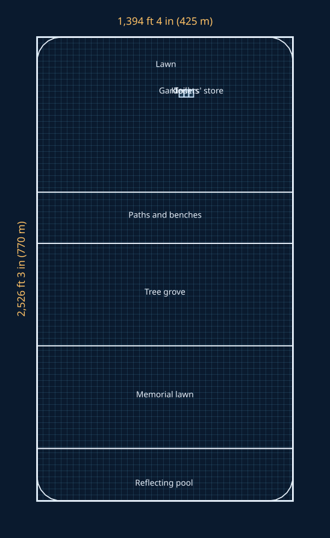

# P8-14 Wing Memorial Garden: plan

Footprint 1,394 ft 4 in (425 m) × 2,526 ft 3 in (770 m) · structural grid 32 ft 10 in (10 m)

## Levels

| Level | Floor above deck | Height | Floor area |
|---|---|---|---|
| Level 1 · Ground | 0 ft (0 mm) | 13 ft 1 in (4,000 mm) | 3,100 sq ft (288 m²) |

## Elements

| ID | Designation | Type | Name | Level(s) | Size / length | Area | Status |
|---|---|---|---|---|---|---|---|
| E001 | D5F2P8B20A1R1 | zone | Lawn | L1 | 1,393 ft 4 in (425 m) × 844 ft 2 in (257 m) | 1,167,652 sq ft (108,478 m²) | proposed |
| E002 | D5F2P8B20A1R2 | room | Kiosk | L1 | 26 ft 3 in (8,000 mm) × 39 ft 4 in (12 m) | 1,033 sq ft (96 m²) | proposed |
| E003 | D5F2P8B20A1R3 | room | Toilets | L1 | 26 ft 3 in (8,000 mm) × 39 ft 4 in (12 m) | 1,033 sq ft (96 m²) | proposed |
| E004 | D5F2P8B20A1R4 | room | Gardeners' store | L1 | 26 ft 3 in (8,000 mm) × 39 ft 4 in (12 m) | 1,033 sq ft (96 m²) | proposed |
| E005 | D5F2P8B20A1R5 | zone | Paths and benches | L1 | 1,393 ft 4 in (425 m) × 279 ft 2 in (85 m) | 388,937 sq ft (36,133 m²) | proposed |
| E006 | D5F2P8B20A1R6 | zone | Tree grove | L1 | 1,393 ft 4 in (425 m) × 558 ft 9 in (170 m) | 778,332 sq ft (72,309 m²) | proposed |
| E007 | D5F2P8B20A1R7 | zone | Memorial lawn | L1 | 1,393 ft 4 in (425 m) × 558 ft 9 in (170 m) | 778,332 sq ft (72,309 m²) | proposed |
| E008 | D5F2P8B20A1R8 | zone | Reflecting pool | L1 | 1,393 ft 1 in (425 m) × 285 ft 5 in (87 m) | 389,317 sq ft (36,169 m²) | proposed |

## Drawings

### Level 1 · Ground

