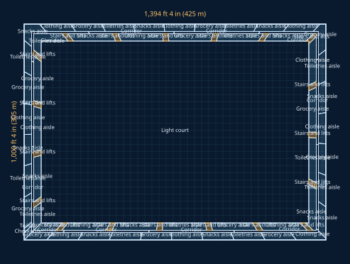

# P8-15 Hangar Commissary: plan

Footprint 1,394 ft 4 in (425 m) × 1,000 ft 4 in (305 m) · structural grid 32 ft 10 in (10 m)

## Levels

| Level | Floor above deck | Height | Floor area |
|---|---|---|---|
| Level 1 · Shop floor | 0 ft (0 mm) | 16 ft 5 in (5,000 mm) | 291,108 sq ft (27,045 m²) |

## Elements

| ID | Designation | Type | Name | Level(s) | Size / length | Area | Status |
|---|---|---|---|---|---|---|---|
| E001 | D5F2P8B22A1R1 | zone | Light court | L1 | 1,236 ft 11 in (377 m) × 842 ft 10 in (257 m) | 1,042,499 sq ft (96,851 m²) | proposed |
| E002 | D5F2P8B22A1R2 | zone | Corridor | L1 | 9 ft 10 in (3,000 mm) × 399 ft 3 in (122 m) | 3,875 sq ft (360 m²) | proposed |
| E003 | D5F2P8B22A1R3 | zone | Corridor | L1 | 9 ft 10 in (3,000 mm) × 398 ft (121 m) | 3,875 sq ft (360 m²) | proposed |
| E004 | D5F2P8B22A1R4 | zone | Corridor | L1 | 267 ft 5 in (82 m) × 142 ft 9 in (44 m) | 3,875 sq ft (360 m²) | proposed |
| E005 | D5F2P8B22A1R5 | zone | Corridor | L1 | 396 ft 8 in (121 m) × 9 ft 10 in (3,000 mm) | 3,875 sq ft (360 m²) | proposed |
| E006 | D5F2P8B22A1R6 | zone | Corridor | L1 | 396 ft 8 in (121 m) × 9 ft 10 in (3,000 mm) | 3,875 sq ft (360 m²) | proposed |
| E007 | D5F2P8B22A1R7 | zone | Corridor | L1 | 276 ft 7 in (84 m) × 133 ft 6 in (41 m) | 3,875 sq ft (360 m²) | proposed |
| E008 | D5F2P8B22A1R8 | zone | Corridor | L1 | 9 ft 10 in (3,000 mm) × 398 ft (121 m) | 3,875 sq ft (360 m²) | proposed |
| E009 | D5F2P8B22A1R9 | zone | Corridor | L1 | 9 ft 10 in (3,000 mm) × 399 ft 3 in (122 m) | 3,875 sq ft (360 m²) | proposed |
| E010 | D5F2P8B22A1R10 | zone | Corridor | L1 | 391 ft 5 in (119 m) × 19 ft (5,800 mm) | 3,875 sq ft (360 m²) | proposed |
| E011 | D5F2P8B22A1R11 | zone | Corridor | L1 | 396 ft 8 in (121 m) × 9 ft 10 in (3,000 mm) | 3,875 sq ft (360 m²) | proposed |
| E012 | D5F2P8B22A1R12 | zone | Corridor | L1 | 398 ft 7 in (122 m) × 9 ft 10 in (3,000 mm) | 3,875 sq ft (360 m²) | proposed |
| E013 | D5F2P8B22A1R13 | zone | Corridor | L1 | 152 ft 7 in (46 m) × 9 ft 10 in (3,000 mm) | 1,414 sq ft (131 m²) | proposed |
| E014 | D5F2P8B22A1R14 | core | Stairs and lifts | L1 | 34 ft 5 in (10 m) × 51 ft 10 in (16 m) | 904 sq ft (84 m²) | proposed |
| E015 | D5F2P8B22A1R15 | core | Stairs and lifts | L1 | 34 ft 5 in (10 m) × 34 ft 1 in (10 m) | 904 sq ft (84 m²) | proposed |
| E016 | D5F2P8B22A1R16 | core | Stairs and lifts | L1 | 34 ft 5 in (10 m) × 36 ft 5 in (11 m) | 904 sq ft (84 m²) | proposed |
| E017 | D5F2P8B22A1R17 | core | Stairs and lifts | L1 | 34 ft 5 in (10 m) × 53 ft 10 in (16 m) | 899 sq ft (83 m²) | proposed |
| E018 | D5F2P8B22A1R18 | core | Stairs and lifts | L1 | 52 ft 10 in (16 m) × 34 ft 5 in (10 m) | 899 sq ft (83 m²) | proposed |
| E019 | D5F2P8B22A1R19 | core | Stairs and lifts | L1 | 40 ft 8 in (12 m) × 34 ft 5 in (10 m) | 904 sq ft (84 m²) | proposed |
| E020 | D5F2P8B22A1R20 | core | Stairs and lifts | L1 | 28 ft 7 in (8,700 mm) × 34 ft 5 in (10 m) | 904 sq ft (84 m²) | proposed |
| E021 | D5F2P8B22A1R21 | core | Stairs and lifts | L1 | 36 ft 1 in (11 m) × 34 ft 5 in (10 m) | 904 sq ft (84 m²) | proposed |
| E022 | D5F2P8B22A1R22 | core | Stairs and lifts | L1 | 48 ft 7 in (15 m) × 34 ft 5 in (10 m) | 904 sq ft (84 m²) | proposed |
| E023 | D5F2P8B22A1R23 | core | Stairs and lifts | L1 | 47 ft 3 in (14 m) × 46 ft 11 in (14 m) | 904 sq ft (84 m²) | proposed |
| E024 | D5F2P8B22A1R24 | core | Stairs and lifts | L1 | 34 ft 5 in (10 m) × 43 ft (13 m) | 904 sq ft (84 m²) | proposed |
| E025 | D5F2P8B22A1R25 | core | Stairs and lifts | L1 | 34 ft 5 in (10 m) × 27 ft 3 in (8,300 mm) | 904 sq ft (84 m²) | proposed |
| E026 | D5F2P8B22A1R26 | core | Stairs and lifts | L1 | 34 ft 5 in (10 m) × 45 ft 3 in (14 m) | 904 sq ft (84 m²) | proposed |
| E027 | D5F2P8B22A1R27 | core | Stairs and lifts | L1 | 59 ft 1 in (18 m) × 34 ft 5 in (10 m) | 904 sq ft (84 m²) | proposed |
| E028 | D5F2P8B22A1R28 | core | Stairs and lifts | L1 | 46 ft 11 in (14 m) × 34 ft 5 in (10 m) | 904 sq ft (84 m²) | proposed |
| E029 | D5F2P8B22A1R29 | core | Stairs and lifts | L1 | 34 ft 9 in (11 m) × 34 ft 5 in (10 m) | 904 sq ft (84 m²) | proposed |
| E030 | D5F2P8B22A1R30 | core | Stairs and lifts | L1 | 30 ft 2 in (9,200 mm) × 34 ft 5 in (10 m) | 904 sq ft (84 m²) | proposed |
| E031 | D5F2P8B22A1R31 | core | Stairs and lifts | L1 | 42 ft 4 in (13 m) × 34 ft 5 in (10 m) | 904 sq ft (84 m²) | proposed |
| E032 | D5F2P8B22A1R32 | core | Stairs and lifts | L1 | 54 ft 6 in (17 m) × 34 ft 5 in (10 m) | 904 sq ft (84 m²) | proposed |
| E033 | D5F2P8B22A1R33 | room | Checkouts | L1 | 34 ft 5 in (10 m) × 64 ft 8 in (20 m) | 1,079 sq ft (100 m²) | proposed |
| E034 | D5F2P8B22A1R34 | room | Toilets | L1 | 34 ft 5 in (10 m) × 50 ft 2 in (15 m) | 644 sq ft (60 m²) | proposed |
| E035 | D5F2P8B22A1R35 | room | Grocery aisle | L1 | 34 ft 5 in (10 m) × 166 ft 4 in (51 m) | 4,843 sq ft (450 m²) | proposed |
| E036 | D5F2P8B22A1R36 | room | Toiletries aisle | L1 | 34 ft 5 in (10 m) × 156 ft 6 in (48 m) | 4,849 sq ft (450 m²) | proposed |
| E037 | D5F2P8B22A1R37 | room | Snacks aisle | L1 | 34 ft 5 in (10 m) × 146 ft 4 in (45 m) | 4,837 sq ft (449 m²) | proposed |
| E038 | D5F2P8B22A1R38 | room | Clothing aisle | L1 | 34 ft 5 in (10 m) × 145 ft 8 in (44 m) | 4,843 sq ft (450 m²) | proposed |
| E039 | D5F2P8B22A1R39 | room | Grocery aisle | L1 | 34 ft 5 in (10 m) × 154 ft 10 in (47 m) | 4,843 sq ft (450 m²) | proposed |
| E040 | D5F2P8B22A1R40 | room | Toiletries aisle | L1 | 34 ft 5 in (10 m) × 165 ft (50 m) | 4,849 sq ft (450 m²) | proposed |
| E041 | D5F2P8B22A1R41 | room | Snacks aisle | L1 | 101 ft 1 in (31 m) × 104 ft (32 m) | 4,843 sq ft (450 m²) | proposed |
| E042 | D5F2P8B22A1R42 | room | Clothing aisle | L1 | 168 ft (51 m) × 34 ft 5 in (10 m) | 4,843 sq ft (450 m²) | proposed |
| E043 | D5F2P8B22A1R43 | room | Grocery aisle | L1 | 161 ft 1 in (49 m) × 34 ft 5 in (10 m) | 4,849 sq ft (450 m²) | proposed |
| E044 | D5F2P8B22A1R44 | room | Toiletries aisle | L1 | 153 ft 7 in (47 m) × 34 ft 5 in (10 m) | 4,837 sq ft (449 m²) | proposed |
| E045 | D5F2P8B22A1R45 | room | Snacks aisle | L1 | 146 ft 8 in (45 m) × 34 ft 5 in (10 m) | 4,843 sq ft (450 m²) | proposed |
| E046 | D5F2P8B22A1R46 | room | Clothing aisle | L1 | 144 ft 4 in (44 m) × 34 ft 5 in (10 m) | 4,849 sq ft (450 m²) | proposed |
| E047 | D5F2P8B22A1R47 | room | Grocery aisle | L1 | 148 ft 7 in (45 m) × 34 ft 5 in (10 m) | 4,837 sq ft (449 m²) | proposed |
| E048 | D5F2P8B22A1R48 | room | Toiletries aisle | L1 | 156 ft 2 in (48 m) × 34 ft 5 in (10 m) | 4,849 sq ft (450 m²) | proposed |
| E049 | D5F2P8B22A1R49 | room | Snacks aisle | L1 | 163 ft 1 in (50 m) × 34 ft 5 in (10 m) | 4,843 sq ft (450 m²) | proposed |
| E050 | D5F2P8B22A1R50 | room | Clothing aisle | L1 | 170 ft 3 in (52 m) × 34 ft 5 in (10 m) | 4,849 sq ft (450 m²) | proposed |
| E051 | D5F2P8B22A1R51 | room | Grocery aisle | L1 | 59 ft 9 in (18 m) × 145 ft (44 m) | 4,843 sq ft (450 m²) | proposed |
| E052 | D5F2P8B22A1R52 | room | Toiletries aisle | L1 | 34 ft 5 in (10 m) × 161 ft 9 in (49 m) | 4,837 sq ft (449 m²) | proposed |
| E053 | D5F2P8B22A1R53 | room | Snacks aisle | L1 | 34 ft 5 in (10 m) × 151 ft 11 in (46 m) | 4,843 sq ft (450 m²) | proposed |
| E054 | D5F2P8B22A1R54 | room | Clothing aisle | L1 | 34 ft 5 in (10 m) × 145 ft 8 in (44 m) | 4,849 sq ft (450 m²) | proposed |
| E055 | D5F2P8B22A1R55 | room | Grocery aisle | L1 | 34 ft 5 in (10 m) × 149 ft 3 in (46 m) | 4,843 sq ft (450 m²) | proposed |
| E056 | D5F2P8B22A1R56 | room | Toiletries aisle | L1 | 34 ft 5 in (10 m) × 159 ft 5 in (49 m) | 4,843 sq ft (450 m²) | proposed |
| E057 | D5F2P8B22A1R57 | room | Snacks aisle | L1 | 34 ft 5 in (10 m) × 169 ft 7 in (52 m) | 4,843 sq ft (450 m²) | proposed |
| E058 | D5F2P8B22A1R58 | room | Clothing aisle | L1 | 164 ft 1 in (50 m) × 42 ft (13 m) | 4,843 sq ft (450 m²) | proposed |
| E059 | D5F2P8B22A1R59 | room | Grocery aisle | L1 | 165 ft (50 m) × 34 ft 5 in (10 m) | 4,849 sq ft (450 m²) | proposed |
| E060 | D5F2P8B22A1R60 | room | Toiletries aisle | L1 | 157 ft 6 in (48 m) × 34 ft 5 in (10 m) | 4,837 sq ft (449 m²) | proposed |
| E061 | D5F2P8B22A1R61 | room | Snacks aisle | L1 | 150 ft 7 in (46 m) × 34 ft 5 in (10 m) | 4,849 sq ft (450 m²) | proposed |
| E062 | D5F2P8B22A1R62 | room | Clothing aisle | L1 | 144 ft (44 m) × 34 ft 5 in (10 m) | 4,843 sq ft (450 m²) | proposed |
| E063 | D5F2P8B22A1R63 | room | Grocery aisle | L1 | 144 ft 8 in (44 m) × 34 ft 5 in (10 m) | 4,837 sq ft (449 m²) | proposed |
| E064 | D5F2P8B22A1R64 | room | Toiletries aisle | L1 | 152 ft 3 in (46 m) × 34 ft 5 in (10 m) | 4,849 sq ft (450 m²) | proposed |
| E065 | D5F2P8B22A1R65 | room | Snacks aisle | L1 | 159 ft 1 in (48 m) × 34 ft 5 in (10 m) | 4,843 sq ft (450 m²) | proposed |
| E066 | D5F2P8B22A1R66 | room | Clothing aisle | L1 | 166 ft 4 in (51 m) × 34 ft 5 in (10 m) | 4,849 sq ft (450 m²) | proposed |
| E067 | D5F2P8B22A1R67 | room | Grocery aisle | L1 | 133 ft 10 in (41 m) × 34 ft 5 in (10 m) | 3,515 sq ft (327 m²) | proposed |
| E068 | D5F2P8B22A1R68 | room | Toiletries aisle | L1 | 34 ft 5 in (10 m) × 130 ft 7 in (40 m) | 3,447 sq ft (320 m²) | proposed |
| E069 | D5F2P8B22A1R69 | room | Snacks aisle | L1 | 34 ft 5 in (10 m) × 216 ft 6 in (66 m) | 6,883 sq ft (639 m²) | proposed |
| E070 | D5F2P8B22A1R70 | room | Clothing aisle | L1 | 34 ft 5 in (10 m) × 208 ft (63 m) | 6,889 sq ft (640 m²) | proposed |
| E071 | D5F2P8B22A1R71 | room | Grocery aisle | L1 | 34 ft 5 in (10 m) × 218 ft 10 in (67 m) | 6,889 sq ft (640 m²) | proposed |
| E072 | D5F2P8B22A1R72 | room | Toiletries aisle | L1 | 158 ft 6 in (48 m) × 104 ft 4 in (32 m) | 6,894 sq ft (640 m²) | proposed |
| E073 | D5F2P8B22A1R73 | room | Snacks aisle | L1 | 220 ft 6 in (67 m) × 34 ft 5 in (10 m) | 6,889 sq ft (640 m²) | proposed |
| E074 | D5F2P8B22A1R74 | room | Clothing aisle | L1 | 208 ft 4 in (64 m) × 34 ft 5 in (10 m) | 6,889 sq ft (640 m²) | proposed |
| E075 | D5F2P8B22A1R75 | room | Grocery aisle | L1 | 205 ft 5 in (63 m) × 34 ft 5 in (10 m) | 6,889 sq ft (640 m²) | proposed |
| E076 | D5F2P8B22A1R76 | room | Toiletries aisle | L1 | 215 ft 11 in (66 m) × 34 ft 5 in (10 m) | 6,883 sq ft (639 m²) | proposed |
| E077 | D5F2P8B22A1R77 | room | Snacks aisle | L1 | 228 ft 4 in (70 m) × 34 ft 5 in (10 m) | 6,889 sq ft (640 m²) | proposed |
| E078 | D5F2P8B22A1R78 | room | Clothing aisle | L1 | 34 ft 5 in (10 m) × 225 ft 5 in (69 m) | 6,889 sq ft (640 m²) | proposed |
| E079 | D5F2P8B22A1R79 | room | Grocery aisle | L1 | 34 ft 5 in (10 m) × 207 ft 8 in (63 m) | 6,883 sq ft (639 m²) | proposed |
| E080 | D5F2P8B22A1R80 | room | Toiletries aisle | L1 | 34 ft 5 in (10 m) × 210 ft (64 m) | 6,889 sq ft (640 m²) | proposed |
| E081 | D5F2P8B22A1R81 | room | Snacks aisle | L1 | 48 ft 3 in (15 m) × 212 ft 11 in (65 m) | 6,889 sq ft (640 m²) | proposed |
| E082 | D5F2P8B22A1R82 | room | Clothing aisle | L1 | 226 ft 8 in (69 m) × 34 ft 5 in (10 m) | 6,889 sq ft (640 m²) | proposed |
| E083 | D5F2P8B22A1R83 | room | Grocery aisle | L1 | 214 ft 7 in (65 m) × 34 ft 5 in (10 m) | 6,889 sq ft (640 m²) | proposed |
| E084 | D5F2P8B22A1R84 | room | Toiletries aisle | L1 | 205 ft 5 in (63 m) × 34 ft 5 in (10 m) | 6,883 sq ft (639 m²) | proposed |
| E085 | D5F2P8B22A1R85 | room | Snacks aisle | L1 | 210 ft (64 m) × 34 ft 5 in (10 m) | 6,889 sq ft (640 m²) | proposed |
| E086 | D5F2P8B22A1R86 | room | Clothing aisle | L1 | 222 ft 1 in (68 m) × 34 ft 5 in (10 m) | 6,889 sq ft (640 m²) | proposed |
| E087 | D5F2P8B22A1R87 | room | Grocery aisle | L1 | 131 ft 7 in (40 m) × 34 ft 5 in (10 m) | 3,441 sq ft (320 m²) | proposed |

## Drawings

### Level 1 · Shop floor

