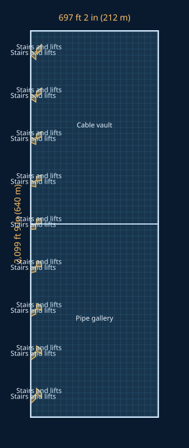
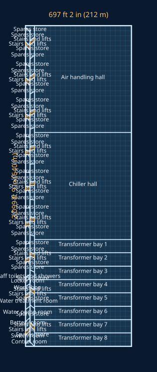
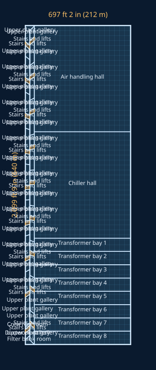

# P8-20 Wing Command Utility Plant: plan

Footprint 697 ft 2 in (212 m) × 2,099 ft 9 in (640 m) · structural grid 32 ft 10 in (10 m)

## Levels

| Level | Floor above deck | Height | Floor area |
|---|---|---|---|
| Level B1 · Pipe and cable basement | −16 ft 5 in (5,000 mm) | 16 ft 5 in (5,000 mm) | 1,463,892 sq ft (136,000 m²) |
| Level 1 · Plant floor | 0 ft (0 mm) | 26 ft 3 in (8,000 mm) | 1,444,002 sq ft (134,152 m²) |
| Level 2 · Upper plant deck | 26 ft 3 in (8,000 mm) | 19 ft 8 in (6,000 mm) | 1,444,002 sq ft (134,152 m²) |

## Elements

| ID | Designation | Type | Name | Level(s) | Size / length | Area | Status |
|---|---|---|---|---|---|---|---|
| E001 | D5F2P8B29A1L1R1, D5F2P8B29A1L2R1 | room | Transformer bay 1 | L1, L2 | 638 ft 1 in (194 m) × 87 ft 3 in (27 m) | 55,689 sq ft (5,174 m²) | proposed |
| E002 | D5F2P8B29A1L1R2, D5F2P8B29A1L2R2 | room | Transformer bay 2 | L1, L2 | 638 ft 1 in (194 m) × 87 ft 7 in (27 m) | 55,899 sq ft (5,193 m²) | proposed |
| E003 | D5F2P8B29A1L1R3, D5F2P8B29A1L2R3 | room | Transformer bay 3 | L1, L2 | 638 ft 1 in (194 m) × 87 ft 7 in (27 m) | 55,899 sq ft (5,193 m²) | proposed |
| E004 | D5F2P8B29A1L1R4, D5F2P8B29A1L2R4 | room | Transformer bay 4 | L1, L2 | 638 ft 1 in (194 m) × 87 ft 3 in (27 m) | 55,689 sq ft (5,174 m²) | proposed |
| E005 | D5F2P8B29A1L1R5, D5F2P8B29A1L2R5 | room | Transformer bay 5 | L1, L2 | 638 ft 1 in (194 m) × 87 ft 7 in (27 m) | 55,899 sq ft (5,193 m²) | proposed |
| E006 | D5F2P8B29A1L1R6, D5F2P8B29A1L2R6 | room | Transformer bay 6 | L1, L2 | 638 ft 1 in (194 m) × 87 ft 7 in (27 m) | 55,899 sq ft (5,193 m²) | proposed |
| E007 | D5F2P8B29A1L1R7, D5F2P8B29A1L2R7 | room | Transformer bay 7 | L1, L2 | 638 ft 1 in (194 m) × 87 ft 3 in (27 m) | 55,689 sq ft (5,174 m²) | proposed |
| E008 | D5F2P8B29A1L1R8, D5F2P8B29A1L2R8 | room | Transformer bay 8 | L1, L2 | 638 ft 1 in (194 m) × 87 ft 7 in (27 m) | 55,899 sq ft (5,193 m²) | proposed |
| E009 | D5F2P8B29A1L1R9, D5F2P8B29A1L2R9 | room | Chiller hall | L1, L2 | 638 ft 1 in (194 m) × 700 ft 2 in (213 m) | 446,770 sq ft (41,506 m²) | proposed |
| E010 | D5F2P8B29A1L1R10, D5F2P8B29A1L2R10 | room | Air handling hall | L1, L2 | 638 ft 1 in (194 m) × 699 ft 10 in (213 m) | 446,561 sq ft (41,487 m²) | proposed |
| E011 | D5F2P8B29A1LB1R1, D5F2P8B29A1L1R11, D5F2P8B29A1L2R11 | core | Stairs and lifts | LB1, L1, L2 | 27 ft 11 in (8,500 mm) × 52 ft 2 in (16 m) | 737 sq ft (68 m²) | proposed |
| E012 | D5F2P8B29A1LB1R2, D5F2P8B29A1L1R12, D5F2P8B29A1L2R12 | core | Stairs and lifts | LB1, L1, L2 | 27 ft 11 in (8,500 mm) × 45 ft 7 in (14 m) | 732 sq ft (68 m²) | proposed |
| E013 | D5F2P8B29A1LB1R3, D5F2P8B29A1L1R13, D5F2P8B29A1L2R13 | core | Stairs and lifts | LB1, L1, L2 | 27 ft 11 in (8,500 mm) × 39 ft 4 in (12 m) | 732 sq ft (68 m²) | proposed |
| E014 | D5F2P8B29A1LB1R4, D5F2P8B29A1L1R14, D5F2P8B29A1L2R14 | core | Stairs and lifts | LB1, L1, L2 | 27 ft 11 in (8,500 mm) × 32 ft 10 in (10 m) | 732 sq ft (68 m²) | proposed |
| E015 | D5F2P8B29A1LB1R5, D5F2P8B29A1L1R15, D5F2P8B29A1L2R15 | core | Stairs and lifts | LB1, L1, L2 | 27 ft 11 in (8,500 mm) × 26 ft 7 in (8,100 mm) | 732 sq ft (68 m²) | proposed |
| E016 | D5F2P8B29A1LB1R6, D5F2P8B29A1L1R16, D5F2P8B29A1L2R16 | core | Stairs and lifts | LB1, L1, L2 | 27 ft 11 in (8,500 mm) × 32 ft 2 in (9,800 mm) | 732 sq ft (68 m²) | proposed |
| E017 | D5F2P8B29A1LB1R7, D5F2P8B29A1L1R17, D5F2P8B29A1L2R17 | core | Stairs and lifts | LB1, L1, L2 | 27 ft 11 in (8,500 mm) × 38 ft 5 in (12 m) | 732 sq ft (68 m²) | proposed |
| E018 | D5F2P8B29A1LB1R8, D5F2P8B29A1L1R18, D5F2P8B29A1L2R18 | core | Stairs and lifts | LB1, L1, L2 | 27 ft 11 in (8,500 mm) × 44 ft 11 in (14 m) | 732 sq ft (68 m²) | proposed |
| E019 | D5F2P8B29A1LB1R9, D5F2P8B29A1L1R19, D5F2P8B29A1L2R19 | core | Stairs and lifts | LB1, L1, L2 | 27 ft 11 in (8,500 mm) × 51 ft 2 in (16 m) | 732 sq ft (68 m²) | proposed |
| E020 | D5F2P8B29A1LB1R10, D5F2P8B29A1L1R20, D5F2P8B29A1L2R20 | core | Stairs and lifts | LB1, L1, L2 | 27 ft 11 in (8,500 mm) × 52 ft 2 in (16 m) | 737 sq ft (68 m²) | proposed |
| E021 | D5F2P8B29A1LB1R11, D5F2P8B29A1L1R21, D5F2P8B29A1L2R21 | core | Stairs and lifts | LB1, L1, L2 | 27 ft 11 in (8,500 mm) × 45 ft 7 in (14 m) | 732 sq ft (68 m²) | proposed |
| E022 | D5F2P8B29A1LB1R12, D5F2P8B29A1L1R22, D5F2P8B29A1L2R22 | core | Stairs and lifts | LB1, L1, L2 | 27 ft 11 in (8,500 mm) × 39 ft 4 in (12 m) | 732 sq ft (68 m²) | proposed |
| E023 | D5F2P8B29A1LB1R13, D5F2P8B29A1L1R23, D5F2P8B29A1L2R23 | core | Stairs and lifts | LB1, L1, L2 | 27 ft 11 in (8,500 mm) × 32 ft 10 in (10 m) | 732 sq ft (68 m²) | proposed |
| E024 | D5F2P8B29A1LB1R14, D5F2P8B29A1L1R24, D5F2P8B29A1L2R24 | core | Stairs and lifts | LB1, L1, L2 | 27 ft 11 in (8,500 mm) × 26 ft 7 in (8,100 mm) | 732 sq ft (68 m²) | proposed |
| E025 | D5F2P8B29A1LB1R15, D5F2P8B29A1L1R25, D5F2P8B29A1L2R25 | core | Stairs and lifts | LB1, L1, L2 | 27 ft 11 in (8,500 mm) × 32 ft 2 in (9,800 mm) | 732 sq ft (68 m²) | proposed |
| E026 | D5F2P8B29A1LB1R16, D5F2P8B29A1L1R26, D5F2P8B29A1L2R26 | core | Stairs and lifts | LB1, L1, L2 | 27 ft 11 in (8,500 mm) × 38 ft 5 in (12 m) | 732 sq ft (68 m²) | proposed |
| E027 | D5F2P8B29A1LB1R17, D5F2P8B29A1L1R27, D5F2P8B29A1L2R27 | core | Stairs and lifts | LB1, L1, L2 | 27 ft 11 in (8,500 mm) × 44 ft 11 in (14 m) | 732 sq ft (68 m²) | proposed |
| E028 | D5F2P8B29A1LB1R18, D5F2P8B29A1L1R28, D5F2P8B29A1L2R28 | core | Stairs and lifts | LB1, L1, L2 | 27 ft 11 in (8,500 mm) × 51 ft 2 in (16 m) | 732 sq ft (68 m²) | proposed |
| E029 | D5F2P8B29A1L1R29 | room | Control room | L1 | 59 ft 1 in (18 m) × 43 ft (13 m) | 1,295 sq ft (120 m²) | proposed |
| E030 | D5F2P8B29A1L1R30 | room | Switch room | L1 | 27 ft 11 in (8,500 mm) × 84 ft 4 in (26 m) | 1,601 sq ft (149 m²) | proposed |
| E031 | D5F2P8B29A1L1R31 | room | Battery room | L1 | 27 ft 11 in (8,500 mm) × 85 ft 11 in (26 m) | 1,711 sq ft (159 m²) | proposed |
| E032 | D5F2P8B29A1L1R32 | room | Water pump room | L1 | 27 ft 11 in (8,500 mm) × 99 ft 9 in (30 m) | 2,146 sq ft (199 m²) | proposed |
| E033 | D5F2P8B29A1L1R33 | room | Water treatment room | L1 | 27 ft 11 in (8,500 mm) × 89 ft 7 in (27 m) | 1,921 sq ft (179 m²) | proposed |
| E034 | D5F2P8B29A1L1R34 | room | Workshop | L1 | 27 ft 11 in (8,500 mm) × 72 ft 2 in (22 m) | 1,500 sq ft (139 m²) | proposed |
| E035 | D5F2P8B29A1L1R35 | room | Locker room | L1 | 27 ft 11 in (8,500 mm) × 51 ft 10 in (16 m) | 965 sq ft (90 m²) | proposed |
| E036 | D5F2P8B29A1L1R36 | room | Staff toilets and showers | L1 | 27 ft 11 in (8,500 mm) × 43 ft 4 in (13 m) | 750 sq ft (70 m²) | proposed |
| E037 | D5F2P8B29A1L1R37 | room | Spares store | L1 | 27 ft 11 in (8,500 mm) × 106 ft 11 in (33 m) | 2,571 sq ft (239 m²) | proposed |
| E038 | D5F2P8B29A1L1R38 | room | Spares store | L1 | 27 ft 11 in (8,500 mm) × 103 ft 8 in (32 m) | 2,571 sq ft (239 m²) | proposed |
| E039 | D5F2P8B29A1L1R39 | room | Spares store | L1 | 27 ft 11 in (8,500 mm) × 123 ft 8 in (38 m) | 3,211 sq ft (298 m²) | proposed |
| E040 | D5F2P8B29A1L1R40 | room | Spares store | L1 | 27 ft 11 in (8,500 mm) × 97 ft 1 in (30 m) | 2,571 sq ft (239 m²) | proposed |
| E041 | D5F2P8B29A1L1R41 | room | Spares store | L1 | 27 ft 11 in (8,500 mm) × 117 ft 5 in (36 m) | 3,216 sq ft (299 m²) | proposed |
| E042 | D5F2P8B29A1L1R42 | room | Spares store | L1 | 27 ft 11 in (8,500 mm) × 93 ft 2 in (28 m) | 2,566 sq ft (238 m²) | proposed |
| E043 | D5F2P8B29A1L1R43 | room | Spares store | L1 | 27 ft 11 in (8,500 mm) × 119 ft 1 in (36 m) | 3,211 sq ft (298 m²) | proposed |
| E044 | D5F2P8B29A1L1R44 | room | Spares store | L1 | 27 ft 11 in (8,500 mm) × 99 ft 9 in (30 m) | 2,571 sq ft (239 m²) | proposed |
| E045 | D5F2P8B29A1L1R45 | room | Spares store | L1 | 27 ft 11 in (8,500 mm) × 125 ft 8 in (38 m) | 3,216 sq ft (299 m²) | proposed |
| E046 | D5F2P8B29A1L1R46 | room | Spares store | L1 | 27 ft 11 in (8,500 mm) × 106 ft (32 m) | 2,571 sq ft (239 m²) | proposed |
| E047 | D5F2P8B29A1L1R47 | room | Spares store | L1 | 27 ft 11 in (8,500 mm) × 131 ft 11 in (40 m) | 3,211 sq ft (298 m²) | proposed |
| E048 | D5F2P8B29A1L1R48 | room | Spares store | L1 | 27 ft 11 in (8,500 mm) × 112 ft 6 in (34 m) | 2,571 sq ft (239 m²) | proposed |
| E049 | D5F2P8B29A1L1R49 | room | Spares store | L1 | 27 ft 11 in (8,500 mm) × 138 ft 5 in (42 m) | 3,216 sq ft (299 m²) | proposed |
| E050 | D5F2P8B29A1L1R50 | room | Spares store | L1 | 27 ft 11 in (8,500 mm) × 118 ft 5 in (36 m) | 2,566 sq ft (238 m²) | proposed |
| E051 | D5F2P8B29A1L1R51 | room | Spares store | L1 | 59 ft 1 in (18 m) × 99 ft 9 in (30 m) | 3,221 sq ft (299 m²) | proposed |
| E052 | D5F2P8B29A1L1R52 | room | Spares store | L1 | 27 ft 11 in (8,500 mm) × 116 ft 2 in (35 m) | 2,566 sq ft (238 m²) | proposed |
| E053 | D5F2P8B29A1L1R53 | room | Spares store | L1 | 27 ft 11 in (8,500 mm) × 136 ft 6 in (42 m) | 3,211 sq ft (298 m²) | proposed |
| E054 | D5F2P8B29A1L1R54 | room | Spares store | L1 | 27 ft 11 in (8,500 mm) × 109 ft 11 in (33 m) | 2,571 sq ft (239 m²) | proposed |
| E055 | D5F2P8B29A1L1R55 | room | Spares store | L1 | 27 ft 11 in (8,500 mm) × 130 ft 3 in (40 m) | 3,216 sq ft (299 m²) | proposed |
| E056 | D5F2P8B29A1L1R56 | room | Spares store | L1 | 27 ft 11 in (8,500 mm) × 103 ft 8 in (32 m) | 2,571 sq ft (239 m²) | proposed |
| E057 | D5F2P8B29A1L1R57 | room | Spares store | L1 | 27 ft 11 in (8,500 mm) × 123 ft 8 in (38 m) | 3,211 sq ft (298 m²) | proposed |
| E058 | D5F2P8B29A1L1R58 | room | Spares store | L1 | 27 ft 11 in (8,500 mm) × 97 ft 1 in (30 m) | 2,571 sq ft (239 m²) | proposed |
| E059 | D5F2P8B29A1L1R59 | room | Spares store | L1 | 27 ft 11 in (8,500 mm) × 117 ft 5 in (36 m) | 3,216 sq ft (299 m²) | proposed |
| E060 | D5F2P8B29A1L1R60 | room | Spares store | L1 | 27 ft 11 in (8,500 mm) × 93 ft 2 in (28 m) | 2,566 sq ft (238 m²) | proposed |
| E061 | D5F2P8B29A1L1R61 | room | Spares store | L1 | 27 ft 11 in (8,500 mm) × 119 ft 1 in (36 m) | 3,211 sq ft (298 m²) | proposed |
| E062 | D5F2P8B29A1L1R62 | room | Spares store | L1 | 27 ft 11 in (8,500 mm) × 99 ft 9 in (30 m) | 2,571 sq ft (239 m²) | proposed |
| E063 | D5F2P8B29A1L1R63 | room | Spares store | L1 | 27 ft 11 in (8,500 mm) × 125 ft 8 in (38 m) | 3,216 sq ft (299 m²) | proposed |
| E064 | D5F2P8B29A1L1R64 | room | Spares store | L1 | 27 ft 11 in (8,500 mm) × 106 ft (32 m) | 2,571 sq ft (239 m²) | proposed |
| E065 | D5F2P8B29A1L1R65 | room | Spares store | L1 | 27 ft 11 in (8,500 mm) × 131 ft 11 in (40 m) | 3,211 sq ft (298 m²) | proposed |
| E066 | D5F2P8B29A1L1R66 | room | Spares store | L1 | 27 ft 11 in (8,500 mm) × 112 ft 6 in (34 m) | 2,571 sq ft (239 m²) | proposed |
| E067 | D5F2P8B29A1L1R67 | room | Spares store | L1 | 27 ft 11 in (8,500 mm) × 138 ft 5 in (42 m) | 3,216 sq ft (299 m²) | proposed |
| E068 | D5F2P8B29A1L1R68 | room | Spares store | L1 | 27 ft 11 in (8,500 mm) × 130 ft 3 in (40 m) | 2,891 sq ft (269 m²) | proposed |
| E069 | D5F2P8B29A1L2R29 | room | Filter bank room | L2 | 59 ft 1 in (18 m) × 58 ft 1 in (18 m) | 1,720 sq ft (160 m²) | proposed |
| E070 | D5F2P8B29A1L2R30 | room | Ductwork gallery | L2 | 27 ft 11 in (8,500 mm) × 68 ft 11 in (21 m) | 1,176 sq ft (109 m²) | proposed |
| E071 | D5F2P8B29A1L2R31 | room | Crew rest room | L2 | 27 ft 11 in (8,500 mm) × 40 ft 4 in (12 m) | 425 sq ft (40 m²) | proposed |
| E072 | D5F2P8B29A1L2R32 | room | Upper plant gallery | L2 | 27 ft 11 in (8,500 mm) × 214 ft 3 in (65 m) | 5,352 sq ft (497 m²) | proposed |
| E073 | D5F2P8B29A1L2R33 | room | Upper plant gallery | L2 | 27 ft 11 in (8,500 mm) × 155 ft 6 in (47 m) | 3,856 sq ft (358 m²) | proposed |
| E074 | D5F2P8B29A1L2R34 | room | Upper plant gallery | L2 | 27 ft 11 in (8,500 mm) × 83 ft 8 in (26 m) | 1,931 sq ft (179 m²) | proposed |
| E075 | D5F2P8B29A1L2R35 | room | Upper plant gallery | L2 | 27 ft 11 in (8,500 mm) × 149 ft 3 in (46 m) | 3,856 sq ft (358 m²) | proposed |
| E076 | D5F2P8B29A1L2R36 | room | Upper plant gallery | L2 | 27 ft 11 in (8,500 mm) × 77 ft 1 in (24 m) | 1,926 sq ft (179 m²) | proposed |
| E077 | D5F2P8B29A1L2R37 | room | Upper plant gallery | L2 | 27 ft 11 in (8,500 mm) × 142 ft 9 in (44 m) | 3,856 sq ft (358 m²) | proposed |
| E078 | D5F2P8B29A1L2R38 | room | Upper plant gallery | L2 | 27 ft 11 in (8,500 mm) × 70 ft 10 in (22 m) | 1,931 sq ft (179 m²) | proposed |
| E079 | D5F2P8B29A1L2R39 | room | Upper plant gallery | L2 | 27 ft 11 in (8,500 mm) × 140 ft 1 in (43 m) | 3,856 sq ft (358 m²) | proposed |
| E080 | D5F2P8B29A1L2R40 | room | Upper plant gallery | L2 | 27 ft 11 in (8,500 mm) × 73 ft 6 in (22 m) | 1,921 sq ft (179 m²) | proposed |
| E081 | D5F2P8B29A1L2R41 | room | Upper plant gallery | L2 | 27 ft 11 in (8,500 mm) × 146 ft 8 in (45 m) | 3,861 sq ft (359 m²) | proposed |
| E082 | D5F2P8B29A1L2R42 | room | Upper plant gallery | L2 | 27 ft 11 in (8,500 mm) × 80 ft 1 in (24 m) | 1,926 sq ft (179 m²) | proposed |
| E083 | D5F2P8B29A1L2R43 | room | Upper plant gallery | L2 | 27 ft 11 in (8,500 mm) × 152 ft 7 in (46 m) | 3,856 sq ft (358 m²) | proposed |
| E084 | D5F2P8B29A1L2R44 | room | Upper plant gallery | L2 | 27 ft 11 in (8,500 mm) × 86 ft 3 in (26 m) | 1,926 sq ft (179 m²) | proposed |
| E085 | D5F2P8B29A1L2R45 | room | Upper plant gallery | L2 | 27 ft 11 in (8,500 mm) × 159 ft 1 in (48 m) | 3,856 sq ft (358 m²) | proposed |
| E086 | D5F2P8B29A1L2R46 | room | Upper plant gallery | L2 | 27 ft 11 in (8,500 mm) × 92 ft 10 in (28 m) | 1,931 sq ft (179 m²) | proposed |
| E087 | D5F2P8B29A1L2R47 | room | Upper plant gallery | L2 | 59 ft 1 in (18 m) × 130 ft 3 in (40 m) | 3,861 sq ft (359 m²) | proposed |
| E088 | D5F2P8B29A1L2R48 | room | Upper plant gallery | L2 | 27 ft 11 in (8,500 mm) × 96 ft 2 in (29 m) | 1,926 sq ft (179 m²) | proposed |
| E089 | D5F2P8B29A1L2R49 | room | Upper plant gallery | L2 | 27 ft 11 in (8,500 mm) × 161 ft 9 in (49 m) | 3,856 sq ft (358 m²) | proposed |
| E090 | D5F2P8B29A1L2R50 | room | Upper plant gallery | L2 | 27 ft 11 in (8,500 mm) × 89 ft 7 in (27 m) | 1,921 sq ft (179 m²) | proposed |
| E091 | D5F2P8B29A1L2R51 | room | Upper plant gallery | L2 | 27 ft 11 in (8,500 mm) × 155 ft 6 in (47 m) | 3,856 sq ft (358 m²) | proposed |
| E092 | D5F2P8B29A1L2R52 | room | Upper plant gallery | L2 | 27 ft 11 in (8,500 mm) × 83 ft 8 in (26 m) | 1,931 sq ft (179 m²) | proposed |
| E093 | D5F2P8B29A1L2R53 | room | Upper plant gallery | L2 | 27 ft 11 in (8,500 mm) × 149 ft 3 in (46 m) | 3,856 sq ft (358 m²) | proposed |
| E094 | D5F2P8B29A1L2R54 | room | Upper plant gallery | L2 | 27 ft 11 in (8,500 mm) × 77 ft 1 in (24 m) | 1,926 sq ft (179 m²) | proposed |
| E095 | D5F2P8B29A1L2R55 | room | Upper plant gallery | L2 | 27 ft 11 in (8,500 mm) × 142 ft 9 in (44 m) | 3,856 sq ft (358 m²) | proposed |
| E096 | D5F2P8B29A1L2R56 | room | Upper plant gallery | L2 | 27 ft 11 in (8,500 mm) × 70 ft 10 in (22 m) | 1,931 sq ft (179 m²) | proposed |
| E097 | D5F2P8B29A1L2R57 | room | Upper plant gallery | L2 | 27 ft 11 in (8,500 mm) × 140 ft 1 in (43 m) | 3,856 sq ft (358 m²) | proposed |
| E098 | D5F2P8B29A1L2R58 | room | Upper plant gallery | L2 | 27 ft 11 in (8,500 mm) × 73 ft 6 in (22 m) | 1,921 sq ft (179 m²) | proposed |
| E099 | D5F2P8B29A1L2R59 | room | Upper plant gallery | L2 | 27 ft 11 in (8,500 mm) × 146 ft 8 in (45 m) | 3,861 sq ft (359 m²) | proposed |
| E100 | D5F2P8B29A1L2R60 | room | Upper plant gallery | L2 | 27 ft 11 in (8,500 mm) × 80 ft 1 in (24 m) | 1,926 sq ft (179 m²) | proposed |
| E101 | D5F2P8B29A1L2R61 | room | Upper plant gallery | L2 | 27 ft 11 in (8,500 mm) × 152 ft 7 in (46 m) | 3,856 sq ft (358 m²) | proposed |
| E102 | D5F2P8B29A1L2R62 | room | Upper plant gallery | L2 | 27 ft 11 in (8,500 mm) × 86 ft 3 in (26 m) | 1,926 sq ft (179 m²) | proposed |
| E103 | D5F2P8B29A1L2R63 | room | Upper plant gallery | L2 | 27 ft 11 in (8,500 mm) × 159 ft 1 in (48 m) | 3,856 sq ft (358 m²) | proposed |
| E104 | D5F2P8B29A1L2R64 | room | Upper plant gallery | L2 | 27 ft 11 in (8,500 mm) × 92 ft 10 in (28 m) | 1,931 sq ft (179 m²) | proposed |
| E105 | D5F2P8B29A1L2R65 | room | Upper plant gallery | L2 | 27 ft 11 in (8,500 mm) × 130 ft 3 in (40 m) | 2,891 sq ft (269 m²) | proposed |
| E106 | D5F2P8B29A1LB1R19 | room | Cable vault | LB1 | 697 ft 2 in (212 m) × 1,049 ft 10 in (320 m) | 731,946 sq ft (68,000 m²) | proposed |
| E107 | D5F2P8B29A1LB1R20 | room | Pipe gallery | LB1 | 697 ft 2 in (212 m) × 1,049 ft 10 in (320 m) | 731,946 sq ft (68,000 m²) | proposed |

## Drawings

### Level B1 · Pipe and cable basement

### Level 1 · Plant floor

### Level 2 · Upper plant deck

