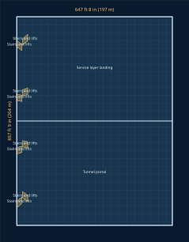
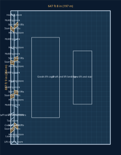
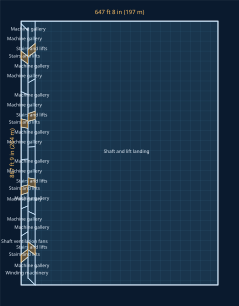

# P8-21 Wing Command Service Shaft: plan

Footprint 647 ft 8 in (197 m) × 867 ft 9 in (264 m) · structural grid 32 ft 10 in (10 m)

## Levels

| Level | Floor above deck | Height | Floor area |
|---|---|---|---|
| Level B1 · Service layer landing | −19 ft 8 in (6,000 mm) | 19 ft 8 in (6,000 mm) | 562,009 sq ft (52,212 m²) |
| Level 1 · Lift landing | 0 ft (0 mm) | 29 ft 6 in (9,000 mm) | 555,298 sq ft (51,589 m²) |
| Level 2 · Winding room | 29 ft 6 in (9,000 mm) | 19 ft 8 in (6,000 mm) | 555,298 sq ft (51,589 m²) |

## Elements

| ID | Designation | Type | Name | Level(s) | Size / length | Area | Status |
|---|---|---|---|---|---|---|---|
| E001 | D5F2P8B31A1L1R1, D5F2P8B31A1L2R1 | room | Shaft and lift landing | L1, L2 | 601 ft 8 in (183 m) × 867 ft 9 in (264 m) | 522,150 sq ft (48,509 m²) | proposed |
| E002 |  | fixture | Goods lift cage | L1 | 180 ft 5 in (55 m) × 520 ft 8 in (159 m) | 93,953 sq ft (8,728 m²) | proposed |
| E003 |  | fixture | Crew lift and stair | L1 | 120 ft 5 in (37 m) × 347 ft 1 in (106 m) | 41,795 sq ft (3,883 m²) | proposed |
| E004 | D5F2P8B31A1LB1R1, D5F2P8B31A1L1R2, D5F2P8B31A1L2R2 | core | Stairs and lifts | LB1, L1, L2 | 21 ft 8 in (6,600 mm) × 43 ft 8 in (13 m) | 568 sq ft (53 m²) | proposed |
| E005 | D5F2P8B31A1LB1R2, D5F2P8B31A1L1R3, D5F2P8B31A1L2R3 | core | Stairs and lifts | LB1, L1, L2 | 21 ft 8 in (6,600 mm) × 32 ft 6 in (9,900 mm) | 568 sq ft (53 m²) | proposed |
| E006 | D5F2P8B31A1LB1R3, D5F2P8B31A1L1R4, D5F2P8B31A1L2R4 | core | Stairs and lifts | LB1, L1, L2 | 21 ft 8 in (6,600 mm) × 31 ft 2 in (9,500 mm) | 568 sq ft (53 m²) | proposed |
| E007 | D5F2P8B31A1LB1R4, D5F2P8B31A1L1R5, D5F2P8B31A1L2R5 | core | Stairs and lifts | LB1, L1, L2 | 21 ft 8 in (6,600 mm) × 42 ft 4 in (13 m) | 568 sq ft (53 m²) | proposed |
| E008 | D5F2P8B31A1LB1R5, D5F2P8B31A1L1R6, D5F2P8B31A1L2R6 | core | Stairs and lifts | LB1, L1, L2 | 21 ft 8 in (6,600 mm) × 43 ft 8 in (13 m) | 568 sq ft (53 m²) | proposed |
| E009 | D5F2P8B31A1LB1R6, D5F2P8B31A1L1R7, D5F2P8B31A1L2R7 | core | Stairs and lifts | LB1, L1, L2 | 21 ft 8 in (6,600 mm) × 32 ft 6 in (9,900 mm) | 568 sq ft (53 m²) | proposed |
| E010 | D5F2P8B31A1LB1R7, D5F2P8B31A1L1R8, D5F2P8B31A1L2R8 | core | Stairs and lifts | LB1, L1, L2 | 21 ft 8 in (6,600 mm) × 31 ft 2 in (9,500 mm) | 568 sq ft (53 m²) | proposed |
| E011 | D5F2P8B31A1LB1R8, D5F2P8B31A1L1R9, D5F2P8B31A1L2R9 | core | Stairs and lifts | LB1, L1, L2 | 21 ft 8 in (6,600 mm) × 42 ft 4 in (13 m) | 568 sq ft (53 m²) | proposed |
| E012 | D5F2P8B31A1L1R10 | room | Lift control room | L1 | 45 ft 11 in (14 m) × 22 ft 4 in (6,800 mm) | 540 sq ft (50 m²) | proposed |
| E013 | D5F2P8B31A1L1R11 | room | Loading bay | L1 | 21 ft 8 in (6,600 mm) × 90 ft 11 in (28 m) | 1,538 sq ft (143 m²) | proposed |
| E014 | D5F2P8B31A1L1R12 | room | Crew check-in | L1 | 21 ft 8 in (6,600 mm) × 35 ft 9 in (11 m) | 423 sq ft (39 m²) | proposed |
| E015 | D5F2P8B31A1L1R13 | room | Tool store | L1 | 21 ft 8 in (6,600 mm) × 54 ft 6 in (17 m) | 860 sq ft (80 m²) | proposed |
| E016 | D5F2P8B31A1L1R14 | room | Staff toilets and showers | L1 | 21 ft 8 in (6,600 mm) × 47 ft 3 in (14 m) | 746 sq ft (69 m²) | proposed |
| E017 | D5F2P8B31A1L1R15 | room | Holding store | L1 | 21 ft 8 in (6,600 mm) × 106 ft 11 in (33 m) | 2,113 sq ft (196 m²) | proposed |
| E018 | D5F2P8B31A1L1R16 | room | Holding store | L1 | 21 ft 8 in (6,600 mm) × 82 ft 4 in (25 m) | 1,709 sq ft (159 m²) | proposed |
| E019 | D5F2P8B31A1L1R17 | room | Holding store | L1 | 21 ft 8 in (6,600 mm) × 115 ft 2 in (35 m) | 2,433 sq ft (226 m²) | proposed |
| E020 | D5F2P8B31A1L1R18 | room | Holding store | L1 | 21 ft 8 in (6,600 mm) × 86 ft 7 in (26 m) | 1,709 sq ft (159 m²) | proposed |
| E021 | D5F2P8B31A1L1R19 | room | Holding store | L1 | 21 ft 8 in (6,600 mm) × 125 ft (38 m) | 2,433 sq ft (226 m²) | proposed |
| E022 | D5F2P8B31A1L1R20 | room | Holding store | L1 | 21 ft 8 in (6,600 mm) × 97 ft 9 in (30 m) | 1,709 sq ft (159 m²) | proposed |
| E023 | D5F2P8B31A1L1R21 | room | Holding store | L1 | 45 ft 11 in (14 m) × 91 ft 6 in (28 m) | 2,440 sq ft (227 m²) | proposed |
| E024 | D5F2P8B31A1L1R22 | room | Holding store | L1 | 21 ft 8 in (6,600 mm) × 93 ft 6 in (28 m) | 1,709 sq ft (159 m²) | proposed |
| E025 | D5F2P8B31A1L1R23 | room | Holding store | L1 | 21 ft 8 in (6,600 mm) × 122 ft 1 in (37 m) | 2,433 sq ft (226 m²) | proposed |
| E026 | D5F2P8B31A1L1R24 | room | Holding store | L1 | 21 ft 8 in (6,600 mm) × 82 ft 4 in (25 m) | 1,709 sq ft (159 m²) | proposed |
| E027 | D5F2P8B31A1L1R25 | room | Holding store | L1 | 21 ft 8 in (6,600 mm) × 115 ft 2 in (35 m) | 2,433 sq ft (226 m²) | proposed |
| E028 | D5F2P8B31A1L1R26 | room | Holding store | L1 | 21 ft 8 in (6,600 mm) × 86 ft 7 in (26 m) | 1,709 sq ft (159 m²) | proposed |
| E029 | D5F2P8B31A1L1R27 | room | Holding store | L1 | 21 ft 8 in (6,600 mm) × 125 ft (38 m) | 2,433 sq ft (226 m²) | proposed |
| E030 | D5F2P8B31A1L1R28 | room | Holding store | L1 | 21 ft 8 in (6,600 mm) × 114 ft 10 in (35 m) | 2,071 sq ft (192 m²) | proposed |
| E031 | D5F2P8B31A1L2R10 | room | Winding machinery | L2 | 45 ft 11 in (14 m) × 91 ft 6 in (28 m) | 2,078 sq ft (193 m²) | proposed |
| E032 | D5F2P8B31A1L2R11 | room | Shaft ventilation fans | L2 | 21 ft 8 in (6,600 mm) × 74 ft 6 in (23 m) | 1,282 sq ft (119 m²) | proposed |
| E033 | D5F2P8B31A1L2R12 | room | Machine gallery | L2 | 21 ft 8 in (6,600 mm) × 98 ft 9 in (30 m) | 1,890 sq ft (176 m²) | proposed |
| E034 | D5F2P8B31A1L2R13 | room | Machine gallery | L2 | 21 ft 8 in (6,600 mm) × 52 ft 10 in (16 m) | 970 sq ft (90 m²) | proposed |
| E035 | D5F2P8B31A1L2R14 | room | Machine gallery | L2 | 21 ft 8 in (6,600 mm) × 90 ft 7 in (28 m) | 1,890 sq ft (176 m²) | proposed |
| E036 | D5F2P8B31A1L2R15 | room | Machine gallery | L2 | 21 ft 8 in (6,600 mm) × 106 ft 8 in (32 m) | 2,252 sq ft (209 m²) | proposed |
| E037 | D5F2P8B31A1L2R16 | room | Machine gallery | L2 | 21 ft 8 in (6,600 mm) × 95 ft 2 in (29 m) | 1,890 sq ft (176 m²) | proposed |
| E038 | D5F2P8B31A1L2R17 | room | Machine gallery | L2 | 21 ft 8 in (6,600 mm) × 116 ft 10 in (36 m) | 2,252 sq ft (209 m²) | proposed |
| E039 | D5F2P8B31A1L2R18 | room | Machine gallery | L2 | 21 ft 8 in (6,600 mm) × 106 ft 4 in (32 m) | 1,890 sq ft (176 m²) | proposed |
| E040 | D5F2P8B31A1L2R19 | room | Machine gallery | L2 | 45 ft 11 in (14 m) × 91 ft 6 in (28 m) | 2,259 sq ft (210 m²) | proposed |
| E041 | D5F2P8B31A1L2R20 | room | Machine gallery | L2 | 21 ft 8 in (6,600 mm) × 101 ft 8 in (31 m) | 1,890 sq ft (176 m²) | proposed |
| E042 | D5F2P8B31A1L2R21 | room | Machine gallery | L2 | 21 ft 8 in (6,600 mm) × 113 ft 6 in (35 m) | 2,252 sq ft (209 m²) | proposed |
| E043 | D5F2P8B31A1L2R22 | room | Machine gallery | L2 | 21 ft 8 in (6,600 mm) × 90 ft 7 in (28 m) | 1,890 sq ft (176 m²) | proposed |
| E044 | D5F2P8B31A1L2R23 | room | Machine gallery | L2 | 21 ft 8 in (6,600 mm) × 106 ft 8 in (32 m) | 2,252 sq ft (209 m²) | proposed |
| E045 | D5F2P8B31A1L2R24 | room | Machine gallery | L2 | 21 ft 8 in (6,600 mm) × 95 ft 2 in (29 m) | 1,890 sq ft (176 m²) | proposed |
| E046 | D5F2P8B31A1L2R25 | room | Machine gallery | L2 | 21 ft 8 in (6,600 mm) × 116 ft 10 in (36 m) | 2,252 sq ft (209 m²) | proposed |
| E047 | D5F2P8B31A1L2R26 | room | Machine gallery | L2 | 21 ft 8 in (6,600 mm) × 114 ft 10 in (35 m) | 2,071 sq ft (192 m²) | proposed |
| E048 | D5F2P8B31A1LB1R9 | room | Service layer landing | LB1 | 647 ft 8 in (197 m) × 433 ft 9 in (132 m) | 280,898 sq ft (26,096 m²) | proposed |
| E049 | D5F2P8B31A1LB1R10 | room | Tunnel portal | LB1 | 647 ft 8 in (197 m) × 434 ft 1 in (132 m) | 281,111 sq ft (26,116 m²) | proposed |

## Drawings

### Level B1 · Service layer landing

### Level 1 · Lift landing

### Level 2 · Winding room

