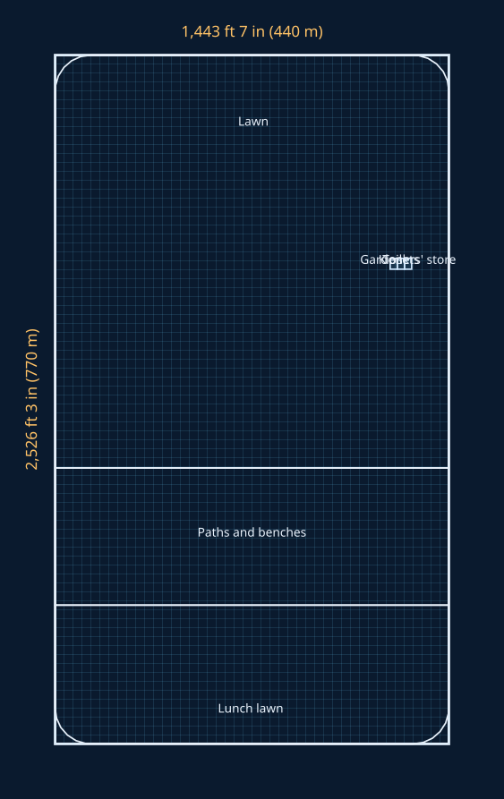

# P8-22 Command Garden 1: plan

Footprint 1,443 ft 7 in (440 m) × 2,526 ft 3 in (770 m) · structural grid 32 ft 10 in (10 m)

## Levels

| Level | Floor above deck | Height | Floor area |
|---|---|---|---|
| Level 1 · Ground | 0 ft (0 mm) | 13 ft 1 in (4,000 mm) | 3,100 sq ft (288 m²) |

## Elements

| ID | Designation | Type | Name | Level(s) | Size / length | Area | Status |
|---|---|---|---|---|---|---|---|
| E001 | D5F2P8B3A1R1 | zone | Lawn | L1 | 1,442 ft 11 in (440 m) × 1,514 ft 5 in (462 m) | 2,175,876 sq ft (202,145 m²) | proposed |
| E002 | D5F2P8B3A1R2 | room | Kiosk | L1 | 26 ft 3 in (8,000 mm) × 39 ft 4 in (12 m) | 1,033 sq ft (96 m²) | proposed |
| E003 | D5F2P8B3A1R3 | room | Toilets | L1 | 26 ft 3 in (8,000 mm) × 39 ft 4 in (12 m) | 1,033 sq ft (96 m²) | proposed |
| E004 | D5F2P8B3A1R4 | room | Gardeners' store | L1 | 26 ft 3 in (8,000 mm) × 39 ft 4 in (12 m) | 1,033 sq ft (96 m²) | proposed |
| E005 | D5F2P8B3A1R5 | zone | Paths and benches | L1 | 1,442 ft 7 in (440 m) × 502 ft 11 in (153 m) | 725,387 sq ft (67,391 m²) | proposed |
| E006 | D5F2P8B3A1R6 | zone | Lunch lawn | L1 | 1,442 ft 7 in (440 m) × 508 ft 10 in (155 m) | 725,572 sq ft (67,408 m²) | proposed |

## Drawings

### Level 1 · Ground

