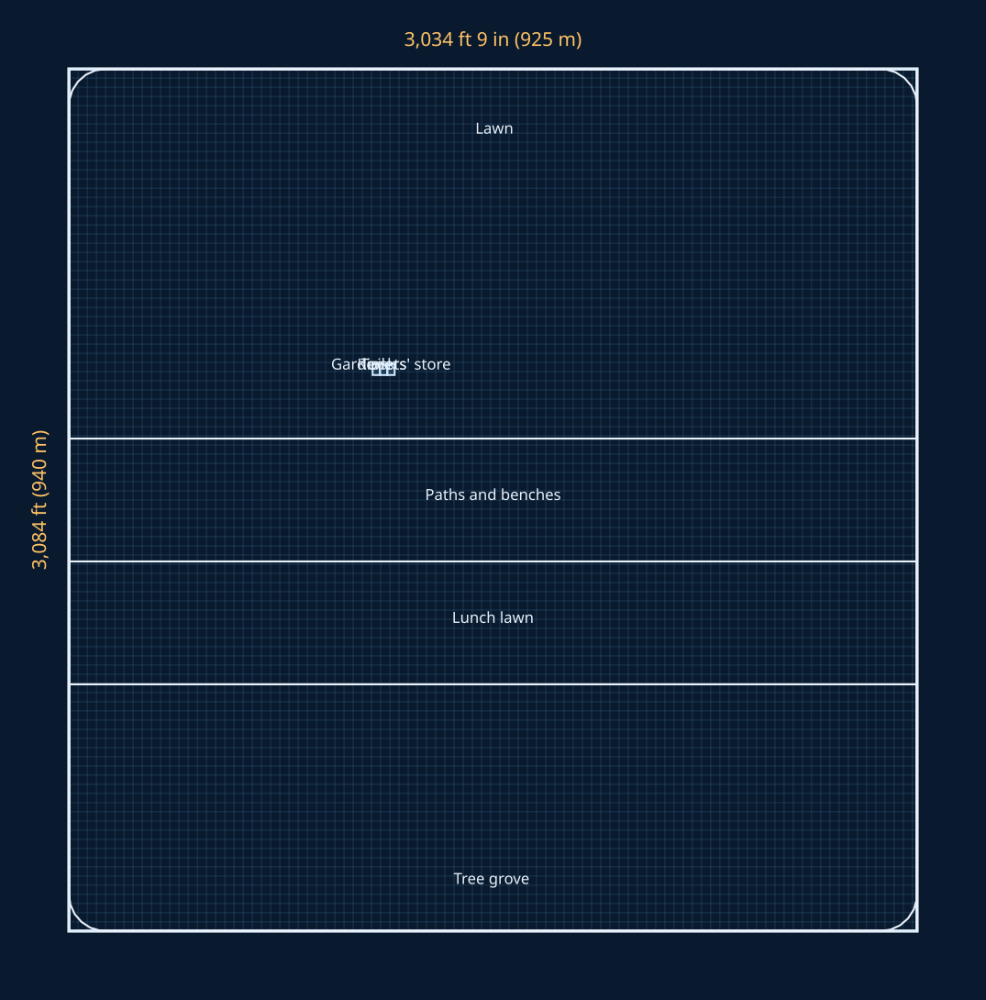

# P8-24 Command Garden 2: plan

Footprint 3,034 ft 9 in (925 m) × 3,084 ft (940 m) · structural grid 32 ft 10 in (10 m)

## Levels

| Level | Floor above deck | Height | Floor area |
|---|---|---|---|
| Level 1 · Ground | 0 ft (0 mm) | 13 ft 1 in (4,000 mm) | 3,100 sq ft (288 m²) |

## Elements

| ID | Designation | Type | Name | Level(s) | Size / length | Area | Status |
|---|---|---|---|---|---|---|---|
| E001 | D5F2P8B9A1R1 | zone | Lawn | L1 | 3,034 ft 1 in (925 m) × 1,322 ft 2 in (403 m) | 4,001,408 sq ft (371,743 m²) | proposed |
| E002 | D5F2P8B9A1R2 | room | Kiosk | L1 | 26 ft 3 in (8,000 mm) × 39 ft 4 in (12 m) | 1,033 sq ft (96 m²) | proposed |
| E003 | D5F2P8B9A1R3 | room | Toilets | L1 | 26 ft 3 in (8,000 mm) × 39 ft 4 in (12 m) | 1,033 sq ft (96 m²) | proposed |
| E004 | D5F2P8B9A1R4 | room | Gardeners' store | L1 | 26 ft 3 in (8,000 mm) × 39 ft 4 in (12 m) | 1,033 sq ft (96 m²) | proposed |
| E005 | D5F2P8B9A1R5 | zone | Paths and benches | L1 | 3,033 ft 6 in (925 m) × 439 ft 8 in (134 m) | 1,333,610 sq ft (123,896 m²) | proposed |
| E006 | D5F2P8B9A1R6 | zone | Lunch lawn | L1 | 3,033 ft 10 in (925 m) × 439 ft 8 in (134 m) | 1,333,610 sq ft (123,896 m²) | proposed |
| E007 | D5F2P8B9A1R7 | zone | Tree grove | L1 | 3,033 ft 10 in (925 m) × 882 ft 7 in (269 m) | 2,667,795 sq ft (247,846 m²) | proposed |

## Drawings

### Level 1 · Ground

