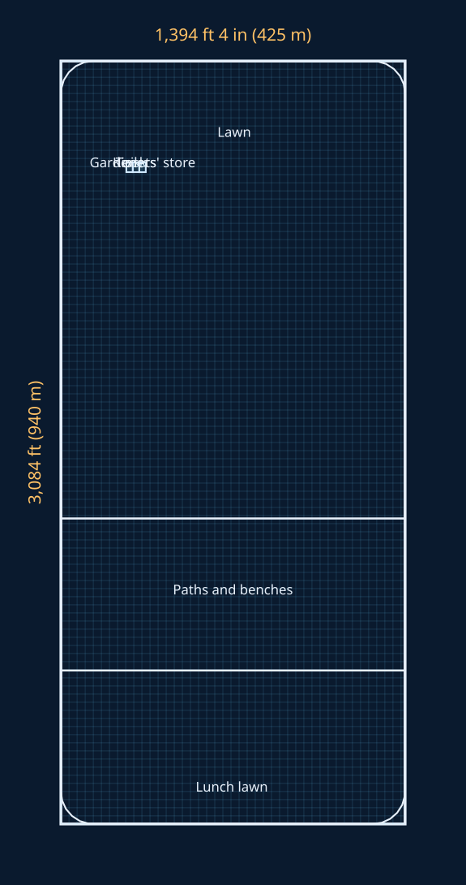

# P8-28 Command Garden 4: plan

Footprint 1,394 ft 4 in (425 m) × 3,084 ft (940 m) · structural grid 32 ft 10 in (10 m)

## Levels

| Level | Floor above deck | Height | Floor area |
|---|---|---|---|
| Level 1 · Ground | 0 ft (0 mm) | 13 ft 1 in (4,000 mm) | 3,100 sq ft (288 m²) |

## Elements

| ID | Designation | Type | Name | Level(s) | Size / length | Area | Status |
|---|---|---|---|---|---|---|---|
| E001 | D5F2P8B18A1R1 | zone | Lawn | L1 | 1,393 ft 8 in (425 m) × 1,849 ft 1 in (564 m) | 2,567,555 sq ft (238,534 m²) | proposed |
| E002 | D5F2P8B18A1R2 | room | Kiosk | L1 | 26 ft 3 in (8,000 mm) × 39 ft 4 in (12 m) | 1,033 sq ft (96 m²) | proposed |
| E003 | D5F2P8B18A1R3 | room | Toilets | L1 | 26 ft 3 in (8,000 mm) × 39 ft 4 in (12 m) | 1,033 sq ft (96 m²) | proposed |
| E004 | D5F2P8B18A1R4 | room | Gardeners' store | L1 | 26 ft 3 in (8,000 mm) × 39 ft 4 in (12 m) | 1,033 sq ft (96 m²) | proposed |
| E005 | D5F2P8B18A1R5 | zone | Paths and benches | L1 | 1,393 ft 4 in (425 m) × 614 ft 6 in (187 m) | 856,028 sq ft (79,528 m²) | proposed |
| E006 | D5F2P8B18A1R6 | zone | Lunch lawn | L1 | 1,393 ft 4 in (425 m) × 620 ft 5 in (189 m) | 855,954 sq ft (79,521 m²) | proposed |

## Drawings

### Level 1 · Ground

