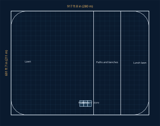

# P8-32 Command Garden 6: plan

Footprint 917 ft 8 in (280 m) × 691 ft 7 in (211 m) · structural grid 32 ft 10 in (10 m)

## Levels

| Level | Floor above deck | Height | Floor area |
|---|---|---|---|
| Level 1 · Ground | 0 ft (0 mm) | 13 ft 1 in (4,000 mm) | 3,100 sq ft (288 m²) |

## Elements

| ID | Designation | Type | Name | Level(s) | Size / length | Area | Status |
|---|---|---|---|---|---|---|---|
| E001 | D5F2P8B26A2R1 | zone | Lawn | L1 | 549 ft 3 in (167 m) × 691 ft 3 in (211 m) | 374,336 sq ft (34,777 m²) | proposed |
| E002 | D5F2P8B26A2R2 | room | Kiosk | L1 | 26 ft 3 in (8,000 mm) × 39 ft 4 in (12 m) | 1,033 sq ft (96 m²) | proposed |
| E003 | D5F2P8B26A2R3 | room | Toilets | L1 | 26 ft 3 in (8,000 mm) × 39 ft 4 in (12 m) | 1,033 sq ft (96 m²) | proposed |
| E004 | D5F2P8B26A2R4 | room | Gardeners' store | L1 | 26 ft 3 in (8,000 mm) × 39 ft 4 in (12 m) | 1,033 sq ft (96 m²) | proposed |
| E005 | D5F2P8B26A2R5 | zone | Paths and benches | L1 | 180 ft 5 in (55 m) × 690 ft 11 in (211 m) | 124,619 sq ft (11,578 m²) | proposed |
| E006 | D5F2P8B26A2R6 | zone | Lunch lawn | L1 | 188 ft (57 m) × 690 ft 7 in (210 m) | 124,858 sq ft (11,600 m²) | proposed |

## Drawings

### Level 1 · Ground

