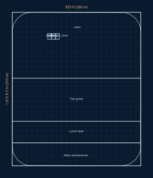

# P8-34 Command Garden 7: plan

Footprint 853 ft (260 m) × 1,015 ft 5 in (310 m) · structural grid 32 ft 10 in (10 m)

## Levels

| Level | Floor above deck | Height | Floor area |
|---|---|---|---|
| Level 1 · Ground | 0 ft (0 mm) | 13 ft 1 in (4,000 mm) | 3,100 sq ft (288 m²) |

## Elements

| ID | Designation | Type | Name | Level(s) | Size / length | Area | Status |
|---|---|---|---|---|---|---|---|
| E001 | D5F2P8B28A2R1 | zone | Lawn | L1 | 852 ft 4 in (260 m) × 436 ft 4 in (133 m) | 364,063 sq ft (33,823 m²) | proposed |
| E002 | D5F2P8B28A2R2 | room | Kiosk | L1 | 26 ft 3 in (8,000 mm) × 39 ft 4 in (12 m) | 1,033 sq ft (96 m²) | proposed |
| E003 | D5F2P8B28A2R3 | room | Toilets | L1 | 26 ft 3 in (8,000 mm) × 39 ft 4 in (12 m) | 1,033 sq ft (96 m²) | proposed |
| E004 | D5F2P8B28A2R4 | room | Gardeners' store | L1 | 26 ft 3 in (8,000 mm) × 39 ft 4 in (12 m) | 1,033 sq ft (96 m²) | proposed |
| E005 | D5F2P8B28A2R5 | zone | Tree grove | L1 | 852 ft (260 m) × 285 ft 1 in (87 m) | 242,826 sq ft (22,559 m²) | proposed |
| E006 | D5F2P8B28A2R6 | zone | Lunch lawn | L1 | 852 ft (260 m) × 142 ft 5 in (43 m) | 121,273 sq ft (11,267 m²) | proposed |
| E007 | D5F2P8B28A2R7 | zone | Paths and benches | L1 | 851 ft 8 in (260 m) × 151 ft 7 in (46 m) | 121,510 sq ft (11,289 m²) | proposed |

## Drawings

### Level 1 · Ground

