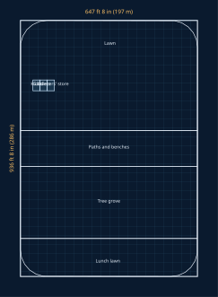

# P8-36 Command Garden 8: plan

Footprint 647 ft 8 in (197 m) × 936 ft 8 in (286 m) · structural grid 32 ft 10 in (10 m)

## Levels

| Level | Floor above deck | Height | Floor area |
|---|---|---|---|
| Level 1 · Ground | 0 ft (0 mm) | 13 ft 1 in (4,000 mm) | 3,100 sq ft (288 m²) |

## Elements

| ID | Designation | Type | Name | Level(s) | Size / length | Area | Status |
|---|---|---|---|---|---|---|---|
| E001 | D5F2P8B31A2R1 | zone | Lawn | L1 | 647 ft (197 m) × 402 ft 7 in (123 m) | 255,939 sq ft (23,778 m²) | proposed |
| E002 | D5F2P8B31A2R2 | room | Kiosk | L1 | 26 ft 3 in (8,000 mm) × 39 ft 4 in (12 m) | 1,033 sq ft (96 m²) | proposed |
| E003 | D5F2P8B31A2R3 | room | Toilets | L1 | 26 ft 3 in (8,000 mm) × 39 ft 4 in (12 m) | 1,033 sq ft (96 m²) | proposed |
| E004 | D5F2P8B31A2R4 | room | Gardeners' store | L1 | 26 ft 3 in (8,000 mm) × 39 ft 4 in (12 m) | 1,033 sq ft (96 m²) | proposed |
| E005 | D5F2P8B31A2R5 | zone | Paths and benches | L1 | 647 ft (197 m) × 131 ft 7 in (40 m) | 85,075 sq ft (7,904 m²) | proposed |
| E006 | D5F2P8B31A2R6 | zone | Tree grove | L1 | 647 ft (197 m) × 263 ft 9 in (80 m) | 170,574 sq ft (15,847 m²) | proposed |
| E007 | D5F2P8B31A2R7 | zone | Lunch lawn | L1 | 646 ft 8 in (197 m) × 138 ft 9 in (42 m) | 85,366 sq ft (7,931 m²) | proposed |

## Drawings

### Level 1 · Ground

