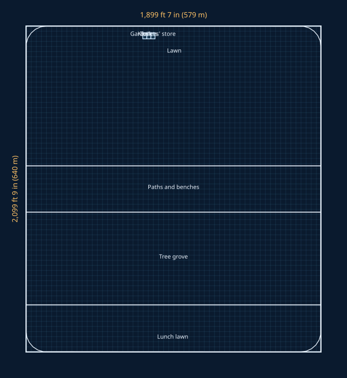

# P8-42 Command Garden 11: plan

Footprint 1,899 ft 7 in (579 m) × 2,099 ft 9 in (640 m) · structural grid 32 ft 10 in (10 m)

## Levels

| Level | Floor above deck | Height | Floor area |
|---|---|---|---|
| Level 1 · Ground | 0 ft (0 mm) | 13 ft 1 in (4,000 mm) | 3,100 sq ft (288 m²) |

## Elements

| ID | Designation | Type | Name | Level(s) | Size / length | Area | Status |
|---|---|---|---|---|---|---|---|
| E001 | D5F2P8B13A2R1 | zone | Lawn | L1 | 1,898 ft 11 in (579 m) × 900 ft 7 in (274 m) | 1,700,957 sq ft (158,024 m²) | proposed |
| E002 | D5F2P8B13A2R2 | room | Kiosk | L1 | 26 ft 3 in (8,000 mm) × 39 ft 4 in (12 m) | 1,033 sq ft (96 m²) | proposed |
| E003 | D5F2P8B13A2R3 | room | Toilets | L1 | 26 ft 3 in (8,000 mm) × 39 ft 4 in (12 m) | 1,033 sq ft (96 m²) | proposed |
| E004 | D5F2P8B13A2R4 | room | Gardeners' store | L1 | 26 ft 3 in (8,000 mm) × 39 ft 4 in (12 m) | 1,033 sq ft (96 m²) | proposed |
| E005 | D5F2P8B13A2R5 | zone | Paths and benches | L1 | 1,898 ft 4 in (579 m) × 298 ft 7 in (91 m) | 566,748 sq ft (52,653 m²) | proposed |
| E006 | D5F2P8B13A2R6 | zone | Tree grove | L1 | 1,898 ft 11 in (579 m) × 597 ft 5 in (182 m) | 1,134,119 sq ft (105,363 m²) | proposed |
| E007 | D5F2P8B13A2R7 | zone | Lunch lawn | L1 | 1,898 ft 4 in (579 m) × 303 ft 2 in (92 m) | 566,822 sq ft (52,659 m²) | proposed |

## Drawings

### Level 1 · Ground

