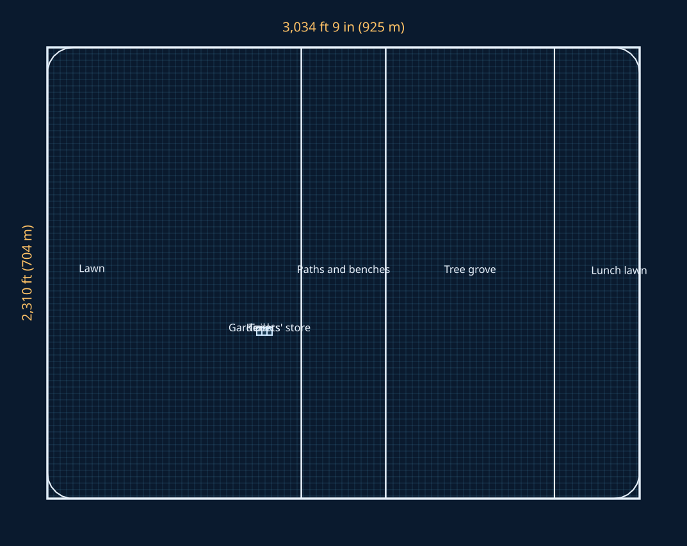

# P8-44 Command Garden 12: plan

Footprint 3,034 ft 9 in (925 m) × 2,310 ft (704 m) · structural grid 32 ft 10 in (10 m)

## Levels

| Level | Floor above deck | Height | Floor area |
|---|---|---|---|
| Level 1 · Ground | 0 ft (0 mm) | 13 ft 1 in (4,000 mm) | 3,100 sq ft (288 m²) |

## Elements

| ID | Designation | Type | Name | Level(s) | Size / length | Area | Status |
|---|---|---|---|---|---|---|---|
| E001 | D5F2P8B16A2R1 | zone | Lawn | L1 | 1,301 ft 2 in (397 m) × 2,309 ft 5 in (704 m) | 2,995,163 sq ft (278,260 m²) | proposed |
| E002 | D5F2P8B16A2R2 | room | Kiosk | L1 | 26 ft 3 in (8,000 mm) × 39 ft 4 in (12 m) | 1,033 sq ft (96 m²) | proposed |
| E003 | D5F2P8B16A2R3 | room | Toilets | L1 | 26 ft 3 in (8,000 mm) × 39 ft 4 in (12 m) | 1,033 sq ft (96 m²) | proposed |
| E004 | D5F2P8B16A2R4 | room | Gardeners' store | L1 | 26 ft 3 in (8,000 mm) × 39 ft 4 in (12 m) | 1,033 sq ft (96 m²) | proposed |
| E005 | D5F2P8B16A2R5 | zone | Paths and benches | L1 | 432 ft 5 in (132 m) × 2,308 ft 9 in (704 m) | 998,328 sq ft (92,748 m²) | proposed |
| E006 | D5F2P8B16A2R6 | zone | Tree grove | L1 | 864 ft 10 in (264 m) × 2,309 ft 5 in (704 m) | 1,996,655 sq ft (185,495 m²) | proposed |
| E007 | D5F2P8B16A2R7 | zone | Lunch lawn | L1 | 436 ft 4 in (133 m) × 2,308 ft 9 in (704 m) | 998,512 sq ft (92,765 m²) | proposed |

## Drawings

### Level 1 · Ground

