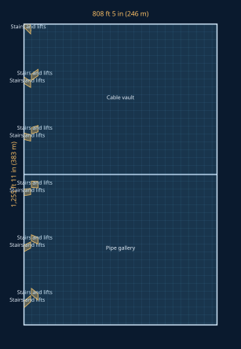
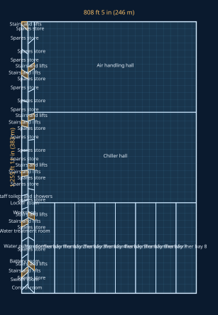
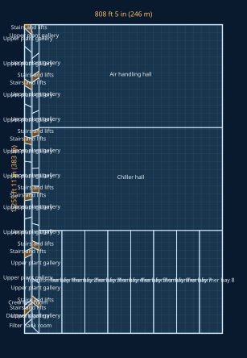

# P9-11 Starboard Yards Utility Plant: plan

Footprint 808 ft 5 in (246 m) × 1,255 ft 11 in (383 m) · structural grid 32 ft 10 in (10 m)

## Levels

| Level | Floor above deck | Height | Floor area |
|---|---|---|---|
| Level B1 · Pipe and cable basement | −16 ft 5 in (5,000 mm) | 16 ft 5 in (5,000 mm) | 1,015,273 sq ft (94,322 m²) |
| Level 1 · Plant floor | 0 ft (0 mm) | 26 ft 3 in (8,000 mm) | 1,003,279 sq ft (93,208 m²) |
| Level 2 · Upper plant deck | 26 ft 3 in (8,000 mm) | 19 ft 8 in (6,000 mm) | 1,003,279 sq ft (93,208 m²) |

## Elements

| ID | Designation | Type | Name | Level(s) | Size / length | Area | Status |
|---|---|---|---|---|---|---|---|
| E001 | D5F2P9B13A1L1R1, D5F2P9B13A1L2R1 | room | Transformer bay 1 | L1, L2 | 93 ft 6 in (28 m) × 418 ft 8 in (128 m) | 39,144 sq ft (3,637 m²) | proposed |
| E002 | D5F2P9B13A1L1R2, D5F2P9B13A1L2R2 | room | Transformer bay 2 | L1, L2 | 93 ft 10 in (29 m) × 418 ft 8 in (128 m) | 39,281 sq ft (3,649 m²) | proposed |
| E003 | D5F2P9B13A1L1R3, D5F2P9B13A1L2R3 | room | Transformer bay 3 | L1, L2 | 93 ft 6 in (28 m) × 418 ft 8 in (128 m) | 39,144 sq ft (3,637 m²) | proposed |
| E004 | D5F2P9B13A1L1R4, D5F2P9B13A1L2R4 | room | Transformer bay 4 | L1, L2 | 93 ft 10 in (29 m) × 418 ft 8 in (128 m) | 39,281 sq ft (3,649 m²) | proposed |
| E005 | D5F2P9B13A1L1R5, D5F2P9B13A1L2R5 | room | Transformer bay 5 | L1, L2 | 93 ft 6 in (28 m) × 418 ft 8 in (128 m) | 39,144 sq ft (3,637 m²) | proposed |
| E006 | D5F2P9B13A1L1R6, D5F2P9B13A1L2R6 | room | Transformer bay 6 | L1, L2 | 93 ft 10 in (29 m) × 418 ft 8 in (128 m) | 39,281 sq ft (3,649 m²) | proposed |
| E007 | D5F2P9B13A1L1R7, D5F2P9B13A1L2R7 | room | Transformer bay 7 | L1, L2 | 93 ft 6 in (28 m) × 418 ft 8 in (128 m) | 39,144 sq ft (3,637 m²) | proposed |
| E008 | D5F2P9B13A1L1R8, D5F2P9B13A1L2R8 | room | Transformer bay 8 | L1, L2 | 93 ft 10 in (29 m) × 418 ft 8 in (128 m) | 39,281 sq ft (3,649 m²) | proposed |
| E009 | D5F2P9B13A1L1R9, D5F2P9B13A1L2R9 | room | Chiller hall | L1, L2 | 749 ft 4 in (228 m) × 418 ft 8 in (128 m) | 313,702 sq ft (29,144 m²) | proposed |
| E010 | D5F2P9B13A1L1R10, D5F2P9B13A1L2R10 | room | Air handling hall | L1, L2 | 749 ft 4 in (228 m) × 418 ft 8 in (128 m) | 313,702 sq ft (29,144 m²) | proposed |
| E011 | D5F2P9B13A1LB1R1, D5F2P9B13A1L1R11, D5F2P9B13A1L2R11 | core | Stairs and lifts | LB1, L1, L2 | 27 ft 11 in (8,500 mm) × 50 ft 6 in (15 m) | 732 sq ft (68 m²) | proposed |
| E012 | D5F2P9B13A1LB1R2, D5F2P9B13A1L1R12, D5F2P9B13A1L2R12 | core | Stairs and lifts | LB1, L1, L2 | 27 ft 11 in (8,500 mm) × 40 ft (12 m) | 732 sq ft (68 m²) | proposed |
| E013 | D5F2P9B13A1LB1R3, D5F2P9B13A1L1R13, D5F2P9B13A1L2R13 | core | Stairs and lifts | LB1, L1, L2 | 27 ft 11 in (8,500 mm) × 29 ft 6 in (9,000 mm) | 732 sq ft (68 m²) | proposed |
| E014 | D5F2P9B13A1LB1R4, D5F2P9B13A1L1R14, D5F2P9B13A1L2R14 | core | Stairs and lifts | LB1, L1, L2 | 27 ft 11 in (8,500 mm) × 33 ft 6 in (10 m) | 732 sq ft (68 m²) | proposed |
| E015 | D5F2P9B13A1LB1R5, D5F2P9B13A1L1R15, D5F2P9B13A1L2R15 | core | Stairs and lifts | LB1, L1, L2 | 27 ft 11 in (8,500 mm) × 43 ft 8 in (13 m) | 732 sq ft (68 m²) | proposed |
| E016 | D5F2P9B13A1LB1R6, D5F2P9B13A1L1R16, D5F2P9B13A1L2R16 | core | Stairs and lifts | LB1, L1, L2 | 29 ft 2 in (8,900 mm) × 41 ft (12 m) | 737 sq ft (68 m²) | proposed |
| E017 | D5F2P9B13A1LB1R7, D5F2P9B13A1L1R17, D5F2P9B13A1L2R17 | core | Stairs and lifts | LB1, L1, L2 | 27 ft 11 in (8,500 mm) × 45 ft 3 in (14 m) | 732 sq ft (68 m²) | proposed |
| E018 | D5F2P9B13A1LB1R8, D5F2P9B13A1L1R18, D5F2P9B13A1L2R18 | core | Stairs and lifts | LB1, L1, L2 | 27 ft 11 in (8,500 mm) × 34 ft 9 in (11 m) | 732 sq ft (68 m²) | proposed |
| E019 | D5F2P9B13A1LB1R9, D5F2P9B13A1L1R19, D5F2P9B13A1L2R19 | core | Stairs and lifts | LB1, L1, L2 | 27 ft 11 in (8,500 mm) × 28 ft 3 in (8,600 mm) | 732 sq ft (68 m²) | proposed |
| E020 | D5F2P9B13A1LB1R10, D5F2P9B13A1L1R20, D5F2P9B13A1L2R20 | core | Stairs and lifts | LB1, L1, L2 | 27 ft 11 in (8,500 mm) × 38 ft 9 in (12 m) | 732 sq ft (68 m²) | proposed |
| E021 | D5F2P9B13A1LB1R11, D5F2P9B13A1L1R21, D5F2P9B13A1L2R21 | core | Stairs and lifts | LB1, L1, L2 | 27 ft 11 in (8,500 mm) × 48 ft 11 in (15 m) | 732 sq ft (68 m²) | proposed |
| E022 | D5F2P9B13A1L1R22 | room | Control room | L1 | 59 ft 1 in (18 m) × 42 ft 8 in (13 m) | 1,290 sq ft (120 m²) | proposed |
| E023 | D5F2P9B13A1L1R23 | room | Switch room | L1 | 27 ft 11 in (8,500 mm) × 81 ft 4 in (25 m) | 1,542 sq ft (143 m²) | proposed |
| E024 | D5F2P9B13A1L1R24 | room | Battery room | L1 | 27 ft 11 in (8,500 mm) × 83 ft 8 in (26 m) | 1,715 sq ft (159 m²) | proposed |
| E025 | D5F2P9B13A1L1R25 | room | Water pump room | L1 | 27 ft 11 in (8,500 mm) × 95 ft 10 in (29 m) | 2,141 sq ft (199 m²) | proposed |
| E026 | D5F2P9B13A1L1R26 | room | Water treatment room | L1 | 27 ft 11 in (8,500 mm) × 80 ft 5 in (24 m) | 1,798 sq ft (167 m²) | proposed |
| E027 | D5F2P9B13A1L1R27 | room | Workshop | L1 | 27 ft 11 in (8,500 mm) × 65 ft 7 in (20 m) | 1,496 sq ft (139 m²) | proposed |
| E028 | D5F2P9B13A1L1R28 | room | Locker room | L1 | 27 ft 11 in (8,500 mm) × 44 ft 7 in (14 m) | 965 sq ft (90 m²) | proposed |
| E029 | D5F2P9B13A1L1R29 | room | Staff toilets and showers | L1 | 27 ft 11 in (8,500 mm) × 35 ft 5 in (11 m) | 750 sq ft (70 m²) | proposed |
| E030 | D5F2P9B13A1L1R30 | room | Spares store | L1 | 27 ft 11 in (8,500 mm) × 93 ft 2 in (28 m) | 2,434 sq ft (226 m²) | proposed |
| E031 | D5F2P9B13A1L1R31 | room | Spares store | L1 | 27 ft 11 in (8,500 mm) × 94 ft 6 in (29 m) | 2,576 sq ft (239 m²) | proposed |
| E032 | D5F2P9B13A1L1R32 | room | Spares store | L1 | 27 ft 11 in (8,500 mm) × 114 ft 6 in (35 m) | 3,079 sq ft (286 m²) | proposed |
| E033 | D5F2P9B13A1L1R33 | room | Spares store | L1 | 27 ft 11 in (8,500 mm) × 102 ft (31 m) | 2,571 sq ft (239 m²) | proposed |
| E034 | D5F2P9B13A1L1R34 | room | Spares store | L1 | 27 ft 11 in (8,500 mm) × 124 ft 8 in (38 m) | 3,079 sq ft (286 m²) | proposed |
| E035 | D5F2P9B13A1L1R35 | room | Spares store | L1 | 27 ft 11 in (8,500 mm) × 112 ft 6 in (34 m) | 2,571 sq ft (239 m²) | proposed |
| E036 | D5F2P9B13A1L1R36 | room | Spares store | L1 | 27 ft 11 in (8,500 mm) × 135 ft 6 in (41 m) | 3,079 sq ft (286 m²) | proposed |
| E037 | D5F2P9B13A1L1R37 | room | Spares store | L1 | 34 ft 1 in (10 m) × 100 ft 9 in (31 m) | 2,580 sq ft (240 m²) | proposed |
| E038 | D5F2P9B13A1L1R38 | room | Spares store | L1 | 27 ft 11 in (8,500 mm) × 132 ft 7 in (40 m) | 3,079 sq ft (286 m²) | proposed |
| E039 | D5F2P9B13A1L1R39 | room | Spares store | L1 | 27 ft 11 in (8,500 mm) × 108 ft 3 in (33 m) | 2,566 sq ft (238 m²) | proposed |
| E040 | D5F2P9B13A1L1R40 | room | Spares store | L1 | 27 ft 11 in (8,500 mm) × 122 ft 1 in (37 m) | 3,083 sq ft (286 m²) | proposed |
| E041 | D5F2P9B13A1L1R41 | room | Spares store | L1 | 27 ft 11 in (8,500 mm) × 98 ft 1 in (30 m) | 2,571 sq ft (239 m²) | proposed |
| E042 | D5F2P9B13A1L1R42 | room | Spares store | L1 | 27 ft 11 in (8,500 mm) × 112 ft 10 in (34 m) | 3,079 sq ft (286 m²) | proposed |
| E043 | D5F2P9B13A1L1R43 | room | Spares store | L1 | 27 ft 11 in (8,500 mm) × 96 ft 9 in (30 m) | 2,571 sq ft (239 m²) | proposed |
| E044 | D5F2P9B13A1L1R44 | room | Spares store | L1 | 27 ft 11 in (8,500 mm) × 119 ft 9 in (36 m) | 3,083 sq ft (286 m²) | proposed |
| E045 | D5F2P9B13A1L1R45 | room | Spares store | L1 | 27 ft 11 in (8,500 mm) × 107 ft 3 in (33 m) | 2,571 sq ft (239 m²) | proposed |
| E046 | D5F2P9B13A1L1R46 | room | Spares store | L1 | 27 ft 11 in (8,500 mm) × 129 ft 11 in (40 m) | 3,079 sq ft (286 m²) | proposed |
| E047 | D5F2P9B13A1L1R47 | room | Spares store | L1 | 27 ft 11 in (8,500 mm) × 127 ft (39 m) | 2,827 sq ft (263 m²) | proposed |
| E048 | D5F2P9B13A1L2R22 | room | Filter bank room | L2 | 59 ft 1 in (18 m) × 57 ft 9 in (18 m) | 1,720 sq ft (160 m²) | proposed |
| E049 | D5F2P9B13A1L2R23 | room | Ductwork gallery | L2 | 27 ft 11 in (8,500 mm) × 65 ft 7 in (20 m) | 1,112 sq ft (103 m²) | proposed |
| E050 | D5F2P9B13A1L2R24 | room | Crew rest room | L2 | 27 ft 11 in (8,500 mm) × 38 ft 9 in (12 m) | 430 sq ft (40 m²) | proposed |
| E051 | D5F2P9B13A1L2R25 | room | Upper plant gallery | L2 | 27 ft 11 in (8,500 mm) × 206 ft (63 m) | 5,224 sq ft (485 m²) | proposed |
| E052 | D5F2P9B13A1L2R26 | room | Upper plant gallery | L2 | 27 ft 11 in (8,500 mm) × 139 ft 9 in (43 m) | 3,614 sq ft (336 m²) | proposed |
| E053 | D5F2P9B13A1L2R27 | room | Upper plant gallery | L2 | 27 ft 11 in (8,500 mm) × 78 ft 5 in (24 m) | 2,031 sq ft (189 m²) | proposed |
| E054 | D5F2P9B13A1L2R28 | room | Upper plant gallery | L2 | 27 ft 11 in (8,500 mm) × 132 ft 10 in (40 m) | 3,623 sq ft (337 m²) | proposed |
| E055 | D5F2P9B13A1L2R29 | room | Upper plant gallery | L2 | 27 ft 11 in (8,500 mm) × 77 ft 9 in (24 m) | 2,031 sq ft (189 m²) | proposed |
| E056 | D5F2P9B13A1L2R30 | room | Upper plant gallery | L2 | 27 ft 11 in (8,500 mm) × 140 ft 5 in (43 m) | 3,619 sq ft (336 m²) | proposed |
| E057 | D5F2P9B13A1L2R31 | room | Upper plant gallery | L2 | 27 ft 11 in (8,500 mm) × 87 ft 11 in (27 m) | 2,031 sq ft (189 m²) | proposed |
| E058 | D5F2P9B13A1L2R32 | room | Upper plant gallery | L2 | 27 ft 11 in (8,500 mm) × 150 ft 11 in (46 m) | 3,619 sq ft (336 m²) | proposed |
| E059 | D5F2P9B13A1L2R33 | room | Upper plant gallery | L2 | 27 ft 11 in (8,500 mm) × 98 ft 9 in (30 m) | 2,031 sq ft (189 m²) | proposed |
| E060 | D5F2P9B13A1L2R34 | room | Upper plant gallery | L2 | 34 ft 1 in (10 m) × 137 ft 2 in (42 m) | 3,623 sq ft (337 m²) | proposed |
| E061 | D5F2P9B13A1L2R35 | room | Upper plant gallery | L2 | 27 ft 11 in (8,500 mm) × 94 ft 2 in (29 m) | 2,036 sq ft (189 m²) | proposed |
| E062 | D5F2P9B13A1L2R36 | room | Upper plant gallery | L2 | 27 ft 11 in (8,500 mm) × 145 ft (44 m) | 3,614 sq ft (336 m²) | proposed |
| E063 | D5F2P9B13A1L2R37 | room | Upper plant gallery | L2 | 27 ft 11 in (8,500 mm) × 83 ft 8 in (25 m) | 2,036 sq ft (189 m²) | proposed |
| E064 | D5F2P9B13A1L2R38 | room | Upper plant gallery | L2 | 27 ft 11 in (8,500 mm) × 134 ft 10 in (41 m) | 3,619 sq ft (336 m²) | proposed |
| E065 | D5F2P9B13A1L2R39 | room | Upper plant gallery | L2 | 27 ft 11 in (8,500 mm) × 74 ft 6 in (23 m) | 2,031 sq ft (189 m²) | proposed |
| E066 | D5F2P9B13A1L2R40 | room | Upper plant gallery | L2 | 27 ft 11 in (8,500 mm) × 135 ft 2 in (41 m) | 3,619 sq ft (336 m²) | proposed |
| E067 | D5F2P9B13A1L2R41 | room | Upper plant gallery | L2 | 27 ft 11 in (8,500 mm) × 83 ft (25 m) | 2,036 sq ft (189 m²) | proposed |
| E068 | D5F2P9B13A1L2R42 | room | Upper plant gallery | L2 | 27 ft 11 in (8,500 mm) × 145 ft 8 in (44 m) | 3,614 sq ft (336 m²) | proposed |
| E069 | D5F2P9B13A1L2R43 | room | Upper plant gallery | L2 | 27 ft 11 in (8,500 mm) × 93 ft 6 in (28 m) | 2,036 sq ft (189 m²) | proposed |
| E070 | D5F2P9B13A1L2R44 | room | Upper plant gallery | L2 | 27 ft 11 in (8,500 mm) × 127 ft (39 m) | 2,827 sq ft (263 m²) | proposed |
| E071 | D5F2P9B13A1LB1R12 | room | Cable vault | LB1 | 808 ft 5 in (246 m) × 627 ft 11 in (191 m) | 507,636 sq ft (47,161 m²) | proposed |
| E072 | D5F2P9B13A1LB1R13 | room | Pipe gallery | LB1 | 808 ft 5 in (246 m) × 627 ft 11 in (191 m) | 507,636 sq ft (47,161 m²) | proposed |

## Drawings

### Level B1 · Pipe and cable basement

### Level 1 · Plant floor

### Level 2 · Upper plant deck

