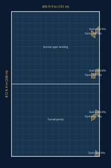
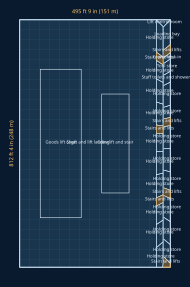
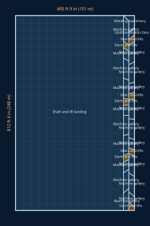

# P9-12 Starboard Yards Service Shaft: plan

Footprint 495 ft 9 in (151 m) × 812 ft 4 in (248 m) · structural grid 32 ft 10 in (10 m)

## Levels

| Level | Floor above deck | Height | Floor area |
|---|---|---|---|
| Level B1 · Service layer landing | −19 ft 8 in (6,000 mm) | 19 ft 8 in (6,000 mm) | 402,703 sq ft (37,412 m²) |
| Level 1 · Lift landing | 0 ft (0 mm) | 29 ft 6 in (9,000 mm) | 396,696 sq ft (36,854 m²) |
| Level 2 · Winding room | 29 ft 6 in (9,000 mm) | 19 ft 8 in (6,000 mm) | 396,696 sq ft (36,854 m²) |

## Elements

| ID | Designation | Type | Name | Level(s) | Size / length | Area | Status |
|---|---|---|---|---|---|---|---|
| E001 | D5F2P9B14A1L1R1, D5F2P9B14A1L2R1 | room | Shaft and lift landing | L1, L2 | 449 ft 10 in (137 m) × 812 ft 4 in (248 m) | 365,391 sq ft (33,946 m²) | proposed |
| E002 |  | fixture | Goods lift cage | L1 | 134 ft 10 in (41 m) × 487 ft 6 in (149 m) | 65,740 sq ft (6,107 m²) | proposed |
| E003 |  | fixture | Crew lift and stair | L1 | 89 ft 11 in (27 m) × 324 ft 10 in (99 m) | 29,198 sq ft (2,713 m²) | proposed |
| E004 | D5F2P9B14A1LB1R1, D5F2P9B14A1L1R2, D5F2P9B14A1L2R2 | core | Stairs and lifts | LB1, L1, L2 | 21 ft 8 in (6,600 mm) × 43 ft (13 m) | 568 sq ft (53 m²) | proposed |
| E005 | D5F2P9B14A1LB1R2, D5F2P9B14A1L1R3, D5F2P9B14A1L2R3 | core | Stairs and lifts | LB1, L1, L2 | 21 ft 8 in (6,600 mm) × 30 ft 2 in (9,200 mm) | 568 sq ft (53 m²) | proposed |
| E006 | D5F2P9B14A1LB1R3, D5F2P9B14A1L1R4, D5F2P9B14A1L2R4 | core | Stairs and lifts | LB1, L1, L2 | 21 ft 8 in (6,600 mm) × 35 ft 1 in (11 m) | 568 sq ft (53 m²) | proposed |
| E007 | D5F2P9B14A1LB1R4, D5F2P9B14A1L1R5, D5F2P9B14A1L2R5 | core | Stairs and lifts | LB1, L1, L2 | 24 ft 11 in (7,600 mm) × 34 ft 5 in (10 m) | 568 sq ft (53 m²) | proposed |
| E008 | D5F2P9B14A1LB1R5, D5F2P9B14A1L1R6, D5F2P9B14A1L2R6 | core | Stairs and lifts | LB1, L1, L2 | 21 ft 8 in (6,600 mm) × 36 ft 9 in (11 m) | 572 sq ft (53 m²) | proposed |
| E009 | D5F2P9B14A1LB1R6, D5F2P9B14A1L1R7, D5F2P9B14A1L2R7 | core | Stairs and lifts | LB1, L1, L2 | 21 ft 8 in (6,600 mm) × 28 ft 10 in (8,800 mm) | 572 sq ft (53 m²) | proposed |
| E010 | D5F2P9B14A1LB1R7, D5F2P9B14A1L1R8, D5F2P9B14A1L2R8 | core | Stairs and lifts | LB1, L1, L2 | 21 ft 8 in (6,600 mm) × 41 ft 8 in (13 m) | 572 sq ft (53 m²) | proposed |
| E011 | D5F2P9B14A1L1R9 | room | Lift control room | L1 | 45 ft 11 in (14 m) × 22 ft 4 in (6,800 mm) | 540 sq ft (50 m²) | proposed |
| E012 | D5F2P9B14A1L1R10 | room | Loading bay | L1 | 21 ft 8 in (6,600 mm) × 98 ft 1 in (30 m) | 1,701 sq ft (158 m²) | proposed |
| E013 | D5F2P9B14A1L1R11 | room | Crew check-in | L1 | 21 ft 8 in (6,600 mm) × 35 ft 1 in (11 m) | 426 sq ft (40 m²) | proposed |
| E014 | D5F2P9B14A1L1R12 | room | Tool store | L1 | 21 ft 8 in (6,600 mm) × 53 ft 2 in (16 m) | 856 sq ft (80 m²) | proposed |
| E015 | D5F2P9B14A1L1R13 | room | Staff toilets and showers | L1 | 21 ft 8 in (6,600 mm) × 46 ft 3 in (14 m) | 749 sq ft (70 m²) | proposed |
| E016 | D5F2P9B14A1L1R14 | room | Holding store | L1 | 21 ft 8 in (6,600 mm) × 82 ft 4 in (25 m) | 1,595 sq ft (148 m²) | proposed |
| E017 | D5F2P9B14A1L1R15 | room | Holding store | L1 | 21 ft 8 in (6,600 mm) × 44 ft 7 in (14 m) | 845 sq ft (79 m²) | proposed |
| E018 | D5F2P9B14A1L1R16 | room | Holding store | L1 | 21 ft 8 in (6,600 mm) × 75 ft 9 in (23 m) | 1,595 sq ft (148 m²) | proposed |
| E019 | D5F2P9B14A1L1R17 | room | Holding store | L1 | 21 ft 8 in (6,600 mm) × 76 ft 9 in (23 m) | 1,595 sq ft (148 m²) | proposed |
| E020 | D5F2P9B14A1L1R18 | room | Holding store | L1 | 21 ft 8 in (6,600 mm) × 65 ft 11 in (20 m) | 1,282 sq ft (119 m²) | proposed |
| E021 | D5F2P9B14A1L1R19 | room | Holding store | L1 | 21 ft 8 in (6,600 mm) × 85 ft 4 in (26 m) | 1,595 sq ft (148 m²) | proposed |
| E022 | D5F2P9B14A1L1R20 | room | Holding store | L1 | 21 ft 8 in (6,600 mm) × 89 ft 7 in (27 m) | 1,595 sq ft (148 m²) | proposed |
| E023 | D5F2P9B14A1L1R21 | room | Holding store | L1 | 21 ft 8 in (6,600 mm) × 78 ft 9 in (24 m) | 1,282 sq ft (119 m²) | proposed |
| E024 | D5F2P9B14A1L1R22 | room | Holding store | L1 | 23 ft (7,000 mm) × 82 ft 8 in (25 m) | 1,598 sq ft (148 m²) | proposed |
| E025 | D5F2P9B14A1L1R23 | room | Holding store | L1 | 21 ft 8 in (6,600 mm) × 90 ft 3 in (28 m) | 1,598 sq ft (148 m²) | proposed |
| E026 | D5F2P9B14A1L1R24 | room | Holding store | L1 | 21 ft 8 in (6,600 mm) × 71 ft 10 in (22 m) | 1,279 sq ft (119 m²) | proposed |
| E027 | D5F2P9B14A1L1R25 | room | Holding store | L1 | 21 ft 8 in (6,600 mm) × 81 ft (25 m) | 1,591 sq ft (148 m²) | proposed |
| E028 | D5F2P9B14A1L1R26 | room | Holding store | L1 | 21 ft 8 in (6,600 mm) × 77 ft 1 in (24 m) | 1,595 sq ft (148 m²) | proposed |
| E029 | D5F2P9B14A1L1R27 | room | Holding store | L1 | 21 ft 8 in (6,600 mm) × 60 ft 8 in (18 m) | 1,282 sq ft (119 m²) | proposed |
| E030 | D5F2P9B14A1L1R28 | room | Holding store | L1 | 21 ft 8 in (6,600 mm) × 78 ft 9 in (24 m) | 1,591 sq ft (148 m²) | proposed |
| E031 | D5F2P9B14A1L1R29 | room | Holding store | L1 | 21 ft 8 in (6,600 mm) × 83 ft (25 m) | 1,595 sq ft (148 m²) | proposed |
| E032 | D5F2P9B14A1L1R30 | room | Holding store | L1 | 21 ft 8 in (6,600 mm) × 72 ft 2 in (22 m) | 1,282 sq ft (119 m²) | proposed |
| E033 | D5F2P9B14A1L1R31 | room | Holding store | L1 | 21 ft 8 in (6,600 mm) × 122 ft 1 in (37 m) | 2,234 sq ft (208 m²) | proposed |
| E034 | D5F2P9B14A1L2R9 | room | Winding machinery | L2 | 45 ft 11 in (14 m) × 70 ft 3 in (21 m) | 1,606 sq ft (149 m²) | proposed |
| E035 | D5F2P9B14A1L2R10 | room | Shaft ventilation fans | L2 | 21 ft 8 in (6,600 mm) × 47 ft 7 in (15 m) | 636 sq ft (59 m²) | proposed |
| E036 | D5F2P9B14A1L2R11 | room | Machine gallery | L2 | 21 ft 8 in (6,600 mm) × 95 ft 10 in (29 m) | 1,776 sq ft (165 m²) | proposed |
| E037 | D5F2P9B14A1L2R12 | room | Machine gallery | L2 | 21 ft 8 in (6,600 mm) × 91 ft 2 in (28 m) | 1,776 sq ft (165 m²) | proposed |
| E038 | D5F2P9B14A1L2R13 | room | Machine gallery | L2 | 21 ft 8 in (6,600 mm) × 48 ft 3 in (15 m) | 920 sq ft (85 m²) | proposed |
| E039 | D5F2P9B14A1L2R14 | room | Machine gallery | L2 | 21 ft 8 in (6,600 mm) × 84 ft 4 in (26 m) | 1,776 sq ft (165 m²) | proposed |
| E040 | D5F2P9B14A1L2R15 | room | Machine gallery | L2 | 21 ft 8 in (6,600 mm) × 85 ft 8 in (26 m) | 1,776 sq ft (165 m²) | proposed |
| E041 | D5F2P9B14A1L2R16 | room | Machine gallery | L2 | 21 ft 8 in (6,600 mm) × 49 ft 6 in (15 m) | 920 sq ft (85 m²) | proposed |
| E042 | D5F2P9B14A1L2R17 | room | Machine gallery | L2 | 21 ft 8 in (6,600 mm) × 93 ft 10 in (29 m) | 1,776 sq ft (165 m²) | proposed |
| E043 | D5F2P9B14A1L2R18 | room | Machine gallery | L2 | 21 ft 8 in (6,600 mm) × 98 ft 5 in (30 m) | 1,776 sq ft (165 m²) | proposed |
| E044 | D5F2P9B14A1L2R19 | room | Machine gallery | L2 | 21 ft 8 in (6,600 mm) × 62 ft 4 in (19 m) | 920 sq ft (85 m²) | proposed |
| E045 | D5F2P9B14A1L2R20 | room | Machine gallery | L2 | 23 ft (7,000 mm) × 90 ft 11 in (28 m) | 1,780 sq ft (165 m²) | proposed |
| E046 | D5F2P9B14A1L2R21 | room | Machine gallery | L2 | 21 ft 8 in (6,600 mm) × 97 ft 9 in (30 m) | 1,776 sq ft (165 m²) | proposed |
| E047 | D5F2P9B14A1L2R22 | room | Machine gallery | L2 | 21 ft 8 in (6,600 mm) × 54 ft 9 in (17 m) | 920 sq ft (85 m²) | proposed |
| E048 | D5F2P9B14A1L2R23 | room | Machine gallery | L2 | 21 ft 8 in (6,600 mm) × 89 ft 3 in (27 m) | 1,772 sq ft (165 m²) | proposed |
| E049 | D5F2P9B14A1L2R24 | room | Machine gallery | L2 | 21 ft 8 in (6,600 mm) × 85 ft (26 m) | 1,776 sq ft (165 m²) | proposed |
| E050 | D5F2P9B14A1L2R25 | room | Machine gallery | L2 | 21 ft 8 in (6,600 mm) × 43 ft 8 in (13 m) | 920 sq ft (85 m²) | proposed |
| E051 | D5F2P9B14A1L2R26 | room | Machine gallery | L2 | 21 ft 8 in (6,600 mm) × 87 ft 3 in (27 m) | 1,772 sq ft (165 m²) | proposed |
| E052 | D5F2P9B14A1L2R27 | room | Machine gallery | L2 | 21 ft 8 in (6,600 mm) × 91 ft 10 in (28 m) | 1,776 sq ft (165 m²) | proposed |
| E053 | D5F2P9B14A1L2R28 | room | Machine gallery | L2 | 21 ft 8 in (6,600 mm) × 55 ft 9 in (17 m) | 920 sq ft (85 m²) | proposed |
| E054 | D5F2P9B14A1L2R29 | room | Machine gallery | L2 | 21 ft 8 in (6,600 mm) × 122 ft 1 in (37 m) | 2,234 sq ft (208 m²) | proposed |
| E055 | D5F2P9B14A1LB1R8 | room | Service layer landing | LB1 | 495 ft 9 in (151 m) × 406 ft 2 in (124 m) | 201,352 sq ft (18,706 m²) | proposed |
| E056 | D5F2P9B14A1LB1R9 | room | Tunnel portal | LB1 | 495 ft 9 in (151 m) × 406 ft 2 in (124 m) | 201,352 sq ft (18,706 m²) | proposed |

## Drawings

### Level B1 · Service layer landing

### Level 1 · Lift landing

### Level 2 · Winding room

