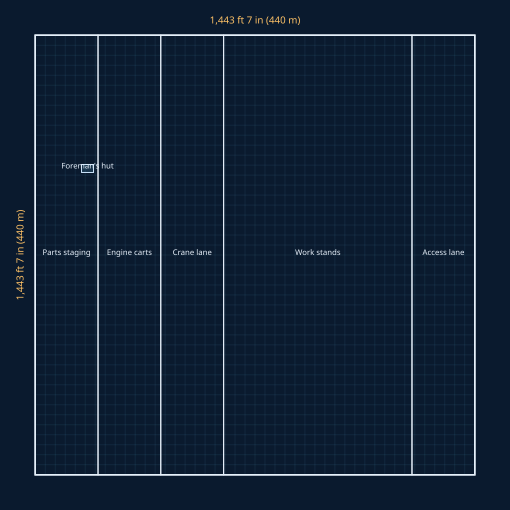

# P9-13 Work Yard 1: plan

Footprint 1,443 ft 7 in (440 m) × 1,443 ft 7 in (440 m) · structural grid 32 ft 10 in (10 m)

## Levels

| Level | Floor above deck | Height | Floor area |
|---|---|---|---|
| Level 1 · Ground | 0 ft (0 mm) | 13 ft 1 in (4,000 mm) | 1,033 sq ft (96 m²) |

## Elements

| ID | Designation | Type | Name | Level(s) | Size / length | Area | Status |
|---|---|---|---|---|---|---|---|
| E001 | D5F2P9B1A1R1 | zone | Parts staging | L1 | 206 ft 4 in (63 m) × 1,443 ft 7 in (440 m) | 297,902 sq ft (27,676 m²) | proposed |
| E002 | D5F2P9B1A1R2 | room | Foreman's hut | L1 | 39 ft 4 in (12 m) × 26 ft 3 in (8,000 mm) | 1,033 sq ft (96 m²) | proposed |
| E003 | D5F2P9B1A1R3 | zone | Engine carts | L1 | 206 ft (63 m) × 1,443 ft 7 in (440 m) | 297,428 sq ft (27,632 m²) | proposed |
| E004 | D5F2P9B1A1R4 | zone | Crane lane | L1 | 206 ft 4 in (63 m) × 1,443 ft 7 in (440 m) | 297,902 sq ft (27,676 m²) | proposed |
| E005 | D5F2P9B1A1R5 | zone | Work stands | L1 | 618 ft 5 in (189 m) × 1,443 ft 7 in (440 m) | 892,759 sq ft (82,940 m²) | proposed |
| E006 | D5F2P9B1A1R6 | zone | Access lane | L1 | 206 ft 4 in (63 m) × 1,443 ft 7 in (440 m) | 297,902 sq ft (27,676 m²) | proposed |

## Drawings

### Level 1 · Ground

