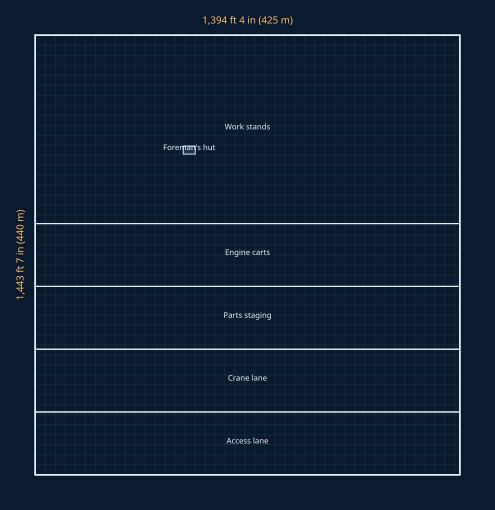

# P9-15 Work Yard 2: plan

Footprint 1,394 ft 4 in (425 m) × 1,443 ft 7 in (440 m) · structural grid 32 ft 10 in (10 m)

## Levels

| Level | Floor above deck | Height | Floor area |
|---|---|---|---|
| Level 1 · Ground | 0 ft (0 mm) | 13 ft 1 in (4,000 mm) | 1,033 sq ft (96 m²) |

## Elements

| ID | Designation | Type | Name | Level(s) | Size / length | Area | Status |
|---|---|---|---|---|---|---|---|
| E001 | D5F2P9B9A1R1 | zone | Work stands | L1 | 1,394 ft 4 in (425 m) × 618 ft 9 in (189 m) | 862,781 sq ft (80,155 m²) | proposed |
| E002 | D5F2P9B9A1R2 | room | Foreman's hut | L1 | 39 ft 4 in (12 m) × 26 ft 3 in (8,000 mm) | 1,033 sq ft (96 m²) | proposed |
| E003 | D5F2P9B9A1R3 | zone | Engine carts | L1 | 1,394 ft 4 in (425 m) × 206 ft (63 m) | 287,289 sq ft (26,690 m²) | proposed |
| E004 | D5F2P9B9A1R4 | zone | Parts staging | L1 | 1,394 ft 4 in (425 m) × 206 ft 4 in (63 m) | 287,746 sq ft (26,732 m²) | proposed |
| E005 | D5F2P9B9A1R5 | zone | Crane lane | L1 | 1,394 ft 4 in (425 m) × 206 ft (63 m) | 287,289 sq ft (26,690 m²) | proposed |
| E006 | D5F2P9B9A1R6 | zone | Access lane | L1 | 1,394 ft 4 in (425 m) × 206 ft 4 in (63 m) | 287,746 sq ft (26,732 m²) | proposed |

## Drawings

### Level 1 · Ground

