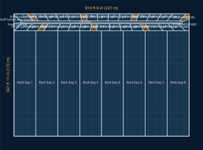
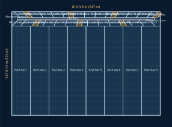

# P9-16 Parts Shed 2: plan

Footprint 810 ft 8 in (247 m) × 567 ft 11 in (173 m) · structural grid 32 ft 10 in (10 m)

## Levels

| Level | Floor above deck | Height | Floor area |
|---|---|---|---|
| Level 1 · Hall floor | 0 ft (0 mm) | 32 ft 10 in (10 m) | 444,151 sq ft (41,263 m²) |
| Level 2 · Gallery floor | 32 ft 10 in (10 m) | 14 ft 9 in (4,500 mm) | 444,151 sq ft (41,263 m²) |

## Elements

| ID | Designation | Type | Name | Level(s) | Size / length | Area | Status |
|---|---|---|---|---|---|---|---|
| E001 | D5F2P9B12A2L1R1, D5F2P9B12A2L2R1 | room | Rack bay 1 | L1, L2 | 101 ft 5 in (31 m) × 489 ft 2 in (149 m) | 49,591 sq ft (4,607 m²) | proposed |
| E002 | D5F2P9B12A2L1R2, D5F2P9B12A2L2R2 | room | Rack bay 2 | L1, L2 | 101 ft 5 in (31 m) × 489 ft 2 in (149 m) | 49,591 sq ft (4,607 m²) | proposed |
| E003 | D5F2P9B12A2L1R3, D5F2P9B12A2L2R3 | room | Rack bay 3 | L1, L2 | 101 ft 5 in (31 m) × 489 ft 2 in (149 m) | 49,591 sq ft (4,607 m²) | proposed |
| E004 | D5F2P9B12A2L1R4, D5F2P9B12A2L2R4 | room | Rack bay 4 | L1, L2 | 101 ft 1 in (31 m) × 489 ft 2 in (149 m) | 49,431 sq ft (4,592 m²) | proposed |
| E005 | D5F2P9B12A2L1R5, D5F2P9B12A2L2R5 | room | Rack bay 5 | L1, L2 | 101 ft 5 in (31 m) × 489 ft 2 in (149 m) | 49,591 sq ft (4,607 m²) | proposed |
| E006 | D5F2P9B12A2L1R6, D5F2P9B12A2L2R6 | room | Rack bay 6 | L1, L2 | 101 ft 5 in (31 m) × 489 ft 2 in (149 m) | 49,591 sq ft (4,607 m²) | proposed |
| E007 | D5F2P9B12A2L1R7, D5F2P9B12A2L2R7 | room | Rack bay 7 | L1, L2 | 101 ft 5 in (31 m) × 489 ft 2 in (149 m) | 49,591 sq ft (4,607 m²) | proposed |
| E008 | D5F2P9B12A2L1R8, D5F2P9B12A2L2R8 | room | Rack bay 8 | L1, L2 | 101 ft 5 in (31 m) × 489 ft 2 in (149 m) | 49,591 sq ft (4,607 m²) | proposed |
| E009 | D5F2P9B12A2L1R9, D5F2P9B12A2L2R9 | core | Stairs and lifts | L1, L2 | 52 ft 10 in (16 m) × 32 ft 6 in (9,900 mm) | 858 sq ft (80 m²) | proposed |
| E010 | D5F2P9B12A2L1R10, D5F2P9B12A2L2R10 | core | Stairs and lifts | L1, L2 | 33 ft 2 in (10 m) × 32 ft 6 in (9,900 mm) | 853 sq ft (79 m²) | proposed |
| E011 | D5F2P9B12A2L1R11, D5F2P9B12A2L2R11 | core | Stairs and lifts | L1, L2 | 39 ft 1 in (12 m) × 32 ft 6 in (9,900 mm) | 853 sq ft (79 m²) | proposed |
| E012 | D5F2P9B12A2L1R12, D5F2P9B12A2L2R12 | core | Stairs and lifts | L1, L2 | 44 ft 11 in (14 m) × 36 ft 5 in (11 m) | 853 sq ft (79 m²) | proposed |
| E013 | D5F2P9B12A2L1R13, D5F2P9B12A2L2R13 | core | Stairs and lifts | L1, L2 | 43 ft (13 m) × 32 ft 6 in (9,900 mm) | 858 sq ft (80 m²) | proposed |
| E014 | D5F2P9B12A2L1R14, D5F2P9B12A2L2R14 | core | Stairs and lifts | L1, L2 | 29 ft 2 in (8,900 mm) × 32 ft 6 in (9,900 mm) | 853 sq ft (79 m²) | proposed |
| E015 | D5F2P9B12A2L1R15, D5F2P9B12A2L2R15 | core | Stairs and lifts | L1, L2 | 48 ft 11 in (15 m) × 32 ft 6 in (9,900 mm) | 853 sq ft (79 m²) | proposed |
| E016 | D5F2P9B12A2L1R16 | zone | Corridor | L1 | 745 ft 9 in (227 m) × 13 ft 9 in (4,200 mm) | 7,379 sq ft (686 m²) | proposed |
| E017 | D5F2P9B12A2L1R17 | room | Issue counter | L1 | 32 ft 6 in (9,900 mm) × 38 ft 5 in (12 m) | 645 sq ft (60 m²) | proposed |
| E018 | D5F2P9B12A2L1R18 | room | Staff toilets and showers | L1 | 32 ft 6 in (9,900 mm) × 39 ft 8 in (12 m) | 757 sq ft (70 m²) | proposed |
| E019 | D5F2P9B12A2L1R19 | room | Small parts cage | L1 | 88 ft 3 in (27 m) × 33 ft 6 in (10 m) | 1,993 sq ft (185 m²) | proposed |
| E020 | D5F2P9B12A2L1R20 | room | Small parts cage | L1 | 72 ft 10 in (22 m) × 32 ft 6 in (9,900 mm) | 1,614 sq ft (150 m²) | proposed |
| E021 | D5F2P9B12A2L1R21 | room | Small parts cage | L1 | 68 ft 11 in (21 m) × 32 ft 6 in (9,900 mm) | 1,620 sq ft (150 m²) | proposed |
| E022 | D5F2P9B12A2L1R22 | room | Small parts cage | L1 | 64 ft 8 in (20 m) × 32 ft 6 in (9,900 mm) | 1,614 sq ft (150 m²) | proposed |
| E023 | D5F2P9B12A2L1R23 | room | Small parts cage | L1 | 70 ft 6 in (22 m) × 32 ft 6 in (9,900 mm) | 1,950 sq ft (181 m²) | proposed |
| E024 | D5F2P9B12A2L1R24 | room | Small parts cage | L1 | 53 ft 6 in (16 m) × 32 ft 6 in (9,900 mm) | 1,620 sq ft (150 m²) | proposed |
| E025 | D5F2P9B12A2L1R25 | room | Small parts cage | L1 | 51 ft 10 in (16 m) × 32 ft 6 in (9,900 mm) | 1,614 sq ft (150 m²) | proposed |
| E026 | D5F2P9B12A2L1R26 | room | Small parts cage | L1 | 54 ft 6 in (17 m) × 32 ft 6 in (9,900 mm) | 1,614 sq ft (150 m²) | proposed |
| E027 | D5F2P9B12A2L1R27 | room | Small parts cage | L1 | 69 ft 3 in (21 m) × 32 ft 6 in (9,900 mm) | 1,950 sq ft (181 m²) | proposed |
| E028 | D5F2P9B12A2L1R28 | room | Small parts cage | L1 | 65 ft 11 in (20 m) × 32 ft 6 in (9,900 mm) | 1,620 sq ft (150 m²) | proposed |
| E029 | D5F2P9B12A2L1R29 | room | Small parts cage | L1 | 69 ft 11 in (21 m) × 32 ft 6 in (9,900 mm) | 1,614 sq ft (150 m²) | proposed |
| E030 | D5F2P9B12A2L1R30 | room | Small parts cage | L1 | 74 ft 2 in (23 m) × 32 ft 6 in (9,900 mm) | 1,614 sq ft (150 m²) | proposed |
| E031 | D5F2P9B12A2L1R31 | room | Small parts cage | L1 | 88 ft 11 in (27 m) × 32 ft 6 in (9,900 mm) | 1,950 sq ft (181 m²) | proposed |
| E032 | D5F2P9B12A2L1R32 | room | Small parts cage | L1 | 48 ft 3 in (15 m) × 56 ft 5 in (17 m) | 1,614 sq ft (150 m²) | proposed |
| E033 | D5F2P9B12A2L1R33 | room | Small parts cage | L1 | 78 ft 9 in (24 m) × 32 ft 6 in (9,900 mm) | 1,620 sq ft (150 m²) | proposed |
| E034 | D5F2P9B12A2L1R34 | room | Small parts cage | L1 | 74 ft 6 in (23 m) × 32 ft 6 in (9,900 mm) | 1,614 sq ft (150 m²) | proposed |
| E035 | D5F2P9B12A2L1R35 | room | Small parts cage | L1 | 80 ft 1 in (24 m) × 32 ft 6 in (9,900 mm) | 1,945 sq ft (181 m²) | proposed |
| E036 | D5F2P9B12A2L1R36 | room | Small parts cage | L1 | 63 ft (19 m) × 32 ft 6 in (9,900 mm) | 1,614 sq ft (150 m²) | proposed |
| E037 | D5F2P9B12A2L1R37 | room | Small parts cage | L1 | 59 ft 1 in (18 m) × 32 ft 6 in (9,900 mm) | 1,620 sq ft (150 m²) | proposed |
| E038 | D5F2P9B12A2L1R38 | room | Small parts cage | L1 | 54 ft 9 in (17 m) × 32 ft 6 in (9,900 mm) | 1,614 sq ft (150 m²) | proposed |
| E039 | D5F2P9B12A2L1R39 | room | Small parts cage | L1 | 62 ft 4 in (19 m) × 32 ft 6 in (9,900 mm) | 1,950 sq ft (181 m²) | proposed |
| E040 | D5F2P9B12A2L1R40 | room | Small parts cage | L1 | 56 ft 1 in (17 m) × 32 ft 6 in (9,900 mm) | 1,620 sq ft (150 m²) | proposed |
| E041 | D5F2P9B12A2L1R41 | room | Small parts cage | L1 | 60 ft (18 m) × 32 ft 6 in (9,900 mm) | 1,614 sq ft (150 m²) | proposed |
| E042 | D5F2P9B12A2L1R42 | room | Small parts cage | L1 | 64 ft 4 in (20 m) × 32 ft 6 in (9,900 mm) | 1,614 sq ft (150 m²) | proposed |
| E043 | D5F2P9B12A2L1R43 | room | Small parts cage | L1 | 79 ft 1 in (24 m) × 32 ft 6 in (9,900 mm) | 1,950 sq ft (181 m²) | proposed |
| E044 | D5F2P9B12A2L1R44 | room | Small parts cage | L1 | 75 ft 9 in (23 m) × 32 ft 6 in (9,900 mm) | 1,620 sq ft (150 m²) | proposed |
| E045 | D5F2P9B12A2L1R45 | room | Small parts cage | L1 | 85 ft (26 m) × 32 ft 6 in (9,900 mm) | 1,780 sq ft (165 m²) | proposed |
| E046 | D5F2P9B12A2L2R16 | zone | Corridor | L2 | 745 ft 9 in (227 m) × 13 ft 9 in (4,200 mm) | 7,379 sq ft (686 m²) | proposed |
| E047 | D5F2P9B12A2L2R17 | room | Mezzanine store | L2 | 45 ft 3 in (14 m) × 78 ft 9 in (24 m) | 1,939 sq ft (180 m²) | proposed |
| E048 | D5F2P9B12A2L2R18 | room | Mezzanine store | L2 | 74 ft 2 in (23 m) × 32 ft 6 in (9,900 mm) | 1,455 sq ft (135 m²) | proposed |
| E049 | D5F2P9B12A2L2R19 | room | Mezzanine store | L2 | 82 ft 4 in (25 m) × 32 ft 6 in (9,900 mm) | 1,934 sq ft (180 m²) | proposed |
| E050 | D5F2P9B12A2L2R20 | room | Mezzanine store | L2 | 77 ft 9 in (24 m) × 32 ft 6 in (9,900 mm) | 1,945 sq ft (181 m²) | proposed |
| E051 | D5F2P9B12A2L2R21 | room | Mezzanine store | L2 | 72 ft 6 in (22 m) × 32 ft 6 in (9,900 mm) | 1,939 sq ft (180 m²) | proposed |
| E052 | D5F2P9B12A2L2R22 | room | Mezzanine store | L2 | 39 ft 4 in (12 m) × 32 ft 6 in (9,900 mm) | 980 sq ft (91 m²) | proposed |
| E053 | D5F2P9B12A2L2R23 | room | Mezzanine store | L2 | 63 ft (19 m) × 32 ft 6 in (9,900 mm) | 1,939 sq ft (180 m²) | proposed |
| E054 | D5F2P9B12A2L2R24 | room | Mezzanine store | L2 | 62 ft 4 in (19 m) × 32 ft 6 in (9,900 mm) | 1,939 sq ft (180 m²) | proposed |
| E055 | D5F2P9B12A2L2R25 | room | Mezzanine store | L2 | 66 ft 7 in (20 m) × 32 ft 6 in (9,900 mm) | 1,945 sq ft (181 m²) | proposed |
| E056 | D5F2P9B12A2L2R26 | room | Mezzanine store | L2 | 40 ft 4 in (12 m) × 32 ft 6 in (9,900 mm) | 975 sq ft (91 m²) | proposed |
| E057 | D5F2P9B12A2L2R27 | room | Mezzanine store | L2 | 76 ft 1 in (23 m) × 32 ft 6 in (9,900 mm) | 1,939 sq ft (180 m²) | proposed |
| E058 | D5F2P9B12A2L2R28 | room | Mezzanine store | L2 | 81 ft (25 m) × 32 ft 6 in (9,900 mm) | 1,939 sq ft (180 m²) | proposed |
| E059 | D5F2P9B12A2L2R29 | room | Mezzanine store | L2 | 86 ft 3 in (26 m) × 32 ft 6 in (9,900 mm) | 1,945 sq ft (181 m²) | proposed |
| E060 | D5F2P9B12A2L2R30 | room | Mezzanine store | L2 | 60 ft (18 m) × 32 ft 6 in (9,900 mm) | 975 sq ft (91 m²) | proposed |
| E061 | D5F2P9B12A2L2R31 | room | Mezzanine store | L2 | 57 ft 9 in (18 m) × 56 ft 5 in (17 m) | 1,934 sq ft (180 m²) | proposed |
| E062 | D5F2P9B12A2L2R32 | room | Mezzanine store | L2 | 87 ft 7 in (27 m) × 32 ft 6 in (9,900 mm) | 1,945 sq ft (181 m²) | proposed |
| E063 | D5F2P9B12A2L2R33 | room | Mezzanine store | L2 | 82 ft 4 in (25 m) × 32 ft 6 in (9,900 mm) | 1,939 sq ft (180 m²) | proposed |
| E064 | D5F2P9B12A2L2R34 | room | Mezzanine store | L2 | 48 ft 11 in (15 m) × 32 ft 6 in (9,900 mm) | 975 sq ft (91 m²) | proposed |
| E065 | D5F2P9B12A2L2R35 | room | Mezzanine store | L2 | 72 ft 10 in (22 m) × 32 ft 6 in (9,900 mm) | 1,939 sq ft (180 m²) | proposed |
| E066 | D5F2P9B12A2L2R36 | room | Mezzanine store | L2 | 67 ft 11 in (21 m) × 32 ft 6 in (9,900 mm) | 1,939 sq ft (180 m²) | proposed |
| E067 | D5F2P9B12A2L2R37 | room | Mezzanine store | L2 | 62 ft 8 in (19 m) × 32 ft 6 in (9,900 mm) | 1,939 sq ft (180 m²) | proposed |
| E068 | D5F2P9B12A2L2R38 | room | Mezzanine store | L2 | 31 ft 2 in (9,500 mm) × 32 ft 6 in (9,900 mm) | 980 sq ft (91 m²) | proposed |
| E069 | D5F2P9B12A2L2R39 | room | Mezzanine store | L2 | 66 ft 3 in (20 m) × 32 ft 6 in (9,900 mm) | 1,939 sq ft (180 m²) | proposed |
| E070 | D5F2P9B12A2L2R40 | room | Mezzanine store | L2 | 71 ft 2 in (22 m) × 32 ft 6 in (9,900 mm) | 1,939 sq ft (180 m²) | proposed |
| E071 | D5F2P9B12A2L2R41 | room | Mezzanine store | L2 | 76 ft 5 in (23 m) × 32 ft 6 in (9,900 mm) | 1,945 sq ft (181 m²) | proposed |
| E072 | D5F2P9B12A2L2R42 | room | Mezzanine store | L2 | 50 ft 2 in (15 m) × 32 ft 6 in (9,900 mm) | 975 sq ft (91 m²) | proposed |
| E073 | D5F2P9B12A2L2R43 | room | Mezzanine store | L2 | 85 ft 11 in (26 m) × 32 ft 6 in (9,900 mm) | 1,939 sq ft (180 m²) | proposed |
| E074 | D5F2P9B12A2L2R44 | room | Mezzanine store | L2 | 75 ft 6 in (23 m) × 32 ft 6 in (9,900 mm) | 1,460 sq ft (136 m²) | proposed |

## Drawings

### Level 1 · Hall floor

### Level 2 · Gallery floor

